# Database map, integrity and rebuild disposition

Documentation-only audit, captured 2026-10-03. Main is `18fc1a505c64615fe9ef197dba0e2cd037063d31`; accepted but unmerged alpha is `2107df58885c883960422ce7e60719f0adbac0e4`; fullest inspected local Evry schema is `b3bb9f52af6e0c64b537f7ba1316b2edf0f373ae`. The source manifest records checkout and dirty-file provenance. No database was contacted, no environment secrets were read, and no migration or seed was run.

The [machine-readable map](../audits/database-map.json) is the exhaustive per-table deliverable. It contains **88 unique records: 84 tables in the source union and 4 historical dropped tables**. Main declares 79 tables. Alpha declares 82 and adds `task_status_history`, `record_corrections`, `password_reset_requests`. Local Evry additionally declares `evry_eve_attachments` and `communication_failed_retries`; full local schema enumeration found80declarations and no other additional table names. The main/alpha schema retains 13 Evry tables whose runtime was retired; the separate local branch restores implemented assistant capabilities. Presence of a table is not proof that its feature is reachable in main.

Each map record includes schema symbol, pinned source references, implementation status, owning module, purpose, consumers, actual declared physical foreign keys and application-only relations, constraints, proposed target model/path, integrity gates and open decisions. `DB-<TABLE>` acceptance gate names are storage checks; feature prefixes are reconciled to the central capability registry by its `tables` field. A table can serve several capabilities. A table count is neither a feature count nor a test-coverage result.

## Evidence basis and a schema-drift finding

`docs/evidence/schema-source.json` supplies declarations from both checkouts. Alpha's `src/db/migrations/meta/0085_snapshot.json` supplies **199 physical FK definitions**. Manual migration `0013_schema_hardening.sql` supplies three additional FK definitions absent from the current TypeScript declarations and Drizzle snapshots: `ministry_teams.reports_to_team_id`, `team_roles.reports_to_role_id`, and `message_templates.source_template_id`. No later committed DROP of these constraints was found. The source-defined alpha expectation is therefore **202 FKs**, plus the local attachment table's three FKs and failed-retry table's four FKs for a **209-edge source union**. This is evidence of source drift; it does not assert that any live database has exactly that catalog.

Fresh v3 must generate and inspect the actual catalog on an owned test database, including hand-authored migration effects, and compare it against the declared model. Otherwise later schema generation can forget a self-FK that migration history installed. The map preserves both sources instead of quietly choosing one.

`0011_unified_meetings.sql` copies and repoints Vision/team meetings and attendance, then drops `vision_meetings`, `team_meetings`, `vision_meeting_attendance`, `team_meeting_attendances`. These four are historical models, not four new v3 features. The actual Vision and team workflows remain preserved. Historical memory mentions `assistant_threads`, `assistant_messages`, `assistant_artifacts` in an unmatched live migration-ledger gap; no current source declaration establishes their contents or current existence. They are operational provenance to investigate only if an operator later addresses v2, never v3 bootstrap inputs.

## Product semantics that storage must preserve

Human 4Cs assessments, five-criteria interviews, signed commitments, Vision meetings, ministry teams and human-declared phases derive from the authoritative planting Playbook. The SME Plant Intelligence rubric governs evidence interpretation. These foundations are retained; changing table shape or framework does not authorize changing question wording, thresholds, diagnosis, consent, or the role of human judgment. The detailed source/version reconciliation belongs to the methodology specification.

Keep the distinctions encoded by the current models:

- `assessments` are human person-level 4Cs records; `plant_assessments` are versioned AI plant-level runs. A generic “assessment” table would obscure different authority, evidence and history.
- `users.seat` plus tenancy establishes authority. A `discovery_profiles` association, `churches.sending_*` relationship, `coach_assignments` assignment, `persons.user_id` link and team leadership each mean something different. None may lend a broader grant to another.
- Guest/attendance state, RSVP and Vision response cards are different facts. A response card is not a seat invitation, and a meeting invitation is not an organization association invitation.
- Task **Complete** and **No longer needed** are different outcomes. Follow-up obligation, meeting-based 48-hour completion and actual-contact 14-day freshness remain separate. Alpha's approved policy excludes manual tasks from the meeting-origin metric and returns Unknown for an unmeasurable denominator.
- Phase transition, scheduled launch date, actual launch outcome and readiness milestones have distinct human ownership. Completing a launch does not auto-promote a church phase.
- Feature sharing is consent; notification preferences are delivery choices. In-app visibility, provider acceptance, delivery, open/click and manual log evidence are distinct states.

A new v3 schema may remove duplicated storage, but no capability removal is assumed approved. Dormant fields such as facilities/financial sharing and the task `facility` discriminator do **not** establish an implemented facilities/finance module. The intended generalized Note model in `product-docs/decisions.md` has no current Note table; per-feature notes are what exists. Document the future directions as decisions rather than inventing implemented coverage.

## Proposed target ownership and semantic ERD

Use one PostgreSQL database for bounded modules with shared short transactions, not one database per module. Each module owns writes to its tables; cross-module operations compose authorized functions on the same connection. Keep query SQL local and explicit. A generic repository layer per table, generalized entity EAV model or event sourcing is not necessary.

Normalize identity from domain membership: Better Auth owns accounts, credentials, sessions and verification. `tenancy_membership` owns the current single active Owner/Admin/Member grant with explicit tenant kind; discovery and coach assignment remain independent. Preserve the current single active tenancy default until a product decision extends it. Whether organization identities use separate network/church tables or an explicit organization sum type is a contract-freeze choice, not a mandate to generalize every domain entity.

The following is a proposed **semantic** ERD; it shows domain relationships, not a frozen SQL migration. Fine-grained score/history/reference entities remain in the exhaustive map.

```mermaid
erDiagram
    account ||--o{ tenancy_membership : holds
    church ||--o{ tenancy_membership : grants
    sending_church ||--o{ tenancy_membership : grants
    sending_network ||--o{ tenancy_membership : grants
    account ||--o| discovery_profile : explores
    account ||--o{ coach_assignment : coaches
    church ||--o{ coach_assignment : receives
    church ||--|| church_sharing_policy : controls
    sending_network ||--o{ sending_church : associates
    sending_church o|--o{ church : associates
    sending_network o|--o{ church : associates
    church ||--o{ association_event : records
    church ||--o{ person : contains
    account o|--o{ person : links_without_grant
    household o|--o{ person : groups
    person ||--o{ person_4c_assessment : assessed_by_human
    person ||--o{ person_interview : interviewed
    person ||--o{ person_commitment : attests
    church ||--o{ meeting : schedules
    meeting ||--o{ meeting_participation : attends
    person ||--o{ meeting_participation : participates
    meeting_participation ||--o| vision_response : returns
    meeting ||--o| meeting_evaluation : evaluates
    meeting ||--o{ follow_up_obligation : originates
    person ||--o{ follow_up_obligation : concerns
    follow_up_obligation ||--o{ task : fulfills
    task o|--o{ task : checklist
    task ||--o{ task_dependency : waits_on
    recurrence_series o|--o{ task : instances
    task ||--o{ task_status_event : history
    church ||--o{ ministry_team : organizes
    ministry_team ||--o{ team_role : defines
    person ||--o{ team_membership : serves
    team_role ||--o{ team_membership : staffs
    training_program ||--o{ training_completion : verifies
    person ||--o{ training_completion : completes
    church ||--o| launch : plans
    launch ||--o{ launch_milestone : prepares
    launch_milestone ||--o{ launch_milestone_task : links
    task ||--o{ launch_milestone_task : supports
    launch ||--o{ launch_event : records
    church ||--o{ phase_transition : human_decides
    church ||--o{ planter_checkin : private_week
    church ||--o{ intelligence_assessment_run : analyzes
    intelligence_assessment_run ||--o{ intelligence_insight : publishes
    reference_version ||--o{ reference_chunk : grounds
    reference_version ||--o{ wiki_article : publishes
    communication ||--o{ communication_recipient : addresses
    communication_recipient ||--o{ delivery_attempt : sends
    notification ||--o{ delivery_attempt : sends
    account ||--o{ assistant_conversation : owns
    assistant_conversation ||--o{ assistant_message : appends
    assistant_plan ||--o| assistant_approval : reviewed
    assistant_approval ||--o{ operation_execution : authorizes
    operation_execution ||--o{ operation_effect : claims
    operation_execution ||--o{ audit_event : records
```



The shared `delivery_attempt` representation can retain separate foreign keys or typed parent tables; do not replace enforceable parent relations with unchecked `(type, id)` merely to save a table. Likewise generic `record_correction` needs a closed supported-entity registry and authority checked through the owning operation; typed history tables are preferable where relation integrity is otherwise hard to express.

## Concrete integrity gaps and proportional remedies

| Evidence in v2 | What it means | Proposed v3 remedy and required proof |
|---|---|---|
| `users` has three tenancy FKs and one-owner partial indexes, but no exactly-one-tenancy CHECK | Code narrows valid shape; SQL alone can admit a seat across inconsistent pointers | Explicit normalized membership with tenant-shape CHECK and unique active membership/owner. Test direct invalid insert and concurrent owner claim/handover. |
| Most children independently reference church and parent by UUID | Ordinary FK does not prove child church agrees with parent's church | Composite `(id, church_id)` parent keys and same-tenant FKs for person/household/tag/meeting/team/training/milestone/task references. `task_dependencies` already demonstrates this. |
| `.$type<Enum>()` on many varchar columns; scores/totals are integers without CHECKs | Compile-time typing does not constrain repairs or concurrent/alternate writers | Closed SQL CHECKs for durable state vocabularies; score ranges and calculated totals where canonical method specifies them. Do not invent methodology constraints. |
| `wiki_articles_slug_church_idx` is unique `(slug, church_id)` with ordinary distinct NULLs | It permits several global rows of same slug; current canonical uniqueness is partly operational | Separate unique global-slug and tenant-slug indexes (or verified NULLS NOT DISTINCT). Test global duplicate, draft override, search/list/detail agreement. |
| `meeting_responses` references person/meeting, not attendance | Removal must explicitly delete response or numerator can exceed participant denominator | FK to participation or atomic permitted archival/removal policy. Test remove/correct/re-add and response counts. |
| `tasks.related_type/related_id`, `follow_up_meeting_id`, `notifications.entity_*`, `association_events.org_*`, Wiki slugs | Polymorphic relations are application-only, and some supported values are future directions | Typed actual links and discriminated shape CHECKs; stable origin relation for obligations; navigation links may remain soft references with safe missing-entity behavior. |
| `team_memberships_role_active_unique_idx` only active role, plus hierarchy/leader synchronization | Membership identity, role occupancy, explicit leader and derived leader are different rules | Keep approved one-active-occupant rule, reporting-cycle checks and leader provenance. Serialize affected leadership aggregate; test concurrent assign/removal/merge. |
| `person_merges` source uniqueness, reviewed md5 snapshots and full reference registry | A merge has history and permanent effects, not a reversible delete | One interactive transaction, sorted locks, reviewed revisions and all typed references. Test rollback and stale review; do not promise unmerge from snapshot alone. |
| `leadership_versions` is trigger-bumped by many row changes, no alpha runtime reader | Retained Evry concurrency witness causes writes but is not current UI functionality | Use explicit aggregate revision shared by native/assistant writes; retain needed stale-approval behavior, remove unused blanket witness only in new design. |
| `planter_checkins.edit_history` JSON array and `record_corrections` snapshots for people, meeting evaluations, locations, teams and training | Human correction evidence exists; blanket append-only policy would hide supported corrections | Typed bounded history, actor/reason/revision and same-transaction correction. Keep private check-in history private. |

Application authorization remains essential even with composite FKs. V2 uses tenant predicates rather than RLS (`src/lib/wiki/get-articles.ts`, auth access policy). In v3 use one `ActorContext`, scoped queries and permission-filtered DTOs for UI, exports, files, worker and Evry. RLS can add defense in depth only if connection-pool/transaction tenant context and global reference exceptions are proven; it does not replace ownership, consent or field projection. Do not build an elaborate general permission DSL before the actual seat, coach and sharing rules are named and tested.

## Transactions, concurrency and failure recovery

V2's `src/db/index.ts` chooses `drizzle-orm/neon-http`, which has no interactive transactions. Batched statements are atomic but cannot branch on awaited reads. Source comments' three sanctioned shapes—prebuilt batch, replay-safe effects plus marker-last, database uniqueness—are understandable adaptations, not v3 architecture requirements. Select an interactive PostgreSQL driver before the first feature slice. Retain unique keys and scoped idempotency; a new transaction driver does not solve external-effect ambiguity.

| Operation and current source | v3 database boundary | Failure/concurrency acceptance |
|---|---|---|
| `churchCreationStatements`, register and invitation core | Valid invitation claim + account/membership or discovery conversion + owner person + defaults + association audit | Concurrent revoke/accept/registration never leaves an unclaimed privileged grant; no partial onboarding aggregate. Current register-before-claim race is an accepted limitation, not a new-build requirement. |
| `people/household.ts` | Verify active person and create/link household in one transaction | Rollback cannot leave inert household if person disappears. Current two READ COMMITTED batch statements accepted an orphan window. |
| `people/merge.ts#mergePeople` | Lock both reviewed people and leadership scope; validate versions/conflicts; move enumerated references, survivor fields, receipt and soft deletion | Duplicate retry returns same survivor; stale/foreign/conflicting review writes nothing. Fail at every statement and verify complete rollback. |
| `meetings/service.ts#finalizeAttendance`, tasks event handler | Finalized participation revision + deterministic first-timer/evaluation obligation claims + tasks + domain audit | Two finalizes/reconcile runs yield one obligation each; late attendee correction and date edits obey explicit origin/reconciliation rules. |
| `tasks/service.ts`, recurrence and dependencies | Task transition/history + successor/checklist + dependency guard | Complete twice creates one successor; waived task has different outcome; concurrent dependency edges cannot create a longer cycle. |
| `tasks/phase-prompt.ts#acceptPhaseTemplatePrompt` | One accepted/declined transition response + selected canonical template imports, all atomic | Current claim-first sequential import can retain a partial import and cookie receipt. Fresh v3 can make local insert set atomic; zero writes leaves offer, success spends it, intentional manual import remains available. |
| `people/corrections.ts`, training undo | Expected revision + scoped value update + exact old/new snapshot + changed-fact marker | Stale correction cannot overwrite another editor; history displays correct author/time without leaking another record. |
| `assessment/generate-assessment.ts` | Persist versioned run/facts before inference; after inference atomically publish validated insight rows + complete metadata if eligible | Last good result remains on failed/deferred attempt; no duplicate insight publication; crash after insights but before status cannot leave ambiguous publish. |
| Launch service/outcome/milestones | Authorized launch update + typed journal and readiness/task link changes | Stale moved-date/outcome correction refused; completing or correcting launch does not auto-change phase. |
| Assistant execution | Exact plan/approval digest + current permission/revision check + domain writes + audit/outbox | Revoked/stale approval refused; retried operation returns same result, partial external effect explicitly represented. |

Prefer a revision integer over hashing the entire row when an edit conflict depends on a named aggregate. Acquire locks in stable order, keep transactions short, and do not hold them during email, object-store or model calls. Idempotency keys are scoped to tenant, actor and operation with request digest; a different payload cannot reuse a successful key. Keep domain uniqueness separate: one active role occupant, one open recurrence successor, one participant, one obligation and one answered transition are not the same as a request-key ledger.

The in-process `src/lib/events/event-bus.ts` calls handlers via `Promise.allSettled`; strict mode reports failures after all handlers have run, and some material-event handlers intentionally swallow failures. The “no feature import another service” policy can push essential work into non-transactional event choreography. In v3 let explicit cross-module operations share a unit of work for required effects; use committed outbox/job rows for external or genuinely asynchronous effects. Preserve events only where durable retry/reconciliation is useful. No Kafka, event sourcing or generalized workflow engine is justified by the inspected needs.

## Delivery, jobs and operational state

`notifications/dispatch.ts` has thoughtful scoped row/channel claims and unique delivery constraints. It also treats a queued delivery after a crash as in-flight forever because provider acceptance is uncertain; this preserves at-most-once intent at the cost of possible lost delivery. Backoff uses delivery `updated_at` because `scheduled_for` gates feed visibility. Keep those semantic distinctions, but use explicit job lease owner/expiry, next-attempt timestamp, typed failure reason and an Unknown/reconciliation outcome. Do not encode permanent failure in an error-string prefix in the new model.

A small PostgreSQL worker queue/outbox is sufficient for notification/email dispatch, digest periods, AI assessments, document generation when slow, reference embeddings and orphan-object cleanup. Each job records tenant/actor, operation/event version, due instant, lease, attempt, stable idempotency key and safe result/error. Provider idempotency and verified callbacks reconcile status; no blind resend after uncertain external acceptance. A failure queue with authorized retry/reconcile controls is more useful than hidden SQL repair.

Bulk `communications` and `notification_deliveries` currently use different ledgers. Share the low-level provider/suppression/idempotency adapter while preserving different product state and audience semantics. The global suppression model must be honored consistently; a preference cannot grant consent, and a bounce is not a successful send. Replay duplicate/out-of-order callbacks and verify nonregressing recipient state. Freeze exact sender/recipient state disclosure in the auth and communication acceptance specs.

## Dates, weeks and timezone semantics

The alpha snapshot has **138 `timestamp` columns without timezone, 27 `timestamp with time zone`, 9 `date`, and 1 `time`**. This mix includes histories, pending tokens, meeting schedules and check-in weeks. It is not enough to rename them all as instants.

`src/lib/datetime.ts` pins meeting `datetime-local` wall-clock input to UTC for round-trip display, while true church-scoped instants render in the church IANA timezone. New churches default to `America/Chicago`; address is not timezone inference. `planter-checkin.ts#weekStartOf` defines UTC Monday identity, intentionally independent of reader location. Tasks store due date/time separately. Launch/commitment/assessment/interview dates are calendar dates. Follow-up due day (meeting day + two) differs from elapsed 48 hours from the originating meeting; contact freshness uses real dated contact evidence.

Use explicit types in contracts: `LocalDate`, `LocalTime`, `IanaTimeZone`, `Instant`, `CheckinWeekKey`. Persist actual instants as `timestamptz`; calendar days as `date`; schedule meaning as local date/time + IANA zone and derived scheduled instant. Define nonexistent/repeated DST times, recurrence across DST, tenant timezone edit behavior, deadline arithmetic and calendar versus elapsed-window semantics before freeze. Preserve UTC check-in week identity by default; changing to tenant-local week is an open product decision, not an automatic timezone cleanup. Test UTC/local Monday boundary, DST transitions, date-only serialization and SSR/client formatting. No customer timestamps are migrated.

## Fresh reference bootstrap and migrations

V3 has no customers and no customer migration. Do not copy v2 tenant, identity/session, contacts, conversations, communications, tasks, check-ins, assessments or audit histories. Do not replay the v2 migration ledger, reconcile its anomalies or prune historical database objects. Existing source migrations are lessons/evidence only.

Build an independent fresh schema baseline and versioned SQL migrations. A sole schema-release owner merges migration changes in DAG order; parallel modules submit schema proposals against the shared contract milestone. Validate fresh apply, expected catalog/checks/indexes/triggers, representative integrity inserts and next-version upgrade on throwaway databases. Application startup must never implicitly migrate, reset or seed.

Reference bootstrap is a separate approved versioned asset:

1. Resolve exact authoritative Playbook and rubric versions, canonical template keys, team/role/responsibility, phase/task/launch catalogs and document templates. Preserve method content and note version contradictions.
2. Use the authorized local global-reference snapshot at `/Users/sebastian/Documents/Codex/2026-09-30/task/evidence/assessment-ops/bootstrap-dry-run/`. Its manifest is bound to alpha `2107df58885c883960422ce7e60719f0adbac0e4`; independently verified `global-seed-payload.json` SHA-256 is `7933b93d693b73b3d8768aa2f7e2ad91fa665b6ec23127cb8b4856466d936f59`, containing **96 global published articles, 21 sections and 7 system communication templates**. These are verified snapshot counts, not a claim about today's live catalog. V2's Wiki is database-backed; `scripts/seed-dev-db.ts` protects these tables and does not supply the corpus. The snapshot removes the need for a new live export. Editorial/currentness approval of that exact version remains a build gate; no customer data is imported.
3. Create manifest entries with stable key, source/version, checksum, locale, format and ownership. Do not let production bootstrap import test/marketing tenants.
4. Idempotently upsert reference data by canonical key/version; never overwrite church forks/choices. Offer tenant templates explicitly and record offer/import outcomes; reads must not recreate user-deleted tasks/responsibilities.
5. Regenerate methodology chunks/embeddings: the snapshot manifest reports missing/stale/mismatched chunks and no stored embedding model provenance. Derive them only from approved manifest versions; record chunk hashes and embedding model/dimensions. Rebuildability means original source remains available. No private customer content belongs in the global vector corpus.

V2's `memory/contracts/db.md` documents unmatched applied rows and attended ledger incidents. These facts justify isolated environments, immutable migrations and target-identity checks. They do not constrain a fresh v3 baseline or authorize live investigation. Reference import, disposable fixtures and schema migration must be separate commands with explicit environment identity. Avoid a destructive all-tables seed sweep as the ordinary developer bootstrap.

## Verification, acceptance and remaining decisions

This audit performed source/metadata coverage checks only. It did not run application tests or claim product behavior verified in a browser. V2's live race suites and source-shape assertions are useful evidence locations, but a high test count does not prove acceptance coverage. Relevant examples include `src/db/schema/ruled-guards.test.ts`, `seat-owner-uniqueness.test.ts`, `tasks/*-live.test.ts`, `tasks/follow-up-race.test.ts`, `ministry-teams/role-seat-race.test.ts`, `people/merge-model.test.ts`, `wiki/tenancy-live.test.ts`, `auth/password-reset-live.test.ts`, `meetings` analytics/authorization tests and `scripts/db-migrate.test.ts`.

Future storage gates require both domain-positive and denial/invalid-shape checks; concurrency gates run against real PostgreSQL, not SQL-string mocks. Add rollback-at-each-step, duplicate request, stale revision, revoked grant/approval, out-of-order callback, orphan-object cleanup and no-evidence AI fixtures. A schema-to-feature gate asserts every intended table has an owner and capability mapping, every feature's relations exist, and no generalized “entity” row bypasses tenant authority. Every removal/consolidation must name the preserved capability and test.

Open decisions affecting database contracts:

- Exact Better Auth adapter schema and current single-tenancy grant model; ownership handover and platform-admin representation.
- Separate organization tables versus one organization kind table, and per-relationship consent if partners need different sharing policies.
- Check-in UTC week identity versus an explicitly approved tenant-local alternative; DST schedule policy and timezone changes.
- Explicit recurrence series/follow-up obligation tables versus a smaller typed task schema; keep all current lifecycle/metrics outcomes either way.
- Unified assistant persistence replacing old classic and Eve systems remains a storage-design choice. Initial authority is accepted PD-001 / OD-003: authorized reads/drafts immediately and exact human review/approval before every durable Evry change. Autonomous mutation classes are deferred and require a new user decision.
- Unknown external-send recovery and provider evidence limits; do not silently trade possible loss for duplicate sends.
- Editorial/currentness approval of the verified global Wiki snapshot; article slug/override/version identity and bootstrap provenance.
- Audit/check-in/conversation/storage retention and private traces. Generalized Note and facilities/financial directions remain separate product decisions.

## Exhaustive table disposition index

The table below indexes all 88 records. Full foreign-key definitions, concrete consumers, current constraints and per-table gates are in the linked JSON. “Replace” means a different mechanism preserves the capabilities; it does not approve removing them. “Historical” means no new table is needed for an old storage shape, while the Vision/team behavior remains in the target module.

### Evry

| Table / source symbol | Source status | Capability prefixes | Target disposition/model |
|---|---|---|---|
| `evry_action_plan_states` / `evryActionPlanStates` | retained-schema/main; retired-runtime/main; implemented/local-only-Evry | EVR | replace → assistant_plan state/revision |
| `evry_action_plans` / `evryActionPlans` | retained-schema/main; retired-runtime/main; implemented/local-only-Evry | EVR | replace → assistant_plan |
| `evry_active_runs` / `evryActiveRuns` | retained-schema/main; retired-runtime/main; implemented/local-only-Evry | EVR | replace → assistant_run/job |
| `evry_conversation_artifacts` / `evryConversationArtifacts` | retained-schema/main; retired-runtime/main; implemented/local-only-Evry | EVR | replace → assistant_artifact |
| `evry_conversation_messages` / `evryConversationMessages` | retained-schema/main; retired-runtime/main; implemented/local-only-Evry | EVR | replace → assistant_message |
| `evry_conversation_states` / `evryConversationStates` | retained-schema/main; retired-runtime/main; implemented/local-only-Evry | EVR | replace → assistant_conversation state |
| `evry_conversations` / `evryConversations` | retained-schema/main; retired-runtime/main; implemented/local-only-Evry | EVR | replace → assistant_conversation |
| `communication_failed_retries` / `communicationFailedRetries` | implemented/local-only-Evry | COM, EVR | simplify → shared communication_delivery_retry ledger |
| `evry_eve_attachments` / `evryEveAttachments` | implemented/local-only-Evry | EVR, PPL, DOC | replace → private upload_intent/assistant_attachment |
| `evry_eve_sessions` / `evryEveSessions` | retained-schema/main; retired-runtime/main; implemented/local-only-Evry | EVR | replace → assistant_conversation provider_binding |
| `evry_execution_attempts` / `evryExecutionAttempts` | retained-schema/main; retired-runtime/main; implemented/local-only-Evry | EVR | replace → operation_execution |
| `evry_execution_effect_claims` / `evryExecutionEffectClaims` | retained-schema/main; retired-runtime/main; implemented/local-only-Evry | EVR | replace → operation_effect |
| `evry_execution_outcomes` / `evryExecutionOutcomes` | retained-schema/main; retired-runtime/main; implemented/local-only-Evry | EVR | replace → operation_result |
| `evry_plan_confirmations` / `evryPlanConfirmations` | retained-schema/main; retired-runtime/main; implemented/local-only-Evry | EVR | replace → assistant_approval |
| `evry_product_audit_events` / `evryProductAuditEvents` | retained-schema/main; retired-runtime/main; implemented/local-only-Evry | EVR | replace → audit_event |

### communication

| Table / source symbol | Source status | Capability prefixes | Target disposition/model |
|---|---|---|---|
| `communication_recipients` / `communicationRecipients` | implemented/main | COM, NTF, PPL | keep → communication_recipient + delivery_attempt |
| `communications` / `communications` | implemented/main | COM, MTG, PPL | simplify → communication + send_batch |
| `meeting_confirmation_tokens` / `meetingConfirmationTokens` | implemented/main | COM, MTG, IDN | replace → hashed meeting_rsvp_token |
| `message_templates` / `messageTemplates` | implemented/main | COM, REF | keep → message_template + version |

### documents

| Table / source symbol | Source status | Capability prefixes | Target disposition/model |
|---|---|---|---|
| `generated_documents` / `generatedDocuments` | implemented/main | DOC, REF | simplify → generated_document + object_metadata |

### feedback/admin

| Table / source symbol | Source status | Capability prefixes | Target disposition/model |
|---|---|---|---|
| `feedback` / `feedback` | implemented/main | ADM, OPS | keep → product_feedback |

### history/corrections

| Table / source symbol | Source status | Capability prefixes | Target disposition/model |
|---|---|---|---|
| `record_corrections` / `recordCorrections` | implemented/local-only-alpha | PPL, MTG, TEAM | simplify → record_correction |

### identity/access

| Table / source symbol | Source status | Capability prefixes | Target disposition/model |
|---|---|---|---|
| `auth_attempts` / `authAttempts` | implemented/main | IDN, OPS | simplify → auth_attempt or provider-supported durable throttle store |
| `email_change_requests` / `emailChangeRequests` | implemented/main | IDN | replace → Better Auth email-change adapter with equivalent verification/audit state |
| `password_reset_requests` / `passwordResetRequests` | implemented/local-only-alpha | IDN | replace → Better Auth verification/recovery state |
| `sessions` / `sessions` | implemented/main | IDN | replace → Better Auth session |
| `users` / `users` | implemented/main | IDN | replace → Better Auth user + explicit tenancy_membership and platform_grant |

### launch

| Table / source symbol | Source status | Capability prefixes | Target disposition/model |
|---|---|---|---|
| `launch_events` / `launchEvents` | implemented/main | LCH | keep → launch_event |
| `launch_milestone_tasks` / `launchMilestoneTasks` | implemented/main | LCH, TSK | keep → launch_milestone_task |
| `launch_milestones` / `launchMilestones` | implemented/main | LCH, TSK, REF, PI | keep → launch_milestone |
| `launches` / `launches` | implemented/main | LCH, PHASE, PI | keep → launch |

### meetings

| Table / source symbol | Source status | Capability prefixes | Target disposition/model |
|---|---|---|---|
| `church_meetings` / `churchMeetings` | implemented/main | MTG, COM, TSK, PI | simplify → meeting with typed type payload |
| `invitations` / `invitations` | implemented/main | MTG, PPL | keep → meeting_invitation |
| `locations` / `locations` | implemented/main | MTG | keep → meeting_location |
| `meeting_attendance` / `meetingAttendance` | implemented/main | MTG, TSK, PI | keep → meeting_participation |
| `meeting_checklist_items` / `meetingChecklistItems` | implemented/main | MTG | keep → meeting_checklist_item |
| `meeting_evaluations` / `meetingEvaluations` | implemented/main | MTG, TSK, PI | keep → meeting_evaluation |
| `meeting_responses` / `meetingResponses` | implemented/main | MTG, PI | keep → vision_response |
| `team_meeting_attendances` / `historical SQL table; no current TS declaration` | historical/dropped-by-0011 | MTG | historical-no-new-table → meeting or meeting_participation with typed Vision/team domain behavior |
| `team_meetings` / `historical SQL table; no current TS declaration` | historical/dropped-by-0011 | MTG | historical-no-new-table → meeting or meeting_participation with typed Vision/team domain behavior |
| `vision_meeting_attendance` / `historical SQL table; no current TS declaration` | historical/dropped-by-0011 | MTG | historical-no-new-table → meeting or meeting_participation with typed Vision/team domain behavior |
| `vision_meetings` / `historical SQL table; no current TS declaration` | historical/dropped-by-0011 | MTG | historical-no-new-table → meeting or meeting_participation with typed Vision/team domain behavior |

### notifications

| Table / source symbol | Source status | Capability prefixes | Target disposition/model |
|---|---|---|---|
| `email_suppressions` / `emailSuppressions` | implemented/main | NTF, IDN, COM | keep → email_suppression |
| `notification_deliveries` / `notificationDeliveries` | implemented/main | NTF, OPS | simplify → delivery_attempt/outcome |
| `notification_preferences` / `notificationPreferences` | implemented/main | NTF | keep → notification_preference |
| `notifications` / `notifications` | implemented/main | NTF, IDN, TSK, MTG | simplify → notification + explicit delivery_job |

### organizations/oversight

| Table / source symbol | Source status | Capability prefixes | Target disposition/model |
|---|---|---|---|
| `association_events` / `associationEvents` | implemented/main | IDN, NTF | keep → association_event |
| `church_privacy_settings` / `churchPrivacySettings` | implemented/main | IDN, NTF, WIKI | keep → church_sharing_policy |
| `churches` / `churches` | implemented/main | IDN, PHASE, PI, NTF | simplify → church + church_settings + aggregate revision |
| `coach_assignments` / `coachAssignments` | implemented/main | IDN | keep → coach_assignment |
| `discovery_profiles` / `discoveryProfiles` | implemented/main | IDN | keep → discovery_profile |
| `organization_invitations` / `organizationInvitations` | implemented/main | IDN | keep → association_invitation |
| `sending_churches` / `sendingChurches` | implemented/main | IDN | keep → sending_church |
| `sending_networks` / `sendingNetworks` | implemented/main | IDN | keep → sending_network |
| `user_invitations` / `userInvitations` | implemented/main | IDN | simplify → access_invitation |

### people

| Table / source symbol | Source status | Capability prefixes | Target disposition/model |
|---|---|---|---|
| `assessments` / `assessments` | implemented/main | PPL, PI | keep → person_4c_assessment |
| `commitments` / `commitments` | implemented/main | PPL, PI, DOC | keep → person_commitment |
| `households` / `households` | implemented/main | PPL | keep → household |
| `interviews` / `interviews` | implemented/main | PPL, PI | keep → person_interview |
| `person_activities` / `personActivities` | implemented/main | PPL, COM, PI | simplify → person_activity |
| `person_merges` / `personMerges` | implemented/main | PPL | keep → person_merge |
| `person_tags` / `personTags` | implemented/main | PPL | keep → person_tag |
| `persons` / `persons` | implemented/main | PPL, IDN | keep → person |
| `skills_inventory` / `skillsInventory` | implemented/main | PPL, TEAM | keep → person_skill |
| `tags` / `tags` | implemented/main | PPL | keep → person_tag_definition |

### phases/intelligence

| Table / source symbol | Source status | Capability prefixes | Target disposition/model |
|---|---|---|---|
| `insight_feedback` / `insightFeedback` | implemented/main | PI | keep → intelligence_feedback |
| `phase_transitions` / `phaseTransitions` | implemented/main | PHASE, PI, TSK, IDN | keep → phase_transition |
| `plant_assessments` / `plantAssessments` | implemented/main | PI | keep → intelligence_assessment_run |
| `plant_insights` / `plantInsights` | implemented/main | PI, WIKI | keep → intelligence_insight |
| `plant_signals` / `plantSignals` | implemented/main | PI, PHASE | simplify → typed plant_attestation catalog |
| `planter_checkins` / `planterCheckins` | implemented/main | PI | simplify → planter_checkin + typed correction events |

### reference/knowledge

| Table / source symbol | Source status | Capability prefixes | Target disposition/model |
|---|---|---|---|
| `methodology_embeddings` / `methodologyEmbeddings` | implemented/main | REF, PI, WIKI | replace → reference_chunk with canonical version/hash + derived embedding |
| `wiki_article_feedback` / `wikiArticleFeedback` | implemented/main | WIKI | keep → wiki_article_feedback |
| `wiki_articles` / `wikiArticles` | implemented/main | WIKI, REF, PI | keep → wiki_article + article_version |
| `wiki_bookmarks` / `wikiBookmarks` | implemented/main | WIKI | simplify → wiki_bookmark |
| `wiki_progress` / `wikiProgress` | implemented/main | WIKI, IDN | simplify → wiki_read_progress |
| `wiki_sections` / `wikiSections` | implemented/main-reference-parent; direct-runtime-reader-not-found | WIKI, REF | simplify → reference_section manifest and optional read table |

### tasks/follow-ups

| Table / source symbol | Source status | Capability prefixes | Target disposition/model |
|---|---|---|---|
| `phase_prompt_answers` / `phasePromptAnswers` | implemented/main | TSK, PHASE, REF | simplify → phase_template_offer_response + template_import receipt |
| `task_dependencies` / `taskDependencies` | implemented/main | TSK | keep → task_dependency |
| `task_status_history` / `taskStatusHistory` | implemented/local-only-alpha | TSK, PI | keep → task_status_event |
| `tasks` / `tasks` | implemented/main | TSK, MTG, PPL, LCH, PI | simplify → task + typed task_relation + recurrence_series + follow_up_obligation |

### teams/training

| Table / source symbol | Source status | Capability prefixes | Target disposition/model |
|---|---|---|---|
| `leadership_versions` / `leadershipVersions` | schema-and-trigger/main; runtime-reader-not-found/alpha | TEAM, EVR | replace → explicit aggregate_revision on leadership scope |
| `ministry_teams` / `ministryTeams` | implemented/main | TEAM, IDN, PI | keep → ministry_team |
| `team_memberships` / `teamMemberships` | implemented/main | TEAM, PPL, PI | keep → team_membership |
| `team_responsibilities` / `teamResponsibilities` | implemented/main | TEAM | keep → team_responsibility |
| `team_roles` / `teamRoles` | implemented/main | TEAM, PI | keep → team_role |
| `training_completions` / `trainingCompletions` | implemented/main | TEAM, PPL, PI | keep → training_completion |
| `training_programs` / `trainingPrograms` | implemented/main | TEAM, PI | keep → training_program |

## Appendix: complete source-defined physical relationship graph

This graph contains all 84 source-union table nodes and 209 physical FK edges: 199 from alpha snapshot, 3 migration-only overlays, 3 local attachment relations and4 local failed-retry relations. It is a source relation inventory, **not** a verified live catalog or a cardinality promise. Arrows point from child columns to referenced parent columns; repeated composite-identity links are intentionally shown. Historical merge targets appear in the JSON rather than this current physical graph. Logical polymorphic references are described per table and are not represented as physical FKs.

```mermaid
flowchart LR
    evry_action_plan_states["evry_action_plan_states"]
    evry_action_plans["evry_action_plans"]
    evry_active_runs["evry_active_runs"]
    evry_conversation_artifacts["evry_conversation_artifacts"]
    evry_conversation_messages["evry_conversation_messages"]
    evry_conversation_states["evry_conversation_states"]
    evry_conversations["evry_conversations"]
    communication_failed_retries["communication_failed_retries"]
    evry_eve_attachments["evry_eve_attachments"]
    evry_eve_sessions["evry_eve_sessions"]
    evry_execution_attempts["evry_execution_attempts"]
    evry_execution_effect_claims["evry_execution_effect_claims"]
    evry_execution_outcomes["evry_execution_outcomes"]
    evry_plan_confirmations["evry_plan_confirmations"]
    evry_product_audit_events["evry_product_audit_events"]
    communication_recipients["communication_recipients"]
    communications["communications"]
    meeting_confirmation_tokens["meeting_confirmation_tokens"]
    message_templates["message_templates"]
    generated_documents["generated_documents"]
    feedback["feedback"]
    record_corrections["record_corrections"]
    auth_attempts["auth_attempts"]
    email_change_requests["email_change_requests"]
    password_reset_requests["password_reset_requests"]
    sessions["sessions"]
    users["users"]
    launch_events["launch_events"]
    launch_milestone_tasks["launch_milestone_tasks"]
    launch_milestones["launch_milestones"]
    launches["launches"]
    church_meetings["church_meetings"]
    invitations["invitations"]
    locations["locations"]
    meeting_attendance["meeting_attendance"]
    meeting_checklist_items["meeting_checklist_items"]
    meeting_evaluations["meeting_evaluations"]
    meeting_responses["meeting_responses"]
    email_suppressions["email_suppressions"]
    notification_deliveries["notification_deliveries"]
    notification_preferences["notification_preferences"]
    notifications["notifications"]
    association_events["association_events"]
    church_privacy_settings["church_privacy_settings"]
    churches["churches"]
    coach_assignments["coach_assignments"]
    discovery_profiles["discovery_profiles"]
    organization_invitations["organization_invitations"]
    sending_churches["sending_churches"]
    sending_networks["sending_networks"]
    user_invitations["user_invitations"]
    assessments["assessments"]
    commitments["commitments"]
    households["households"]
    interviews["interviews"]
    person_activities["person_activities"]
    person_merges["person_merges"]
    person_tags["person_tags"]
    persons["persons"]
    skills_inventory["skills_inventory"]
    tags["tags"]
    insight_feedback["insight_feedback"]
    phase_transitions["phase_transitions"]
    plant_assessments["plant_assessments"]
    plant_insights["plant_insights"]
    plant_signals["plant_signals"]
    planter_checkins["planter_checkins"]
    methodology_embeddings["methodology_embeddings"]
    wiki_article_feedback["wiki_article_feedback"]
    wiki_articles["wiki_articles"]
    wiki_bookmarks["wiki_bookmarks"]
    wiki_progress["wiki_progress"]
    wiki_sections["wiki_sections"]
    phase_prompt_answers["phase_prompt_answers"]
    task_dependencies["task_dependencies"]
    task_status_history["task_status_history"]
    tasks["tasks"]
    leadership_versions["leadership_versions"]
    ministry_teams["ministry_teams"]
    team_memberships["team_memberships"]
    team_responsibilities["team_responsibilities"]
    team_roles["team_roles"]
    training_completions["training_completions"]
    training_programs["training_programs"]
    evry_action_plan_states -->|"plan_id,church_id to id,church_id"| evry_action_plans
    evry_action_plans -->|"church_id to id"| churches
    evry_action_plans -->|"actor_user_id to id"| users
    evry_action_plans -->|"supersedes_plan_id,church_id to id,church_id"| evry_action_plans
    evry_active_runs -->|"church_id to id"| churches
    evry_active_runs -->|"actor_user_id to id"| users
    evry_active_runs -->|"conversation_id,church_id,actor_user_id to id,church_id,actor_user_id"| evry_conversations
    evry_active_runs -->|"plan_id,church_id,actor_user_id,plan_fingerprint to id,church_id,actor_user_id,fingerprint"| evry_action_plans
    evry_conversation_artifacts -->|"message_id,conversation_id,church_id,actor_user_id to id,conversation_id,church_id,actor_user_id"| evry_conversation_messages
    evry_conversation_messages -->|"conversation_id,church_id,actor_user_id to id,church_id,actor_user_id"| evry_conversations
    evry_conversation_states -->|"conversation_id,church_id,actor_user_id to id,church_id,actor_user_id"| evry_conversations
    evry_conversations -->|"church_id to id"| churches
    evry_conversations -->|"actor_user_id to id"| users
    evry_conversations -->|"active_plan_id,church_id,actor_user_id,active_plan_fingerprint to id,church_id,actor_user_id,fingerprint"| evry_action_plans
    communication_failed_retries -->|"source_recipient_id to id"| communication_recipients
    communication_failed_retries -->|"retry_recipient_id to id"| communication_recipients
    communication_failed_retries -->|"church_id to id"| churches
    communication_failed_retries -->|"plan_id to id"| evry_action_plans
    evry_eve_attachments -->|"session_id to id"| evry_eve_sessions
    evry_eve_attachments -->|"church_id to id"| churches
    evry_eve_attachments -->|"user_id to id"| users
    evry_eve_sessions -->|"church_id to id"| churches
    evry_eve_sessions -->|"user_id to id"| users
    evry_execution_attempts -->|"plan_id,church_id,actor_user_id,plan_fingerprint to id,church_id,actor_user_id,fingerprint"| evry_action_plans
    evry_execution_attempts -->|"proposal_event_id,plan_id,church_id,actor_user_id,plan_fingerprint,correlation_id,proposal_event_type to id,plan_id,church_id,actor_user_id,plan_fingerprint,correlation_id,event_type"| evry_product_audit_events
    evry_execution_attempts -->|"confirmation_id,plan_id,church_id,actor_user_id,plan_fingerprint to id,plan_id,church_id,actor_user_id,plan_fingerprint"| evry_plan_confirmations
    evry_execution_effect_claims -->|"attempt_id,plan_id,church_id,actor_user_id,plan_fingerprint,correlation_id to id,plan_id,church_id,actor_user_id,plan_fingerprint,correlation_id"| evry_execution_attempts
    evry_execution_outcomes -->|"attempt_id,plan_id,church_id,actor_user_id,plan_fingerprint,correlation_id to id,plan_id,church_id,actor_user_id,plan_fingerprint,correlation_id"| evry_execution_attempts
    evry_plan_confirmations -->|"church_id to id"| churches
    evry_plan_confirmations -->|"actor_user_id to id"| users
    evry_plan_confirmations -->|"plan_id,church_id,actor_user_id,plan_fingerprint to id,church_id,actor_user_id,fingerprint"| evry_action_plans
    evry_product_audit_events -->|"church_id to id"| churches
    evry_product_audit_events -->|"actor_user_id to id"| users
    evry_product_audit_events -->|"plan_id,church_id,actor_user_id,plan_fingerprint to id,church_id,actor_user_id,fingerprint"| evry_action_plans
    communication_recipients -->|"church_id to id"| churches
    communication_recipients -->|"communication_id to id"| communications
    communication_recipients -->|"person_id to id"| persons
    communications -->|"church_id to id"| churches
    communications -->|"template_id to id"| message_templates
    communications -->|"meeting_id to id"| church_meetings
    communications -->|"created_by_id to id"| users
    meeting_confirmation_tokens -->|"church_id to id"| churches
    meeting_confirmation_tokens -->|"meeting_id to id"| church_meetings
    meeting_confirmation_tokens -->|"person_id to id"| persons
    message_templates -->|"church_id to id"| churches
    message_templates -->|"source_template_id to id"| message_templates
    generated_documents -->|"church_id to id"| churches
    generated_documents -->|"user_id to id"| users
    feedback -->|"church_id to id"| churches
    feedback -->|"user_id to id"| users
    record_corrections -->|"church_id to id"| churches
    record_corrections -->|"corrected_by to id"| users
    email_change_requests -->|"user_id to id"| users
    password_reset_requests -->|"user_id to id"| users
    sessions -->|"user_id to id"| users
    users -->|"church_id to id"| churches
    users -->|"sending_church_id to id"| sending_churches
    users -->|"sending_network_id to id"| sending_networks
    launch_events -->|"launch_id to id"| launches
    launch_events -->|"church_id to id"| churches
    launch_events -->|"actor_user_id to id"| users
    launch_milestone_tasks -->|"milestone_id to id"| launch_milestones
    launch_milestone_tasks -->|"task_id to id"| tasks
    launch_milestone_tasks -->|"church_id to id"| churches
    launch_milestones -->|"launch_id to id"| launches
    launch_milestones -->|"church_id to id"| churches
    launch_milestones -->|"completed_by_user_id to id"| users
    launches -->|"church_id to id"| churches
    church_meetings -->|"church_id to id"| churches
    church_meetings -->|"location_id to id"| locations
    church_meetings -->|"team_id to id"| ministry_teams
    church_meetings -->|"created_by to id"| users
    invitations -->|"church_id to id"| churches
    invitations -->|"meeting_id to id"| church_meetings
    invitations -->|"inviter_id to id"| persons
    invitations -->|"invitee_id to id"| persons
    locations -->|"church_id to id"| churches
    meeting_attendance -->|"church_id to id"| churches
    meeting_attendance -->|"meeting_id to id"| church_meetings
    meeting_attendance -->|"person_id to id"| persons
    meeting_attendance -->|"invited_by_id to id"| persons
    meeting_attendance -->|"created_by to id"| users
    meeting_checklist_items -->|"church_id to id"| churches
    meeting_checklist_items -->|"meeting_id to id"| church_meetings
    meeting_checklist_items -->|"assigned_to to id"| persons
    meeting_evaluations -->|"church_id to id"| churches
    meeting_evaluations -->|"meeting_id to id"| church_meetings
    meeting_evaluations -->|"evaluated_by to id"| users
    meeting_responses -->|"church_id to id"| churches
    meeting_responses -->|"meeting_id to id"| church_meetings
    meeting_responses -->|"person_id to id"| persons
    meeting_responses -->|"recorded_by_id to id"| users
    email_suppressions -->|"cleared_by_user_id to id"| users
    notification_deliveries -->|"notification_id to id"| notifications
    notification_preferences -->|"user_id to id"| users
    notifications -->|"church_id to id"| churches
    notifications -->|"recipient_user_id to id"| users
    association_events -->|"discovery_user_id to id"| users
    association_events -->|"church_id to id"| churches
    association_events -->|"subject_sending_church_id to id"| sending_churches
    association_events -->|"actor_user_id to id"| users
    association_events -->|"source_invitation_id to id"| organization_invitations
    church_privacy_settings -->|"church_id to id"| churches
    church_privacy_settings -->|"updated_by to id"| users
    churches -->|"sending_church_id to id"| sending_churches
    churches -->|"sending_network_id to id"| sending_networks
    coach_assignments -->|"coach_user_id to id"| users
    coach_assignments -->|"church_id to id"| churches
    discovery_profiles -->|"user_id to id"| users
    discovery_profiles -->|"sending_church_id to id"| sending_churches
    discovery_profiles -->|"sending_network_id to id"| sending_networks
    organization_invitations -->|"inviter_user_id to id"| users
    organization_invitations -->|"target_user_id to id"| users
    organization_invitations -->|"target_church_id to id"| churches
    organization_invitations -->|"target_sending_church_id to id"| sending_churches
    organization_invitations -->|"sending_church_id to id"| sending_churches
    organization_invitations -->|"sending_network_id to id"| sending_networks
    organization_invitations -->|"responded_by to id"| users
    sending_churches -->|"sending_network_id to id"| sending_networks
    user_invitations -->|"church_id to id"| churches
    user_invitations -->|"sending_church_id to id"| sending_churches
    user_invitations -->|"sending_network_id to id"| sending_networks
    user_invitations -->|"inviter_user_id to id"| users
    user_invitations -->|"responded_by to id"| users
    assessments -->|"church_id to id"| churches
    assessments -->|"person_id to id"| persons
    assessments -->|"assessed_by to id"| users
    commitments -->|"church_id to id"| churches
    commitments -->|"person_id to id"| persons
    commitments -->|"witnessed_by to id"| users
    households -->|"church_id to id"| churches
    interviews -->|"church_id to id"| churches
    interviews -->|"person_id to id"| persons
    interviews -->|"interviewed_by to id"| users
    person_activities -->|"church_id to id"| churches
    person_activities -->|"person_id to id"| persons
    person_activities -->|"performed_by to id"| users
    person_merges -->|"church_id to id"| churches
    person_merges -->|"source_id to id"| persons
    person_merges -->|"survivor_id to id"| persons
    person_merges -->|"actor_id to id"| users
    person_tags -->|"church_id to id"| churches
    person_tags -->|"person_id to id"| persons
    person_tags -->|"tag_id to id"| tags
    persons -->|"church_id to id"| churches
    persons -->|"household_id to id"| households
    persons -->|"user_id to id"| users
    persons -->|"created_by to id"| users
    skills_inventory -->|"church_id to id"| churches
    skills_inventory -->|"person_id to id"| persons
    tags -->|"church_id to id"| churches
    insight_feedback -->|"insight_id to id"| plant_insights
    insight_feedback -->|"assessment_id to id"| plant_assessments
    insight_feedback -->|"church_id to id"| churches
    insight_feedback -->|"user_id to id"| users
    phase_transitions -->|"church_id to id"| churches
    phase_transitions -->|"initiated_by_id to id"| users
    plant_assessments -->|"church_id to id"| churches
    plant_insights -->|"assessment_id to id"| plant_assessments
    plant_insights -->|"church_id to id"| churches
    plant_signals -->|"church_id to id"| churches
    plant_signals -->|"attested_by_id to id"| users
    planter_checkins -->|"church_id to id"| churches
    planter_checkins -->|"answered_by_id to id"| users
    wiki_article_feedback -->|"church_id to id"| churches
    wiki_article_feedback -->|"user_id to id"| users
    wiki_articles -->|"church_id to id"| churches
    wiki_articles -->|"section_id to id"| wiki_sections
    wiki_bookmarks -->|"user_id to id"| users
    wiki_progress -->|"user_id to id"| users
    wiki_sections -->|"parent_section_id to id"| wiki_sections
    phase_prompt_answers -->|"church_id to id"| churches
    phase_prompt_answers -->|"transition_id to id"| phase_transitions
    phase_prompt_answers -->|"answered_by_id to id"| users
    task_dependencies -->|"church_id to id"| churches
    task_dependencies -->|"task_id,church_id to id,church_id"| tasks
    task_dependencies -->|"prerequisite_task_id,church_id to id,church_id"| tasks
    task_status_history -->|"task_id to id"| tasks
    task_status_history -->|"church_id to id"| churches
    tasks -->|"church_id to id"| churches
    tasks -->|"assigned_to_id to id"| users
    tasks -->|"parent_task_id to id"| tasks
    tasks -->|"completed_by_id to id"| users
    tasks -->|"created_by_id to id"| users
    leadership_versions -->|"church_id to id"| churches
    ministry_teams -->|"church_id to id"| churches
    ministry_teams -->|"leader_id to id"| persons
    ministry_teams -->|"created_by to id"| users
    ministry_teams -->|"reports_to_team_id to id"| ministry_teams
    team_memberships -->|"church_id to id"| churches
    team_memberships -->|"team_id to id"| ministry_teams
    team_memberships -->|"person_id to id"| persons
    team_memberships -->|"role_id to id"| team_roles
    team_memberships -->|"created_by to id"| users
    team_responsibilities -->|"church_id to id"| churches
    team_responsibilities -->|"team_id to id"| ministry_teams
    team_responsibilities -->|"created_by to id"| users
    team_roles -->|"church_id to id"| churches
    team_roles -->|"team_id to id"| ministry_teams
    team_roles -->|"created_by to id"| users
    team_roles -->|"reports_to_role_id to id"| team_roles
    training_completions -->|"church_id to id"| churches
    training_completions -->|"person_id to id"| persons
    training_completions -->|"training_program_id to id"| training_programs
    training_completions -->|"verified_by to id"| users
    training_completions -->|"created_by to id"| users
    training_programs -->|"church_id to id"| churches
    training_programs -->|"team_id to id"| ministry_teams
    training_programs -->|"created_by to id"| users
```

## Local failed-delivery retry ledger supplement

`communication_failed_retries` exists only in the audited local Evry commit, not current main/alpha. It permits one reviewed retry child of a verified provider-failed recipient; source/child are distinct, the child is unique, and outbound content/first attempt are frozen together at the provider boundary. Four local-schema FKs link both recipients, church and exact plan. v3 should preserve this explicit operation through the shared communication domain and delivery ledger; unknown provider outcomes and local/legacy failures do not authorize a new send. Source: local b3bb9f52 `src/db/schema/communication.ts:244`, migration `0080_communication_failed_retry.sql`, `src/lib/communication/failed-retry.ts` and Evry reader `content-communication.ts`.
