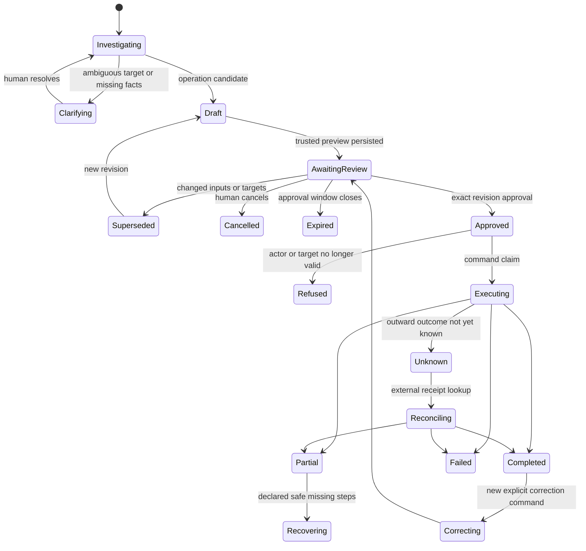

# Evry: operational assistant specification

This is a proposed v3 specification, dated 2026-10-03. It preserves operational capabilities found in historical main and unmerged local Evry source while re-evaluating implementation. It does not implement Evry, migrate customer data, or retain the Eve framework by default. The accepted initial authority is reviewed writes; autonomous mutation classes remain deferred. Evidence and every stable feature ID are in [Evry inventory](modules/evry-inventory.md), [feature matrix](../audits/evry.json), and [actual source surfaces](../audits/evry-surfaces.json).

## Product purpose and authority

Evry helps a church leader inspect recorded work, find relevant evidence, prepare changes, and complete authorized operations. It works across People, Meetings, Tasks and follow-up, Ministry Teams and training, Communication, Launch, Plant Intelligence, Documents, Wiki, dashboard, personal notifications and feedback. A person can start from the global launcher, the current page or durable history and continue a saved operational task.

The church-planting Playbook and SME Plant Intelligence rubric remain authoritative product foundations. Evry may explain a recorded assessment against its exact rubric version, retrieve Playbook passages, distinguish a human attestation from measured evidence, and propose the user's operational next step. It must not invent a readiness threshold, change a church phase itself, diagnose spiritual health, judge pastoral suitability, write prayers, offer biblical counsel, or replace the responsible human's discernment. A request to store the exact title “Pray for the launch” can be an ordinary task operation; a request to compose that prayer is outside Evry's scope.

Neither a prompt, summary, inferred fact, loaded skill, selected tool, provider session, tenant ID in tool arguments nor a retrieved document grants authority. Authentication and domain authorization run in trusted application code. A model can choose among capabilities and supply candidate arguments; it cannot bypass record scope, lifecycle rules, validation or the approval policy.

The current v2 retirement decision is not a v3 removal decision. All identified capabilities have a preservation target. Staging below changes delivery order, not the full target. Historical exclusions—Settings, authentication, coaching, oversight, public/sessionless flows, pre-tenancy onboarding and platform-admin operations—are explicit product decisions to revisit. The first release should support seated plant accounts and use safe Settings handoffs. Document any later expansion by actor, domain operation and disclosure rather than letting a broad chat tool inherit all access.

## Accepted authority: reviewed writes

The user accepted **authorized reads and drafts immediately; persistent writes only after an exact visible human review and approval** on 2026-10-03. [PD-001 / OD-003](decisions/user-rulings.md) records the source and wording. This initial product policy applies to every durable Evry operation. The other options below are future decision options, not enabled authority.

| Policy option | Behavior | Benefit | Cost / required safeguards |
|---|---|---|---|
| Reviewed writes, accepted initial policy | Authorized reads, navigation, source retrieval and non-persistent drafts run immediately. Every durable write, file replacement/generation and outbound communication receives exact review. | Predictable ownership and easy release safety gates. | Extra confirmations for low-impact self actions; batch coherent changes in one review. |
| Bounded low-impact execution | Explicitly approved operation classes, such as one's own bookmark or notification read state, can run without a per-action review. | Lower friction for routine work. | Per-actor opt-in, closed operation list, limits, visible receipt and command-specific undo. Never infer opt-in from usage. |
| Delegated task automation | A human grants a named scope, target set, schedule/trigger, maximum effects, expiry and review exceptions. | Recurring operational work can be carried out. | Durable grants, revocation, fresh permissions at dispatch, quotas, audit and escalation. Outbound communication still needs an explicitly chosen send policy. |

Do not use a model confidence score as permission. “Yes” in conversation is a candidate human intent until the application binds it to the exact currently displayed proposal; the trusted review control is the default approval mechanism. A revised target, body, date, audience, attachment, ownership or step set creates a new revision and invalidates the prior approval. Approval expiry parameters require a reviewed contract. Any exemption for a low-impact write class requires a new user decision; no exemption is enabled by this plan.

Human ownership is concrete: the actor initiating work owns the conversation and proposal; the domain record keeps its existing responsible person; task assignment stays with eligible accounts, ministry membership with People records, and plant declarations with authorized leaders. Evry does not become a person, task owner or ministry leader. Organization sponsorship and coaching access do not silently authorize private plant operations.

## Proposed module boundary and owning paths

The architecture must work with the root backend ADR. A separate Bun + Hono service is the leading candidate; a modular Next.js service can expose the same contracts. The following ownership follows the [canonical architecture](architecture/architecture.md); HTTP adapters live in `apps/api/src/http/`. These directories are future ownership, not files implemented by this plan:

| Owning path / module | Responsibility | Public interface |
|---|---|---|
| `packages/contracts/src/<module>/` | Operation IDs, input/output schemas, query pages, public errors and command results. | `OperationId`, `QueryInput`, `CommandInput`, `QueryResult`, `CommandReceipt`. |
| `packages/domain/src/<module>/` | Domain queries/commands, authorization, validations, transaction and domain history. | `read(actor, input)` and `execute(actor, command, context)`. |
| `packages/evry/src/conversations/` | App-owned private threads, message sequence, turn replay, verified references and user/model planning notes. | Create/list/read/append/observe/archive conversation. |
| `packages/evry/src/proposals/` | Immutable reviewed revision, source snapshots, review rendering, approval/cancel/supersede/expiry. | `prepare`, `revise`, `approve`, `cancel`, `readReview`. |
| `packages/evry/src/runtime/` | Bounded model loop, tool adapters, policy boundary, budget, cancellation and recovery. | `startTurn`, `continueTurn`, `observeRun`, `cancelTurn`. |
| `packages/evry/src/tools/` | Derived assistant-visible query and prepare tools. | Closed catalog generated from shared operation metadata. |
| `packages/evry/src/evaluations/` | Synthetic fixture contracts, factual/effect observations and quality rubrics. | Versioned case/fixture/run/report schema. |
| `apps/web/src/features/evry/` | One client state machine for launcher/panel/history, typed cards, review/edit/cancel/confirm and streaming recovery. | Contract consumer only; no client authority rules. |
| Shared storage/jobs/audit modules | Staging handles, durable queued delivery, run execution, outbox and product audit. | Existing application interfaces, not duplicate Evry services. |

Each domain exposes its own operations. Evry must not own duplicated SQL implementations of People deletion, meeting attendance, team assignment or task completion. A frontend server action can be a thin adapter, but it cannot be the canonical domain handler if the assistant has to reproduce its behavior. Framework request/session objects stop at the auth adapter; operation handlers receive a trusted `ActorContext` and typed inputs.

Operation metadata is deliberately small: ID, version, input/output schema, required capability, record predicate owner, effect class, review projection, idempotency class, retry/compensation policy and evaluation examples. Generate a model catalog and UI capability metadata from this source. Keep factual authorization in domain code. Avoid a generic policy language, dynamic plugin system, workflow engine or event-sourced database until a proven need warrants it.

## Shared operation and evidence contracts

The contract below is pseudocode for a future build. It is intentionally framework-independent.

```ts
type ActorContext = {
  userId: UserId;
  tenantId: TenantId;
  tenancy: "plant" | "sending-church" | "sending-network";
  sessionId: SessionId;          // trusted server value, never model-visible
};

type EvidenceRef = {
  entityType: string;
  entityId: string;
  version: string;
  sourceLink: AppPath;
  observedAt: Instant;
  methodologyVersion?: string;
};

type QueryPage<T> = {
  items: T[];
  matched: number | null;        // null when not measured
  returned: number;
  completeness: "complete" | "partial";
  nextCursor: string | null;
  evidence: EvidenceRef[];
  exclusions?: { reason: string; count: number }[];
};

type CommandContext = {
  origin: "ui" | "evry" | "job";
  idempotencyKey: string;
  expectedVersions: { entityType: string; entityId: string; version: string }[];
  correlationId: string;
};

type CommandReceipt = {
  executionId: string;
  status: "completed" | "partial" | "failed" | "refused" | "unknown";
  affected: number | null;
  excluded: { reason: string; count: number }[];
  results: EvidenceRef[];
  correction?: { operationId: string; eligible: boolean; reason?: string };
};
```

The model never receives a database connection, arbitrary SQL, actor/session credentials or an operation's effect executor. A read tool invokes the shared query with trusted actor context and parsed arguments. A prepare tool creates a candidate proposal and trusted review artifact. A trusted application action approves and executes the saved revision through the same domain command. A receipt read observes saved outcomes and never calls an executor.

Public errors are closed types: validation, ambiguity, unavailable source, permission refusal, changed target, expired approval, rate/budget limit, retryable external failure and uncertain external outcome. They carry useful safe fields and a correlation ID, not raw exception messages/SQL/provider payloads. Private diagnostics can resolve the correlation ID in access-controlled logs. Repeatedly mapping unknown exceptions into user-facing prose is not a substitute for a typed public boundary.

## Feature-to-tool surface

The fine-grained preservation matrix carries all191 domain contracts and117 preparation operation aliases. The following is the target family map. Root domain specs own exact business transitions, fields, roles and acceptance. During contract freeze, map every native operation ID to the appropriate shared handler and adapter behavior; many aliases may share a bounded target operation/tool. This does not require191 target tools or255 APIs. Preserve variant permissions, validation, recovery and acceptance while consolidating the implementation. The [complexity budget](architecture/complexity-budget.md) describes the source-to-target disposition crosswalk and shared registration pattern.

| Domain | Authorized read tools | Draft / propose / execute tools | Important semantic guard |
|---|---|---|---|
| People | Search/count/group cohorts; bulk person/household detail; tags/skills; interview/assessment/commitment/note/activity history; duplicates; pipeline; export/template; photo and commitment content/download. | Create/update/soft-delete/stage reason; notes; households/address propagation; tags/skills; interview/assessment/commitment recording; photo upload/removal; reviewed CSV import; pipeline ordering. | Person ID differs from account ID. Missing recorded interview is not proof no interview happened. Do not invent assessment thresholds or pastoral judgment. |
| Meetings | List/calendar/detail, locations, agenda/checklist/evaluation, RSVPs/attendance/response cards, analytics and first-time/follow-up relations. | Create/update/status/delete; location create/update; guest/attendee/walk-in add/remove and quick-create; RSVP/attendance note/batch/finalize; response record/clear; agenda/checklist/evaluation; reviewed invitation recipe. | RSVP, invited, attended and response are distinct. First-time vision attendance drives Playbook follow-up; returning attendees must not receive fabricated duplicate follow-up. |
| Tasks / follow-up | List/count/group; bulk details/prerequisites/checklist; templates/current phase prompt; eligible assignees and follow-up ownership. | Create/quick-create/update/status/complete/reopen/delete; checklist add/complete; bulk complete/reschedule; follow-up create/assign/handoff; template import; phase prompt import/dismiss. | Own-task authority uses account ownership. Parent completion is an explicit human claim. Recurrence makes fresh checklist. “Today” excludes overdue. Alpha waiver/correction semantics must be added to these older adapters. |
| Ministry Teams | Teams/roles/rosters/vacancies/health; bulk details; candidate memberships; responsibilities; training requirements/completion and person assignments. | Team create/update/initialize; roles create/update/delete/import; member assign/remove; leader assign; responsibility create/update/delete/complete/initialize; training create/complete; ministry meeting through Meetings. | Account leadership authority and People membership are distinct. Responsibilities have no individual assignee in old source. Team template offers are not resurrected after deletion. Use alpha leadership/provenance rules. |
| Communication | Templates/compose merge data; recipients/groups; message content/history; person/meeting history; provider tracking; totals; eligible non-openers and confirmed failures. | Editable message draft/send; template create/update/delete/fork; resend non-openers; confirmed-failure retry. | Show exact body/subject, recipients/exclusions and source versions. Provider acceptance, delivery, opening and executor completion are different. |
| Launch | Schedule/status/readiness sources; milestone/task detail; outcome/journal. | Schedule/postpone; complete/reopen milestone; linked task completion; record/correct launch outcome. | Member milestone authority differs from Owner launch scheduling. Recording Launch Sunday does not promote phase. Future outcomes are expected missing. |
| Plant Intelligence / operational declarations | Authorized operational facts, assessment/run/diagnosis history, rubric evidence and trends; private weekly check-ins are excluded. | Reviewed operational signals, phase declaration/attestation and permitted assessment acknowledgments through shared domain commands; no private check-in read, prepare or write tool. | PD-002 excludes private answers, notes and history from every Evry tool and model context. Native planter-only check-in UI/history/corrections remain. PD-005 keeps contact freshness independent of task completion. |
| Documents | Template metadata, generated history, source content and authenticated downloads. | Reviewed generation using canonical template/merge data; attachment-based People documents through storage. | Unsupported format/content remains unavailable; metadata/snippet is not full document. Generation is a lasting effect under proposed default. |
| Wiki | Browse/search/revisioned full content/navigation, personal progress and bookmarks. | Personal bookmark, reading-progress and feedback changes. | Canonical Playbook content is retrieved and cited; reading progress is personal, never inferred as spiritual progress. |
| Dashboard / notifications / feedback | Scoped operational summary, own unread count/feed and exact selected notifications. | Mark one/selected/all own notifications read; submit product feedback with actual publication disclosure. | Personal feed scope is account-owned. Public GitHub bridge must not attach private identity/system context; ordinary feedback is not a pastoral conversation. |

Evry's richer cross-module query families retain list/count/group/bulk behavior. Important reference queries include: prospects with follow-up but no recorded interview; people attending two vision meetings but only RSVP to another; active volunteers assigned to multiple distinct teams; missing training for each assignment's actual team requirements; overdue tasks owned by the actor versus today's tasks; launch readiness from current milestones/tasks/staffing/meetings even without a historical assessment; all recorded notes across pages and Unicode continuations; confirmed failed recipients without equating unavailable status with failure.

Bound query interfaces instead of giving an unrestricted “search anything” endpoint. Every query has documented filters, maximum scope, ordering/cursor stability, relationship/count semantics and completeness. Query results include source time zone and distinguish event date from entry date where both exist. Authorization predicates apply inside joins/subqueries, not only to a top-level row. Grouping that multiplies a join must have a distinct entity policy.

## Proposed lifecycle, approval and transactions



Keep chat-turn/run state separate from proposal state and domain state. A turn can fail while a prior approved command completed. A browser disconnect is an observer failure, not proof of no action. A user cancel stops new model/query work and queued unstarted effects; it cannot promise reversal of a committed effect. Show the exact safe stopping point and durable outcome.

Proposal creation performs authorized reads and derives the canonical review from domain metadata. It stores operation/schema version, normalized arguments, tenant/actor, expected target versions, recipient/attachment/content digests and human-readable material consequences. Snapshots are review evidence, not current authority. Approval transaction locks/conditionally updates that exact revision, verifies actor/session and records approval with audit. An edit produces a successor revision.

Execution reauthenticates, verifies approval/current revision/expiry and target versions, then conditionally claims a command idempotency key. Domain handlers check permissions and invariants again in the commit transaction. Insert/update the domain record, its history and the command receipt atomically where the same database is involved. Follow-up generation, team assignment and duplicate-check decisions need domain-specific uniqueness/locking, not a client disable flag.

External email/file effects do not belong inside a transaction pretending to roll back a provider. Use a small durable outbox or job only for effects that require retry/continuation. The transaction records the intended outward effect and stable key; the worker dispatches, persists provider/object receipt and updates product status. Unknown acceptance after a crash requires reconciliation by provider idempotency/receipt before another send. Suppression, recipient eligibility and current consent are rechecked at dispatch if policy requires them. It is acceptable for a coherent multi-step recipe to leave a meeting created while an invitation fails, provided the partial receipt names the result and retry never duplicates the meeting.

Do not add an event bus for every Evry read/proposal. Product audit and delivery outbox are enough initially. Use existing domain events only where another module genuinely consumes them; one event's delivery is not a permission grant. Recipes are named operations with a small deterministic dependency list, not model-authored arbitrary execution graphs.

## Correction, undo and recovery

V2 has domain reopen/correct/delete effects, but no general assistant undo system was found. Preserve those actual operations and design correction deliberately. “Undo” must map to a new domain command with its own validation/permissions and receipt; it is never a database rewind.

| Effect class | Correction / recovery | User-facing behavior |
|---|---|---|
| Own bookmark / notification state | Idempotent inverse if the current state/version still permits it. | Offer Undo only where a tested compensation exists. |
| Task complete/status/due date, attendance or launch outcome | Existing reopen/correction command with prior value/history and current version check. | Show before/after and any downstream consequences. |
| Team membership/leadership | Domain-specific end/reassign/correction with provenance and task-authority release rules. | Re-evaluate current leadership; no stale actor restoration. |
| People deletion / import | Domain-approved restore or reviewed compensating changes; import receipts identify created/updated/skipped rows. | Do not promise blanket undo when later activity references those records. |
| File generation / replacement | Delete unreferenced generated artifact or restore prior version when policy permits. | Preserve evidence; cleanup handles must not delete claimed/live content. |
| Email sent / provider accepted | Cannot recall by reversing a row. Reconcile delivery; retry only confirmed eligible failures. | State what was submitted/delivered/unknown. A correction email is a new reviewed send. |
| Phase declaration / attestation | Human correction with methodology/history intact. | Do not hide prior declarations or fabricate changed evidence. |

Recovery acceptance includes before/after every durable boundary: proposal saved before response loss; approval saved before execution request; effect committed before receipt observed; provider accepted before worker crash; partial recipe; process restart; role revoked between steps; object handle expired between review/execute; compaction/provider failure before response. Retry of an unchanged request key returns saved state; changed bytes under that key are refused. A new explicit command is required when the old result is terminal or correction changes meaning.

## Conversation, context and privacy

**Accepted private-care boundary:** [PD-002](decisions/user-rulings.md) excludes private weekly check-in answers, notes and history from every Evry tool and model context, including retrieval, summaries, drafts, corrections, traces and evaluations. Preserve native planter-only entry/corrections/history. Tool catalog generation must omit historical check-in adapters (EVR-267/268); trusted denial tests cover guessed operation IDs and indirect queries. Owner authority does not override this purpose boundary. A future selected-entry access option requires a new product decision. Historical inventory is retained as evidence, not a target permission grant.


App-owned conversation history is the durable source. Model/provider sessions and caches are optional optimizations. One private conversation belongs to one account and tenant. Team-shared assistant conversations would be a new disclosure/ownership feature and need a decision; shared task records do not make private chat visible.

Retain the exact user messages, typed artifacts, verified reference selections, proposal revisions and durable receipts needed to resume and audit. Keep model planning notes tagged `user`, `record`, `inferred`; a source-backed fact also carries record/version/time. Inferred facts never silently overwrite recorded facts. Summaries can shorten context but cannot mint aliases, approvals or entity existence. Re-resolve ambiguous/stale targets with user-visible distinguishing facts.

Context compilation receives a stable product/policy prefix; current authenticated operation metadata; bounded relevant user turns; verified references; exact pending review; current run/outcomes; and source passages selected for the task. It should not upload an entire plant database for every question. Use measured token/call/latency budgets with a clear partial result and explicit Continue/narrow-request behavior. A factual “not yet measured” answer is useful; repeatedly calling tools to find a missing field is not.

Retain exact source content only when the task needs it and authorize every read. For notes/history, typed metadata must say record and content completeness; page limit is not the complete corpus. Distinguish complete evidence from partial/retrieval-only evidence in substantive conclusions. Multiple authorized reads are not automatically a transaction-consistent snapshot; an exhaustive operation can declare a server snapshot/version basis when necessary.

Files use the shared storage module: private staging object, validated MIME/size/content, digest, expiry, account/tenant ownership and optional conversation binding. Models receive opaque attachment IDs and safe descriptors. They never receive signed transport tokens or arbitrary external URLs. CSV preview shows exact matching rules, duplicates, excluded/invalid rows and import consequences. File replacement/import is reviewed. Cleanup claims are coordinated with execution so expired/stale handles cannot erase a committed artifact.

Provider data posture is a root architecture/dependency decision supported by current official sources. Do not reproduce historical no-retention promises. Keep credentials server-side, raw personal content out of routine telemetry, safe public errors, redacted/synthetic eval artifacts, and access-controlled audit. A best-effort credential scrubber is defense in depth; it cannot justify intentionally forwarding secrets.

## Runtime/framework options and simplification ADR

| Option | Fit | Evidence-backed tradeoff |
|---|---|---|
| Plain AI SDK bounded tool loop +app-owned state, recommended evaluation baseline | A small operational assistant sharing domain queries/commands. | Reduces duplicate Eve/application histories and avoids the tracked Eve compaction patch. Requires implementing/resolving stream recovery, clarifications, budgets and persisted turns explicitly. Must prove equivalent behavior before choice is final. |
| Retain Eve behind an adapter | User-steered durable conversations, native skill/tool loading and checkpoint recovery. | Local source has substantial real functionality and isolated proofs. Costs include Nitro/Eve deployment boundary, framework persistence mapping, schema-strictness workaround, a compaction patch and multiple state stores. Keep only if acceptance and maintenance evidence justify it. |
| Generated code-mode composition as optional capability | Complex cross-module read collection where direct bulk queries are insufficient. | Actual QuickJS/WASM sandbox exposes only reads/preparation and enforces per-call authority/resource limits. Added sandbox/budget/recovery/evaluation surface. Preserve as explicit future capability; delivery can defer it while a bounded query/recipe covers common workflows. |
| Optional TypeSafe Jev hints/evaluation | Advisory initial schema/skill shortlist and calibrated narrow semantic checks. | Local source benchmark does not validate it as sole tool selector. A hint miss must not block a legitimate tool. Adds vendor/privacy/cost configuration; no mandatory v3 dependency without new held-out evidence. |

Do not rebuild four registries per operation for permissions, route parity, tool discovery, planning and executor independently. Shared operation schemas/metadata should derive surfaces, with tests proving assistant and UI permissions match in both allowed/refused directions. Keep source coverage as a validation aid; a generated source-text test cannot detect a timing bug, wrong SQL count or missing tool registration.

Historical local runtime is hardcoded to `gpt-5.6-luna`, medium reasoning. That is source behavior, not a v3 model recommendation and not the model used to write this plan. Runtime model selection must satisfy future factual/effect/safety/quality gates and measured latency/cost. Static old benchmark prices are not current pricing. Root dependency research owns current stable SDK/runtime releases.

## Acceptance gates

Every `AC-EVR-###` feature record resolves to its relevant infrastructure procedure below or, for domain capabilities, a parameterized query/effect contract fixture. Release gates count feature contracts independently from test-file counts. Each row needs a fixture, observed result and failure cases; `not_run`/`blocked` never becomes passed.

| Gate | Acceptance procedure | Required evidence |
|---|---|---|
| `AC-EVR-READ` | For each of 76 pack reads and 30 richer read/helpers, seed an owned tenant, foreign tenant and distractors. Exercise relevant filters/detail/list/count/group/bulk/pagination/content/date basis. Revoke the actor or change scope between calls. | Expected IDs/counts from fixture manifests/domain queries; authorized source links; complete/partial metadata; zero domain/outbound effects. |
| `AC-EVR-EFFECT` | For each of 115 pack effects and 117 preparation aliases, prepare editable preview, approve exact revision, execute with duplicate/reordered requests, change target/role, and crash at durable boundaries. | Before/after DB/history/outbox/file/provider-attempt counts; correct operation/actor/tenant; review digest; exactly-once/idempotent result; precise excluded/partial/refused outcome. |
| `AC-EVR-242-FAILED-RETRY` | Exercise `communication.retry_failed` exact cohorts up to 100 and all ineligible provenance/status/current-email/suppression/deletion cases. Compete source claims, lose responses after child creation/provider attempt, change eligibility before dispatch, retry inside and outside 23 hours. | One child per source; only proven provider-delivery failure eligible; exact frozen first outbound bytes and stable provider key; no uncertain/bounce resend; expired provider-key window refuses and never mints a replacement. |
| `AC-EVR-289-SELECTED` | Review 1–10 deduplicated selected own unread notifications, include unselected unread/foreign/read distractors, duplicate execute, change target state. | Exact reviewed subset changes once; remaining unread feed unchanged; one/selected/all scopes separately proven. |
| `AC-EVR-015-MEETING-INVITE` | Prepare one new meeting+guests+invitation; edit calendar/audience/content; execute create→guest→send dependencies; fail/restart after each step and retry. Reuse requires fresh facts and approval. | Persisted created meeting ID binds later steps; send waits for guests; coherent disclosed review; partial created output visible; no repeated meeting/guest/completed-send effect. Existing meeting invitation uses Communication send. |
| Policy / scope (`001–004`, `020`, `027`, `032`) | Operational, pastoral, mixed, ambiguous and malicious retrieved requests; invalid schemas; provider error; unsupported actor; credential-bearing payload. | No private access/effects for refusal; safe public error; hints never permission; benchmark facts distinguished from execution. |
| Surface / context (`005–010`, `022–024`, `028`) | Real browser launcher/panel/history, page changes, duplicate names, clarification, responsive layouts, keyboard, card markers and stale selected results. | Visible context; exact referent; preserved draft/history; correct public projection; focus/scroll; allowed controls present and refused controls absent. |
| Proposal / executor (`011–015`, `018`, `033–034`) | Revised/expired/reused review; double approval; simultaneous actors; partial recipe and safe retry; GET receipt after restart. | Exact revision approval; immutable prior evidence; no duplicate effects; dependency IDs persisted; read-only GET; durable product audit. |
| Run / time (`016–017`) | Stream disconnect, stale request body, observer reconnect, server replacement, DST boundary, current-zone change and wall-clock record. | Same run/request identity; no replayed command; correct local date/time/zone; ambiguity before action. |
| Files / composition (`025–026`, `031`) | Incomplete upload, foreign session, expired/digest-changed file, cleanup race, all note pages/Unicode offsets, sandbox abuse/queued cancellation. | No token/body secrets to model; exact staged source; completeness; sandbox containment; resource ceilings; no effect/approval executor exposed. |
| Budget / compaction (`029`) | Call/token/cost budget exhaustion, multi-call compaction provider failure, cancellation and explicit Retry after restart. | Saved transcript and exhausted turn; new explicit turn; no hidden retries; known unknown usage kept reserved; durable receipt unaffected. |
| Evaluation / observability (`019`, `030`) | Run representative/critical fixtures repeatedly; test telemetry outage and redaction; factual/effect gate fails while semantic judge praises prose. | Fact/effect failures remain failure; trace sink cannot alter product result; independent rubric/model/build/fixture versions and all attempts. |

Fixture coverage includes the 158 inherited scenarios but is not limited to them. Re-bind the 48 gaps and add alpha/new-domain behaviors, command compensation, tenant/actor lifecycle and full UI recovery cases. Preserve all scenarios when changing a tool API by mapping old expected product outcomes to new operations. Review routing-only oracle separately from planning/execution oracle; do not change labels to match predictions.

Critical end-to-end scenarios run at least three independent repetitions and report all outcomes: meeting invitation review/edit/execute/reconnect; CSV preview/approval/import/crash; own follow-up completion versus foreign task; team leadership change and revoked authority; Plant Intelligence source explanation and phase declaration; exact selected notification changes; provider-confirmed delivery retry; full interview/commitment review with authenticated PDF. Synthetic test tenants and fake providers prove domain effects without customer writes or real email. A limited live-provider evaluation is a separate future authorization/budget and cannot replace browser/domain evidence.

Quality grading separates grounded facts, task completion, useful explanation, natural language, needed clarification count, tool/call count, first-text/first-interaction/total latency and cost. Define product-specific release thresholds with human calibration; no weighted score can compensate for an unauthorized write, wrong tenant, fabricated record or duplicate send. Avoid exposing cursors/SQL/internal state in user prose. Focused counts can be concise; substantive overviews need interpretation from relevant recorded facts. Cards support inspection and do not repeat an entire answer.

## Future work packages and integration order

The following `EVRY-01`–`EVRY-08` labels are advisory design breakdowns, not actual work-package IDs or a competing DAG. The [root build plan](plan/build-plan.md) and [machine DAG](plan/dag.json) own final prerequisites, gates and IDs: conversation051, read registry052, approval kernel053, uploads054, policy/evals055 and domain read/write packs059–086. Root feature mapping resolves each raw `WP-evry` placeholder centrally. No implementation runs as part of this plan.

| Suggested subdivision | Inputs / prerequisites | Outputs / owner | Acceptance and merge order |
|---|---|---|---|
| `EVRY-01` policy/contract freeze | Actor/tenant contract; canonical methodology versions; root domain operation catalog; accepted PD-001 reviewed-write baseline and remaining approval-parameter contracts. | Reviewed scope/options; shared query/command/proposal/receipt schemas in contracts. | Source+feature+table mapping complete; no unresolved authority assumptions. Merge before consumers. |
| `EVRY-02` application state | Contracts; database/schema lane; shared audit/jobs/storage interfaces. | Conversation/turn/run/proposal/approval/receipt persistence and version/uniqueness constraints. | Crash/replay/isolation/concurrency probes; no provider required. |
| `EVRY-03` read vertical slice | People/Tasks domain query handlers; state; approved model adapter. | Read-only assistant +source cards +history with factual query fixtures. | Policy/read/browser/privacy/budget gates. Gives first useful slice, not full parity. |
| `EVRY-04` reviewed command vertical slice | Task create/complete and meeting/communication command/outbox contracts; proposal state. | Editable exact review, confirm/edit/cancel, execution receipt and recover. | Duplicate approval/execute, target/role changed, crash and provider fake. |
| `EVRY-05` full feature adapters | Owning domain handlers independently complete and versioned. | All191 pack contracts +30 richer helpers +117 aliases mapped and tested. | Domain lanes may work in parallel; integrate by frozen operation contract, then every capability gate. |
| `EVRY-06` UI and durable continuity | State/run protocol; design system; proposal and artifact contracts. | Shared launcher/panel/history controller, typed artifacts, context chips/suggestions and recovery. | Real browser focus/keyboard/responsive/scroll/stream tests; preserves drafts. |
| `EVRY-07` workflow/composition choice | Direct operations and representative eval metrics. | Named invite/follow-up/outreach/staffing/launch workflows; ADR for optional Eve/code mode/Jev. | Equivalent recovery/isolation proof; no speculative framework adoption. |
| `EVRY-08` complete evidence release gate | All adapters, UI, fixture coverage; observed latency/cost; current provider posture. | Bound inherited corpus +alpha additions; independent quality report and operational runbook. | Zero unclassified/dropped features; no blocked critical fixture; approved limitations named; safety/fact/effect gates pass. |

Use the root [shared contract freeze procedure](architecture/decisions.md#shared-contract-freeze-procedure): C0 actor/IDs/errors/time/idempotency; C1 identity/tenancy/People/grants; C2 attendance/follow-up/task/phase transitions; C3 rubric publication and approved Evry plan digest/execution policy. This document defines no competing freeze sequence. Coordinate breaking changes through the designated contract owner and update UI/Evry adapters and fixture mappings together.

Parallel lanes: domain teams own People, Meetings/Communication, Tasks/follow-up, Teams/training, Intelligence/Launch and content/platform handlers; Evry owns state/runtime/tool adaptation; UI consumes frozen contracts; independent evaluation can author fixture manifests while handlers are being built. Integrate contracts first, persistence/security second, domain handlers third, thin adapters/UI fourth, full workflow/evidence gate last. The critical path is canonical methodology +identity contract → domain commands +proposal state → exact reviewed execution/outbox recovery → full cross-module acceptance. A dedicated Evry/evaluation owner should not be expected to implement every domain feature again.

## Open decisions and concrete unresolved gaps

1. Specify per-actor/grant lifecycle and approval expiry parameters within accepted PD-001 / OD-003: authorized reads and non-persistent drafts immediately; exact human review/approval before every durable change, including outbound sends. Autonomous mutation classes and any write exemptions are deferred and require a new user decision; the reviewed-write baseline is already accepted.
2. Choose plain AI SDK versus Eve after equivalent recovery/clarification/budget/browser proof; retain capability semantics regardless of framework. No old framework API is a blanket v3 constraint.
3. Decide Settings/coach/oversight/onboarding/admin tool expansion. Preserve privacy and actor separation; historical exclusions are evidence and not invisible omissions.
4. Resolve one app-owned history/run/proposal schema and command-audit storage. All fourteen historical/local Evry tables are mapped; none requires customer migration or old ledger reuse.
5. Adopt alpha domain behavior for corrections, task waiver/filter/follow-up, leadership and privacy rather than transplanting stale unmerged effect SQL. Reconcile each adapter against its owning spec before implementation.
6. Bind all48 inherited eval gaps and close recorded browser/latency/repeated-prose limitations. Source-heavy test suites and routing measurements are insufficient release evidence.
7. Define compensation eligibility by command; no general v2 undo exists. Email recall is not a possible database inverse.
8. Decide optional code-mode/Jev after measured need and new held-out evaluation; no sole-selector approval exists.
9. Confirm provider/telemetry retention and private-content posture from current official primary sources in the root dependency ADR. Historical estimates and no-retention language are not current promises.

The full target preserves every identified operational assistant capability and all actual security/data-integrity guarantees. It reduces duplicated operation implementations, histories, catalogs and framework patches only where replacement acceptance proves equivalent behavior.
