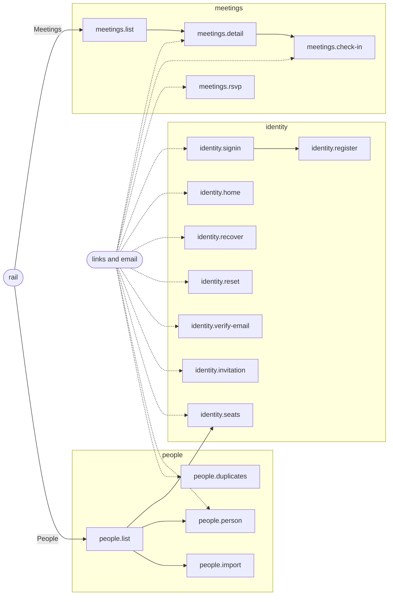

# Feature maps

Generated by `node tools/ci/feature-maps.ts --write` from every `feature-map.json`. Do not edit by hand.

Each feature directory under `apps/web/src/features/` describes its surfaces: the routes it owns, how each persona
reaches them, the states a verifier can open and the tests, cases and browser steps that prove each behavior.
Print one surface with `node tools/ci/feature-maps.ts show <surface-id>`.

Routes mapped: 27 of 136. Not yet mapped: 109, listed in [`apps/web/feature-maps.pending.json`](../../apps/web/feature-maps.pending.json).

| Feature | Map | Surfaces | Routes | Behaviors | Browser behavior proofs | Browser presence proofs |
|---|---|---|---|---|---|---|
| [identity](identity.md) | [`apps/web/src/features/identity/feature-map.json`](../../apps/web/src/features/identity/feature-map.json) | 8 | 10 | 11 | 4 | 1 |
| [meetings](meetings.md) | [`apps/web/src/features/meetings/feature-map.json`](../../apps/web/src/features/meetings/feature-map.json) | 4 | 5 | 10 | 4 | 4 |
| [people](people.md) | [`apps/web/src/features/people/feature-map.json`](../../apps/web/src/features/people/feature-map.json) | 4 | 12 | 11 | 6 | 2 |

## Become a persona

Every map uses the QA seed ([`tools/qa/qa-seed.ts`](../../tools/qa/qa-seed.ts)): it creates the personas below and the data the
steps name (for example "QA vision meeting" or "Maria Santos"). Run the app on a QA-seeded database, for example a
local proof slot or a QA preview (`bin/qa`). Sign in at `/signin` with the persona's address and password, both in
[`tools/qa/qa-guard.ts`](../../tools/qa/qa-guard.ts); a proof slot's `login --persona <id>` sets the same session cookie.
In commands, `$ORIGIN` is the app's address, `$REPO` the checkout, and `<QA_LOGINS.x>` and `<QA_PASSWORD>` are
values from that file. Each step that opens, clicks, presses or uploads is followed by a network-idle wait, so the page
has hydrated and the next check sees the result.
A state marked setup creates its own data first; run its setup once per fresh seed.

| Persona | Context | Who | Sign in with |
|---|---|---|---|
| `owner` | plant owner | Daniel Reyes, Owner of Harvest Point (QA) | `QA_LOGINS.owner` and `QA_PASSWORD` |
| `admin` | plant admin | Lena Park, Admin of Harvest Point (QA) | `QA_LOGINS.admin` and `QA_PASSWORD` |
| `member` | plant member | Ruth Allen, Member of Harvest Point (QA) | `QA_LOGINS.member` and `QA_PASSWORD` |
| `network` | organization | Marcus Bell, Admin of Harvest Network (QA) | `QA_LOGINS.network` and `QA_PASSWORD` |
| `resident` | account, residency linked | Casey Lee, a seatless account linked to a sending church's residency | `QA_LOGINS.resident` and `QA_PASSWORD` |
| `signup` | account | Hannah Cole, a verified sign-up with no church yet | `QA_LOGINS.signup` and `QA_PASSWORD` |
| `triage` | account | Tess Morgan, a seatless account that triages feedback | `QA_LOGINS.triage` and `QA_PASSWORD` |
| `visitor` | signed-out | Nobody signed in | none |

## What the check proves, and what it cannot

`node tools/ci/feature-maps.ts` (CI: tooling job) proves the map is consistent with the code, not that the app
behaves as the map says. It checks: every route belongs to one surface or the shrink-only pending list; route
files import only their own feature; every `loading`, `error` and `not-found` file is a declared state; test
names exist exactly; cases are `AC:` markers in those tests; operations are in the catalog, serve the behavior's
catalog features and are quoted or declared in code; email links name a template that builds that path; rail
reaches agree with `shellNav` both ways for every persona; personas are QA seed logins; and every name, label
and text in a step equals (or, for `contains`, is part of) a string literal or JSX text, comments excluded, in the
feature's folder, `packages/ui/src`, the shell (each with the modules it imports directly) or the QA seed, or was
typed earlier in the same steps.

It cannot catch, and only running the browser steps catches:

- a rename where the old text still exists elsewhere in that scope;
- the wrong role for a name (a heading checked as a button);
- whether a persona really has the access the map gives it, or a state's checks also pass on another screen;
- whether the seed data the steps name is in the state the steps expect (each run needs a fresh seed).

A browser proof marked presence only shows that the control is there; the listed tests prove the outcome.
