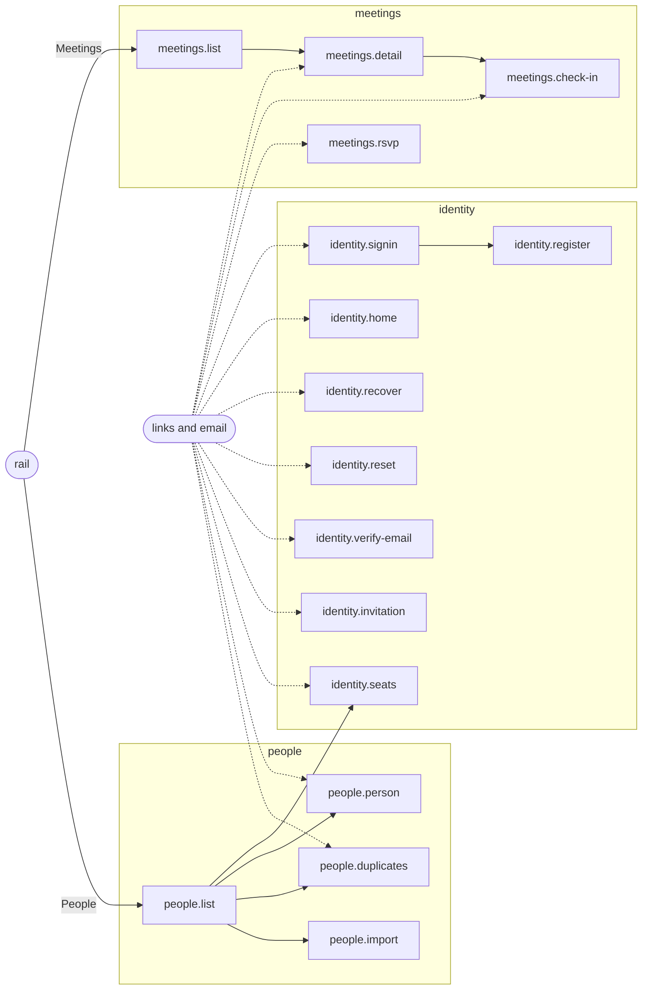

# Feature maps

Generated by `node tools/ci/feature-maps.ts --write` from every `feature-map.json`. Do not edit by hand.

Each feature directory under `apps/web/src/features/` describes its surfaces: the routes it owns, how each persona
reaches them, the states a verifier can open and the tests, cases and browser steps that prove each behavior.
Personas are in [`tests/ui/personas.json`](../../tests/ui/personas.json). Print one surface with
`node tools/ci/feature-maps.ts show <surface-id>`.

Routes mapped: 27 of 136. Not yet mapped: 109, listed in [`apps/web/feature-maps.pending.json`](../../apps/web/feature-maps.pending.json).

| Feature | Map | Surfaces | Routes | Behaviors | Browser steps |
|---|---|---|---|---|---|
| [identity](identity.md) | [`apps/web/src/features/identity/feature-map.json`](../../apps/web/src/features/identity/feature-map.json) | 8 | 10 | 11 | 6 |
| [meetings](meetings.md) | [`apps/web/src/features/meetings/feature-map.json`](../../apps/web/src/features/meetings/feature-map.json) | 4 | 5 | 10 | 9 |
| [people](people.md) | [`apps/web/src/features/people/feature-map.json`](../../apps/web/src/features/people/feature-map.json) | 4 | 12 | 11 | 8 |
