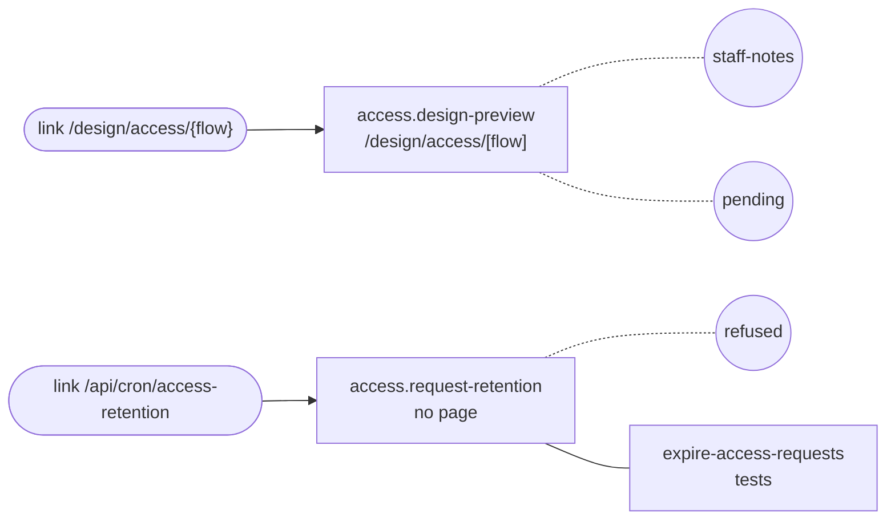

# Feature map: access

Generated from [`apps/web/src/features/access/feature-map.json`](../../apps/web/src/features/access/feature-map.json) by `node tools/ci/feature-maps.ts --write`. Do not edit by hand.
Personas, sign-in and what the checker cannot catch: [README](README.md).



## Surfaces

### access.design-preview

Design previews of the access boundary pages and the staff notes panel by viewer duty, with sample data and no database.

- Routes: `/design/access/[flow]`
- Personas: `visitor` read

Reach:

- Link `/design/access/{flow}` where `{flow}` is not-available, session-ended, pending or staff-notes

States:

- **staff-notes**: radiogroup "Preview as"; heading "Staff notes"; button "Show more notes". As `visitor`, on the QA seed:

```bash
agent-browser open "$ORIGIN/design/access/staff-notes"
agent-browser wait --load networkidle
agent-browser find role radiogroup text --name "Preview as" --exact
agent-browser find role heading text --name "Staff notes" --exact
agent-browser find role button text --name "Show more notes" --exact
```

- **pending**: heading "Finish setting up"; link "Set up your church". As `visitor`, on the QA seed:

```bash
agent-browser open "$ORIGIN/design/access/pending"
agent-browser wait --load networkidle
agent-browser find role heading text --name "Finish setting up" --exact
agent-browser find role link text --name "Set up your church" --exact
```

### access.request-retention

The daily cron that expires old early-access requests: it refuses any caller without the cron secret.

- Routes: none
- Endpoints: `/api/cron/access-retention`
- Personas: `visitor` none

Reach:

- Link `/api/cron/access-retention`

States:

- **refused**: URL `/api/cron/access-retention`. As `visitor`, on the QA seed:

```bash
agent-browser open "$ORIGIN/api/cron/access-retention"
agent-browser wait --load networkidle
agent-browser wait --url "**/api/cron/access-retention"
```

#### access.request-retention#expire-access-requests

The daily run deletes early-access requests after twelve months and clears stored IP addresses older than thirty days; without the cron secret it changes nothing.

- Operations: marketing.expireAccessRequests
- Catalog: ADM-006
- Test: `packages/domain/test/requests.test.ts`: `INV-access: scheduled retention deletes after twelve months and clears only IPs older than thirty days`
- Test: `packages/domain/test/requests.test.ts`: `INV-access: cron requires a configured secret and refuses unauthorized retention`
