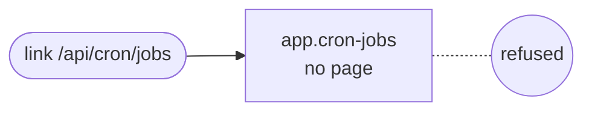

# Feature map: app

Generated from [`apps/web/src/app/feature-map.json`](../../apps/web/src/app/feature-map.json) by `node tools/ci/feature-maps.ts --write`. Do not edit by hand.
Personas, sign-in and what the checker cannot catch: [README](README.md).



## Surfaces

### app.cron-jobs

The scheduler endpoint the platform cron calls: with the exact bearer it runs every feature's due jobs and mail passes in one tick; any other call gets 401 and nothing runs.

- Routes: none
- Endpoints: `/api/cron/jobs`
- Personas: `visitor` none

Reach:

- Link `/api/cron/jobs`

States:

- **refused**: text "unauthorized". As `visitor`, on the QA seed:

```bash
agent-browser open "$ORIGIN/api/cron/jobs"
agent-browser wait --load networkidle
agent-browser find text "unauthorized" text --exact
```

