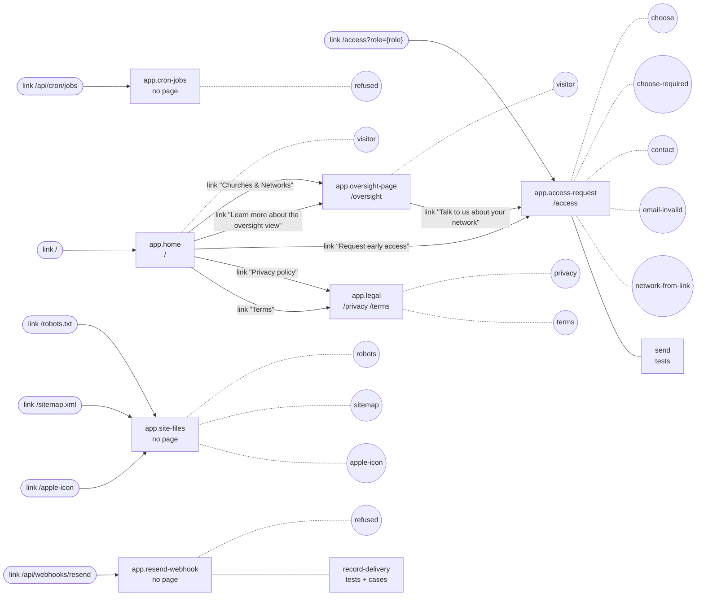

# Feature map: app

Generated from [`apps/web/src/app/feature-map.json`](../../apps/web/src/app/feature-map.json) by `node tools/ci/feature-maps.ts --write`. Do not edit by hand.
Personas, sign-in and what the checker cannot catch: [README](README.md).



## Surfaces

### app.cron-jobs

The scheduler endpoint the platform cron calls: with the exact bearer it runs every feature's due jobs and mail passes in one tick; a call without that bearer gets 401 and runs nothing, and a deployment with no cron secret set answers 503.

- Routes: none
- Endpoints: `/api/cron/jobs`
- Personas: `visitor` none

Reach:

- Link `/api/cron/jobs`

States:

- **refused**: text containing "unauthorized". As `visitor`, on the QA seed:

```bash
agent-browser open "$ORIGIN/api/cron/jobs"
agent-browser wait --load networkidle
agent-browser wait --text "unauthorized"
```

### app.home

The public home page for church planters: the hero with its demo animation, the phases, what Evry does, the oversight teaser and links to request early access. It needs no sign-in.

- Routes: `/`
- Personas: `visitor` read
- Catalog: ADM-006

Reach:

- Link `/`

States:

- **visitor**: heading "From calling to Launch Sunday."; link "Request early access"; heading "Everything a church plant needs, in the order you need it."; link "Learn more about the oversight view". As `visitor`, on the QA seed:

```bash
agent-browser open "$ORIGIN/"
agent-browser wait --load networkidle
agent-browser find role heading text --name "From calling to Launch Sunday." --exact
agent-browser find role link text --name "Request early access" --exact
agent-browser find role heading text --name "Everything a church plant needs, in the order you need it." --exact
agent-browser find role link text --name "Learn more about the oversight view" --exact
```

### app.oversight-page

The public page for sending churches and networks: a sample dashboard of the plants they send, the trust cards and the questions people ask, with a link that opens the access form already set to a network.

- Routes: `/oversight`
- Personas: `visitor` read
- Catalog: ADM-006

Reach:

- From app.home as `visitor`:

```bash
agent-browser find role link click --name "Churches & Networks" --exact
agent-browser wait --load networkidle
```

- From app.home as `visitor`:

```bash
agent-browser find role link click --name "Learn more about the oversight view" --exact
agent-browser wait --load networkidle
```

States:

- **visitor**: URL `/oversight`; heading "See every church plant you send."; columnheader "Church plant"; link "Talk to us about your network". As `visitor`, on the QA seed:

```bash
agent-browser open "$ORIGIN/"
agent-browser wait --load networkidle
agent-browser find role link click --name "Churches & Networks" --exact
agent-browser wait --load networkidle
agent-browser wait --url "**/oversight"
agent-browser find role heading text --name "See every church plant you send." --exact
agent-browser find role columnheader text --name "Church plant" --exact
agent-browser find role link text --name "Talk to us about your network" --exact
```

### app.access-request

The one early access form: the visitor says who they are, then gives contact and church or network details step by step, and sends. Each step is checked on the server before the next. Sending emails the Everyfield owner through the mail provider directly, with no capture outbox, so no browser step here presses the final send; the tests prove it.

- Routes: `/access`
- Personas: `visitor` write
- Catalog: ADM-006

Reach:

- From app.home as `visitor`:

```bash
agent-browser find role link click --name "Request early access" --exact
agent-browser wait --load networkidle
```

- From app.oversight-page as `visitor`:

```bash
agent-browser find role link click --name "Talk to us about your network" --exact
agent-browser wait --load networkidle
```

- Link `/access?role={role}` where `{role}` is planter, church or network, which picks the first answer

States:

- **choose**: heading "Request early access"; heading "Which of these describes you?"; radio "Church planter"; radio "Sending network". As `visitor`, on the QA seed:

```bash
agent-browser open "$ORIGIN/access"
agent-browser wait --load networkidle
agent-browser find role heading text --name "Request early access" --exact
agent-browser find role heading text --name "Which of these describes you?" --exact
agent-browser find role radio text --name "Church planter" --exact
agent-browser find role radio text --name "Sending network" --exact
```

- **choose-required**: text containing "Choose the one that describes you."; heading "Which of these describes you?". As `visitor`, on the QA seed:

```bash
agent-browser open "$ORIGIN/access"
agent-browser wait --load networkidle
agent-browser find role button click --name "Continue" --exact
agent-browser wait --load networkidle
agent-browser wait --text "Choose the one that describes you."
agent-browser find role heading text --name "Which of these describes you?" --exact
```

- **contact**: heading "How can we reach you?"; textbox "Your name"; button "Back". As `visitor`, on the QA seed:

```bash
agent-browser open "$ORIGIN/access"
agent-browser wait --load networkidle
agent-browser find role radio click --name "Church planter" --exact
agent-browser wait --load networkidle
agent-browser find role button click --name "Continue" --exact
agent-browser wait --load networkidle
agent-browser find role heading text --name "How can we reach you?" --exact
agent-browser find role textbox text --name "Your name" --exact
agent-browser find role button text --name "Back" --exact
```

- **email-invalid**: text containing "Enter an email address, such as name@example.com."; heading "How can we reach you?". As `visitor`, on the QA seed:

```bash
agent-browser open "$ORIGIN/access"
agent-browser wait --load networkidle
agent-browser find role radio click --name "Church planter" --exact
agent-browser wait --load networkidle
agent-browser find role button click --name "Continue" --exact
agent-browser wait --load networkidle
agent-browser find label "Your name" fill "Sam Field"
agent-browser find label "Email" fill "not-an-email"
agent-browser find role button click --name "Continue" --exact
agent-browser wait --load networkidle
agent-browser wait --text "Enter an email address, such as name@example.com."
agent-browser find role heading text --name "How can we reach you?" --exact
```

- **network-from-link**: heading "Which network are you with?"; textbox "Network name". As `visitor`, on the QA seed:

```bash
agent-browser open "$ORIGIN/access?role=network"
agent-browser wait --load networkidle
agent-browser find role button click --name "Continue" --exact
agent-browser wait --load networkidle
agent-browser find label "Your name" fill "Sam Field"
agent-browser find label "Email" fill "sam@example.org"
agent-browser find role button click --name "Continue" --exact
agent-browser wait --load networkidle
agent-browser find role heading text --name "Which network are you with?" --exact
agent-browser find role textbox text --name "Network name" --exact
```

#### app.access-request#send

A complete request is stored with every field and sends one email to the owner; the same email and form within 24 hours sends nothing more, five requests per email and twenty per address an hour are the limit, a filled honeypot gets a receipt with nothing stored, and a failed store or mail never claims success.

- No operation: The form's server action calls `receiveAccessRequest` (`packages/domain/src/early-access/index.ts`); the catalog's `marketing.requestInvitation` names no code.
- Catalog: ADM-006
- Test: `packages/domain/test/requests.test.ts`: `INV-access: accepted forms normalize email, store every field and send one complete owner email each`
- Test: `packages/domain/test/requests.test.ts`: `INV-access: 24-hour duplicates use normalized email and form without another row or email`
- Test: `packages/domain/test/requests.test.ts`: `INV-access: five valid attempts per normalized email in 24 hours then email refusal`
- Test: `packages/domain/test/requests.test.ts`: `INV-access: twenty attempts per IP in one hour then IP refusal`
- Test: `packages/domain/test/requests.test.ts`: `INV-access: honeypot receives a fake receipt with no data, limit attempts or email`
- Test: `packages/domain/test/requests.test.ts`: `INV-access: mail rejection, missing receipt and timeout never claim success; retry keeps original row and payload`

### app.legal

The public privacy policy and terms, linked from every public page's footer and from the access form.

- Routes: `/privacy`, `/terms`
- Personas: `visitor` read
- Catalog: ADM-007

Reach:

- From app.home as `visitor`:

```bash
agent-browser find role link click --name "Privacy policy" --exact
agent-browser wait --load networkidle
```

- From app.home as `visitor`:

```bash
agent-browser find role link click --name "Terms" --exact
agent-browser wait --load networkidle
```

States:

- **privacy**: URL `/privacy`; heading "Privacy policy"; heading "What we collect"; heading "Ask for a copy, a correction or deletion". As `visitor`, on the QA seed:

```bash
agent-browser open "$ORIGIN/"
agent-browser wait --load networkidle
agent-browser find role link click --name "Privacy policy" --exact
agent-browser wait --load networkidle
agent-browser wait --url "**/privacy"
agent-browser find role heading text --name "Privacy policy" --exact
agent-browser find role heading text --name "What we collect" --exact
agent-browser find role heading text --name "Ask for a copy, a correction or deletion" --exact
```

- **terms**: URL `/terms`; heading "Terms"; heading "Your requests". As `visitor`, on the QA seed:

```bash
agent-browser open "$ORIGIN/"
agent-browser wait --load networkidle
agent-browser find role link click --name "Terms" --exact
agent-browser wait --load networkidle
agent-browser wait --url "**/terms"
agent-browser find role heading text --name "Terms" --exact
agent-browser find role heading text --name "Your requests" --exact
```

### app.site-files

The files search engines and phones fetch from the public site: robots.txt allows only the live public pages and their share images and points to the sitemap, the sitemap lists the five public pages, and the Apple touch icon is a 180 px PNG.

- Routes: none
- Endpoints: `/robots.txt`, `/sitemap.xml`, `/apple-icon`
- Personas: `visitor` read
- Catalog: ADM-007

Reach:

- Link `/robots.txt`
- Link `/sitemap.xml`
- Link `/apple-icon`

States:

- **robots**: text containing "/oversight/twitter-image"; text containing "/sitemap.xml". As `visitor`, on the QA seed:

```bash
agent-browser open "$ORIGIN/robots.txt"
agent-browser wait --load networkidle
agent-browser wait --text "/oversight/twitter-image"
agent-browser wait --text "/sitemap.xml"
```

- **sitemap**: text containing "https://everyfield.app"; text containing "monthly". As `visitor`, on the QA seed:

```bash
agent-browser open "$ORIGIN/sitemap.xml"
agent-browser wait --load networkidle
agent-browser wait --text "https://everyfield.app"
agent-browser wait --text "monthly"
```

- **apple-icon**: URL `/apple-icon`; no text "Page not found"; no text "Error". As `visitor`, on the QA seed:

```bash
agent-browser open "$ORIGIN/apple-icon"
agent-browser wait --load networkidle
agent-browser wait --url "**/apple-icon"
agent-browser wait --fn "!document.body.innerText.includes(\"Page not found\")"
agent-browser wait --fn "!document.body.innerText.includes(\"Error\")"
```

### app.resend-webhook

The Resend webhook that records delivery, bounce and open callbacks for sent mail: it refuses any method but a signed POST.

- Routes: none
- Endpoints: `/api/webhooks/resend`
- Personas: `visitor` none

Reach:

- Link `/api/webhooks/resend`

States:

- **refused**: URL `/api/webhooks/resend`; text containing "method_not_allowed". As `visitor`, on the QA seed:

```bash
agent-browser open "$ORIGIN/api/webhooks/resend"
agent-browser wait --load networkidle
agent-browser wait --url "**/api/webhooks/resend"
agent-browser wait --text "method_not_allowed"
```

#### app.resend-webhook#record-delivery

A signed callback records one delivery outcome for the sent mail, and a callback with a bad signature writes nothing.

- No operation: the Resend webhook handler (server/jobs/webhook-route.ts) verifies the signature and the mail callback job records the outcome; it is a provider callback, not a catalog operation
- Catalog: NTF-010
- Cases: CASE-NTF-010
- Test: `tests/integration/communication/delivery.test.mts`: `AC:CASE-NTF-010 AC:SEC-09 AC:SEC-06 AC:NOTIFY47-008 callbacks record one outcome and a bad signature writes nothing`
