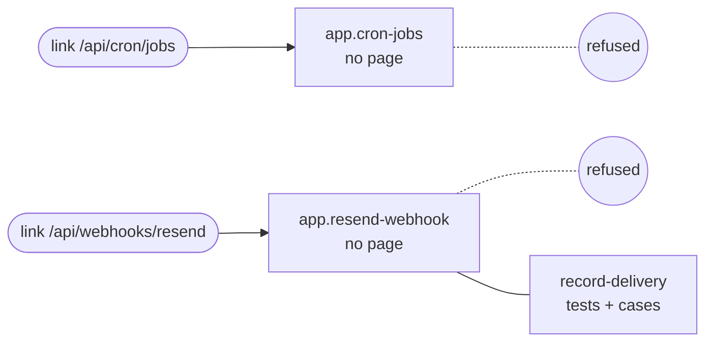

# Feature map: app

Generated from [`apps/web/src/app/feature-map.json`](../../apps/web/src/app/feature-map.json) by `node tools/ci/feature-maps.ts --write`. Do not edit by hand.
Personas, sign-in and what the checker cannot catch: [README](README.md).



## Surfaces

### app.cron-jobs

The scheduler endpoint the platform cron calls: with the exact bearer it runs every feature's due jobs and mail passes in one tick; a call without that bearer gets 401 and runs nothing, and a deployment with no cron secret set answers 503.

- Routes: none
- Endpoints: `/api/cron/jobs`
- Personas: `visitor` none

Reach:

- Link `/api/cron/jobs`

States:

- **refused**: text containing "unauthorized". As `visitor`, on the QA seed:

```bash
agent-browser open "$ORIGIN/api/cron/jobs"
agent-browser wait --load networkidle
agent-browser wait --text "unauthorized"
```

### app.resend-webhook

The Resend webhook that records delivery, bounce and open callbacks for sent mail: it refuses any method but a signed POST.

- Routes: none
- Endpoints: `/api/webhooks/resend`
- Personas: `visitor` none

Reach:

- Link `/api/webhooks/resend`

States:

- **refused**: URL `/api/webhooks/resend`; text containing "method_not_allowed". As `visitor`, on the QA seed:

```bash
agent-browser open "$ORIGIN/api/webhooks/resend"
agent-browser wait --load networkidle
agent-browser wait --url "**/api/webhooks/resend"
agent-browser wait --text "method_not_allowed"
```

#### app.resend-webhook#record-delivery

A signed callback records one delivery outcome for the sent mail, and a callback with a bad signature writes nothing.

- No operation: the Resend webhook handler (server/jobs/webhook-route.ts) verifies the signature and the mail callback job records the outcome; it is a provider callback, not a catalog operation
- Catalog: NTF-010
- Cases: CASE-NTF-010
- Test: `tests/integration/communication/delivery.test.mts`: `AC:CASE-NTF-010 AC:SEC-09 AC:SEC-06 AC:NOTIFY47-008 callbacks record one outcome and a bad signature writes nothing`
