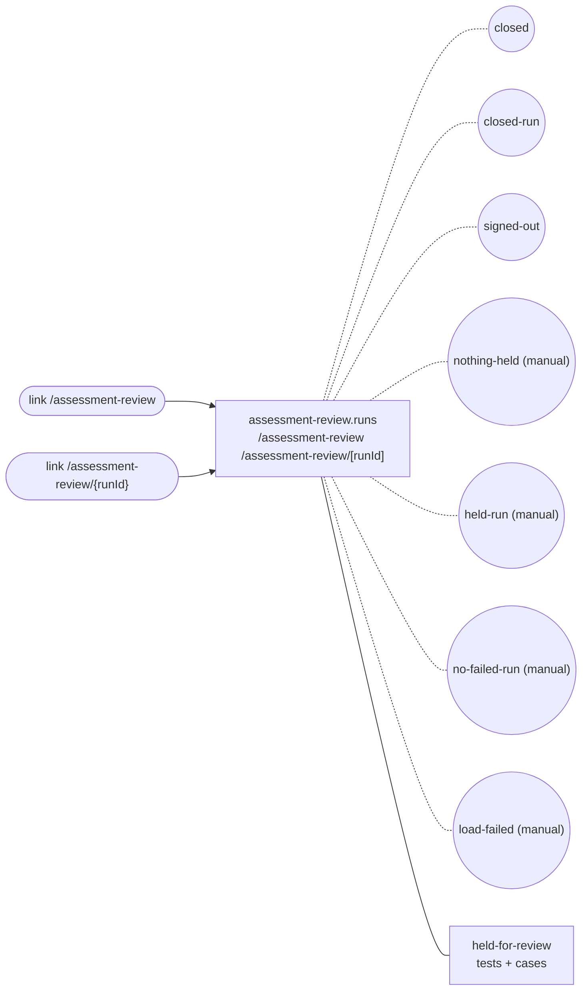

# Feature map: assessment-review

Generated from [`apps/web/src/features/assessment-review/feature-map.json`](../../apps/web/src/features/assessment-review/feature-map.json) by `node tools/ci/feature-maps.ts --write`. Do not edit by hand.
Personas, sign-in and what the checker cannot catch: [README](README.md).



## Surfaces

### assessment-review.runs

For an Everyfield team member with assessment review access: the plants held after three failed scheduled assessments in a row, and one failed run's cause, counters and streak, never the plant's facts or draft text. Everyone else sees one closed page.

- Routes: `/assessment-review`, `/assessment-review/[runId]`
- Personas: `owner` none, `triage` none, `visitor` none
- Catalog: PI-042

Reach:

- Link `/assessment-review`
- Link `/assessment-review/{runId}` where `{runId}` is a held run's id, from a row of the list

States:

- **closed**: heading "Assessment review"; heading "Assessment review needs an operator grant"; no text "Nothing is held". As `owner`, on the QA seed:

```bash
agent-browser open "$ORIGIN/assessment-review"
agent-browser wait --load networkidle
agent-browser find role heading text --name "Assessment review" --exact
agent-browser find role heading text --name "Assessment review needs an operator grant" --exact
agent-browser wait --fn "!document.body.innerText.includes(\"Nothing is held\")"
```

- **closed-run**: heading "Assessment run"; heading "Assessment review needs an operator grant". As `triage`, on the QA seed:

```bash
agent-browser open "$ORIGIN/assessment-review/00000000-0000-0000-0000-000000000000"
agent-browser wait --load networkidle
agent-browser find role heading text --name "Assessment run" --exact
agent-browser find role heading text --name "Assessment review needs an operator grant" --exact
```

- **signed-out**: URL `/signin?returnTo=%2Fassessment-review`. As `visitor`, on the QA seed:

```bash
agent-browser open "$ORIGIN/assessment-review"
agent-browser wait --load networkidle
agent-browser wait --url "**/signin?returnTo=%2Fassessment-review"
```

- **nothing-held**: heading "Nothing is held". Not scripted: open /assessment-review as triage, after giving that account the operator grant in the app's database: INSERT INTO platform_grant(account_id, capability) SELECT account_id, 'assessment_operator' FROM platform_grant WHERE capability = 'feedback_triage' (a map step cannot write the database; delete the row afterwards).
- **held-run**: list "Held assessments"; heading "Cause"; heading "Failed in a row". Not scripted: needs the operator grant (as for nothing-held) and a plant whose last three scheduled assessments failed, which no seed creates; the list row opens the run.
- **no-failed-run**: heading "There is no failed run here". Not scripted: open /assessment-review/00000000-0000-0000-0000-000000000000 as triage, after giving that account the operator grant in the app's database: INSERT INTO platform_grant(account_id, capability) SELECT account_id, 'assessment_operator' FROM platform_grant WHERE capability = 'feedback_triage' (a map step cannot write the database; delete the row afterwards).
- **load-failed**: heading "Held assessments did not load". Not scripted: stop the app's database (on a proof slot, docker stop its Postgres) and open /assessment-review signed in; the run page says This run did not load instead.

#### assessment-review.runs#held-for-review

Three scheduled failures in a row hold a plant for review with the real cause; only an operator reads the list and the run, and the plant keeps its last good assessment.

- Operations: intelligence.listRunsForReview, intelligence.describeRunFailure
- Catalog: PI-042
- Cases: PI-CASE-028
- Test: `tests/integration/intelligence/orchestration.test.mts`: `AC:PI-CASE-028 three scheduled failures in a row hold the plant for review with the real cause and no plant data; it keeps its last good assessment; a material change runs again`
