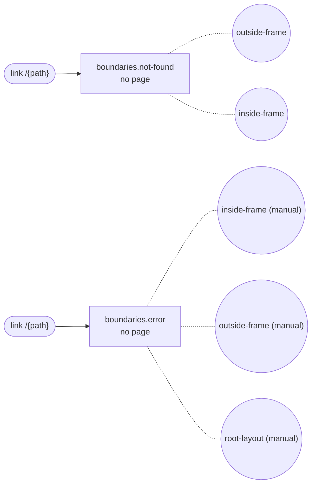

# Feature map: boundaries

Generated from [`apps/web/src/features/boundaries/feature-map.json`](../../apps/web/src/features/boundaries/feature-map.json) by `node tools/ci/feature-maps.ts --write`. Do not edit by hand.
Personas, sign-in and what the checker cannot catch: [README](README.md).



## Surfaces

### boundaries.not-found

The page an unknown address shows: outside the product frame with a link to the home page, and inside it, around the frame, with a link to the viewer's own home.

- Routes: none
- Personas: `visitor` read, `owner` read

Reach:

- Link `/{path}` where `{path}` is any address no page answers

States:

- **outside-frame** (`not-found.tsx`): heading "Page not found"; link "Go to the home page". As `visitor`, on the QA seed:

```bash
agent-browser open "$ORIGIN/this-page-does-not-exist"
agent-browser wait --load networkidle
agent-browser find role heading text --name "Page not found" --exact
agent-browser find role link text --name "Go to the home page" --exact
```

- **inside-frame** (`not-found.tsx`): heading "Page not found"; link "Go to home"; navigation "Main". As `owner`, on the QA seed:

```bash
agent-browser open "$ORIGIN/settings/no-such-section"
agent-browser wait --load networkidle
agent-browser find role heading text --name "Page not found" --exact
agent-browser find role link text --name "Go to home" --exact
agent-browser find role navigation text --name "Main" --exact
```

### boundaries.error

The page a failed render shows: it says something went wrong, offers Try again and a way home, and shows only an error reference, never the error's message.

- Routes: none
- Personas: `visitor` read, `owner` read

Reach:

- Link `/{path}` where `{path}` is a page whose render fails

States:

- **inside-frame** (`error.tsx`): heading "Something went wrong"; button "Try again"; link "Go to home". Not scripted: shows when a signed-in page throws while it renders and the frame layout itself still works; no seed, step or outside action we know of causes it; the unit tests in tests/unit/shell/boundaries.test.mts render it.
- **outside-frame** (`error.tsx`): heading "Something went wrong"; button "Try again"; link "Go to the home page". Not scripted: shows when a page outside the product frame throws, and also for a frame page whose frame layout throws; to see it, stop the app's database (on a proof slot, docker stop its Postgres) and open any signed-in page such as /overview.
- **root-layout** (`global-error.tsx`): heading "Something went wrong". Not scripted: shows when the root layout itself fails; no seed, step or outside action we know of causes it; the unit tests in tests/unit/shell/boundaries.test.mts render it.
