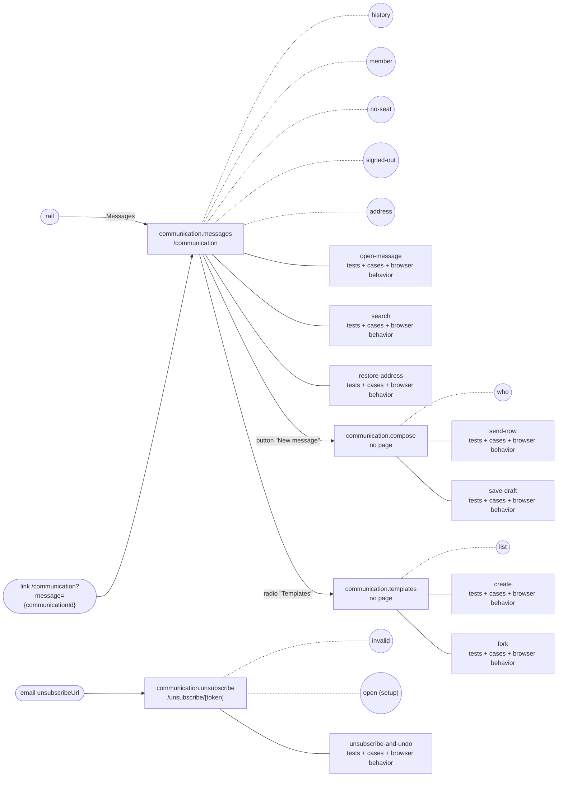

# Feature map: communication

Generated from [`apps/web/src/features/communication/feature-map.json`](../../apps/web/src/features/communication/feature-map.json) by `node tools/ci/feature-maps.ts --write`. Do not edit by hand.
Personas, sign-in and what the checker cannot catch: [README](README.md).



## Surfaces

### communication.messages

Messages: the church's sent and draft email, each message's delivery, and your own address.

- Routes: `/communication`
- Personas: `owner` write, `admin` write, `member` read, `triage` none, `visitor` none
- Catalog: COM-001, COM-002, NTF-011

Reach:

- Rail "Messages" for `owner`, `admin`, `member`
- Link `/communication?message={communicationId}` where `{communicationId}` is the id a message row writes into the address

States:

- **history**: heading "History"; button "New message"; button containing "QA delivery check". As `owner`, on the QA seed:

```bash
agent-browser open "$ORIGIN/communication"
agent-browser wait --load networkidle
agent-browser find role heading text --name "History" --exact
agent-browser find role button text --name "New message" --exact
agent-browser find role button text --name "QA delivery check"
```

- **member**: text "You can read messages. An Owner or Admin writes, schedules, and saves a follow-up."; no button "New message". As `member`, on the QA seed:

```bash
agent-browser open "$ORIGIN/communication"
agent-browser wait --load networkidle
agent-browser find text "You can read messages. An Owner or Admin writes, schedules, and saves a follow-up." text --exact
! agent-browser find role button text --name "New message" --exact
```

- **no-seat**: heading "Messages are not part of your seat". As `triage`, on the QA seed:

```bash
agent-browser open "$ORIGIN/communication"
agent-browser wait --load networkidle
agent-browser find role heading text --name "Messages are not part of your seat" --exact
```

- **signed-out**: URL `/signin?returnTo=%2Fcommunication`. As `visitor`, on the QA seed:

```bash
agent-browser open "$ORIGIN/communication"
agent-browser wait --load networkidle
agent-browser wait --url "**/signin?returnTo=%2Fcommunication"
```

- **address**: heading "Your address"; button "Restore this address". As `admin`, on the QA seed:

```bash
agent-browser open "$ORIGIN/communication?view=address"
agent-browser wait --load networkidle
agent-browser find role heading text --name "Your address" --exact
agent-browser find role button text --name "Restore this address" --exact
```

#### communication.messages#open-message

Choosing a message in History opens its delivery, recipients and preview beside the list.

- Operations: communication.get
- Catalog: COM-001, COM-002
- Cases: CASE-COM-001, CASE-COM-002
- Test: `tests/integration/communication/ui-reads.test.mts`: `AC:CASE-COM-001 history items and detail carry scheduled time, sent time and sender name`
- Test: `tests/integration/communication/history.test.mts`: `AC:CASE-COM-002 AC:CASE-COM-003 detail keeps the sealed delivery address`
- Browser, behavior proof (acts and checks the result), from state history:

```bash
agent-browser find role button click --name "QA delivery check"
agent-browser wait --load networkidle
agent-browser wait --url "**/communication?message=*"
agent-browser find role heading text --name "QA delivery check" --exact
agent-browser find role heading text --name "Recipients" --exact
```

#### communication.messages#search

Searching History by subject or message keeps only the messages that match.

- Operations: communication.list
- Catalog: COM-001
- Cases: CASE-COM-001
- Test: `tests/integration/communication/history.test.mts`: `INV-history-search: history search for an ampersand phrase matches the message body and subject as typed`
- Test: `tests/integration/communication/history.test.mts`: `AC:CASE-COM-001 AC:MAIL51-008 history keeps a zero rate and hides private text`
- Browser, behavior proof (acts and checks the result), from state history:

```bash
agent-browser find label "Subject or message" fill "QA delivery"
agent-browser wait --fn "!document.body.innerText.includes(\"Welcome to Harvest Point\")"
agent-browser find role button text --name "QA delivery check"
```

#### communication.messages#restore-address

An Owner or Admin whose own address bounced restores it with a reason, and Past restores lists it.

- No operation: emailSuppression.requestRestore is implemented as a property of the communication writer (packages/domain/src/communication/writer.ts:350), which the checker does not take for a declaration
- Catalog: IDN-012, NTF-011
- Cases: CASE-NTF-011
- Test: `tests/integration/communication/restores.test.mts`: `AC:CASE-NTF-011 Your address lists each past restore of the viewer's own address, newest first, in fixed statements`
- Browser, behavior proof (acts and checks the result), from state address:

```bash
agent-browser find label "Reason" fill "Map restore check"
agent-browser find role button click --name "Restore this address" --exact
agent-browser wait --load networkidle
agent-browser find text "This address can receive email again. No new email was sent." text --exact
agent-browser find text "Map restore check" text --exact
```

### communication.compose

New message: Who, Write, then Review and send, each step in the address, ending in Send now or a schedule.

- Routes: none
- Endpoints: `/api/dev/outbox`
- Personas: `owner` write, `admin` write, `member` none
- Catalog: COM-003, COM-004, COM-012

Reach:

- From communication.messages as `owner`:

```bash
agent-browser find role button click --name "New message" --exact
agent-browser wait --load networkidle
agent-browser wait --url "**/communication?compose=new&step=who"
```

States:

- **who**: heading "Who is this for?"; combobox "Add a person". As `owner`, on the QA seed:

```bash
agent-browser open "$ORIGIN/communication?compose=new&step=who"
agent-browser wait --load networkidle
agent-browser find role heading text --name "Who is this for?" --exact
agent-browser find role combobox text --name "Add a person" --exact
```

#### communication.compose#send-now

Send now mails each recipient once; the proof slot's capture outbox (/api/dev/outbox) shows the mail.

- Operations: communication.saveDraft, communication.scheduleReviewed
- Catalog: COM-003, COM-004, COM-012
- Cases: CASE-COM-012, CASE-COM-004, CASE-COM-003
- Test: `tests/integration/communication/ui-reads.test.mts`: `AC:CASE-COM-012 the real Send now chain sends once for a double confirm`
- Test: `tests/integration/communication/ui-reads.test.mts`: `AC:CASE-COM-004 recipient search matches word prefixes of the name and the email local part, never the domain`
- Test: `tests/unit/communication/capture.test.mts`: `AC:CASE-COM-003 a development server records each send and calls no provider`
- Browser, behavior proof (acts and checks the result), from state who:

```bash
agent-browser find label "Add a person" fill "Maria"
agent-browser wait --text "Maria Santos"
agent-browser find role option click --name "Maria Santos"
agent-browser wait --load networkidle
agent-browser find role button click --name "Next" --exact
agent-browser wait --load networkidle
agent-browser find label "Subject" fill "Map send check"
agent-browser find label "Message" fill "Hello from the map."
agent-browser find role button click --name "Next" --exact
agent-browser wait --load networkidle
agent-browser find role button click --name "Send now to"
agent-browser wait --load networkidle
agent-browser find role button click --name "Send now" --exact
agent-browser wait --load networkidle
agent-browser wait --url "**/communication?message=*"
agent-browser open "$ORIGIN/api/dev/outbox"
agent-browser wait --load networkidle
agent-browser find role link text --name "Map send check" --exact
```

#### communication.compose#save-draft

Save draft keeps an unsent message; History lists it as a draft to open again.

- Operations: communication.saveDraft, communication.listDrafts
- Catalog: COM-012
- Cases: CASE-COM-012
- Test: `tests/integration/communication/communication.test.mts`: `AC:CASE-COM-012 AC:CASE-COM-003 drafts save and a reviewed schedule stays inside thirty days`
- Test: `tests/integration/communication/communication.test.mts`: `AC:CASE-COM-012 a draft update that leaves out the subject keeps the stored subject; null clears it`
- Browser, behavior proof (acts and checks the result), from state who:

```bash
agent-browser find label "Add a person" fill "Maria"
agent-browser wait --text "Maria Santos"
agent-browser find role option click --name "Maria Santos"
agent-browser wait --load networkidle
agent-browser find role button click --name "Next" --exact
agent-browser wait --load networkidle
agent-browser find label "Subject" fill "Map draft check"
agent-browser find role button click --name "Save draft" --exact
agent-browser wait --load networkidle
agent-browser open "$ORIGIN/communication"
agent-browser wait --load networkidle
agent-browser find role button text --name "Map draft check"
```

### communication.templates

Templates: the seven system emails and the church's own; a system template is forked to change a copy.

- Routes: none
- Personas: `owner` write, `admin` write, `member` read
- Catalog: COM-007

Reach:

- From communication.messages as `owner`:

```bash
agent-browser find role radio click --name "Templates" --exact
agent-browser wait --load networkidle
agent-browser wait --url "**/communication?view=templates"
```

States:

- **list**: heading "System"; heading "Your church"; button "New template". As `owner`, on the QA seed:

```bash
agent-browser open "$ORIGIN/communication?view=templates"
agent-browser wait --load networkidle
agent-browser find role heading text --name "System" --exact
agent-browser find role heading text --name "Your church" --exact
agent-browser find role button text --name "New template" --exact
```

#### communication.templates#create

New template saves a church template that the Your church list then shows.

- Operations: communication.templates.create
- Catalog: COM-007
- Cases: CASE-COM-007
- Test: `tests/integration/communication/communication.test.mts`: `AC:CASE-COM-007 a plant fork replaces one system source and keeps referenced history`
- Browser, behavior proof (acts and checks the result), from state list:

```bash
agent-browser find role button click --name "New template" --exact
agent-browser wait --load networkidle
agent-browser find label "Name" fill "Map welcome"
agent-browser find label "Subject" fill "Welcome from the map"
agent-browser find label "Message" fill "Glad you came."
agent-browser find role button click --name "Save template" --exact
agent-browser wait --load networkidle
agent-browser find role button click --name "Back to templates" --exact
agent-browser wait --load networkidle
agent-browser find role button text --name "Map welcome"
```

#### communication.templates#fork

Fork template makes an editable church copy of a system template.

- Operations: communication.templates.fork
- Catalog: COM-007
- Cases: CASE-COM-007
- Test: `tests/integration/communication/communication.test.mts`: `AC:CASE-COM-007 a plant fork replaces one system source and keeps referenced history`
- Test: `tests/integration/communication/communication.test.mts`: `AC:CASE-COM-007 forking a source whose church fork is archived brings the fork back with its edits`
- Browser, behavior proof (acts and checks the result), from state list:

```bash
agent-browser find role button click --name "System template"
agent-browser wait --load networkidle
agent-browser find role button click --name "Fork template" --exact
agent-browser wait --load networkidle
agent-browser find role button click --name "Back to templates" --exact
agent-browser wait --load networkidle
agent-browser find role button text --name "Church copy"
```

### communication.unsubscribe

The public page a Messages email's Unsubscribe link opens: one button stops that church's email, with an hour to undo.

- Routes: `/unsubscribe/[token]`
- Endpoints: `/unsubscribe/[token]/one-click`
- Personas: `visitor` write, `owner` write
- Catalog: NTF-016

Reach:

- Email `unsubscribeUrl` links to `/unsubscribe/{token}` where `{token}` is the token in the Unsubscribe link of a Messages email

States:

- **invalid**: heading "This link does not work". As `visitor`, on the QA seed:

```bash
agent-browser open "$ORIGIN/unsubscribe/not-a-token"
agent-browser wait --load networkidle
agent-browser find role heading text --name "This link does not work" --exact
```

- **open**: heading containing "Stop email from"; button "Unsubscribe". As `owner`, after the setup steps below, which create what no seed holds:

```bash
agent-browser open "$ORIGIN/communication?compose=new&step=who"
agent-browser wait --load networkidle
agent-browser find label "Add a person" fill "Maria"
agent-browser wait --text "Maria Santos"
agent-browser find role option click --name "Maria Santos"
agent-browser wait --load networkidle
agent-browser find role button click --name "Next" --exact
agent-browser wait --load networkidle
agent-browser find label "Subject" fill "Map unsubscribe check"
agent-browser find label "Message" fill "Hello from the map."
agent-browser find role button click --name "Next" --exact
agent-browser wait --load networkidle
agent-browser find role button click --name "Send now to"
agent-browser wait --load networkidle
agent-browser find role button click --name "Send now" --exact
agent-browser wait --load networkidle
agent-browser wait --url "**/communication?message=*"
agent-browser open "$ORIGIN/api/dev/outbox"
agent-browser wait --load networkidle
agent-browser find role link click --name "Map unsubscribe check" --exact
agent-browser wait --load networkidle
agent-browser find role link click --name "Unsubscribe" --exact
agent-browser wait --load networkidle
agent-browser wait --url "**/unsubscribe/*"
agent-browser find role heading text --name "Stop email from"
agent-browser find role button text --name "Unsubscribe" --exact
```

#### communication.unsubscribe#unsubscribe-and-undo

Unsubscribe stops this church's Messages email to the person, and Undo within the hour takes it back.

- Operations: communication.applyMessagesOptOut, communication.undoMessagesOptOut
- Catalog: NTF-016
- Cases: CASE-NTF-016
- Test: `tests/integration/communication/messages-unsubscribe.test.mts`: `AC:CASE-NTF-016 the page changes nothing until the button; one-click needs its form body; undo works for one hour and is refused after it`
- Test: `tests/integration/communication/messages-unsubscribe.test.mts`: `AC:CASE-NTF-016 a forged, tampered, other-key or wrong-purpose token fails closed and changes nothing`
- Browser, behavior proof (acts and checks the result), from state open:

```bash
agent-browser find role button click --name "Unsubscribe" --exact
agent-browser wait --load networkidle
agent-browser find role heading text --name "You will no longer get email from"
agent-browser find role button click --name "Undo" --exact
agent-browser wait --load networkidle
agent-browser find role heading text --name "You will get email from"
```
