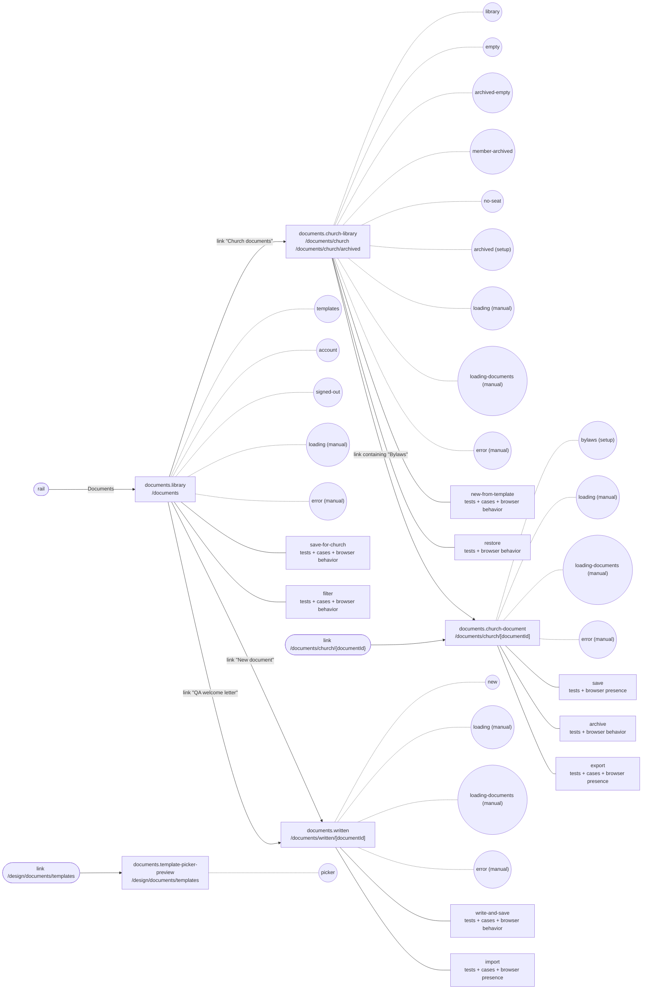

# Feature map: documents

Generated from [`apps/web/src/features/documents/feature-map.json`](../../apps/web/src/features/documents/feature-map.json) by `node tools/ci/feature-maps.ts --write`. Do not edit by hand.
Personas, sign-in and what the checker cannot catch: [README](README.md).



## Surfaces

### documents.library

Documents: fill a template and download or save it, and open what was written for the church or for you.

- Routes: `/documents`
- Endpoints: `/documents/preview`
- Personas: `owner` write, `admin` write, `member` write, `resident` write, `signup` write, `triage` write, `visitor` none
- Catalog: DOC-001, DOC-002, DOC-003, DOC-016
- Polls: the template list keeps fetching PDF page previews, so the page never goes network-idle. No network-idle wait here: each step waits on the check after it.

Reach:

- Rail "Documents" for `owner`, `admin`, `member`, `resident`, `signup`, `triage`

States:

- **templates**: text containing "QA welcome letter"; button "Save for your church"; link "QA welcome letter"; link "Church documents". As `owner`, on the QA seed:

```bash
agent-browser open "$ORIGIN/documents"
agent-browser wait --text "QA welcome letter"
agent-browser find role button text --name "Save for your church" --exact
agent-browser find role link text --name "QA welcome letter" --exact
agent-browser find role link text --name "Church documents" --exact
```

- **account**: text containing "Your documents"; link "New document"; no button "Save for your church"; no link "Church documents". As `resident`, on the QA seed:

```bash
agent-browser open "$ORIGIN/documents"
agent-browser wait --text "Your documents"
agent-browser find role link text --name "New document" --exact
! agent-browser find role button text --name "Save for your church" --exact
! agent-browser find role link text --name "Church documents" --exact
```

- **signed-out**: URL `/signin?returnTo=%2Fdocuments`. As `visitor`, on the QA seed:

```bash
agent-browser open "$ORIGIN/documents"
agent-browser wait --url "**/signin?returnTo=%2Fdocuments"
```

- **loading** (`loading.tsx`): text "Loading documents". Not scripted: shows only while the server renders the page.
- **error** (`error.tsx`): heading "We could not load documents"; button "Try again". Not scripted: renders only when the page throws while rendering.

#### documents.library#save-for-church

Save for your church keeps the filled template as a saved file in Saved for your church.

- Operations: documents.generate
- Catalog: DOC-002, DOC-003
- Cases: CASE-DOC-003
- Test: `tests/integration/documents/church.test.mts`: `AC:DOC-003 Save for your church makes one saved file of each text template and no Church Document`
- Test: `tests/integration/documents/owned.test.mts`: `AC:CASE-DOC-003 AC:CASE-DOC-015 AC:PROVIDER48-002 AC:PROVIDER48-003 AC:TEN-004 saved renders match the preview and keep a private key`
- Browser, behavior proof (acts and checks the result), from state templates:

```bash
agent-browser find role button click --name "Save for your church" --exact
agent-browser wait --fn "!document.body.innerText.includes(\"Nothing saved for your church yet.\")"
agent-browser wait --text "for your church."
```

#### documents.library#filter

The Category choice narrows the template list to that kind of template; Administrative keeps Bylaws and Budget Worksheet and drops the Vision meeting templates. The narrowing runs in the page, and no test covers it; the test proves the list it narrows.

- Operations: documents.templates.list
- Catalog: DOC-001
- Cases: CASE-DOC-001
- Test: `tests/integration/documents/documents.test.mts`: `AC:CASE-DOC-001 the library lists 13 templates and 13 formats, and a retired id does not resolve`
- Browser, behavior proof (acts and checks the result), from state templates:

```bash
agent-browser find role radio click --name "Administrative" --exact
agent-browser wait --fn "!document.body.innerText.includes(\"Guest Sign-in Sheet\")"
agent-browser wait --fn "!document.body.innerText.includes(\"Vision Meeting Agenda\")"
agent-browser wait --text "Budget Worksheet"
agent-browser find role button text --name "Bylaws" --exact
agent-browser find role button text --name "Budget Worksheet" --exact
```

### documents.church-library

Church documents: the church plant's own editable copies of templates, and the archived ones.

- Routes: `/documents/church`, `/documents/church/archived`
- Personas: `owner` write, `admin` write, `member` read, `resident` none
- Catalog: DOC-022

Reach:

- From documents.library as `owner`:

```bash
agent-browser find role link click --name "Church documents" --exact
agent-browser wait --load networkidle
agent-browser wait --url "**/documents/church"
```

States:

- **library**: heading "Church documents"; button "New from template"; link "Archived documents". As `owner`, on the QA seed:

```bash
agent-browser open "$ORIGIN/documents/church"
agent-browser wait --load networkidle
agent-browser find role heading text --name "Church documents" --exact
agent-browser find role button text --name "New from template" --exact
agent-browser find role link text --name "Archived documents" --exact
```

- **empty**: heading "No church documents yet"; button "New from template". As `owner`, on the QA seed:

```bash
agent-browser open "$ORIGIN/documents/church"
agent-browser wait --load networkidle
agent-browser find role heading text --name "No church documents yet" --exact
agent-browser find role button text --name "New from template" --exact
```

- **archived-empty**: heading "No archived documents"; link "Back to Church documents". As `owner`, on the QA seed:

```bash
agent-browser open "$ORIGIN/documents/church/archived"
agent-browser wait --load networkidle
agent-browser find role heading text --name "No archived documents" --exact
agent-browser find role link text --name "Back to Church documents" --exact
```

- **member-archived**: heading "This page is not available". As `member`, on the QA seed:

```bash
agent-browser open "$ORIGIN/documents/church/archived"
agent-browser wait --load networkidle
agent-browser find role heading text --name "This page is not available" --exact
```

- **no-seat**: heading "Church documents need a church plant seat". As `resident`, on the QA seed:

```bash
agent-browser open "$ORIGIN/documents/church"
agent-browser wait --load networkidle
agent-browser find role heading text --name "Church documents need a church plant seat" --exact
```

- **archived**: heading "Archived documents"; button containing "Restore". As `owner`, after the setup steps below, which create what no seed holds:

```bash
agent-browser open "$ORIGIN/documents/church"
agent-browser wait --load networkidle
agent-browser find role button click --name "New from template" --exact
agent-browser wait --load networkidle
agent-browser find role button click --name "Bylaws"
agent-browser wait --load networkidle
agent-browser wait --url "**/documents/church/*"
agent-browser find role button click --name "Archive" --exact
agent-browser wait --load networkidle
agent-browser find role button click --name "Archive document" --exact
agent-browser wait --load networkidle
agent-browser wait --url "**/documents/church?archived=1"
agent-browser open "$ORIGIN/documents/church/archived"
agent-browser wait --load networkidle
agent-browser find role heading text --name "Archived documents" --exact
agent-browser find role button text --name "Restore"
```

- **loading** (`loading.tsx`): status "Loading". Not scripted: shows only while the server renders the page.
- **loading-documents** (`loading.tsx`): text "Loading documents". Not scripted: the Documents loading screen, shown while a page under /documents renders and no nearer loading screen applies.
- **error** (`error.tsx`): heading "We could not load documents". Not scripted: renders only when the page throws while rendering.

#### documents.church-library#new-from-template

New from template makes the church plant's own editable copy and opens it.

- Operations: documents.createFromTemplate
- Catalog: DOC-022
- Cases: CASE-DOC-022
- Test: `tests/integration/documents/church.test.mts`: `AC:CASE-DOC-022 New from template forks the policy, records its origin and freezes the church and brand kit values`
- Browser, behavior proof (acts and checks the result), from state library:

```bash
agent-browser find role button click --name "New from template" --exact
agent-browser wait --load networkidle
agent-browser find role button click --name "Bylaws"
agent-browser wait --load networkidle
agent-browser wait --url "**/documents/church/*"
agent-browser find role heading text --name "Bylaws" --exact
agent-browser find role button text --name "Download PDF" --exact
```

#### documents.church-library#restore

Restore puts an archived document back in the library, editable again.

- Operations: documents.restoreChurch
- Catalog: DOC-022
- Test: `tests/integration/documents/church-restore.test.mts`: `AC:DOC-016 only an Owner or Admin restores, only an archived document, once, with one audit row`
- Test: `tests/integration/documents/church-restore.test.mts`: `AC:DOC-023 revisions and saved exports are unchanged by archive and restore, and the document is live again`
- Browser, behavior proof (acts and checks the result), from state archived:

```bash
agent-browser find role button click --name "Restore"
agent-browser wait --load networkidle
agent-browser find role button click --name "Restore document" --exact
agent-browser wait --load networkidle
agent-browser wait --url "**/documents/church?restored=1"
agent-browser find text "The document was restored. It is back in the library and can be edited again." text --exact
agent-browser find role link text --name "Bylaws"
```

### documents.church-document

One church document: edit it, see its revisions, download it as PDF or Word, archive or delete it.

- Routes: `/documents/church/[documentId]`
- Endpoints: `/documents/church/[documentId]/exports`, `/documents/church/[documentId]/exports/[exportId]`, `/documents/church/[documentId]/file`
- Personas: `owner` write, `admin` write, `member` read
- Catalog: DOC-022, DOC-023

Reach:

- From documents.church-library as `owner`:

```bash
agent-browser find role link click --name "Bylaws"
agent-browser wait --load networkidle
agent-browser wait --url "**/documents/church/*"
```

- Link `/documents/church/{documentId}` where `{documentId}` is the id in a church document's link

States:

- **bylaws**: heading "Bylaws"; button "Download PDF"; button "Download Word"; heading "Revisions". As `owner`, after the setup steps below, which create what no seed holds:

```bash
agent-browser open "$ORIGIN/documents/church"
agent-browser wait --load networkidle
agent-browser find role button click --name "New from template" --exact
agent-browser wait --load networkidle
agent-browser find role button click --name "Bylaws"
agent-browser wait --load networkidle
agent-browser wait --url "**/documents/church/*"
agent-browser find role heading text --name "Bylaws" --exact
agent-browser find role button text --name "Download PDF" --exact
agent-browser find role button text --name "Download Word" --exact
agent-browser find role heading text --name "Revisions" --exact
```

- **loading** (`loading.tsx`): status "Loading". Not scripted: shows only while the server renders the page.
- **loading-documents** (`loading.tsx`): text "Loading documents". Not scripted: the Documents loading screen, shown while a page under /documents renders and no nearer loading screen applies.
- **error** (`error.tsx`): heading "We could not load documents". Not scripted: renders only when the page throws while rendering.

#### documents.church-document#save

Save stores the body as a new revision, listed first under Revisions with the time and who saved it.

- Operations: documents.saveNative
- Catalog: DOC-016, DOC-022
- Test: `tests/integration/documents/church.test.mts`: `AC:DOC-016 a body the editor builds saves as one revision; a Member's save writes nothing`
- Browser, presence proof only (the control is there; the tests prove the outcome), from state bylaws:

```bash
agent-browser find role button text --name "Save" --exact
agent-browser find role list text --name "Revisions, newest first" --exact
```

#### documents.church-document#archive

Archive takes the document out of the library; its revisions and saved exports stay readable.

- No operation: the church archive write it calls has no catalog entry; documents.archive in the catalog archives a written document
- Catalog: DOC-022
- Test: `tests/integration/documents/church-archive.test.mts`: `AC:DOC-022 an archived document leaves the library for every seat and every write refuses it`
- Browser, behavior proof (acts and checks the result), from state bylaws:

```bash
agent-browser find role button click --name "Archive" --exact
agent-browser wait --load networkidle
agent-browser find role button click --name "Archive document" --exact
agent-browser wait --load networkidle
agent-browser wait --url "**/documents/church?archived=1"
agent-browser find text "The document was archived. Its revisions and saved exports stay available." text --exact
```

#### documents.church-document#export

Download PDF and Download Word export the current revision; the preview, the download and the saved export are the same bytes.

- Operations: documents.exportNative
- Catalog: DOC-023
- Cases: CASE-DOC-023
- Test: `tests/integration/documents/church.test.mts`: `AC:CASE-DOC-023 the preview, Download PDF and the saved export of one revision have the same sha256`
- Browser, presence proof only (the control is there; the tests prove the outcome), from state bylaws:

```bash
agent-browser find role button text --name "Download PDF" --exact
agent-browser find role button text --name "Download Word" --exact
```

### documents.written

A written document: write or import text, save it, and use it for the church.

- Routes: `/documents/written/[documentId]`
- Endpoints: `/documents/written/import`
- Personas: `owner` write, `admin` write, `member` read, `resident` write, `signup` write, `triage` write
- Catalog: DOC-016

Reach:

- From documents.library as `resident`:

```bash
agent-browser find role link click --name "New document" --exact
agent-browser wait --load networkidle
agent-browser wait --url "**/documents/written/new"
```

- From documents.library as `owner`:

```bash
agent-browser find role link click --name "QA welcome letter" --exact
agent-browser wait --load networkidle
agent-browser wait --url "**/documents/written/*"
```

States:

- **new**: heading "New document"; textbox "Title"; button "Import a text or Word file". As `resident`, on the QA seed:

```bash
agent-browser open "$ORIGIN/documents/written/new"
agent-browser wait --load networkidle
agent-browser find role heading text --name "New document" --exact
agent-browser find role textbox text --name "Title" --exact
agent-browser find role button text --name "Import a text or Word file" --exact
```

- **loading** (`loading.tsx`): status "Loading". Not scripted: shows only while the server renders the page.
- **loading-documents** (`loading.tsx`): text "Loading documents". Not scripted: the Documents loading screen, shown while a page under /documents renders and no nearer loading screen applies.
- **error** (`error.tsx`): heading "We could not load documents". Not scripted: renders only when the page throws while rendering.

#### documents.written#write-and-save

Save stores a new document under its own address with its title.

- Operations: documents.saveNative
- Catalog: DOC-016
- Cases: CASE-DOC-016
- Test: `tests/integration/documents/owned.test.mts`: `AC:CASE-DOC-016 INV-documents: a native body is checked at the boundary, old text opens intact, and Use for this church writes one copy`
- Browser, behavior proof (acts and checks the result), from state new:

```bash
agent-browser find label "Title" fill "Map residency notes"
agent-browser find label "Document text" fill "Notes from the map."
agent-browser find role button click --name "Save" --exact
agent-browser wait --load networkidle
agent-browser wait --url "**/documents/written/*"
agent-browser find role heading text --name "Map residency notes" --exact
agent-browser find role button text --name "More actions" --exact
```

#### documents.written#import

Import a text or Word file turns a UTF-8 text or modern Word file into the document's text, keeping headings, lists, links and tables, and refuses unsafe or oversized files. The tests prove the import; the browser proof shows the control.

- Operations: documents.importTextOrWord
- Catalog: DOC-016
- Cases: CASE-DOC-016
- Test: `tests/integration/documents/owned.test.mts`: `AC:CASE-DOC-016 AC:SCHEMA-008 AC:WIKI52-003 one owner, unsafe imports stay out, and the church copy survives purge`
- Test: `tests/integration/documents/owned.test.mts`: `AC:CASE-DOC-016 a Word entry that declares 10 bytes and inflates past 40 MiB is refused without inflating past its declared size`
- Test: `tests/integration/documents/owned.test.mts`: `AC:CASE-DOC-016 a Word file keeps its headings, lists and links as native nodes`
- Test: `tests/integration/documents/owned.test.mts`: `AC:CASE-DOC-016: a Word table imports as a native table of text columns`
- Browser, presence proof only (the control is there; the tests prove the outcome), from state new:

```bash
agent-browser find role button text --name "Import a text or Word file" --exact
```

### documents.template-picker-preview

A design preview of New from template with 60 invented templates, to check search and paging. No database; production returns 404.

- Routes: `/design/documents/templates`
- Personas: `visitor` read, `owner` read

Reach:

- Link `/design/documents/templates`

States:

- **picker**: searchbox "Search templates"; button containing "Volunteer Application"; button "Next page". As `visitor`, on the QA seed:

```bash
agent-browser open "$ORIGIN/design/documents/templates"
agent-browser wait --load networkidle
agent-browser find role button click --name "New from template" --exact
agent-browser wait --load networkidle
agent-browser find role searchbox text --name "Search templates" --exact
agent-browser find role button text --name "Volunteer Application"
agent-browser find role button text --name "Next page" --exact
```

