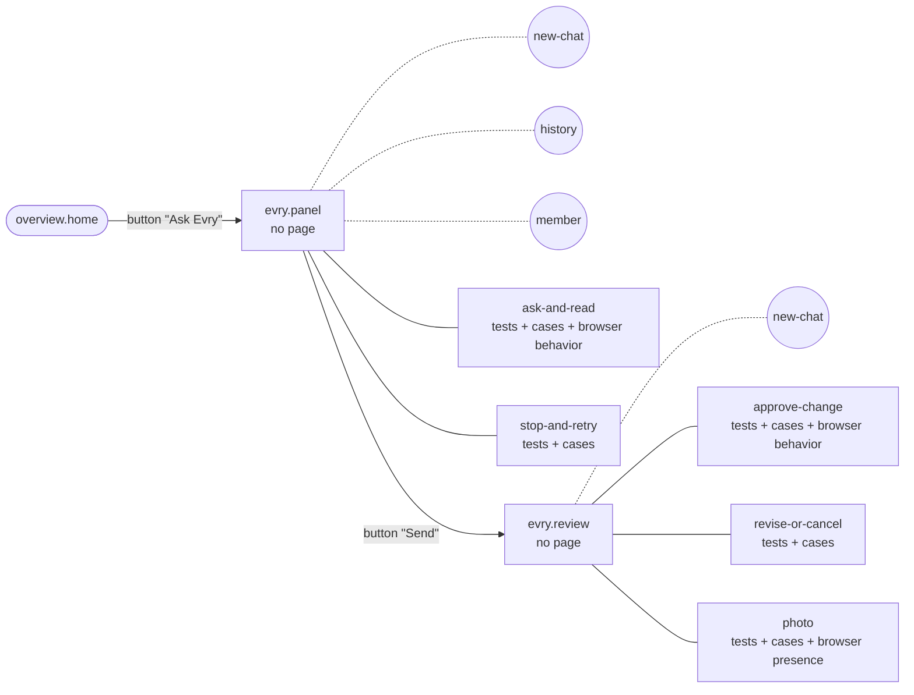

# Feature map: evry

Generated from [`apps/web/src/features/evry/feature-map.json`](../../apps/web/src/features/evry/feature-map.json) by `node tools/ci/feature-maps.ts --write`. Do not edit by hand.
Personas, sign-in and what the checker cannot catch: [README](README.md).



## Surfaces

### evry.panel

The Evry panel the Ask Evry button opens beside any page: ask in words and see what Evry read as cards of linked rows. Each person has their own conversations. The catalog endpoint is listed for completeness: nothing in the app calls it, so no step reaches it.

- Routes: none
- Endpoints: `/api/evry/catalog`, `/api/evry/open`, `/api/evry/conversations`, `/api/evry/conversations/[id]`, `/api/evry/conversations/[id]/turns`, `/api/evry/conversations/[id]/stream`, `/api/evry/conversations/[id]/cancel`, `/api/evry/conversations/[id]/retry`, `/api/evry/photos`
- Personas: `owner` write, `member` write, `network` write, `visitor` none
- Catalog: EVR-003, EVR-005, EVR-008, EVR-021, EVR-029

Reach:

- From overview.home as `owner`:

```bash
agent-browser find role button click --name "Ask Evry" --exact
agent-browser wait --load networkidle
```

States:

- **new-chat**: heading "Ask Evry"; button "List the people in this church"; textbox "Message Evry". As `owner`, on the QA seed:

```bash
agent-browser open "$ORIGIN/overview"
agent-browser wait --load networkidle
agent-browser find role button click --name "Ask Evry" --exact
agent-browser wait --load networkidle
agent-browser find role button click --name "History" --exact
agent-browser wait --load networkidle
agent-browser find role button click --name "New chat" --exact
agent-browser wait --load networkidle
agent-browser find role heading text --name "Ask Evry" --exact
agent-browser find role button text --name "List the people in this church" --exact
agent-browser find role textbox text --name "Message Evry" --exact
```

- **history**: heading "History"; searchbox "Search conversations"; button "New chat". As `owner`, on the QA seed:

```bash
agent-browser open "$ORIGIN/overview"
agent-browser wait --load networkidle
agent-browser find role button click --name "Ask Evry" --exact
agent-browser wait --load networkidle
agent-browser find role button click --name "History" --exact
agent-browser wait --load networkidle
agent-browser find role heading text --name "History" --exact
agent-browser find role searchbox text --name "Search conversations" --exact
agent-browser find role button text --name "New chat" --exact
```

- **member**: textbox "Message Evry". As `member`, on the QA seed:

```bash
agent-browser open "$ORIGIN/overview"
agent-browser wait --load networkidle
agent-browser find role button click --name "Ask Evry" --exact
agent-browser wait --load networkidle
agent-browser find role textbox text --name "Message Evry" --exact
```

#### evry.panel#ask-and-read

A question runs one turn in the signed-in person's own conversation; what Evry read comes back as a card of linked rows from this church only.

- Operations: evry.submitTurn, evry.invokeRead
- Catalog: EVR-003, EVR-005, EVR-008
- Cases: UI45-001
- Test: `tests/evry/runtime/conversations.test.mts`: `AC:UI45-001 AC:UI45-002 AC:INH-REGRESSION-SESSION-NAVIGATION AC:EVRY-RETRY-CANCEL AC:INH-CROSS-08 one private conversation, one turn per request key, one active run, cancel and explicit retry`
- Test: `tests/evry/runtime/conversations.test.mts`: `AC:INH-REGRESSION-FOREIGN-SESSION AC:TEN-002 AC:SEC-02 AC:UI45-006 INV-tenancy: another account or context cannot read, stream, append, cancel or continue a conversation`
- Browser, behavior proof (acts and checks the result), from state new-chat:

```bash
agent-browser find role button click --name "List the people in this church" --exact
agent-browser wait --load networkidle
agent-browser find role region text --name "People"
! agent-browser find role heading text --name "Ask Evry" --exact
```

#### evry.panel#stop-and-retry

Stop ends a running turn and keeps what was written; Try again reruns only the last turn that did not finish, and a change that did not confirm can be retried once.

- Operations: evry.cancelTurn, evry.retryTurn, evry.retryUnresolvedEffects
- Catalog: EVR-013, EVR-021, EVR-029
- Cases: EVRY-RETRY-CANCEL
- Test: `tests/evry/runtime/conversations.test.mts`: `AC:UI45-001 AC:UI45-002 AC:INH-REGRESSION-SESSION-NAVIGATION AC:EVRY-RETRY-CANCEL AC:INH-CROSS-08 one private conversation, one turn per request key, one active run, cancel and explicit retry`
- Test: `tests/evry/runtime/streaming.test.mts`: `INV-stream-stop INV-stream-end: Stop keeps the partial text and ends the stream promptly`
- Test: `tests/evry/execution/proposals.test.mts`: `INV-effect-recovery: an approved effect that no worker took within 60 s reads as unconfirmed, not as saving; Try again's job is claimed first and runs it once`

### evry.review

A change Evry prepared, shown in the panel as Review before saving with the exact old and new values: Approve runs it once, Revise replaces it, Cancel ends it. Nothing changes until you approve.

- Routes: none
- Endpoints: `/api/evry/proposals/[id]`, `/api/evry/proposals/[id]/approve`, `/api/evry/proposals/[id]/revise`, `/api/evry/proposals/[id]/cancel`, `/api/evry/proposals/[id]/check`, `/api/evry/proposals/[id]/retry`, `/api/evry/proposals/[id]/photo`
- Personas: `owner` write, `member` write, `network` write, `visitor` none
- Catalog: EVR-011, EVR-012, EVR-013, EVR-014, EVR-025

Reach:

- From evry.panel as `owner`:

```bash
agent-browser find label "Message Evry" fill "Change Maria's city to Dallas"
agent-browser find role button click --name "Send" --exact
agent-browser wait --load networkidle
```

States:

- **new-chat**: heading "Ask Evry"; button "List the people in this church"; textbox "Message Evry". As `owner`, on the QA seed:

```bash
agent-browser open "$ORIGIN/overview"
agent-browser wait --load networkidle
agent-browser find role button click --name "Ask Evry" --exact
agent-browser wait --load networkidle
agent-browser find role button click --name "History" --exact
agent-browser wait --load networkidle
agent-browser find role button click --name "New chat" --exact
agent-browser wait --load networkidle
agent-browser find role heading text --name "Ask Evry" --exact
agent-browser find role button text --name "List the people in this church" --exact
agent-browser find role textbox text --name "Message Evry" --exact
```

#### evry.review#approve-change

A change Evry prepares shows as Review before saving with the exact old and new values; Approve runs it once and the page it changed shows the new value.

- Operations: evry.approveProposal, evry.executeProposal
- Catalog: EVR-012, EVR-013, EVR-014
- Cases: UI45-004
- Test: `tests/evry/execution/proposals.test.mts`: `AC:UI45-004 AC:UI45-003 AC:INH-REGRESSION-REVISED-APPROVAL AC:INH-REGRESSION-TEMPLATE-EDIT AC:INH-REGRESSION-CONFIRM-REPLAY AC:UI45-005 AC:AUDIT-002 INV-budget: nothing changes until the exact current revision is approved; then the change runs once with its own audit row`
- Test: `tests/ui/evry/review.test.mjs`: `AC:INH-REGRESSION-CONFIRM-REPLAY INV-approve-runs-once: a first approval saves its change without any other request; its replay saves nothing again`
- Browser, behavior proof (acts and checks the result), from state new-chat:

```bash
agent-browser find label "Message Evry" fill "Change Maria's city to Dallas"
agent-browser find role button click --name "Send" --exact
agent-browser wait --load networkidle
agent-browser find role heading text --name "Review before saving" --exact
agent-browser find role button click --name "Approve" --exact
agent-browser wait --load networkidle
agent-browser find text "Approved by you" text --exact
agent-browser open "$ORIGIN/people"
agent-browser wait --load networkidle
agent-browser find role link click --name "Maria Santos" --exact
agent-browser wait --load networkidle
agent-browser find text "Dallas" text --exact
```

#### evry.review#revise-or-cancel

Revise replaces the prepared change and voids the earlier approval; Cancel ends it with nothing saved.

- Operations: evry.reviseProposal, evry.cancelProposal
- Catalog: EVR-011, EVR-012
- Cases: UI45-002
- Test: `tests/ui/evry/review.test.mjs`: `AC:UI45-002 AC:INH-REGRESSION-CONFIRM-REPLAY INV-lost-approval: a revised change saves once (${engine})`
- Test: `tests/evry/execution/proposals.test.mts`: `AC:UI45-004 AC:UI45-003 AC:INH-REGRESSION-REVISED-APPROVAL AC:INH-REGRESSION-TEMPLATE-EDIT AC:INH-REGRESSION-CONFIRM-REPLAY AC:UI45-005 AC:AUDIT-002 INV-budget: nothing changes until the exact current revision is approved; then the change runs once with its own audit row`
- Test: `tests/evry/execution/proposals.test.mts`: `AC:INH-REGRESSION-EXPIRED-APPROVAL AC:UI45-004 AC:SEC-12 an approval at or after expiry, even one that lapses while the effect waits, or a cancelled one, starts nothing`

#### evry.review#photo

A photo attached in the panel is staged privately for one proposal; only its owner sees it while the review lasts, and approval needs it.

- No operation: the panel stages the photo through the Settings avatar upload (conversation/photoActions.ts) and the review card reads it back from packages/evry/src/proposals/store.ts; neither is an Evry catalog operation
- Catalog: EVR-025
- Cases: UI45-003
- Test: `tests/evry/adapters/people/commands/commands.test.mts`: `AC:UI45-003 a photo proposal's owner sees the exact staged upload while the review lasts; approval needs it`
- Browser, presence proof only (the control is there; the tests prove the outcome), from state new-chat:

```bash
agent-browser find role button text --name "Attach a photo" --exact
```
