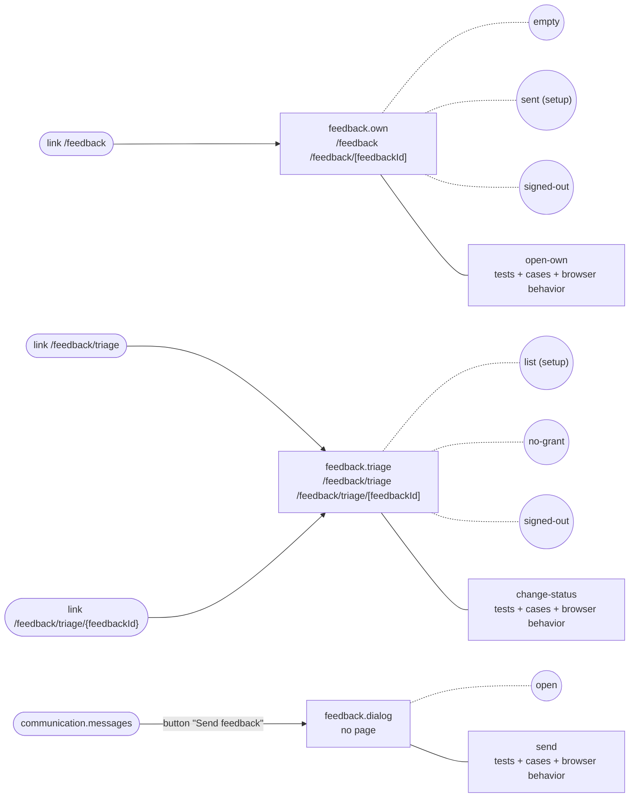

# Feature map: feedback

Generated from [`apps/web/src/features/feedback/feature-map.json`](../../apps/web/src/features/feedback/feature-map.json) by `node tools/ci/feature-maps.ts --write`. Do not edit by hand.
Personas, sign-in and what the checker cannot catch: [README](README.md).



## Surfaces

### feedback.dialog

Send feedback, from every signed-in page: a type and what would make it better, saved with the page it came from.

- Routes: none
- Personas: `owner` write, `admin` write, `member` write, `resident` write, `signup` write, `triage` write, `network` write
- Catalog: ADM-001

Reach:

- From communication.messages as `owner`:

```bash
agent-browser find role button click --name "Send feedback" --exact
agent-browser wait --load networkidle
agent-browser find role dialog text --name "Send feedback" --exact
```

States:

- **open**: dialog "Send feedback"; radio "Idea"; textbox "What would make this better?". As `owner`, on the QA seed:

```bash
agent-browser open "$ORIGIN/feedback"
agent-browser wait --load networkidle
agent-browser find role button click --name "Send feedback" --exact
agent-browser wait --load networkidle
agent-browser find role dialog text --name "Send feedback" --exact
agent-browser find role radio text --name "Idea" --exact
agent-browser find role textbox text --name "What would make this better?" --exact
```

#### feedback.dialog#send

Send saves the feedback as the author's own; Sent feedback then lists it.

- Operations: feedback.submit, feedback.listOwn
- Catalog: ADM-001
- Cases: CASE-ADM-001
- Test: `tests/integration/feedback/feedback.test.mts`: `AC:CASE-ADM-001 the dialog saves its details, takes church and role from the seat, strips the address and saves a resend once`
- Test: `tests/integration/feedback/feedback.test.mts`: `AC:CASE-ADM-001 AC:PUB57-002 INV-privacy: the author lists only their own feedback, 25 at a time, without private details`
- Browser, behavior proof (acts and checks the result), from state open:

```bash
agent-browser find label "What would make this better?" fill "Map feedback idea"
agent-browser find role button click --name "Send" --exact
agent-browser wait --load networkidle
agent-browser find role heading text --name "Thank you"
agent-browser find role button click --name "Done" --exact
agent-browser wait --load networkidle
agent-browser open "$ORIGIN/feedback"
agent-browser wait --load networkidle
agent-browser find role link text --name "Idea" --exact
! agent-browser find role heading text --name "You have not sent feedback yet" --exact
```

### feedback.own

Sent feedback: what you sent with Send feedback and where each one stands.

- Routes: `/feedback`, `/feedback/[feedbackId]`
- Personas: `owner` read, `admin` read, `member` read, `resident` read, `signup` read, `triage` read, `network` read, `visitor` none
- Catalog: ADM-001

Reach:

- Link `/feedback`

States:

- **empty**: heading "Sent feedback"; heading "You have not sent feedback yet". As `owner`, on the QA seed:

```bash
agent-browser open "$ORIGIN/feedback"
agent-browser wait --load networkidle
agent-browser find role heading text --name "Sent feedback" --exact
agent-browser find role heading text --name "You have not sent feedback yet" --exact
```

- **sent**: heading "Sent feedback"; link "Idea". As `member`, after the setup steps below, which create what no seed holds:

```bash
agent-browser open "$ORIGIN/feedback"
agent-browser wait --load networkidle
agent-browser find role button click --name "Send feedback" --exact
agent-browser wait --load networkidle
agent-browser find label "What would make this better?" fill "Map member idea"
agent-browser find role button click --name "Send" --exact
agent-browser wait --load networkidle
agent-browser find role heading text --name "Thank you"
agent-browser find role button click --name "Done" --exact
agent-browser wait --load networkidle
agent-browser open "$ORIGIN/feedback"
agent-browser wait --load networkidle
agent-browser find role heading text --name "Sent feedback" --exact
agent-browser find role link text --name "Idea" --exact
```

- **signed-out**: URL `/signin?returnTo=%2Ffeedback`. As `visitor`, on the QA seed:

```bash
agent-browser open "$ORIGIN/feedback"
agent-browser wait --load networkidle
agent-browser wait --url "**/signin?returnTo=%2Ffeedback"
```

#### feedback.own#open-own

Opening one shows its type, when it was sent, its status and its public issue, without the private details.

- Operations: feedback.getOwnStatus
- Catalog: ADM-001
- Cases: CASE-ADM-001
- Test: `tests/integration/feedback/feedback.test.mts`: `AC:CASE-ADM-001 AC:PUB57-002 INV-privacy: the author lists only their own feedback, 25 at a time, without private details`
- Browser, behavior proof (acts and checks the result), from state sent:

```bash
agent-browser find role link click --name "Idea" --exact
agent-browser wait --load networkidle
agent-browser wait --url "**/feedback/*"
agent-browser find role heading text --name "Feedback" --exact
agent-browser find role link text --name "Sent feedback" --exact
agent-browser find text "None yet" text --exact
```

### feedback.triage

Feedback triage: everyone's feedback, filtered by status and type, for an account with the triage grant.

- Routes: `/feedback/triage`, `/feedback/triage/[feedbackId]`
- Personas: `triage` write, `owner` none, `visitor` none
- Catalog: ADM-002

Reach:

- Link `/feedback/triage`
- Link `/feedback/triage/{feedbackId}` where `{feedbackId}` is the id in a triage row's link

States:

- **list**: heading "Feedback triage"; radiogroup "Status"; link containing "Map triage idea". As `triage`, after the setup steps below, which create what no seed holds:

```bash
agent-browser open "$ORIGIN/feedback"
agent-browser wait --load networkidle
agent-browser find role button click --name "Send feedback" --exact
agent-browser wait --load networkidle
agent-browser find label "What would make this better?" fill "Map triage idea"
agent-browser find role button click --name "Send" --exact
agent-browser wait --load networkidle
agent-browser find role heading text --name "Thank you"
agent-browser find role button click --name "Done" --exact
agent-browser wait --load networkidle
agent-browser open "$ORIGIN/feedback/triage"
agent-browser wait --load networkidle
agent-browser find role heading text --name "Feedback triage" --exact
agent-browser find role radiogroup text --name "Status" --exact
agent-browser find role link text --name "Map triage idea"
```

- **no-grant**: heading "Feedback triage needs a triage grant". As `owner`, on the QA seed:

```bash
agent-browser open "$ORIGIN/feedback/triage"
agent-browser wait --load networkidle
agent-browser find role heading text --name "Feedback triage needs a triage grant" --exact
```

- **signed-out**: URL `/signin?returnTo=%2Ffeedback%2Ftriage`. As `visitor`, on the QA seed:

```bash
agent-browser open "$ORIGIN/feedback/triage"
agent-browser wait --load networkidle
agent-browser wait --url "**/signin?returnTo=%2Ffeedback%2Ftriage"
```

#### feedback.triage#change-status

A triager moves feedback to Reviewed, Resolved or Dismissed, and History names each move.

- No operation: feedback.admin.changeStatus, its catalog name, is not quoted or declared in code
- Catalog: ADM-002
- Cases: CASE-ADM-002
- Test: `tests/integration/feedback/feedback.test.mts`: `AC:CASE-ADM-002 AC:PUB57-002 a triager filters, moves a status with history, and never overwrites a newer change`
- Test: `tests/integration/feedback/feedback.test.mts`: `AC:CASE-ADM-002 INV-privacy: an Owner without a current triage grant reads and changes no one's feedback`
- Browser, behavior proof (acts and checks the result), from state list:

```bash
agent-browser find role link click --name "Map triage idea"
agent-browser wait --load networkidle
agent-browser wait --url "**/feedback/triage/*"
agent-browser find role radio click --name "Reviewed" --exact
agent-browser wait --load networkidle
agent-browser wait --fn "!document.body.innerText.includes(\"No status changes yet. It arrived as New.\")"
agent-browser open "$ORIGIN/feedback/triage?status=reviewed"
agent-browser wait --load networkidle
agent-browser find role link text --name "Map triage idea"
```
