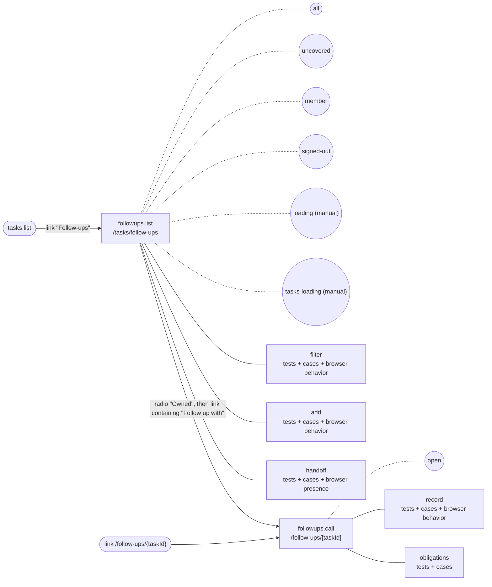

# Feature map: followups

Generated from [`apps/web/src/features/followups/feature-map.json`](../../apps/web/src/features/followups/feature-map.json) by `node tools/ci/feature-maps.ts --write`. Do not edit by hand.
Personas, sign-in and what the checker cannot catch: [README](README.md).



## Surfaces

### followups.list

Who reaches out to whom: every contact with its follow-up and owners, the ones with none, and a handoff when an owner leaves.

- Routes: `/tasks/follow-ups`
- Endpoints: `/follow-ups/read`
- Personas: `owner` write, `admin` write, `member` read, `visitor` none
- Catalog: TSK-012, TSK-013, PPL-022

Reach:

- From tasks.list as `owner`:

```bash
agent-browser find role link click --name "Follow-ups" --exact
agent-browser wait --load networkidle
agent-browser wait --url "**/tasks/follow-ups"
```

States:

- **all**: heading "Follow-ups"; button "Hand off follow-ups"; link "James Okafor". As `owner`, on the QA seed:

```bash
agent-browser open "$ORIGIN/tasks/follow-ups"
agent-browser wait --load networkidle
agent-browser find role heading text --name "Follow-ups" --exact
agent-browser find role button text --name "Hand off follow-ups" --exact
agent-browser find role link text --name "James Okafor" --exact
```

- **uncovered**: link "David Kim"; button "Add follow-up"; no link "James Okafor". As `owner`, on the QA seed:

```bash
agent-browser open "$ORIGIN/tasks/follow-ups?show=uncovered"
agent-browser wait --load networkidle
agent-browser find role link text --name "David Kim" --exact
agent-browser find role button text --name "Add follow-up" --exact
! agent-browser find role link text --name "James Okafor" --exact
```

- **member**: heading "Your follow-ups"; no text "Hand off follow-ups". As `member`, on the QA seed:

```bash
agent-browser open "$ORIGIN/tasks/follow-ups"
agent-browser wait --load networkidle
agent-browser find role heading text --name "Your follow-ups" --exact
agent-browser wait --fn "!document.body.innerText.includes(\"Hand off follow-ups\")"
```

- **signed-out**: URL `/signin?returnTo=%2Ftasks%2Ffollow-ups`. As `visitor`, on the QA seed:

```bash
agent-browser open "$ORIGIN/tasks/follow-ups"
agent-browser wait --load networkidle
agent-browser wait --url "**/signin?returnTo=%2Ftasks%2Ffollow-ups"
```

- **loading** (`loading.tsx`): text "Loading follow-ups". Not scripted: shows only while the server renders the follow-ups.
- **tasks-loading** (`loading.tsx`): no text "Hand off follow-ups". Not scripted: shows while a page outside Tasks opens this route, before the follow-ups boundary takes over.

#### followups.list#filter

No follow-up shows only the contacts nobody is following up, and the choice lives in the address.

- Operations: tasks.followUpCoverage
- Catalog: TSK-012, PPL-022
- Cases: TARGET-TSK-012, TARGET-PPL-022
- Test: `tests/integration/followups/followups.test.mts`: `AC:TARGET-TSK-012 AC:TARGET-PPL-022 AC:GAP-PPL-022 only a currently eligible account owns a follow-up; uncovered contacts are not urgent work`
- Browser, behavior proof (acts and checks the result), from state all:

```bash
agent-browser find role radio click --name "No follow-up"
agent-browser wait --load networkidle
agent-browser wait --url "**/tasks/follow-ups?show=uncovered"
agent-browser find role link text --name "David Kim" --exact
! agent-browser find role link text --name "James Okafor" --exact
```

#### followups.list#add

Add follow-up gives a contact a follow-up, owned or marked Needs owner, and the contact leaves No follow-up.

- Operations: tasks.createFollowUp
- Catalog: TSK-012, PPL-022
- Cases: TARGET-TSK-012
- Test: `tests/integration/followups/followups.test.mts`: `AC:TARGET-TSK-012 task assignment, create and edit refuse a follow-up owner who cannot own one`
- Test: `tests/unit/followups/model.test.mjs`: `AC:TARGET-TSK-012 AC:TARGET-TSK-013 owner totals follow confirmed assignments, new follow-ups and handoffs`
- Browser, behavior proof (acts and checks the result), from state uncovered:

```bash
agent-browser find role button click --name "Add follow-up" --exact
agent-browser wait --load networkidle
agent-browser find role button click --name "Add follow-up" --exact
agent-browser wait --load networkidle
! agent-browser find role link text --name "David Kim" --exact
agent-browser find role link text --name "Kim Wu" --exact
```

#### followups.list#handoff

Hand off follow-ups moves a leaving owner's open follow-ups, after review, to someone who can own them.

- Operations: tasks.planHandoff, tasks.executeHandoff
- Catalog: TSK-013
- Cases: TARGET-TSK-013
- Test: `tests/integration/followups/followups.test.mts`: `AC:TARGET-TSK-013 INV-statements handoff moves reviewed open follow-ups or nothing; reads cost one statement`
- Test: `tests/integration/followups/followups.test.mts`: `AC:TARGET-TSK-013 a handoff swaps only the leaving owner, and a contact finishes only the follow-ups the Member holds`
- Browser, presence proof only (the control is there; the tests prove the outcome), from state all:

```bash
agent-browser find role button click --name "Hand off follow-ups" --exact
agent-browser wait --load networkidle
agent-browser find role dialog text --name "Hand off follow-ups" --exact
agent-browser find role combobox text --name "Whose follow-ups" --exact
```

### followups.call

One follow-up as a call screen: who to reach, how it went, and the contact log it adds to.

- Routes: `/follow-ups/[taskId]`
- Personas: `owner` write, `admin` write, `member` write
- Catalog: TSK-004, TSK-011, TSK-012

Reach:

- From followups.list as `owner`:

```bash
agent-browser find role radio click --name "Owned" --exact
agent-browser wait --load networkidle
agent-browser find role link click --name "Follow up with"
agent-browser wait --load networkidle
agent-browser wait --url "**/follow-ups/*"
```

- Link `/follow-ups/{taskId}` where `{taskId}` is the id in a follow-up row's link

States:

- **open**: heading "James Okafor"; heading "How did it go?"; radio "Tried, no contact". As `owner`, on the QA seed:

```bash
agent-browser open "$ORIGIN/tasks/follow-ups?show=owned"
agent-browser wait --load networkidle
agent-browser find role link click --name "Follow up with"
agent-browser wait --load networkidle
agent-browser wait --url "**/follow-ups/*"
agent-browser find role heading text --name "James Okafor" --exact
agent-browser find role heading text --name "How did it go?" --exact
agent-browser find role radio text --name "Tried, no contact" --exact
```

#### followups.call#record

Saving how it went adds an entry to the contact log; only a contacted outcome counts as contact.

- Operations: followups.recordOutcome, followups.correctOutcome
- Catalog: TSK-004, TSK-011
- Cases: TARGET-MTG-022, TARGET-TSK-004
- Test: `tests/integration/followups/followups.test.mts`: `AC:TARGET-COM-011 AC:TARGET-MTG-022 AC:ROLE43-008 contact log: only an effective contacted outcome is contact; corrections keep history`
- Test: `tests/unit/followups/model.test.mjs`: `AC:TARGET-TSK-004 no longer needed never completes, and a standalone contact never completes a task`
- Browser, behavior proof (acts and checks the result), from state open:

```bash
agent-browser find role radio click --name "Tried, no contact" --exact
agent-browser wait --load networkidle
agent-browser find role button click --name "Save" --exact
agent-browser wait --load networkidle
agent-browser find role heading text --name "Record another try" --exact
agent-browser find role link text --name "Contact log" --exact
```

#### followups.call#obligations

A Vision meeting's guests get a follow-up due two days later and a 48-hour window measured from the meeting start.

- Operations: followups.readObligations, tasks.ensureMeetingObligations
- Catalog: TSK-011
- Cases: TARGET-TSK-011, TARGET-MTG-021
- Test: `tests/integration/followups/followups.test.mts`: `AC:TARGET-MTG-021 AC:TARGET-TSK-011 AC:TARGET-TSK-017 AC:TARGET-MTG-020 AC:ROLE43-015 AC:TARGET-TSK-004 obligations measure 48 hours at a frozen asOf, separate from contact and waiver`
- Test: `tests/integration/followups/followups.test.mts`: `AC:B03-004 AC:B03-005 INV-dates: due day is meeting day plus two; the 48-hour window is exact elapsed time`
