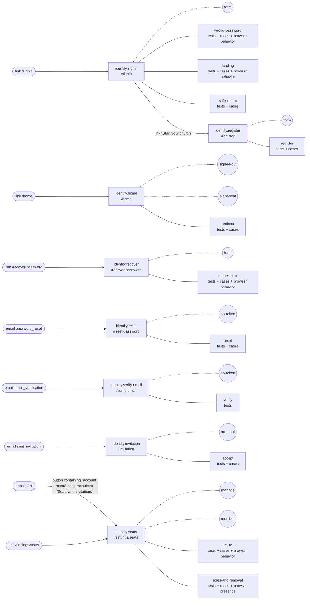

# Feature map: identity

Generated from [`apps/web/src/features/identity/feature-map.json`](../../apps/web/src/features/identity/feature-map.json) by `node tools/ci/feature-maps.ts --write`. Do not edit by hand.
Personas, sign-in and what the checker cannot catch: [README](README.md).



## Surfaces

### identity.signin

Sign in with email and password, then land where the seat and a safe return address say.

- Routes: `/signin`
- Endpoints: `/api/auth/[...path]`
- Personas: `visitor` write, `owner` write, `signup` write
- Catalog: IDN-001, IDN-028

Reach:

- Link `/signin`

States:

- **form**: heading "Welcome back"; button "Sign in". As `visitor`, on the QA seed:

```bash
agent-browser open "$ORIGIN/signin"
agent-browser wait --load networkidle
agent-browser find role heading text --name "Welcome back" --exact
agent-browser find role button text --name "Sign in" --exact
```

#### identity.signin#wrong-password

A wrong password and an unknown address get the same answer.

- No operation: sign-in, recovery and verification run through the Better Auth handler at /api/auth; the catalog's auth.* names are not used in code
- Catalog: IDN-001
- Cases: TARGET-IDN-001
- Test: `tests/integration/identity/identity.test.mts`: `AC:TARGET-IDN-001 INV-nonenumeration: sign-in refuses a wrong password and an unknown address alike, and a deleting account gets no session`
- Browser, behavior proof (acts and checks the result), from state form:

```bash
agent-browser find label "Email" fill "nobody@example.test"
agent-browser find label "Password" fill "not-the-password-1"
agent-browser find role button click --name "Sign in" --exact
agent-browser wait --load networkidle
agent-browser wait --fn "((x,l=[])=>/json/.test(document.contentType)?(JSON.parse(document.body.firstChild.textContent,(k,v)=>(v===Object(v)||l.push(String(v)),v)),l.includes(x)):[...document.querySelectorAll('body *')].some(e=>e.checkVisibility()&&e.innerText?.trim()===x))(\"Email or password is incorrect.\")"
```

#### identity.signin#landing

An Owner whose setup is finished lands on Overview; an unfinished setup or a new account lands on onboarding.

- No operation: sign-in, recovery and verification run through the Better Auth handler at /api/auth; the catalog's auth.* names are not used in code
- Catalog: IDN-001
- Cases: TARGET-IDN-001
- Test: `tests/ui/identity/landing.test.mjs`: `AC:TARGET-IDN-001 (${name}): an owner whose setup is finished lands on /overview`
- Test: `tests/ui/identity/landing.test.mjs`: `AC:TARGET-IDN-001 (${name}): a new account lands on /onboarding`
- Browser, behavior proof (acts and checks the result), from state form:

```bash
agent-browser find label "Email" fill "<QA_LOGINS.owner>"
agent-browser find label "Password" fill "<QA_PASSWORD>"
agent-browser find role button click --name "Sign in" --exact
agent-browser wait --load networkidle
agent-browser wait --url "**/overview"
agent-browser find role link text --name "Overview" --exact
```

#### identity.signin#safe-return

A safe local return address wins over the landing rule; an unsafe one is ignored and never leaves the site.

- No operation: sign-in, recovery and verification run through the Better Auth handler at /api/auth; the catalog's auth.* names are not used in code
- Catalog: IDN-028
- Cases: TARGET-IDN-028, CASE-ADM-004
- Test: `tests/ui/identity/landing.test.mjs`: `AC:TARGET-IDN-028 INV-safe-return (${name}): an unsafe returnTo is ignored and never leaves the origin`
- Test: `packages/contracts/src/identity/identity.test.mts`: `AC:TARGET-IDN-028 AC:CASE-ADM-004 landingFor sends a finished seat to a safe returnTo, else its home, and setup never skips`

### identity.home

The landing address every home and post-sign-in link uses; it only redirects.

- Routes: `/home`
- Personas: `visitor` read, `owner` read
- Catalog: IDN-001

Reach:

- Link `/home`

States:

- **signed-out**: URL `/signin?returnTo=%2Fhome`. As `visitor`, on the QA seed:

```bash
agent-browser open "$ORIGIN/home"
agent-browser wait --load networkidle
agent-browser wait --url "**/signin?returnTo=%2Fhome"
```

- **plant-seat**: URL `/overview`. As `owner`, on the QA seed:

```bash
agent-browser open "$ORIGIN/home"
agent-browser wait --load networkidle
agent-browser wait --url "**/overview"
```

#### identity.home#redirect

Signed out goes to sign in with /home to come back to, without a loop.

- No operation: sign-in, recovery and verification run through the Better Auth handler at /api/auth; the catalog's auth.* names are not used in code
- Catalog: IDN-001
- Cases: TARGET-IDN-001
- Test: `tests/ui/identity/landing.test.mjs`: `AC:TARGET-IDN-001 INV-session (${name}): a signed-out visitor to /home goes to /signin with /home as returnTo, without a loop`

### identity.register

Create an account to start a church, join as a sending church or network, or explore.

- Routes: `/register`
- Personas: `visitor` write
- Catalog: IDN-002, IDN-003

Reach:

- From identity.signin as `visitor`:

```bash
agent-browser find role link click --name "Start your church" --exact
agent-browser wait --load networkidle
```

States:

- **form**: heading "Create your account"; button "Create account". As `visitor`, on the QA seed:

```bash
agent-browser open "$ORIGIN/register"
agent-browser wait --load networkidle
agent-browser find role heading text --name "Create your account" --exact
agent-browser find role button text --name "Create account" --exact
```

#### identity.register#register

Registration reveals no account or church, and a repeated registration ends in one account.

- No operation: sign-in, recovery and verification run through the Better Auth handler at /api/auth; the catalog's auth.* names are not used in code
- Catalog: IDN-002
- Cases: TARGET-IDN-030
- Test: `tests/integration/identity/identity.test.mts`: `AC:TARGET-IDN-030 INV-nonenumeration: pending credentials reveal no account or tenant authority, duplicate registration converges, authenticated self resumes`

### identity.recover

Ask for a password reset link by email; the answer never says whether the address has an account.

- Routes: `/recover-password`
- Personas: `visitor` write
- Catalog: IDN-009

Reach:

- Link `/recover-password`

States:

- **form**: heading "Reset your password"; button "Send reset link". As `visitor`, on the QA seed:

```bash
agent-browser open "$ORIGIN/recover-password"
agent-browser wait --load networkidle
agent-browser find role heading text --name "Reset your password" --exact
agent-browser find role button text --name "Send reset link" --exact
```

#### identity.recover#request-link

Send reset link always answers Check your email, for a known or an unknown address.

- No operation: sign-in, recovery and verification run through the Better Auth handler at /api/auth; the catalog's auth.* names are not used in code
- Catalog: IDN-009
- Cases: TARGET-IDN-009
- Test: `tests/integration/identity/identity.test.mts`: `AC:TARGET-IDN-009 INV-nonenumeration INV-identity: recovery is nonenumerating through outbox failure and unknown provider acceptance; tokens never reach security diagnostics`
- Browser, behavior proof (acts and checks the result), from state form:

```bash
agent-browser find label "Email" fill "nobody@example.test"
agent-browser find role button click --name "Send reset link" --exact
agent-browser wait --load networkidle
agent-browser find role heading text --name "Check your email" --exact
```

### identity.reset

Choose a new password from the emailed link; the link works once and ends every other session.

- Routes: `/reset-password`
- Personas: `visitor` write
- Catalog: IDN-009

Reach:

- Email `password_reset` links to `/reset-password?token={token}` where `{token}` is the proof in the reset email

States:

- **no-token**: heading "This link is incomplete"; link "Ask for a new link". As `visitor`, on the QA seed:

```bash
agent-browser open "$ORIGIN/reset-password"
agent-browser wait --load networkidle
agent-browser find role heading text --name "This link is incomplete" --exact
agent-browser find role link text --name "Ask for a new link" --exact
```

#### identity.reset#reset

A real reset consumes one proof, refuses an expired or used one and signs out every earlier session.

- No operation: sign-in, recovery and verification run through the Better Auth handler at /api/auth; the catalog's auth.* names are not used in code
- Catalog: IDN-009
- Cases: TARGET-IDN-009
- Test: `tests/integration/identity/identity.test.mts`: `AC:TARGET-IDN-009 INV-proof-link: real single-use reset consumes one proof, rejects unchanged/expired/consumed proof, revokes every prior session and reports failure truthfully`

### identity.verify-email

Confirm an email address from the emailed link.

- Routes: `/verify-email`
- Personas: `visitor` write
- Catalog: IDN-002

Reach:

- Email `email_verification` links to `/verify-email?token={token}` where `{token}` is the proof in the confirmation email

States:

- **no-token**: heading "This link is incomplete". As `visitor`, on the QA seed:

```bash
agent-browser open "$ORIGIN/verify-email"
agent-browser wait --load networkidle
agent-browser find role heading text --name "This link is incomplete" --exact
```

#### identity.verify-email#verify

Confirming the address records it with its security event and mail together.

- No operation: sign-in, recovery and verification run through the Better Auth handler at /api/auth; the catalog's auth.* names are not used in code
- Catalog: IDN-002
- Test: `tests/integration/identity/identity.test.mts`: `INV-identity: interruption after credentials preserves authenticated resumption, email verification and successful reset append event and outbox together`

### identity.invitation

Accept or decline a seat or residency invitation from its emailed link, signing in or creating an account on the way.

- Routes: `/invitation`
- Endpoints: `/api/invitation`
- Personas: `visitor` write, `owner` write
- Catalog: IDN-003, IDN-017

Reach:

- Email `seat_invitation` links to `/invitation#proof={proof}` where `{proof}` is the proof in the invitation email

States:

- **no-proof**: heading "This page is not available". As `visitor`, on the QA seed:

```bash
agent-browser open "$ORIGIN/invitation"
agent-browser wait --load networkidle
agent-browser find role heading text --name "This page is not available" --exact
```

#### identity.invitation#accept

Accepting activates one seat and Person even when two tabs accept at once, and never from email equality alone.

- Operations: seats.acceptInvitation
- Catalog: IDN-017
- Cases: TARGET-IDN-002, TARGET-IDN-003, TARGET-IDN-030
- Test: `tests/integration/identity/invitations.test.mts`: `AC:TARGET-IDN-002 AC:TARGET-IDN-030 AC:SCHEMA-002 INV-acceptance: concurrent same-intent claim activates one seat, Person, receipt and security intent`
- Test: `tests/integration/identity/invitations.test.mts`: `AC:TARGET-IDN-002 AC:TARGET-IDN-003 AC:TARGET-IDN-030 AC:SEC-03 native invitation signup, sign-in and exact resume never activate from email equality`

### identity.seats

Seats and invitations: who can sign in to the church, pending invitations, roles and removal.

- Routes: `/settings/seats`
- Endpoints: `/settings/seats/read`
- Personas: `owner` write, `admin` write, `member` read
- Catalog: IDN-017, IDN-019

Reach:

- From people.list as `owner`:

```bash
agent-browser find role button click --name "account menu"
agent-browser wait --load networkidle
agent-browser find role menuitem click --name "Seats and invitations" --exact
agent-browser wait --load networkidle
```

- Link `/settings/seats`

States:

- **manage**: heading "Seats and invitations"; button "Send invitation". As `owner`, on the QA seed:

```bash
agent-browser open "$ORIGIN/settings/seats"
agent-browser wait --load networkidle
agent-browser find role heading text --name "Seats and invitations" --exact
agent-browser find role button text --name "Send invitation" --exact
```

- **member**: heading "Seats and invitations"; no text "Send invitation". As `member`, on the QA seed:

```bash
agent-browser open "$ORIGIN/settings/seats"
agent-browser wait --load networkidle
agent-browser find role heading text --name "Seats and invitations" --exact
agent-browser wait --fn "!document.body.innerText.includes(\"Send invitation\")"
```

#### identity.seats#invite

Send invitation emails a link that works for 30 days and lists it under Waiting for an answer.

- Operations: seats.invite, seats.listInvitations
- Catalog: IDN-017
- Cases: TARGET-IDN-017, ROLE43-006
- Test: `tests/integration/identity/invitations.test.mts`: `AC:TARGET-IDN-017 AC:TARGET-IDN-003 AC:ROLE43-006 ordinary invitation hides account resolution and persists hashed expiring proof`
- Test: `tests/integration/identity/invitations.test.mts`: `AC:ROLE43-006 INV-settings-member INV-invitations: pending and Member actors cannot send or list administrative invitations`
- Browser, behavior proof (acts and checks the result), from state manage:

```bash
agent-browser find label "Email address" fill "map-proof@example.test"
agent-browser find role button click --name "Send invitation" --exact
agent-browser wait --load networkidle
agent-browser wait --text "Invitation sent to"
agent-browser wait --fn "((x,l=[])=>/json/.test(document.contentType)?(JSON.parse(document.body.firstChild.textContent,(k,v)=>(v===Object(v)||l.push(String(v)),v)),l.includes(x)):[...document.querySelectorAll('body *')].some(e=>e.checkVisibility()&&e.innerText?.trim()===x))(\"map-proof@example.test\")"
```

#### identity.seats#roles-and-removal

An Owner changes roles and removes a seat after handing over its open duties; the Owner seat stays.

- Operations: seats.changeOrdinaryRole, seats.appointAdmin, seats.demote, seats.remove
- Catalog: IDN-019
- Cases: TARGET-IDN-019
- Test: `tests/integration/identity/invitations.test.mts`: `AC:TARGET-IDN-019 AC:ROLE43-009 AC:ROLE43-017 roster and ordinary role changes preserve Owner and exact tenant`
- Test: `tests/integration/identity/invitations.test.mts`: `AC:TARGET-IDN-019 INV-removal: exact open-duty handoff retains Person and closed work while revoking all sessions`
- Browser, presence proof only (the control is there; the tests prove the outcome), from state manage:

```bash
agent-browser find role combobox text --name "Role for"
```
