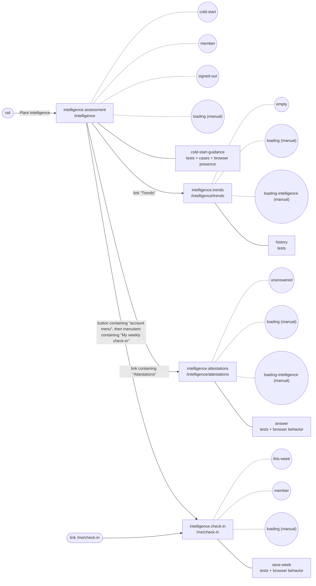

# Feature map: intelligence

Generated from [`apps/web/src/features/intelligence/feature-map.json`](../../apps/web/src/features/intelligence/feature-map.json) by `node tools/ci/feature-maps.ts --write`. Do not edit by hand.
Personas, sign-in and what the checker cannot catch: [README](README.md).



## Surfaces

### intelligence.assessment

Plant Intelligence: the church's latest assessment, or what to record first while none is prepared.

- Routes: `/intelligence`
- Personas: `owner` read, `admin` read, `member` none, `visitor` none
- Catalog: PI-024, PI-025, PI-034

Reach:

- Rail "Plant Intelligence" for `owner`, `admin`

States:

- **cold-start**: heading "Your first assessment hasn't been prepared yet"; region "Next steps from your records"; link "Trends". As `owner`, on the QA seed:

```bash
agent-browser open "$ORIGIN/intelligence"
agent-browser wait --load networkidle
agent-browser find role heading text --name "Your first assessment hasn't been prepared yet" --exact
agent-browser find role region text --name "Next steps from your records" --exact
agent-browser find role link text --name "Trends" --exact
```

- **member**: heading "Plant Intelligence is for Owners and Admins". As `member`, on the QA seed:

```bash
agent-browser open "$ORIGIN/intelligence"
agent-browser wait --load networkidle
agent-browser find role heading text --name "Plant Intelligence is for Owners and Admins" --exact
```

- **signed-out**: URL `/signin?returnTo=%2Fintelligence`. As `visitor`, on the QA seed:

```bash
agent-browser open "$ORIGIN/intelligence"
agent-browser wait --load networkidle
agent-browser wait --url "**/signin?returnTo=%2Fintelligence"
```

- **loading** (`loading.tsx`): text "Loading Plant Intelligence". Not scripted: shows only while the server renders the page.

#### intelligence.assessment#cold-start-guidance

With no assessment yet, the page lists next steps from the church's own records, each a link to where to record it.

- No operation: its catalog read, intelligence.readColdStartGuidance, is a name the code does not quote or declare
- Catalog: PI-034
- Cases: PI-CASE-025
- Test: `tests/unit/intelligence/assessment-model.test.mjs`: `AC:PI-CASE-025 cold start says not prepared, on its way or couldn't be prepared, never a result`
- Browser, presence proof only (the control is there; the tests prove the outcome), from state cold-start:

```bash
agent-browser find role region text --name "Next steps from your records" --exact
```

### intelligence.trends

Trends: the latest twelve complete assessments, newest first.

- Routes: `/intelligence/trends`
- Personas: `owner` read, `admin` read, `member` none
- Catalog: PI-029

Reach:

- From intelligence.assessment as `owner`:

```bash
agent-browser find role link click --name "Trends" --exact
agent-browser wait --load networkidle
agent-browser wait --url "**/intelligence/trends"
```

States:

- **empty**: heading "Trends"; heading "No assessments yet". As `owner`, on the QA seed:

```bash
agent-browser open "$ORIGIN/intelligence/trends"
agent-browser wait --load networkidle
agent-browser find role heading text --name "Trends" --exact
agent-browser find role heading text --name "No assessments yet" --exact
```

- **loading** (`loading.tsx`): text "Loading Plant Intelligence". Not scripted: shows only while the server renders the page.
- **loading-intelligence** (`loading.tsx`): text "Loading Plant Intelligence". Not scripted: the Plant Intelligence loading screen of the parent route.

#### intelligence.trends#history

Trends shows each complete assessment, dated; a fact an older one did not have reads Not measured.

- No operation: its catalog read, intelligence.readAssessmentHistory, is a name the code does not quote or declare
- Catalog: PI-029
- Test: `tests/integration/intelligence/views.test.mts`: `trends show the latest twelve complete assessments, newest first and dated; a fact an older snapshot did not have reads Not measured, never zero`

### intelligence.attestations

Attestations: the seven answers only the church can give, dated and with history, and leadership candidates.

- Routes: `/intelligence/attestations`
- Personas: `owner` write, `admin` write, `member` none
- Catalog: PI-014, PI-015

Reach:

- From intelligence.assessment as `owner`:

```bash
agent-browser find role link click --name "Attestations"
agent-browser wait --load networkidle
agent-browser wait --url "**/intelligence/attestations"
```

States:

- **unanswered**: region "Prayer"; text "Answer"; button "Record a candidate"; no button containing "Update". As `owner`, on the QA seed:

```bash
agent-browser open "$ORIGIN/intelligence/attestations"
agent-browser wait --load networkidle
agent-browser find role region text --name "Prayer" --exact
agent-browser find text "Answer" text --exact
agent-browser find role button text --name "Record a candidate" --exact
! agent-browser find role button text --name "Update"
```

- **loading** (`loading.tsx`): text "Loading the attestations". Not scripted: shows only while the server renders the page.
- **loading-intelligence** (`loading.tsx`): text "Loading Plant Intelligence". Not scripted: the Plant Intelligence loading screen of the parent route.

#### intelligence.attestations#answer

Answering a signal saves a dated statement; the signal then offers Update.

- Operations: signals.attest
- Catalog: PI-015
- Test: `tests/integration/intelligence/signals.test.mts`: `AC:PI-015 AC:REQ-KNOW-050 a signal is answered with its name and date; detail and reference are never required; a retry replays`
- Browser, behavior proof (acts and checks the result), from state unanswered:

```bash
agent-browser find text "Answer" click --exact
agent-browser wait --load networkidle
agent-browser find role radio click --name "Yes" --exact
agent-browser wait --load networkidle
agent-browser find role button click --name "Save answer" --exact
agent-browser wait --load networkidle
agent-browser find role button text --name "Update"
agent-browser wait --text "Answer saved."
```

### intelligence.check-in

My weekly check-in: four private answers each week, only the author sees them, with a twelve-week strip to correct.

- Routes: `/me/check-in`
- Personas: `owner` write, `admin` write, `member` none
- Catalog: PI-038, PI-039, PI-040, PI-041

Reach:

- From intelligence.assessment as `owner`:

```bash
agent-browser find role button click --name "account menu"
agent-browser wait --load networkidle
agent-browser find role menuitem click --name "My weekly check-in"
agent-browser wait --load networkidle
agent-browser wait --url "**/me/check-in"
```

- Link `/me/check-in`

States:

- **this-week**: heading "This week"; radiogroup "Spiritually"; button "Save check-in"; heading "Your last 12 weeks". As `owner`, on the QA seed:

```bash
agent-browser open "$ORIGIN/me/check-in"
agent-browser wait --load networkidle
agent-browser find role heading text --name "This week" --exact
agent-browser find role radiogroup text --name "Spiritually" --exact
agent-browser find role button text --name "Save check-in" --exact
agent-browser find role heading text --name "Your last 12 weeks" --exact
```

- **member**: heading "The weekly check-in is for Owners and Admins". As `member`, on the QA seed:

```bash
agent-browser open "$ORIGIN/me/check-in"
agent-browser wait --load networkidle
agent-browser find role heading text --name "The weekly check-in is for Owners and Admins" --exact
```

- **loading** (`loading.tsx`): text "Loading your check-in". Not scripted: shows only while the server renders the page.

#### intelligence.check-in#save-week

Saving four answers records this week, which then offers a correction in the strip.

- Operations: privateCare.save
- Catalog: PI-038, PI-041
- Test: `tests/integration/intelligence/care.test.mts`: `AC:B03-024 AC:PI-CARE-001 a save changes this week only, a same answer adds nothing and a key replays`
- Test: `tests/integration/intelligence/care.test.mts`: `AC:B03-026 AC:GAP-PI-041 a correction keeps the week, its zone and author and the earlier answer`
- Browser, behavior proof (acts and checks the result), from state this-week:

```bash
agent-browser find role radio click --name "Steady" --exact
agent-browser wait --load networkidle
agent-browser press Tab
agent-browser wait --load networkidle
agent-browser press Space
agent-browser wait --load networkidle
agent-browser press Tab
agent-browser wait --load networkidle
agent-browser press Space
agent-browser wait --load networkidle
agent-browser press Tab
agent-browser wait --load networkidle
agent-browser press Space
agent-browser wait --load networkidle
agent-browser find label "A note for yourself" fill "Map week note"
agent-browser find role button click --name "Save check-in" --exact
agent-browser wait --load networkidle
agent-browser wait --text "Saved"
agent-browser find role button text --name "Correct the week of"
```
