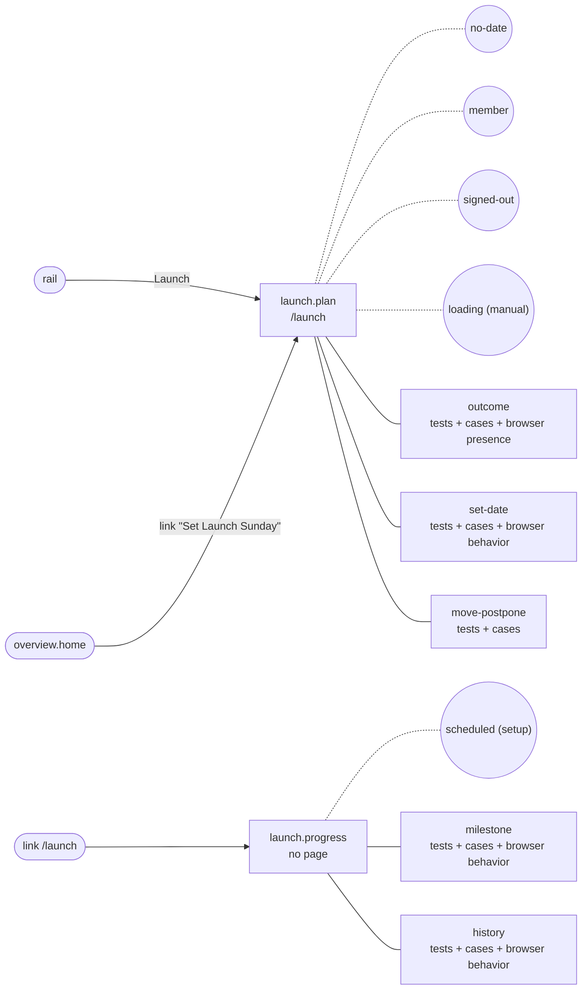

# Feature map: launch

Generated from [`apps/web/src/features/launch/feature-map.json`](../../apps/web/src/features/launch/feature-map.json) by `node tools/ci/feature-maps.ts --write`. Do not edit by hand.
Personas, sign-in and what the checker cannot catch: [README](README.md).



## Surfaces

### launch.plan

Launch Sunday's date and countdown, its readiness, and the outcome form once the day arrives.

- Routes: `/launch`
- Personas: `owner` write, `admin` write, `member` read, `visitor` none
- Catalog: LCH-001, LCH-003, LCH-006, LCH-007, LCH-008

Reach:

- Rail "Launch" for `owner`, `admin`, `member`
- From overview.home as `owner`:

```bash
agent-browser find role link click --name "Set Launch Sunday" --exact
agent-browser wait --load networkidle
agent-browser wait --url "**/launch"
```

States:

- **no-date**: heading "No launch date yet"; button "Set Launch Sunday"; button "Record Launch Sunday". As `owner`, on the QA seed:

```bash
agent-browser open "$ORIGIN/launch"
agent-browser wait --load networkidle
agent-browser find role heading text --name "No launch date yet" --exact
agent-browser find role button text --name "Set Launch Sunday" --exact
agent-browser find role button text --name "Record Launch Sunday" --exact
```

- **member**: text containing "An Owner or Admin sets Launch Sunday"; no button "Set Launch Sunday". As `member`, on the QA seed:

```bash
agent-browser open "$ORIGIN/launch"
agent-browser wait --load networkidle
agent-browser wait --text "An Owner or Admin sets Launch Sunday"
! agent-browser find role button text --name "Set Launch Sunday" --exact
```

- **signed-out**: URL `/signin?returnTo=%2Flaunch`. As `visitor`, on the QA seed:

```bash
agent-browser open "$ORIGIN/launch"
agent-browser wait --load networkidle
agent-browser wait --url "**/signin?returnTo=%2Flaunch"
```

- **loading** (`loading.tsx`): text "Loading the Launch plan". Not scripted: shows only while the server renders the Launch plan.

#### launch.plan#outcome

Once the date arrives, Record Launch Sunday saves what happened, named guests become People, and corrections keep history.

- Operations: launch.recordOutcome, launch.correctOutcome
- Catalog: LCH-006, LCH-007
- Cases: CASE-LCH-006, CASE-LCH-007
- Test: `tests/integration/launch/outcome.test.mts`: `AC:LAUNCH46-001 AC:CASE-LCH-006 Launch Sunday held on Oct 11 sits beside the planned Oct 10, which stays, and no meeting is made`
- Test: `tests/integration/launch/outcome.test.mts`: `AC:LAUNCH46-003 AC:CASE-LCH-006 typing only Mara adds a new Person named Mara, linked as a Launch Sunday guest, with nothing made up`
- Test: `tests/integration/launch/outcome.test.mts`: `AC:CASE-LCH-007 AC:B02-021 correcting 40 to 50 with a reason is history once; the phase stays and no task is made`
- Browser, presence proof only (the control is there; the tests prove the outcome), from state no-date:

```bash
agent-browser find role button click --name "Record Launch Sunday" --exact
agent-browser wait --load networkidle
agent-browser find role dialog text --name "Record Launch Sunday" --exact
```

#### launch.plan#set-date

Set Launch Sunday saves the date and seeds the nine milestones and their prep tasks once.

- Operations: launch.schedule, launch.ensureReadiness
- Catalog: LCH-001, LCH-003
- Cases: CASE-LCH-001, CASE-LCH-003, CASE-LCH-008
- Test: `tests/integration/launch/launch.test.mts`: `AC:CASE-LCH-001 AC:CASE-LCH-003 setting Launch Sunday seeds the nine milestones and 23 undated, unassigned prep tasks once`
- Test: `tests/integration/launch/launch.test.mts`: `AC:CASE-LCH-008 the countdown counts church-local days: 28 days, today, overdue, postponed and no date`
- Browser, behavior proof (acts and checks the result), from state no-date:

```bash
agent-browser find role button click --name "Set Launch Sunday" --exact
agent-browser wait --load networkidle
agent-browser press Tab
agent-browser wait --load networkidle
agent-browser press 1
agent-browser wait --load networkidle
agent-browser press 2
agent-browser wait --load networkidle
agent-browser press 1
agent-browser wait --load networkidle
agent-browser press 5
agent-browser wait --load networkidle
agent-browser press 2
agent-browser wait --load networkidle
agent-browser press 0
agent-browser wait --load networkidle
agent-browser press 3
agent-browser wait --load networkidle
agent-browser press 0
agent-browser wait --load networkidle
agent-browser find role button click --name "Set date" --exact
agent-browser wait --load networkidle
agent-browser find role button text --name "Move date" --exact
agent-browser find role button text --name "Postpone" --exact
! agent-browser find role heading text --name "No launch date yet" --exact
```

#### launch.plan#move-postpone

Moving or postponing Launch Sunday keeps every task's due date, assignee and status, and a later date schedules it again.

- Operations: launch.move, launch.postpone
- Catalog: LCH-001
- Cases: CASE-LCH-001
- Test: `tests/integration/launch/launch.test.mts`: `AC:CASE-LCH-001 moving Launch Sunday keeps every task's due date, assignee and status and the phase`
- Test: `tests/integration/launch/launch.test.mts`: `AC:CASE-LCH-001 postponing clears the countdown and a later date schedules Launch Sunday again`

### launch.progress

After a date is set: the nine milestones with their prep tasks, and Launch history.

- Routes: none
- Personas: `owner` write, `admin` write, `member` read
- Catalog: LCH-002, LCH-004, LCH-005, LCH-010

Reach:

- Link `/launch`

States:

- **scheduled**: heading containing "Scheduled"; button "Move date"; heading "Milestones". As `owner`, after the setup steps below, which create what no seed holds:

```bash
agent-browser open "$ORIGIN/launch"
agent-browser wait --load networkidle
agent-browser find role button click --name "Set Launch Sunday" --exact
agent-browser wait --load networkidle
agent-browser press Tab
agent-browser wait --load networkidle
agent-browser press 1
agent-browser wait --load networkidle
agent-browser press 2
agent-browser wait --load networkidle
agent-browser press 1
agent-browser wait --load networkidle
agent-browser press 5
agent-browser wait --load networkidle
agent-browser press 2
agent-browser wait --load networkidle
agent-browser press 0
agent-browser wait --load networkidle
agent-browser press 3
agent-browser wait --load networkidle
agent-browser press 0
agent-browser wait --load networkidle
agent-browser find role button click --name "Set date" --exact
agent-browser wait --load networkidle
agent-browser open "$ORIGIN/launch"
agent-browser wait --load networkidle
agent-browser find role heading text --name "Scheduled"
agent-browser find role button text --name "Move date" --exact
agent-browser find role heading text --name "Milestones" --exact
```

#### launch.progress#milestone

A milestone is completed or reopened by hand; its tasks' progress never completes it for you.

- Operations: launch.completeMilestone, launch.reopenMilestone
- Catalog: LCH-004, LCH-005
- Cases: CASE-LCH-004, CASE-LCH-005
- Test: `tests/integration/launch/launch.test.mts`: `AC:CASE-LCH-004 a milestone completes with an open task, refuses a stale review, needs review when a done task reopens`
- Test: `tests/integration/launch/launch.test.mts`: `AC:CASE-LCH-005 progress follows the live tasks, and finishing every task never completes the milestone`
- Test: `tests/integration/launch/launch.test.mts`: `AC:CASE-LCH-001 AC:CASE-LCH-004 a Member reads the plan and completes their own task, and nothing else`
- Browser, behavior proof (acts and checks the result), from state scheduled:

```bash
agent-browser find role button click --name "Not complete"
agent-browser wait --load networkidle
agent-browser find role button click --name "Complete milestone" --exact
agent-browser wait --load networkidle
agent-browser find role button text --name "Reopen milestone" --exact
agent-browser find role button text --name "Completed"
```

#### launch.progress#history

Launch history lists every date change, milestone and outcome with who made it and when.

- Operations: launch.readJournal
- Catalog: LCH-002, LCH-010
- Cases: CASE-LCH-002, CASE-LCH-010
- Test: `tests/integration/launch/outcome.test.mts`: `AC:CASE-LCH-002 AC:CASE-LCH-010 Launch history lists date moves, postponement, milestones and the outcome; a deleted account is a former account`
- Browser, behavior proof (acts and checks the result), from state scheduled:

```bash
agent-browser find role button click --name "Show history" --exact
agent-browser wait --load networkidle
agent-browser wait --fn "((x, leaves = []) => /json/.test(document.contentType) ? (JSON.parse(document.body.firstChild.textContent, (k, v) => (v === Object(v) || leaves.push(String(v)), v)), leaves.includes(x)) : [...document.querySelectorAll(\"body *\")].some((e) => e.checkVisibility() && e.innerText?.trim() === x))(\"Launch Sunday set\")"
agent-browser find role button text --name "Refresh" --exact
```
