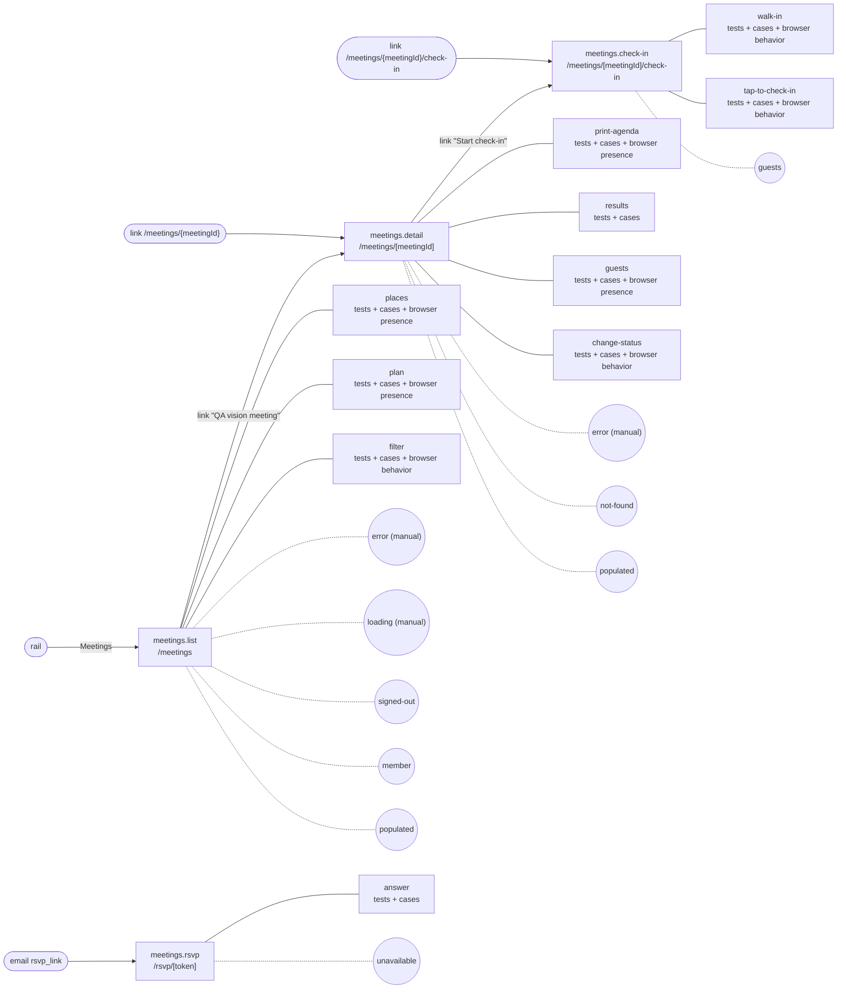

# Feature map: meetings

Generated from [`apps/web/src/features/meetings/feature-map.json`](../../apps/web/src/features/meetings/feature-map.json) by `node tools/ci/feature-maps.ts --write`. Do not edit by hand.
Personas, sign-in and what the checker cannot catch: [README](README.md).



## Surfaces

### meetings.list

Every meeting of the church, with the next one first, filtered by when, type and status.

- Routes: `/meetings`
- Personas: `owner` write, `admin` write, `member` read, `visitor` none
- Catalog: MTG-001, MTG-002, MTG-003

Reach:

- Rail "Meetings" for `owner`, `admin`, `member`

States:

- **populated**: heading "All meetings"; button "Plan a meeting". As `owner`, on the QA seed:

```bash
agent-browser open "$ORIGIN/meetings"
agent-browser wait --load networkidle
agent-browser find role heading text --name "All meetings" --exact
agent-browser find role button text --name "Plan a meeting" --exact
```

- **member**: heading "All meetings"; no text "Plan a meeting". As `member`, on the QA seed:

```bash
agent-browser open "$ORIGIN/meetings"
agent-browser wait --load networkidle
agent-browser find role heading text --name "All meetings" --exact
agent-browser wait --fn "!document.body.innerText.includes(\"Plan a meeting\")"
```

- **signed-out**: URL `/signin?returnTo=%2Fmeetings`. As `visitor`, on the QA seed:

```bash
agent-browser open "$ORIGIN/meetings"
agent-browser wait --load networkidle
agent-browser wait --url "**/signin?returnTo=%2Fmeetings"
```

- **loading** (`loading.tsx`): text "Loading meetings". Not scripted: shows only while the server renders the list.
- **error** (`error.tsx`): heading "We could not load meetings"; button "Try again". Not scripted: renders only when the page throws while rendering.

#### meetings.list#filter

The When, Type and Status filters narrow the list and live in the address.

- Operations: meetings.list
- Catalog: MTG-001
- Cases: TARGET-MTG-001, B02-007
- Test: `tests/integration/meetings/meetings.test.mts`: `AC:TARGET-MTG-001 AC:B02-007 windows, closed type filter, equal-start paging, empty filter with history and foreign detail`
- Browser, behavior proof (acts and checks the result), from state populated:

```bash
agent-browser find role radio click --name "Orientation" --exact
agent-browser wait --load networkidle
agent-browser wait --url "**/meetings?type=orientation"
agent-browser find role link text --name "QA orientation" --exact
! agent-browser find role link text --name "QA vision meeting" --exact
```

#### meetings.list#plan

An Owner or Admin plans a meeting with its venue, agenda, kit and guests in one save.

- Operations: meetings.schedule
- Catalog: MTG-002, MTG-005, MTG-006
- Cases: TARGET-MTG-002, TARGET-MTG-005, TARGET-MTG-006
- Test: `tests/integration/meetings/meetings.test.mts`: `AC:TARGET-MTG-002 AC:GAP-MTG-003 AC:TARGET-MTG-005 AC:TARGET-MTG-006 schedule saves venue copy, agenda, kit and guests together with distinct Vision numbers`
- Browser, presence proof only (the control is there; the tests prove the outcome), from state populated:

```bash
agent-browser find role button click --name "Plan a meeting" --exact
agent-browser wait --load networkidle
agent-browser find role dialog text --name "Plan a meeting" --exact
```

#### meetings.list#places

Places keeps the church's venues; a meeting keeps its own copy of the venue it used.

- Operations: venues.create, venues.edit, venues.archive, venues.restore
- Catalog: MTG-003, MTG-004
- Cases: TARGET-MTG-003, TARGET-MTG-004
- Test: `tests/integration/meetings/meetings.test.mts`: `AC:TARGET-MTG-003 AC:TARGET-MTG-004 AC:GAP-MTG-004 venues keep meeting copies through edit, archive, restore and stale corrections`
- Browser, presence proof only (the control is there; the tests prove the outcome), from state populated:

```bash
agent-browser find role button click --name "Places" --exact
agent-browser wait --load networkidle
agent-browser find role dialog text --name "Places" --exact
```

### meetings.detail

One meeting: its status, guests and RSVPs, kit, agenda, results and evaluation.

- Routes: `/meetings/[meetingId]`
- Endpoints: `/meetings/[meetingId]/agenda`
- Personas: `owner` write, `admin` write, `member` read
- Catalog: MTG-001, MTG-002, MTG-005, MTG-007, MTG-012, MTG-013, MTG-014

Reach:

- From meetings.list as `owner`:

```bash
agent-browser find role link click --name "QA vision meeting" --exact
agent-browser wait --load networkidle
agent-browser wait --url "**/meetings/*"
```

- Link `/meetings/{meetingId}` where `{meetingId}` is the id in a meeting row's link

States:

- **populated**: heading containing "QA vision meeting"; button containing "Status"; tab containing "Guests". As `owner`, on the QA seed:

```bash
agent-browser open "$ORIGIN/meetings"
agent-browser wait --load networkidle
agent-browser find role link click --name "QA vision meeting" --exact
agent-browser wait --load networkidle
agent-browser wait --url "**/meetings/*"
agent-browser find role heading text --name "QA vision meeting"
agent-browser find role button text --name "Status"
agent-browser find role tab text --name "Guests"
```

- **not-found** (`not-found.tsx`): heading "This meeting is not here"; link "Back to Meetings". As `owner`, on the QA seed:

```bash
agent-browser open "$ORIGIN/meetings/00000000-0000-4000-8000-000000000000"
agent-browser wait --load networkidle
agent-browser find role heading text --name "This meeting is not here" --exact
agent-browser find role link text --name "Back to Meetings" --exact
```

- **error** (`error.tsx`): heading "We could not load meetings". Not scripted: renders only when the page throws while rendering.

#### meetings.detail#change-status

An Owner or Admin moves a meeting on from the Status menu and the toast confirms it.

- Operations: meetings.changeStatus
- Catalog: MTG-002
- Cases: TARGET-MTG-002
- Test: `tests/integration/meetings/meetings.test.mts`: `AC:B02-008 AC:B02-009 AC:B02-011 AC:B02-012 AC:B02-013 AC:B02-015 AC:B02-032 AC:TARGET-MTG-002 held practices count once and only when actually held`
- Browser, behavior proof (acts and checks the result), from state populated:

```bash
agent-browser find role button click --name "Status"
agent-browser wait --load networkidle
agent-browser find role menuitem click --name "Mark as ready" --exact
agent-browser wait --load networkidle
agent-browser wait --text "is saved."
agent-browser find role button text --name "Ready"
```

#### meetings.detail#guests

Add guest puts People and new contacts on the guest list in one write and names who was not added.

- Operations: meetings.addGuests
- Catalog: MTG-007, MTG-011
- Cases: TARGET-MTG-007, TARGET-MTG-011
- Test: `tests/integration/meetings/add-guests.test.mts`: `AC:TARGET-MTG-007 AC:TARGET-MTG-011 one write adds People and new contacts, keeps each guest rule and names who was not added`
- Browser, presence proof only (the control is there; the tests prove the outcome), from state populated:

```bash
agent-browser find role button click --name "Add guest" --exact
agent-browser wait --load networkidle
agent-browser find role dialog text --name "Add guest" --exact
```

#### meetings.detail#results

On Results, attendance is finalized with its generated work and the Vision meeting is evaluated.

- Operations: meetings.finalizeAttendance, meetings.recordEvaluation
- Catalog: MTG-012, MTG-014
- Cases: TARGET-MTG-012, TARGET-MTG-014, TARGET-MTG-015
- Test: `tests/integration/meetings/attendance.test.mts`: `AC:TARGET-MTG-020 AC:TARGET-MTG-012 AC:TARGET-TSK-017 AC:GAP-PPL-020 AC:CASE-OPS-004 finalize commits attendance, progression and generated work together`
- Test: `tests/integration/meetings/attendance.test.mts`: `AC:TARGET-MTG-014 AC:GAP-MTG-015 AC:TARGET-MTG-015 one evaluation, computed average, reviewed corrections`
- Test: `tests/ui/meetings/attendance.test.mjs`: `BUG-ce8e6b7f7 messages/com-8 (${name}): finalize, then Record response card saves the first time`

#### meetings.detail#print-agenda

A Vision meeting has Print agenda, which opens its agenda as a printable page.

- Operations: meetings.readAgenda
- Catalog: MTG-005
- Cases: TARGET-MTG-005
- Test: `tests/integration/meetings/meetings.test.mts`: `AC:TARGET-MTG-005 an agenda saves whole: reorder and retime round trip, invalid payloads are refused by name`
- Browser, presence proof only (the control is there; the tests prove the outcome), from state populated:

```bash
agent-browser find role link text --name "Print agenda" --exact
```

### meetings.check-in

Door check-in on a phone: tap a name to check them in, add walk-ins, then finish and finalize.

- Routes: `/meetings/[meetingId]/check-in`
- Personas: `owner` write, `admin` write, `member` none
- Catalog: MTG-010, MTG-011, MTG-012

Reach:

- From meetings.detail as `owner`:

```bash
agent-browser find role link click --name "Start check-in" --exact
agent-browser wait --load networkidle
agent-browser wait --url "**/meetings/*/check-in"
```

- Link `/meetings/{meetingId}/check-in` where `{meetingId}` is the meeting's id

States:

- **guests**: heading "Check-in"; button "Finish check-in". As `owner`, on the QA seed:

```bash
agent-browser open "$ORIGIN/meetings"
agent-browser wait --load networkidle
agent-browser find role link click --name "QA vision meeting" --exact
agent-browser wait --load networkidle
agent-browser wait --url "**/meetings/*"
agent-browser find role link click --name "Start check-in" --exact
agent-browser wait --load networkidle
agent-browser wait --url "**/meetings/*/check-in"
agent-browser find role heading text --name "Check-in" --exact
agent-browser find role button text --name "Finish check-in" --exact
```

#### meetings.check-in#tap-to-check-in

A tap on a guest marks them here in place; a second tap takes it back.

- Operations: meetings.setAttendance
- Catalog: MTG-010
- Cases: TARGET-MTG-010, TARGET-MTG-012, TARGET-MTG-014
- Test: `tests/ui/meetings/attendance.test.mjs`: `AC:TARGET-MTG-010 AC:TARGET-MTG-012 AC:TARGET-MTG-014 (${name}): door check-in, finalize and evaluation`
- Test: `tests/integration/meetings/attendance.test.mts`: `AC:TARGET-MTG-001 AC:TARGET-MTG-010 AC:B02-010 AC:PERSONREF-MEETING-INVITATION-RSVP-ATTENDANCE-CARD-RETIRE draft attendance is all or nothing and keeps RSVP and card`
- Browser, behavior proof (acts and checks the result), from state guests:

```bash
agent-browser find role button click --name "Sara Nunez" --exact
agent-browser wait --load networkidle
agent-browser wait --text "Here"
agent-browser wait --text "checked in"
```

#### meetings.check-in#walk-in

Add a walk-in checks in someone new at the door, and Finish check-in finalizes the first time.

- Operations: meetings.createWalkInContact, meetings.finalizeAttendance
- Catalog: MTG-011, MTG-012
- Cases: TARGET-MTG-011
- Test: `tests/ui/meetings/attendance.test.mjs`: `BUG-ce8e6b7f7 messages/com-9 (${name}): a walk-in, then Finish check-in finalizes the first time`
- Test: `tests/integration/meetings/meetings.test.mts`: `AC:TARGET-MTG-011 AC:GAP-MTG-011 AC:B02-023 AC:B02-024 quick-add contacts create one real Person and one guest, or nothing`
- Browser, behavior proof (acts and checks the result), from state guests:

```bash
agent-browser find role button click --name "Add a walk-in" --exact
agent-browser wait --load networkidle
agent-browser find role radio click --name "Someone new" --exact
agent-browser wait --load networkidle
agent-browser find label "Name" fill "Map Walk-in"
agent-browser find role button click --name "Check in" --exact
agent-browser wait --load networkidle
agent-browser wait --text "is checked in."
```

### meetings.rsvp

The public RSVP page an invitation email links to: no sign-in, one answer per guest.

- Routes: `/rsvp/[token]`
- Personas: `visitor` write
- Catalog: MTG-009

Reach:

- Email `rsvp_link` links to `/rsvp/{token}` where `{token}` is the token in the guest's invitation email

States:

- **unavailable**: heading "This link does not work". As `visitor`, on the QA seed:

```bash
agent-browser open "$ORIGIN/rsvp/not-a-token"
agent-browser wait --load networkidle
agent-browser find role heading text --name "This link does not work" --exact
```

#### meetings.rsvp#answer

The guest answers yes or no from the link; a closed, answered or expired link takes no answer.

- No operation: the token RSVP reads and writes (meetings.readTokenRsvp, meetings.resolveTokenRsvp) are catalog names the code does not use
- Catalog: MTG-009
- Cases: CASE-COM-010, TARGET-MTG-009
- Test: `tests/integration/meetings/meetings.test.mts`: `AC:CASE-COM-010 AC:TARGET-MTG-001 AC:TARGET-MTG-008 AC:TARGET-MTG-009 AC:GAP-MTG-008 one current RSVP from link, own reply or Admin, never attendance`
- Test: `tests/integration/meetings/meetings.test.mts`: `BUG-ce8e6b7f7: a link to a cancelled or completed meeting reads as closed, open, answered or expired, and takes no answer`
