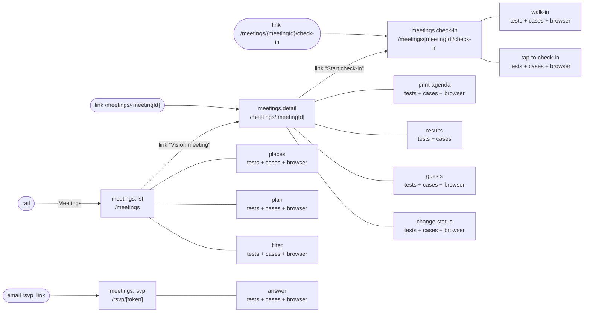

# Feature map: meetings

Generated from [`apps/web/src/features/meetings/feature-map.json`](../../apps/web/src/features/meetings/feature-map.json) by `node tools/ci/feature-maps.ts --write`. Do not edit by hand.



## Surfaces

### meetings.list

Every meeting of the church, with the next one first, filtered by when, type and status.

- Routes: `/meetings`
- Personas: plant-owner write, plant-admin write, plant-member read, visitor none
- Catalog: MTG-001, MTG-002, MTG-003
- Reach:
  - rail "Meetings" (plant-owner, plant-admin, plant-member)

| State | Reach | Expect |
|---|---|---|
| populated | plant-owner opens `/meetings` | heading "All meetings"; button "Plan a meeting" |
| member | plant-member opens `/meetings` | heading "All meetings"; no text "Plan a meeting" |
| signed-out | manual: open /meetings with no session: the page sends the visitor to sign in | URL `/signin?returnTo=%2Fmeetings` |
| loading (`loading.tsx`) | manual: shows only while the server renders the list | text "Loading meetings" |
| error (`error.tsx`) | manual: renders only when the page throws while rendering | heading "We could not load meetings"; button "Try again" |

#### meetings.list#filter

The When, Type and Status filters narrow the list and live in the address.

- Operations: meetings.list
- Cases: TARGET-MTG-001, B02-007
- Test: `tests/integration/meetings/meetings.test.mts`: `AC:TARGET-MTG-001 AC:B02-007 windows, closed type filter, equal-start paging, empty filter with history and foreign detail`
- Browser: As plant-owner, from state populated (`/meetings`):

```bash
agent-browser find role radio click --name "Past" --exact
agent-browser wait --load networkidle
agent-browser wait --url "**/meetings?when=past"
agent-browser find role radio text --name "Past" --exact
```

#### meetings.list#plan

An Owner or Admin plans a meeting with its venue, agenda, kit and guests in one save.

- Operations: meetings.schedule
- Cases: TARGET-MTG-002, TARGET-MTG-005, TARGET-MTG-006
- Test: `tests/integration/meetings/meetings.test.mts`: `AC:TARGET-MTG-002 AC:GAP-MTG-003 AC:TARGET-MTG-005 AC:TARGET-MTG-006 schedule saves venue copy, agenda, kit and guests together with distinct Vision numbers`
- Browser: As plant-owner, from state populated (`/meetings`):

```bash
agent-browser find role button click --name "Plan a meeting" --exact
agent-browser wait --load networkidle
agent-browser find role dialog text --name "Plan a meeting" --exact
```

#### meetings.list#places

Places keeps the church's venues; a meeting keeps its own copy of the venue it used.

- Operations: venues.create, venues.edit, venues.archive, venues.restore
- Cases: TARGET-MTG-003, TARGET-MTG-004
- Test: `tests/integration/meetings/meetings.test.mts`: `AC:TARGET-MTG-003 AC:TARGET-MTG-004 AC:GAP-MTG-004 venues keep meeting copies through edit, archive, restore and stale corrections`
- Browser: As plant-owner, from state populated (`/meetings`):

```bash
agent-browser find role button click --name "Places" --exact
agent-browser wait --load networkidle
agent-browser find role dialog text --name "Places" --exact
```

### meetings.detail

One meeting: its status, guests and RSVPs, kit, agenda, results and evaluation.

- Routes: `/meetings/[meetingId]`
- Endpoints: `/meetings/[meetingId]/agenda`
- Personas: plant-owner write, plant-admin write, plant-member read
- Catalog: MTG-001, MTG-002, MTG-005, MTG-007, MTG-012, MTG-013, MTG-014
- Reach:
  - from meetings.list as plant-owner: click link "Vision meeting"
  - link `/meetings/{meetingId}` with `{meetingId}` = `<meetings:/past/chromium/meetingId>`

| State | Reach | Expect |
|---|---|---|
| populated | plant-owner opens `/meetings/{meetingId}` with `{meetingId}` = `<meetings:/past/chromium/meetingId>` | button "Status"; tab "Guests" |
| not-found (`not-found.tsx`) | plant-owner opens `/meetings/00000000-0000-4000-8000-000000000000` | heading "This meeting is not here"; link "Back to Meetings" |
| error (`error.tsx`) | manual: renders only when the page throws while rendering | heading "We could not load meetings" |

#### meetings.detail#change-status

An Owner or Admin moves a meeting on from the Status menu and the toast confirms it.

- Operations: meetings.changeStatus
- Cases: TARGET-MTG-002
- Test: `tests/integration/meetings/meetings.test.mts`: `AC:B02-008 AC:B02-009 AC:B02-011 AC:B02-012 AC:B02-013 AC:B02-015 AC:B02-032 AC:TARGET-MTG-002 held practices count once and only when actually held`
- Test: `tests/unit/meetings/status-view.test.mjs`: `BUG-58bc5acb8: a past planning or ready meeting reads Not closed in the attention tone`
- Browser: As plant-owner, from state populated (`/meetings/{meetingId}` with `{meetingId}` = `<meetings:/past/chromium/meetingId>`):

```bash
agent-browser find role button click --name "Status"
agent-browser find role menuitem click --name "Mark as ready" --exact
agent-browser wait --load networkidle
agent-browser wait --text "is saved."
agent-browser find role button text --name "Ready"
```

#### meetings.detail#guests

Add guest puts People and new contacts on the guest list in one write and names who was not added.

- Operations: meetings.addGuests
- Cases: TARGET-MTG-007, TARGET-MTG-011
- Test: `tests/integration/meetings/add-guests.test.mts`: `AC:TARGET-MTG-007 AC:TARGET-MTG-011 one write adds People and new contacts, keeps each guest rule and names who was not added`
- Browser: As plant-owner, from state populated (`/meetings/{meetingId}` with `{meetingId}` = `<meetings:/past/chromium/meetingId>`):

```bash
agent-browser find role button click --name "Add guest" --exact
agent-browser wait --load networkidle
agent-browser find role dialog text --name "Add guest" --exact
```

#### meetings.detail#results

On Results, attendance is finalized with its generated work and the Vision meeting is evaluated.

- Operations: meetings.finalizeAttendance, meetings.recordEvaluation
- Cases: TARGET-MTG-012, TARGET-MTG-014, TARGET-MTG-015
- Test: `tests/integration/meetings/attendance.test.mts`: `AC:TARGET-MTG-020 AC:TARGET-MTG-012 AC:TARGET-TSK-017 AC:GAP-PPL-020 AC:CASE-OPS-004 finalize commits attendance, progression and generated work together`
- Test: `tests/integration/meetings/attendance.test.mts`: `AC:TARGET-MTG-014 AC:GAP-MTG-015 AC:TARGET-MTG-015 one evaluation, computed average, reviewed corrections`
- Test: `tests/ui/meetings/attendance.test.mjs`: `BUG-ce8e6b7f7 messages/com-8 (${name}): finalize, then Record response card saves the first time`

#### meetings.detail#print-agenda

A Vision meeting's Print agenda opens its agenda as a printable page; signed out it goes to sign in.

- Operations: meetings.readAgenda
- Cases: TARGET-MTG-005
- Test: `tests/integration/meetings/meetings.test.mts`: `AC:TARGET-MTG-005 an agenda saves whole: reorder and retime round trip, invalid payloads are refused by name`
- Browser: As plant-owner, from state populated (`/meetings/{meetingId}` with `{meetingId}` = `<meetings:/past/chromium/meetingId>`):

```bash
agent-browser find role link text --name "Print agenda" --exact
```

### meetings.check-in

Door check-in on a phone: tap a name to check them in, add walk-ins, then finish and finalize.

- Routes: `/meetings/[meetingId]/check-in`
- Personas: plant-owner write, plant-admin write, plant-member none
- Catalog: MTG-010, MTG-011, MTG-012
- Reach:
  - from meetings.detail as plant-owner: click link "Start check-in"
  - link `/meetings/{meetingId}/check-in` with `{meetingId}` = `<meetings:/past/chromium/meetingId>`

| State | Reach | Expect |
|---|---|---|
| guests | plant-owner opens `/meetings/{meetingId}/check-in` with `{meetingId}` = `<meetings:/past/chromium/meetingId>` | heading "Check-in"; button "Finish check-in" |

#### meetings.check-in#tap-to-check-in

A tap on a guest marks them here in place; a second tap takes it back.

- Operations: meetings.setAttendance
- Cases: TARGET-MTG-010, TARGET-MTG-012, TARGET-MTG-014
- Test: `tests/ui/meetings/attendance.test.mjs`: `AC:TARGET-MTG-010 AC:TARGET-MTG-012 AC:TARGET-MTG-014 (${name}): door check-in, finalize and evaluation`
- Test: `tests/integration/meetings/attendance.test.mts`: `AC:TARGET-MTG-001 AC:TARGET-MTG-010 AC:B02-010 AC:PERSONREF-MEETING-INVITATION-RSVP-ATTENDANCE-CARD-RETIRE draft attendance is all or nothing and keeps RSVP and card`
- Browser: As plant-owner, from state guests (`/meetings/{meetingId}/check-in` with `{meetingId}` = `<meetings:/past/chromium/meetingId>`):

```bash
agent-browser find role button click --name "<meetings:/past/chromium/guests/0>" --exact
agent-browser wait --load networkidle
agent-browser wait --text "Here"
agent-browser wait --text "checked in"
```

#### meetings.check-in#walk-in

Add a walk-in checks in someone new at the door, and Finish check-in finalizes the first time.

- Operations: meetings.createWalkInContact, meetings.finalizeAttendance
- Cases: TARGET-MTG-011
- Test: `tests/ui/meetings/attendance.test.mjs`: `BUG-ce8e6b7f7 messages/com-9 (${name}): a walk-in, then Finish check-in finalizes the first time`
- Test: `tests/integration/meetings/meetings.test.mts`: `AC:TARGET-MTG-011 AC:GAP-MTG-011 AC:B02-023 AC:B02-024 quick-add contacts create one real Person and one guest, or nothing`
- Browser: As plant-owner, from state guests (`/meetings/{meetingId}/check-in` with `{meetingId}` = `<meetings:/past/chromium/meetingId>`):

```bash
agent-browser find role button click --name "Add a walk-in" --exact
agent-browser wait --load networkidle
agent-browser find role dialog text --name "Add a walk-in" --exact
agent-browser find role radio text --name "Someone new" --exact
```

### meetings.rsvp

The public RSVP page an invitation email links to: no sign-in, one answer per guest.

- Routes: `/rsvp/[token]`
- Personas: visitor write
- Catalog: MTG-009
- Reach:
  - email rsvp_link link `/rsvp/{token}` with `{token}` = `the token in the guest's invitation email`

| State | Reach | Expect |
|---|---|---|
| unavailable | visitor opens `/rsvp/not-a-token` | heading "This link does not work" |

#### meetings.rsvp#answer

The guest answers yes or no from the link; a closed, answered or expired link takes no answer.

- Cases: CASE-COM-010, TARGET-MTG-009
- Test: `tests/integration/meetings/meetings.test.mts`: `AC:CASE-COM-010 AC:TARGET-MTG-001 AC:TARGET-MTG-008 AC:TARGET-MTG-009 AC:GAP-MTG-008 one current RSVP from link, own reply or Admin, never attendance`
- Test: `tests/integration/meetings/meetings.test.mts`: `BUG-ce8e6b7f7: a link to a cancelled or completed meeting reads as closed, open, answered or expired, and takes no answer`
- Browser: As visitor, from state unavailable (`/rsvp/not-a-token`):

```bash
agent-browser wait --fn "!document.body.innerText.includes(\"Sign in\")"
```
