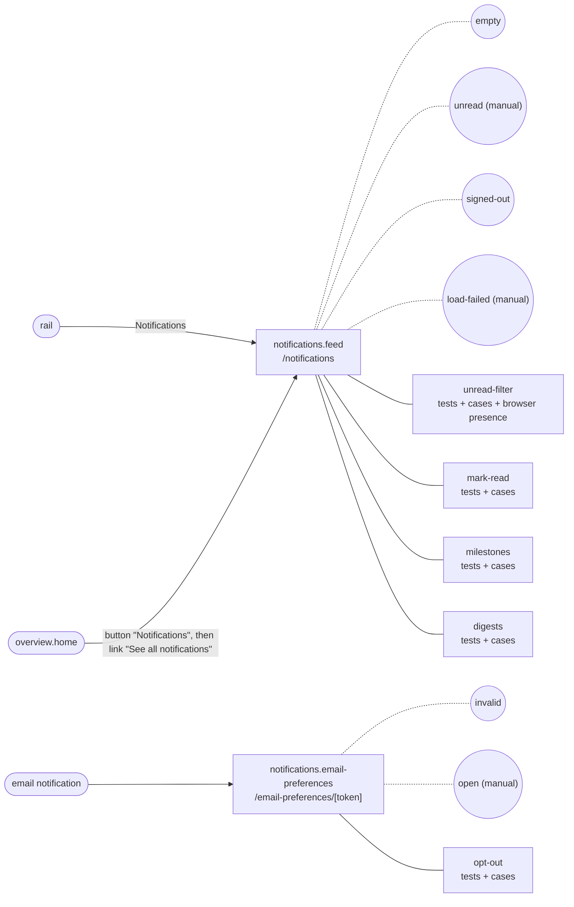

# Feature map: notifications

Generated from [`apps/web/src/features/notifications/feature-map.json`](../../apps/web/src/features/notifications/feature-map.json) by `node tools/ci/feature-maps.ts --write`. Do not edit by hand.
Personas, sign-in and what the checker cannot catch: [README](README.md).



## Surfaces

### notifications.feed

The account's own notifications, newest first, with All and Unread, a category filter and mark as read; the rail bell shows the latest few.

- Routes: `/notifications`
- Endpoints: `/notifications/read`
- Personas: `owner` write, `admin` write, `member` write, `network` write, `visitor` none
- Catalog: NTF-003, NTF-008, NTF-009

Reach:

- Rail "Notifications" for `network`
- From overview.home as `owner`:

```bash
agent-browser find role button click --name "Notifications" --exact
agent-browser wait --load networkidle
agent-browser find role link click --name "See all notifications" --exact
agent-browser wait --load networkidle
agent-browser wait --url "**/notifications"
```

States:

- **empty**: heading "No notifications yet"; radio containing "Unread". As `owner`, on the QA seed:

```bash
agent-browser open "$ORIGIN/notifications"
agent-browser wait --load networkidle
agent-browser find role heading text --name "No notifications yet" --exact
agent-browser find role radio text --name "Unread"
```

- **unread**: button containing "Unread:"; button "Mark all read". Not scripted: needs a notice from another persona, which no seed holds: as owner, complete a milestone on /launch, then sign in as admin; or move the phase forward on /intelligence/journey, then sign in as network.
- **signed-out**: URL `/signin?returnTo=%2Fnotifications`. As `visitor`, on the QA seed:

```bash
agent-browser open "$ORIGIN/notifications"
agent-browser wait --load networkidle
agent-browser wait --url "**/signin?returnTo=%2Fnotifications"
```

- **load-failed**: heading "We could not load your notifications". Not scripted: renders only when the feed read fails on the server.

#### notifications.feed#unread-filter

Unread switches the feed to unread entries only; on the seed's empty feed this shows only the view switching.

- Operations: notifications.feed
- Catalog: NTF-003
- Cases: CASE-NTF-003
- Test: `tests/integration/notifications/notifications.test.mts`: `AC:CASE-NTF-003 AC:NOTIFY47-001 AC:NOTIFY47-010 the feed and mark stay inside one recipient`
- Browser, presence proof only (the control is there; the tests prove the outcome), from state empty:

```bash
agent-browser find role radio click --name "Unread"
agent-browser wait --load networkidle
agent-browser find role heading text --name "You are all caught up" --exact
! agent-browser find role heading text --name "No notifications yet" --exact
```

#### notifications.feed#mark-read

Opening or marking an entry reads it; Mark all read reads everything shown, only for this account.

- Operations: notifications.markRead, notifications.markAllVisibleRead
- Catalog: NTF-003
- Cases: CASE-NTF-003
- Test: `tests/integration/notifications/notifications.test.mts`: `AC:CASE-NTF-003 each feed entry names its subject page's record, digests and phases name none, and the entries are the same`
- Test: `tests/unit/notifications/links.test.mts`: `AC:CASE-NTF-003 a linked entry is one link read or unread; an unlinked one is a button, then text`

#### notifications.feed#milestones

A forward phase move, a completed Launch milestone and sharing changes reach the right Owners, Admins and organizations once.

- No operation: the catalog's notifications.emitPhaseMilestone and notifications.emitLaunchMilestone are quoted only in packages/db/src/schema/annotations.json, not in code
- Catalog: NTF-009
- Cases: CASE-NTF-009
- Test: `tests/integration/notifications/milestones.test.mts`: `AC:CASE-NTF-009 AC:NOTIFY47-005 the scheduled tick tells the plant's Owners and Admins of an approval, a sharing change and an end, in the bell and by email`
- Test: `tests/integration/phases/phases.test.mts`: `AC:CASE-NTF-009 a forward move notifies each connected organization once; declaration, backward and noop do not`

#### notifications.feed#digests

The church digest and the oversight digest arrive at their local hour, in the bell and by email when chosen.

- No operation: the catalog's notifications.generateOwedOversightDigests is quoted only in packages/db/src/schema/annotations.json, not in code
- Catalog: NTF-007, NTF-008
- Cases: CASE-NTF-008
- Test: `tests/integration/notifications/digests.test.mts`: `AC:NOTIFY47-004 the church digest reaches the bell and email at the church's Monday 08:00 in Sydney, not before, and an empty church gets nothing`
- Test: `tests/integration/notifications/digests.test.mts`: `AC:CASE-NTF-008 AC:NOTIFY47-005 the 07:00 oversight digest shows the sharing plant's counts and dates only, in the bell by default and by email when chosen`

### notifications.email-preferences

The page an optional email's Unsubscribe link opens: no sign-in, it turns that one category's email off and can undo it.

- Routes: `/email-preferences/[token]`
- Endpoints: `/email-preferences/[token]/one-click`
- Personas: `visitor` write
- Catalog: NTF-012

Reach:

- Email `notification` links to `/email-preferences/{token}` where `{token}` is the token in an optional email's Unsubscribe link

States:

- **invalid**: heading "This link does not work"; link "Open notification settings". As `visitor`, on the QA seed:

```bash
agent-browser open "$ORIGIN/email-preferences/not-a-token"
agent-browser wait --load networkidle
agent-browser find role heading text --name "This link does not work" --exact
agent-browser find role link text --name "Open notification settings" --exact
```

- **open**: heading containing "Stop emails about"; button "Turn off these emails". Not scripted: needs a real token, which only a sent optional email carries.

#### notifications.email-preferences#opt-out

The link turns off email for its own category only, a one-click request does the same, and undo restores it.

- No operation: the producer's `describeEmailOptOut`, `applyEmailOptOut` and `undoEmailOptOut` (packages/domain/src/notifications/index.ts) are object properties named without the notifications. prefix, which the checker does not read
- Catalog: NTF-012
- Cases: CASE-NTF-012, CASE-NTF-007
- Test: `tests/integration/notifications/digests.test.mts`: `AC:CASE-NTF-007 AC:CASE-NTF-008 each digest email carries the Unsubscribe link and headers of its own digest, and unsubscribing stops that digest only`
- Test: `tests/integration/notifications/notifications.test.mts`: `AC:CASE-NTF-004 AC:CASE-NTF-012 AC:NOTIFY47-002 AC:NOTIFY47-004 AC:TARGET-IDN-012 preferences do not send mail or change another account`
