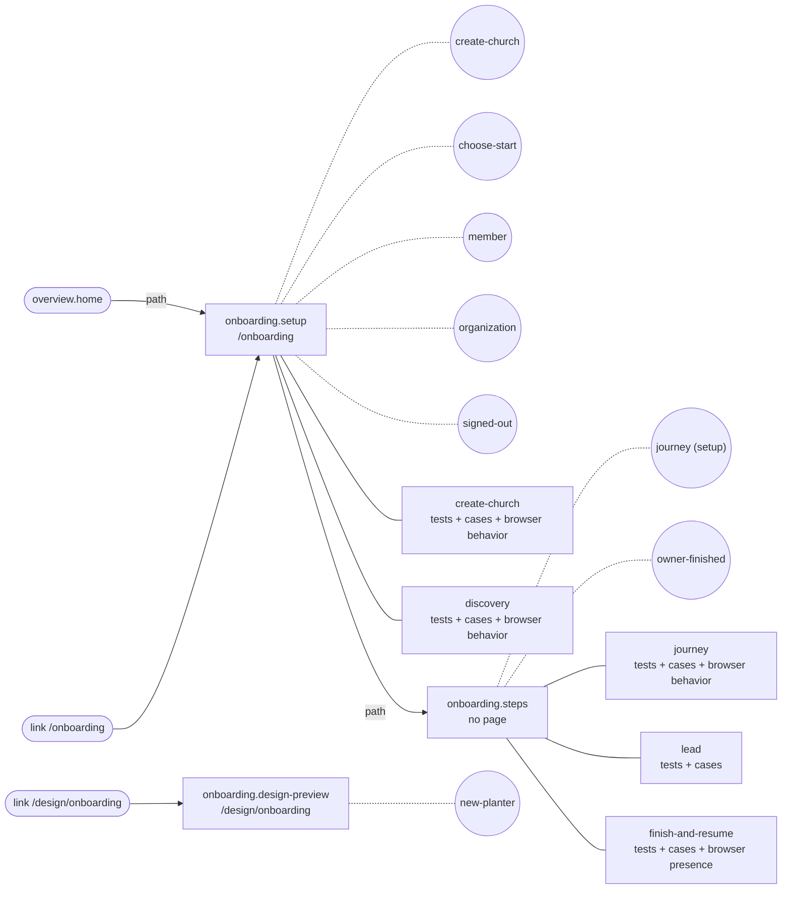

# Feature map: onboarding

Generated from [`apps/web/src/features/onboarding/feature-map.json`](../../apps/web/src/features/onboarding/feature-map.json) by `node tools/ci/feature-maps.ts --write`. Do not edit by hand.
Personas, sign-in and what the checker cannot catch: [README](README.md).



## Surfaces

### onboarding.setup

The account's way into a church: create one, or explore first in a private Discovery space. A member, an organization seat and a signed-out visitor are each sent elsewhere.

- Routes: `/onboarding`
- Personas: `signup` write, `triage` write, `resident` write, `owner` write, `member` read, `network` none, `visitor` none
- Catalog: IDN-013, IDN-016

Reach:

- From overview.home as `signup`:

```bash
agent-browser open "$ORIGIN/overview"
agent-browser wait --load networkidle
```

- Link `/onboarding`

States:

- **create-church**: URL `/onboarding?step=church`; heading "Start your church"; textbox "Church name"; button "Create church". As `signup`, on the QA seed:

```bash
agent-browser open "$ORIGIN/onboarding"
agent-browser wait --load networkidle
agent-browser wait --url "**/onboarding?step=church"
agent-browser find role heading text --name "Start your church" --exact
agent-browser find role textbox text --name "Church name" --exact
agent-browser find role button text --name "Create church" --exact
```

- **choose-start**: heading "How do you want to start?"; radio containing "Start a church"; radio containing "Explore in Discovery". As `triage`, on the QA seed:

```bash
agent-browser open "$ORIGIN/onboarding"
agent-browser wait --load networkidle
agent-browser find role heading text --name "How do you want to start?" --exact
agent-browser find role radio text --name "Start a church"
agent-browser find role radio text --name "Explore in Discovery"
```

- **member**: heading "Setup belongs to the Owner"; button "Try again". As `member`, on the QA seed:

```bash
agent-browser open "$ORIGIN/onboarding"
agent-browser wait --load networkidle
agent-browser find role heading text --name "Setup belongs to the Owner" --exact
agent-browser find role button text --name "Try again" --exact
```

- **organization**: URL `/network`; no text "Start your church". As `network`, on the QA seed:

```bash
agent-browser open "$ORIGIN/onboarding"
agent-browser wait --load networkidle
agent-browser wait --url "**/network"
agent-browser wait --fn "!document.body.innerText.includes(\"Start your church\")"
```

- **signed-out**: URL `/signin?returnTo=%2Fonboarding`. As `visitor`, on the QA seed:

```bash
agent-browser open "$ORIGIN/onboarding"
agent-browser wait --load networkidle
agent-browser wait --url "**/signin?returnTo=%2Fonboarding"
```

#### onboarding.setup#create-church

A church name and the box saying you set it up yourself create the church in Phase 1, with you as its Owner.

- Operations: onboarding.createPlant
- Catalog: IDN-013
- Cases: TARGET-IDN-013
- Test: `tests/integration/onboarding/onboarding.test.mts`: `AC:TARGET-IDN-013 AC:ROLE43-003 AC:ROLE43-014 AC:DC-021 AC:DC-027 AC:DC-029 AC:DC-031 creation is atomic, ungated, leader bootstrap and replay never demote`
- Browser, behavior proof (acts and checks the result), from state create-church:

```bash
agent-browser find label "Church name" fill "Map Test Church"
agent-browser find role checkbox click --name "I’m setting up this church myself" --exact
agent-browser wait --load networkidle
agent-browser find role button click --name "Create church" --exact
agent-browser wait --load networkidle
agent-browser find role heading text --name "Church created" --exact
agent-browser open "$ORIGIN/onboarding?step=church"
agent-browser wait --load networkidle
agent-browser find role heading text --name "Map Test Church"
agent-browser find role heading text --name "Church created" --exact
```

#### onboarding.setup#discovery

An account that is not ready to plant opens Discovery, a private space with no church and no seat, and comes back to it on the next visit.

- Operations: discovery.create
- Catalog: IDN-016
- Cases: TARGET-IDN-016
- Test: `tests/integration/onboarding/onboarding.test.mts`: `AC:TARGET-IDN-016 AC:AF-012 AC:DC-001 Discovery is explicit and seatless; conversion transfers only selected current pairs`
- Browser, behavior proof (acts and checks the result), from state choose-start:

```bash
agent-browser find role radio click --name "Explore in Discovery"
agent-browser wait --load networkidle
agent-browser find role button click --name "Continue" --exact
agent-browser wait --load networkidle
agent-browser find role heading text --name "Explore before you plant" --exact
agent-browser find role button click --name "Open Discovery" --exact
agent-browser wait --load networkidle
agent-browser open "$ORIGIN/onboarding"
agent-browser wait --load networkidle
agent-browser find role heading text --name "Discovery" --exact
agent-browser find role button text --name "Start your church" --exact
```

### onboarding.steps

After the church exists, the Owner's setup steps on the same page: where the church is today, when it launches, who leads it, then Finish.

- Routes: none
- Personas: `signup` write, `owner` write, `member` none
- Catalog: IDN-014, IDN-015

Reach:

- From onboarding.setup as `signup`:

```bash
agent-browser open "$ORIGIN/onboarding?step=journey"
agent-browser wait --load networkidle
```

States:

- **journey**: heading containing "Where is"; radio containing "Launch team formation"; button "Skip for now". As `signup`, after the setup steps below, which create what no seed holds:

```bash
agent-browser open "$ORIGIN/onboarding"
agent-browser wait --load networkidle
agent-browser find label "Church name" fill "Map Onboarding Church"
agent-browser find role checkbox click --name "I’m setting up this church myself" --exact
agent-browser wait --load networkidle
agent-browser find role button click --name "Create church" --exact
agent-browser wait --load networkidle
agent-browser find role heading text --name "Church created" --exact
agent-browser open "$ORIGIN/onboarding?step=journey"
agent-browser wait --load networkidle
agent-browser find role heading text --name "Where is"
agent-browser find role radio text --name "Launch team formation"
agent-browser find role button text --name "Skip for now" --exact
```

- **owner-finished**: URL `/onboarding?step=finish`; heading "Setup is finished"; link "Go to Overview". As `owner`, on the QA seed:

```bash
agent-browser open "$ORIGIN/onboarding"
agent-browser wait --load networkidle
agent-browser wait --url "**/onboarding?step=finish"
agent-browser find role heading text --name "Setup is finished" --exact
agent-browser find role link text --name "Go to Overview" --exact
```

#### onboarding.steps#journey

Picking the phase the church is already in and a launch answer saves both together; the phase then shows as declared and cannot be picked again here.

- Operations: onboarding.declareJourney
- Catalog: IDN-015
- Cases: DC-022, TARGET-IDN-015
- Test: `tests/integration/onboarding/onboarding.test.mts`: `AC:DC-022 explicit journey allows 0..6 once with fixed reason; launch and phase commit together`
- Test: `tests/integration/onboarding/onboarding.test.mts`: `AC:TARGET-IDN-015 AC:DC-018 AC:DC-030 AC:DC-032 unsure, discerning and skip preserve phase and launch; finish preserves real gaps`
- Browser, behavior proof (acts and checks the result), from state journey:

```bash
agent-browser find role radio click --name "Launch team formation"
agent-browser wait --load networkidle
agent-browser find role button click --name "Continue" --exact
agent-browser wait --load networkidle
agent-browser find role radio click --name "No date yet"
agent-browser wait --load networkidle
agent-browser find role button click --name "Save and continue" --exact
agent-browser wait --load networkidle
agent-browser find role heading text --name "Will you lead"
agent-browser open "$ORIGIN/onboarding?step=journey"
agent-browser wait --load networkidle
agent-browser find role heading text --name "You declared Phase"
! agent-browser find role radio text --name "Launch team formation"
```

#### onboarding.steps#lead

Yes, I lead it adds one lead role and gives it to the planter; No assigns nothing; a role someone already holds is kept.

- Operations: identity.answerLeadOnboarding
- Catalog: IDN-014
- Cases: TARGET-IDN-014
- Test: `tests/integration/onboarding/onboarding.test.mts`: `AC:TARGET-IDN-014 AC:ROLE43-004 AC:ROLE43-005 lead answer uses the linked Owner, ordinary role only, and occupied roles conflict`
- Test: `tests/integration/onboarding/onboarding.test.mts`: `AC:TARGET-IDN-014 the Senior pastor fill is off by default and only a Yes answer can carry it`

#### onboarding.steps#finish-and-resume

Finish setup records completion and keeps real gaps; a returning Owner picks up at the first unanswered step.

- Operations: onboarding.complete, onboarding.getResume
- Catalog: IDN-015
- Cases: TARGET-IDN-015
- Test: `tests/integration/onboarding/onboarding.test.mts`: `AC:TARGET-IDN-015 AC:DC-018 AC:DC-030 AC:DC-032 unsure, discerning and skip preserve phase and launch; finish preserves real gaps`
- Test: `tests/integration/onboarding/onboarding.test.mts`: `AC:DC-001 AC:DC-027 account drafts stay private through conversion; resume uses only actual current plant values`
- Browser, presence proof only (the control is there; the tests prove the outcome), from state owner-finished:

```bash
agent-browser find role button text --name "Review answers" --exact
```

### onboarding.design-preview

A design preview of the onboarding screens with sample accounts and no database. Production returns 404.

- Routes: `/design/onboarding`
- Personas: `visitor` read

Reach:

- Link `/design/onboarding`

States:

- **new-planter**: heading "Start your church"; combobox "Preview account". As `visitor`, on the QA seed:

```bash
agent-browser open "$ORIGIN/design/onboarding"
agent-browser wait --load networkidle
agent-browser find role heading text --name "Start your church" --exact
agent-browser find role combobox text --name "Preview account" --exact
```

