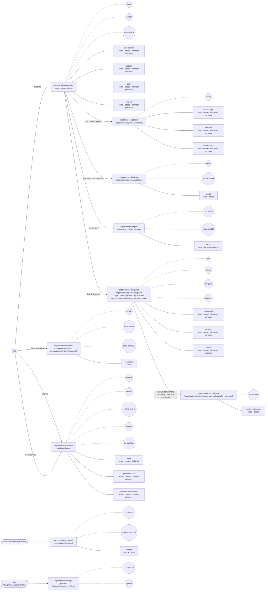

# Feature map: organizations

Generated from [`apps/web/src/features/organizations/feature-map.json`](../../apps/web/src/features/organizations/feature-map.json) by `node tools/ci/feature-maps.ts --write`. Do not edit by hand.
Personas, sign-in and what the checker cannot catch: [README](README.md).



## Surfaces

### organizations.pipeline

A sending church's or network's pipeline board: one column per stage, search and the six-month filter in the address, goals, Add person and Export.

- Routes: `/organization/pipeline`
- Endpoints: `/organization/pipeline/export`, `/organization/pipeline/read`
- Personas: `graceOwner` write, `network` write, `hillOwner` write, `graceDirector` read, `resident` none, `owner` none, `visitor` none
- Catalog: MUL-001, MUL-005, MUL-007, MUL-008

Reach:

- Rail "Pipeline" for `network`, `graceOwner`, `hillOwner`, `graceDirector`

States:

- **board**: heading "Pipeline"; link "Casey Lee"; link "Jordan Reyes"; region "Sending goals and leadership conversations". As `graceOwner`, on the QA seed:

```bash
agent-browser open "$ORIGIN/organization/pipeline"
agent-browser wait --load networkidle
agent-browser find role heading text --name "Pipeline" --exact
agent-browser find role link text --name "Casey Lee" --exact
agent-browser find role link text --name "Jordan Reyes" --exact
agent-browser find role region text --name "Sending goals and leadership conversations" --exact
```

- **empty**: heading "No one in your pipeline yet"; region "Potential leader". As `network`, on the QA seed:

```bash
agent-browser open "$ORIGIN/organization/pipeline"
agent-browser wait --load networkidle
agent-browser find role heading text --name "No one in your pipeline yet" --exact
agent-browser find role region text --name "Potential leader" --exact
```

- **not-available**: heading "This page is not available". As `resident`, on the QA seed:

```bash
agent-browser open "$ORIGIN/organization/pipeline"
agent-browser wait --load networkidle
agent-browser find role heading text --name "This page is not available" --exact
```

#### organizations.pipeline#add-person

An Owner or Admin adds a person with only a name; they join the first stage and stay after a reload.

- Operations: orgPeople.create
- Catalog: MUL-001
- Cases: ADR1-001, ADR1-002
- Test: `tests/integration/organizations/pipeline.test.mts`: `AC:ADR1-001 AC:ADR1-002 an Owner adds a person with an email and responsible staff; nobody outside the organization sees them`
- Browser, behavior proof (acts and checks the result), from state board:

```bash
agent-browser find role button click --name "Add person" --exact
agent-browser wait --load networkidle
agent-browser find label "Name" fill "Map Pipeline Person"
agent-browser press Enter
agent-browser wait --load networkidle
agent-browser open "$ORIGIN/organization/pipeline"
agent-browser wait --load networkidle
agent-browser find role link text --name "Map Pipeline Person" --exact
```

#### organizations.pipeline#search

Search the pipeline, then Enter, narrows the board to matching people and keeps the term in the address.

- Operations: pipeline.listPeople
- Catalog: MUL-008
- Cases: ADR1-009
- Test: `tests/unit/organizations/pipeline-model.test.mts`: `the board's filters round-trip through the address, and anything unreadable falls back`
- Test: `tests/integration/organizations/pipeline.test.mts`: `AC:ADR1-002 AC:ADR1-009 responsible staff see their own people and notes, and nothing of anyone else's`
- Browser, behavior proof (acts and checks the result), from state board:

```bash
agent-browser find label "Search the pipeline" fill "Casey"
agent-browser press Enter
agent-browser wait --load networkidle
agent-browser wait --url "**/organization/pipeline?q=Casey"
agent-browser find role link text --name "Casey Lee" --exact
! agent-browser find role link text --name "Jordan Reyes" --exact
```

#### organizations.pipeline#goals

Add goal opens the sending goal form; the tests prove a saved goal reads back and moves nobody.

- Operations: pipeline.saveGoal
- Catalog: MUL-007
- Cases: ADR1-007
- Test: `tests/integration/organizations/goals.test.mts`: `AC:ADR1-007 an Owner adds and edits goals; a negative target is refused; saving a goal moves nobody`
- Browser, presence proof only (the control is there; the tests prove the outcome), from state board:

```bash
agent-browser find role button click --name "Add goal" --exact
agent-browser wait --load networkidle
agent-browser find role heading text --name "Add a sending goal" --exact
```

#### organizations.pipeline#export

Export opens the pipeline export; the tests prove the file holds contact, stage history and programs and says what and when.

- No operation: the export is `loadPipelineExport`; the catalog's `orgPeople.export` is marked not built
- Catalog: MUL-005
- Cases: ADR1-005
- Test: `tests/integration/organizations/data.test.mts`: `AC:ADR1-005 INV-privacy: the export holds contact, stage history, programs, enrollments and completions, and says what and when`
- Browser, presence proof only (the control is there; the tests prove the outcome), from state board:

```bash
agent-browser find role button click --name "Export" --exact
agent-browser wait --load networkidle
agent-browser find role heading text --name "Export pipeline" --exact
agent-browser find role button text --name "Download CSV" --exact
```

### organizations.person

One pipeline person's record: details, stage history, the Everyfield account link, leadership conversations and staff notes.

- Routes: `/organization/pipeline/[personId]`
- Personas: `graceOwner` write, `network` write, `hillOwner` write, `resident` none
- Catalog: MUL-002, MUL-004, MUL-008, MUL-009

Reach:

- From organizations.pipeline as `graceOwner`:

```bash
agent-browser find role link click --name "Jordan Reyes" --exact
agent-browser wait --load networkidle
agent-browser wait --url "**/organization/pipeline/*"
```

States:

- **record**: heading "Jordan Reyes"; button "Move stage"; button "Log conversation"; heading "Notes". As `graceOwner`, on the QA seed:

```bash
agent-browser open "$ORIGIN/organization/pipeline"
agent-browser wait --load networkidle
agent-browser find role link click --name "Jordan Reyes" --exact
agent-browser wait --load networkidle
agent-browser find role heading text --name "Jordan Reyes" --exact
agent-browser find role button text --name "Move stage" --exact
agent-browser find role button text --name "Log conversation" --exact
agent-browser find role heading text --name "Notes" --exact
```

#### organizations.person#move-stage

Move stage needs a reason; the move and its reason show in the history after a reload.

- No operation: the move is `pipelineWriter.movePerson`; the catalog's `pipeline.moveStage` names no code
- Catalog: MUL-008
- Cases: ADR1-008
- Test: `tests/integration/organizations/pipeline.test.mts`: `AC:ADR1-008 a move needs a reason, and the history shows who moved the person, when and why`
- Browser, behavior proof (acts and checks the result), from state record:

```bash
agent-browser find role button click --name "Move stage" --exact
agent-browser wait --load networkidle
agent-browser find label "Reason" fill "Map move check"
agent-browser find role button click --name "Move" --exact
agent-browser wait --load networkidle
agent-browser open "$ORIGIN/organization/pipeline"
agent-browser wait --load networkidle
agent-browser find role link click --name "Jordan Reyes" --exact
agent-browser wait --load networkidle
agent-browser wait --text "Map move check"
```

#### organizations.person#add-note

A staff note saves on the record and is still there after a reload.

- Operations: orgPeople.addNote
- Catalog: MUL-009
- Cases: ADR1-009
- Test: `tests/integration/organizations/pipeline.test.mts`: `AC:ADR1-009 a note is read by Owner, Admin and responsible staff only, and only its author edits or removes it`
- Browser, behavior proof (acts and checks the result), from state record:

```bash
agent-browser find label "Add a note" fill "Map note check"
agent-browser find role button click --name "Add note" --exact
agent-browser wait --load networkidle
agent-browser open "$ORIGIN/organization/pipeline"
agent-browser wait --load networkidle
agent-browser find role link click --name "Jordan Reyes" --exact
agent-browser wait --load networkidle
agent-browser wait --text "Map note check"
```

#### organizations.person#invite-to-link

Invite to link account emails the person a residency link; the record shows the invitation pending.

- Operations: residency.invite
- Catalog: MUL-004
- Cases: ADR1-004
- Test: `tests/integration/organizations/residency.test.mts`: `AC:ADR1-004 an Admin invites Casey to link; the record shows it pending with its date; revoking kills the emailed link`
- Browser, behavior proof (acts and checks the result), from state record:

```bash
agent-browser find role button click --name "Invite to link account" --exact
agent-browser wait --load networkidle
agent-browser open "$ORIGIN/organization/pipeline"
agent-browser wait --load networkidle
agent-browser find role link click --name "Jordan Reyes" --exact
agent-browser wait --load networkidle
agent-browser wait --text "Invitation pending"
agent-browser find role button text --name "Revoke" --exact
```

### organizations.duplicates

Possible duplicates in the pipeline, for an Owner or Admin to merge or keep apart.

- Routes: `/organization/pipeline/duplicates`
- Personas: `graceOwner` write, `network` write, `hillOwner` write, `resident` none
- Catalog: MUL-017

Reach:

- From organizations.pipeline as `graceOwner`:

```bash
agent-browser find role link click --name "Possible duplicates" --exact
agent-browser wait --load networkidle
agent-browser wait --url "**/organization/pipeline/duplicates"
```

States:

- **none**: heading "Possible duplicates"; heading "No possible duplicates". As `graceOwner`, on the QA seed:

```bash
agent-browser open "$ORIGIN/organization/pipeline/duplicates"
agent-browser wait --load networkidle
agent-browser find role heading text --name "Possible duplicates" --exact
agent-browser find role heading text --name "No possible duplicates" --exact
```

- **not-available**: heading "This page is not available". As `resident`, on the QA seed:

```bash
agent-browser open "$ORIGIN/organization/pipeline/duplicates"
agent-browser wait --load networkidle
agent-browser find role heading text --name "This page is not available" --exact
```

#### organizations.duplicates#merge

A suggested pair merges into one person and Unmerge restores both; the QA seed holds no pair, so the tests prove it.

- Operations: orgPeople.findDuplicates, orgPeople.merge, orgPeople.unmerge
- Catalog: MUL-017
- Cases: ADR1-017
- Test: `tests/integration/organizations/data.test.mts`: `AC:ADR1-017 Casey Lee and Casey L. are suggested by email; collisions refuse; merge joins them and undo restores both`

### organizations.import

Import people into the pipeline from a CSV or a form's Excel export: upload, review columns and rows, import, done.

- Routes: `/organization/pipeline/import`
- Endpoints: `/organization/pipeline/import/preview`, `/organization/pipeline/import/save`
- Personas: `graceOwner` write, `network` write, `hillOwner` write, `resident` none
- Catalog: MUL-001

Reach:

- From organizations.pipeline as `graceOwner`:

```bash
agent-browser find role link click --name "Import" --exact
agent-browser wait --load networkidle
agent-browser wait --url "**/organization/pipeline/import"
```

States:

- **choose-file**: heading "Import people"; heading "Choose a file"; button "Choose a CSV or Excel file". As `graceOwner`, on the QA seed:

```bash
agent-browser open "$ORIGIN/organization/pipeline/import"
agent-browser wait --load networkidle
agent-browser find role heading text --name "Import people" --exact
agent-browser find role heading text --name "Choose a file" --exact
agent-browser find role button text --name "Choose a CSV or Excel file" --exact
```

- **not-available**: heading "This page is not available". As `resident`, on the QA seed:

```bash
agent-browser open "$ORIGIN/organization/pipeline/import"
agent-browser wait --load networkidle
agent-browser find role heading text --name "This page is not available" --exact
```

#### organizations.import#import

A one-row CSV imports one new person into the first stage; the pipeline search then finds them.

- No operation: the pipeline import is `pipelineImportWriter.importPeople`, which `docs/catalog/operations.json` does not list
- Catalog: MUL-001
- Test: `tests/integration/organizations/import.test.mts`: `a UTF-8 CSV with a BOM, CRLF, quoted commas and multi-line answers imports like the Excel file`
- Test: `tests/integration/organizations/import.test.mts`: `Dana imports applications.xlsx: Jordan and Sam join the chosen stage, Casey is skipped and unchanged`
- Browser, behavior proof (acts and checks the result), from state choose-file:

```bash
agent-browser upload "input[type=file]" "$REPO/tools/qa/fixtures/pipeline-applicant.csv"
agent-browser wait --load networkidle
agent-browser find role button click --name "Import"
agent-browser wait --load networkidle
agent-browser wait --text "in your pipeline now"
agent-browser open "$ORIGIN/organization/pipeline"
agent-browser wait --load networkidle
agent-browser find label "Search the pipeline" fill "Map Import Applicant"
agent-browser press Enter
agent-browser wait --load networkidle
agent-browser find role link text --name "Map Import Applicant" --exact
```

### organizations.programs

The Programs tab: the organization's residencies and apprenticeships, a new program from the template or blank, and each program's plan and enrolled people.

- Routes: `/organization/pipeline/programs`, `/organization/pipeline/programs/new`, `/organization/pipeline/programs/[programId]`
- Endpoints: `/organization/pipeline/programs/read`
- Personas: `graceOwner` write, `network` write, `hillOwner` write, `graceDirector` write, `resident` none
- Catalog: MUL-010, MUL-011

Reach:

- From organizations.pipeline as `graceOwner`:

```bash
agent-browser find role link click --name "Programs" --exact
agent-browser wait --load networkidle
agent-browser wait --url "**/organization/pipeline/programs"
```

States:

- **list**: link "Church planting residency"; link "New program"; region "Active residents". As `graceOwner`, on the QA seed:

```bash
agent-browser open "$ORIGIN/organization/pipeline/programs"
agent-browser wait --load networkidle
agent-browser find role link text --name "Church planting residency" --exact
agent-browser find role link text --name "New program" --exact
agent-browser find role region text --name "Active residents" --exact
```

- **empty**: heading "No programs yet"; link "New program". As `network`, on the QA seed:

```bash
agent-browser open "$ORIGIN/organization/pipeline/programs"
agent-browser wait --load networkidle
agent-browser find role heading text --name "No programs yet" --exact
agent-browser find role link text --name "New program" --exact
```

- **program**: heading "Church planting residency"; button "Enroll"; link "Casey Lee". As `graceOwner`, on the QA seed:

```bash
agent-browser open "$ORIGIN/organization/pipeline/programs"
agent-browser wait --load networkidle
agent-browser find role link click --name "Church planting residency" --exact
agent-browser wait --load networkidle
agent-browser find role heading text --name "Church planting residency" --exact
agent-browser find role button text --name "Enroll" --exact
agent-browser find role link text --name "Casey Lee" --exact
```

- **director**: heading "Church planting residency"; button containing "Start Version"; no button "Enroll". As `graceDirector`, on the QA seed:

```bash
agent-browser open "$ORIGIN/organization/pipeline/programs"
agent-browser wait --load networkidle
agent-browser find role link click --name "Church planting residency" --exact
agent-browser wait --load networkidle
agent-browser find role heading text --name "Church planting residency" --exact
agent-browser find role button text --name "Start Version"
! agent-browser find role button text --name "Enroll" --exact
```

#### organizations.programs#create-draft

An Owner starts a residency from the template with a director; it saves as the draft of Version 1 and joins the list.

- Operations: development.saveProgram
- Catalog: MUL-010
- Cases: ADR1-010
- Test: `tests/integration/organizations/programs.test.mts`: `AC:ADR1-010 an Owner starts a residency from the template with Ana as director; a Member cannot create one`
- Browser, behavior proof (acts and checks the result), from state list:

```bash
agent-browser find role link click --name "New program" --exact
agent-browser wait --load networkidle
agent-browser find label "Name" fill "Map residency check"
agent-browser find role combobox click --name "Director" --exact
agent-browser wait --load networkidle
agent-browser find role option click --name "Ana Ruiz" --exact
agent-browser wait --load networkidle
agent-browser find role button click --name "Save draft" --exact
agent-browser wait --load networkidle
agent-browser find role heading text --name "Map residency check" --exact
agent-browser open "$ORIGIN/organization/pipeline/programs"
agent-browser wait --load networkidle
agent-browser find role link text --name "Map residency check" --exact
```

#### organizations.programs#publish

The program's director starts the next version, saves its draft and publishes it; after a reload the draft is gone and the version after it can start.

- Operations: development.saveProgram, development.publishVersion
- Catalog: MUL-010
- Cases: ADR1-010
- Test: `tests/integration/organizations/programs.test.mts`: `AC:ADR1-010 only the current director publishes; Version 1 is published today`
- Browser, behavior proof (acts and checks the result), from state director:

```bash
agent-browser find role button click --name "Start Version"
agent-browser wait --load networkidle
agent-browser find role button click --name "Save draft" --exact
agent-browser wait --load networkidle
agent-browser find role button click --name "Publish Version"
agent-browser wait --load networkidle
agent-browser find role button click --name "Publish" --exact
agent-browser wait --load networkidle
agent-browser open "$ORIGIN/organization/pipeline/programs"
agent-browser wait --load networkidle
agent-browser find role link click --name "Church planting residency" --exact
agent-browser wait --load networkidle
agent-browser wait --fn "!document.body.innerText.includes(\"Draft of Version\")"
agent-browser find role button text --name "Start Version"
```

#### organizations.programs#enroll

Enroll opens the enrollment form; the tests prove the person joins on the current version and their pipeline stage stays.

- Operations: development.enroll
- Catalog: MUL-011
- Cases: ADR1-011
- Test: `tests/integration/organizations/programs.test.mts`: `AC:ADR1-011 an Owner enrolls Casey; the pipeline stage stays; a second active enrollment in the same program is refused`
- Browser, presence proof only (the control is there; the tests prove the outcome), from state program:

```bash
agent-browser find role button click --name "Enroll" --exact
agent-browser wait --load networkidle
agent-browser find role heading text --name "Enroll in"
agent-browser find role combobox text --name "Person" --exact
```

### organizations.enrollment

One person's enrollment: cohort, stage, plan version, what the resident shares, milestones and feedback.

- Routes: `/organization/pipeline/programs/enrollments/[enrollmentId]`
- Personas: `graceOwner` read, `network` read, `hillOwner` read, `resident` none
- Catalog: MUL-011, MUL-012

Reach:

- From organizations.programs as `graceOwner`:

```bash
agent-browser find role link click --name "Church planting residency" --exact
agent-browser wait --load networkidle
agent-browser find role link click --name "Casey Lee" --exact
agent-browser wait --load networkidle
agent-browser wait --url "**/organization/pipeline/programs/enrollments/*"
```

States:

- **enrollment**: heading "Casey Lee"; heading "Enrollment"; text "Clear outline and a warm close. Next time, slow down in the second point.". As `graceOwner`, on the QA seed:

```bash
agent-browser open "$ORIGIN/organization/pipeline/programs"
agent-browser wait --load networkidle
agent-browser find role link click --name "Church planting residency" --exact
agent-browser wait --load networkidle
agent-browser find role link click --name "Casey Lee" --exact
agent-browser wait --load networkidle
agent-browser find role heading text --name "Casey Lee" --exact
agent-browser find role heading text --name "Enrollment" --exact
agent-browser find text "Clear outline and a warm close. Next time, slow down in the second point." text --exact
```

#### organizations.enrollment#confirm-milestone

The director confirms a milestone the resident marked done, or records and confirms one in a step for an enrollee with no linked account. The seed's only enrollee is linked, so Confirm needs the resident to mark first (another persona), and the tests prove both.

- Operations: development.confirmMilestone
- Catalog: MUL-012
- Cases: ADR1-012
- Test: `tests/integration/organizations/residency.test.mts`: `AC:ADR1-012 Casey marks a milestone done; it waits; Ana confirms it; Ana cannot record Casey's milestones in one step`
- Test: `tests/integration/organizations/programs.test.mts`: `AC:ADR1-012 the director records and confirms Casey's milestone in one step; nothing else changes`

### organizations.reviews

Sent for review: kept answers an Owner or Admin sent to this seat, and each send's chosen questions.

- Routes: `/organization/reviews`, `/organization/reviews/[reviewId]`
- Personas: `graceOwner` read, `network` read, `hillOwner` read, `graceDirector` read, `resident` none
- Catalog: MUL-002

Reach:

- Rail "Sent for review" for `network`, `graceOwner`, `hillOwner`, `graceDirector`

States:

- **empty**: heading "Nothing sent to you yet". As `graceOwner`, on the QA seed:

```bash
agent-browser open "$ORIGIN/organization/reviews"
agent-browser wait --load networkidle
agent-browser find role heading text --name "Nothing sent to you yet" --exact
```

- **not-available**: heading "This page is not available". As `resident`, on the QA seed:

```bash
agent-browser open "$ORIGIN/organization/reviews"
agent-browser wait --load networkidle
agent-browser find role heading text --name "This page is not available" --exact
```

- **send**: heading "Sent for review". Not scripted: the QA seed sends no kept answers, and only the receiving seat reads a send, so a send needs one persona to send and another to read.

#### organizations.reviews#read-send

The receiving seat reads only the chosen questions and their answers; a withdrawn send shows as no longer shared.

- No operation: the answer-review reads and sends are not listed in `docs/catalog/operations.json`
- Catalog: MUL-002
- Test: `tests/integration/organizations/reviews.test.mts`: `only Ben reads the send: the chosen questions with their answers and nothing else`
- Test: `tests/integration/organizations/reviews.test.mts`: `withdrawal: Ben sees the send as no longer shared, with no question or answer, and history records both`

### organizations.sharing

Sharing and privacy: connections and what each one sees, pipeline totals, and a resident's residency choices.

- Routes: `/settings/sharing`
- Endpoints: `/connections/read`
- Personas: `owner` write, `network` write, `graceOwner` write, `hillOwner` write, `graceDirector` read, `resident` write, `signup` none
- Catalog: IDN-020, IDN-022, MUL-003, MUL-016

Reach:

- Rail "Sharing" for `network`, `graceOwner`, `hillOwner`, `graceDirector`
- Rail "Connections" for `network`, `graceOwner`, `hillOwner`, `graceDirector`

States:

- **church**: region "Connections"; button "Connect"; switch containing "Share". As `owner`, on the QA seed:

```bash
agent-browser open "$ORIGIN/settings/sharing"
agent-browser wait --load networkidle
agent-browser find role region text --name "Connections" --exact
agent-browser find role button text --name "Connect" --exact
agent-browser find role switch text --name "Share"
```

- **network**: region "Connected churches"; region "Pipeline totals from churches". As `network`, on the QA seed:

```bash
agent-browser open "$ORIGIN/settings/sharing"
agent-browser wait --load networkidle
agent-browser find role region text --name "Connected churches" --exact
agent-browser find role region text --name "Pipeline totals from churches" --exact
```

- **sending-church**: region "Connected churches"; switch containing "Share pipeline totals with". As `graceOwner`, on the QA seed:

```bash
agent-browser open "$ORIGIN/settings/sharing"
agent-browser wait --load networkidle
agent-browser find role region text --name "Connected churches" --exact
agent-browser find role switch text --name "Share pipeline totals with"
```

- **resident**: region containing "Residency with"; button "Leave residency". As `resident`, on the QA seed:

```bash
agent-browser open "$ORIGIN/settings/sharing"
agent-browser wait --load networkidle
agent-browser find role region text --name "Residency with"
agent-browser find role button text --name "Leave residency" --exact
```

- **not-available**: heading "This page is not available". As `signup`, on the QA seed:

```bash
agent-browser open "$ORIGIN/settings/sharing"
agent-browser wait --load networkidle
agent-browser find role heading text --name "This page is not available" --exact
```

#### organizations.sharing#invite

Connect sends an invitation that waits for a reply; Withdraw takes it back.

- Operations: associations.invite, associations.revokeInvitation
- Catalog: IDN-020
- Test: `tests/integration/organizations/relationships.test.mts`: `INV-relationships: invitation rotation, duplicate intents, decline, revoke and rolling limit preserve token boundaries`
- Browser, behavior proof (acts and checks the result), from state sending-church:

```bash
agent-browser find role button click --name "Connect" --exact
agent-browser wait --load networkidle
agent-browser find role combobox click --name "Organization" --exact
agent-browser wait --load networkidle
agent-browser find role option click --name "Harvest Network (QA)"
agent-browser wait --load networkidle
agent-browser find label "Their Owner or Admin's email" fill "<QA_LOGINS.network>"
agent-browser find role button click --name "Send invitation" --exact
agent-browser wait --load networkidle
agent-browser open "$ORIGIN/settings/sharing"
agent-browser wait --load networkidle
agent-browser find role heading text --name "Waiting for a reply" --exact
agent-browser find role button click --name "Withdraw"
agent-browser wait --load networkidle
agent-browser wait --fn "!document.body.innerText.includes(\"Waiting for a reply\")"
agent-browser open "$ORIGIN/settings/sharing"
agent-browser wait --load networkidle
agent-browser wait --fn "!document.body.innerText.includes(\"Waiting for a reply\")"
agent-browser find role button text --name "Connect" --exact
```

#### organizations.sharing#pipeline-totals

A sending church turns pipeline totals for its network off and on; each choice holds after a reload.

- Operations: pipelineSharing.setConsent
- Catalog: MUL-016
- Cases: ADR1-016
- Test: `tests/integration/organizations/consent.test.mts`: `AC:ADR1-016 pipeline consent defaults off and requires two distinct currently eligible churches`
- Browser, behavior proof (acts and checks the result), from state sending-church:

```bash
agent-browser find role switch click --name "Share pipeline totals with"
agent-browser wait --load networkidle
agent-browser open "$ORIGIN/settings/sharing"
agent-browser wait --load networkidle
agent-browser find text "Not shared" text --exact
agent-browser find role switch click --name "Share pipeline totals with"
agent-browser wait --load networkidle
agent-browser open "$ORIGIN/settings/sharing"
agent-browser wait --load networkidle
agent-browser wait --fn "!document.body.innerText.includes(\"Not shared\")"
```

#### organizations.sharing#resident-foundations

A resident shares foundation progress with the sending church; My residency then shows it shared.

- Operations: residency.setSharing
- Catalog: MUL-003, MUL-014
- Cases: ADR1-014
- Test: `tests/integration/organizations/residency.test.mts`: `AC:ADR1-014 foundations: not shared, then a count of the six once Casey shares them, never her reading rows`
- Browser, behavior proof (acts and checks the result), from state resident:

```bash
agent-browser find role switch click --name "Foundation progress"
agent-browser wait --load networkidle
agent-browser open "$ORIGIN/my-residency"
agent-browser wait --load networkidle
agent-browser wait --fn "!document.body.innerText.includes(\"Not shared\")"
agent-browser open "$ORIGIN/settings/sharing"
agent-browser wait --load networkidle
agent-browser find role switch click --name "Foundation progress"
agent-browser wait --load networkidle
agent-browser open "$ORIGIN/my-residency"
agent-browser wait --load networkidle
agent-browser wait --text "Not shared"
```

### organizations.respond

The page a connection invitation opens: the addressed Owner or Admin reads the request and accepts or declines it.

- Routes: `/connections/respond`
- Endpoints: `/api/connections/invitation`
- Personas: `owner` write, `network` write, `graceOwner` write, `hillOwner` write, `visitor` none
- Catalog: IDN-020

Reach:

- Email `relationship_invitation` links to `/connections/respond?invitation={invitationId}#{proof}` where `{invitationId}` is the invitation's id, `{proof}` is the proof in the invitation email

States:

- **no-invitation**: heading "This page is not available". As `owner`, on the QA seed:

```bash
agent-browser open "$ORIGIN/connections/respond"
agent-browser wait --load networkidle
agent-browser find role heading text --name "This page is not available" --exact
```

- **request**: button containing "Accept". Not scripted: the invitation's link reaches only the addressed account's mail, and the QA seed keeps no unanswered invitation, so one persona invites and another opens the link.

#### organizations.respond#accept

The addressed Owner or Admin accepts once and a retry returns the same result; the wrong side, a Member, a wrong proof, expiry, an initiator whose seat ended and a revoked invitation are refused.

- Operations: associations.respondInvitation
- Catalog: IDN-020
- Cases: TARGET-IDN-020
- Test: `tests/integration/organizations/relationships.test.mts`: `AC:AF-010 AC:AF-014 AC:AF-015 AC:AF-020 AC:AF-021 AC:AF-022 AC:AF-023 AC:AF-024 AC:AF-025 AC:AF-026 AC:AF-031 AC:AF-034 AC:AF-040 AC:AF-041 AC:ORG55-002 AC:ORG55-003 AC:GAP-IDN-027 AC:TARGET-IDN-021 AC:TARGET-IDN-027 ending one pair keeps other links, content and minimal history`
- Test: `tests/integration/organizations/relationships.test.mts`: `INV-relationships: invitation rotation, duplicate intents, decline, revoke and rolling limit preserve token boundaries`
- Test: `tests/integration/organizations/relationships.test.mts`: `AC:AF-016 AC:AF-017 AC:AF-019 AC:ROLE43-016 AC:TARGET-IDN-020 wrong side, Member, proof, expiry and revoked initiator cannot approve`
- Test: `tests/unit/organizations/invitation-proof.test.mts`: `the route answers the read as the page did: signed out, unavailable or the request`

### organizations.design-preview

Design previews of the connection, residency and pipeline-sharing screens, with sample data and no database.

- Routes: `/design/organizations/[flow]`
- Personas: `visitor` read

Reach:

- Link `/design/organizations/{flow}` where `{flow}` is connections, organization, invitation, residency, pipeline or notices

States:

- **connections**: heading "Sharing and privacy"; heading "Waiting for a reply"; radiogroup "Scenario". As `visitor`, on the QA seed:

```bash
agent-browser open "$ORIGIN/design/organizations/connections"
agent-browser wait --load networkidle
agent-browser find role heading text --name "Sharing and privacy" --exact
agent-browser find role heading text --name "Waiting for a reply" --exact
agent-browser find role radiogroup text --name "Scenario" --exact
```

- **pipeline**: switch containing "Share pipeline totals with"; radiogroup "Preview as". As `visitor`, on the QA seed:

```bash
agent-browser open "$ORIGIN/design/organizations/pipeline"
agent-browser wait --load networkidle
agent-browser find role switch text --name "Share pipeline totals with"
agent-browser find role radiogroup text --name "Preview as" --exact
```

