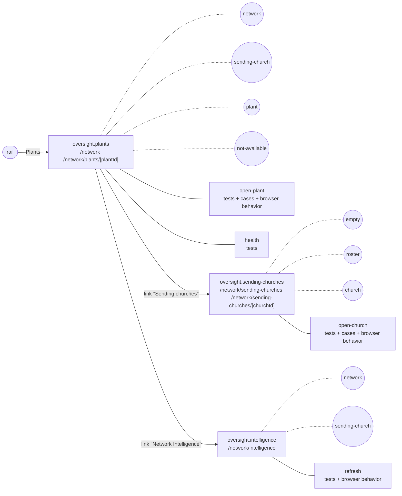

# Feature map: oversight

Generated from [`apps/web/src/features/oversight/feature-map.json`](../../apps/web/src/features/oversight/feature-map.json) by `node tools/ci/feature-maps.ts --write`. Do not edit by hand.
Personas, sign-in and what the checker cannot catch: [README](README.md).



## Surfaces

### oversight.plants

An organization's plant directory and each linked plant's view: phase, Launch Sunday, readiness, health and what the plant shares.

- Routes: `/network`, `/network/plants/[plantId]`
- Personas: `network` read, `graceOwner` read, `hillOwner` read, `graceDirector` read, `owner` none, `resident` none
- Catalog: IDN-023, PI-031

Reach:

- Rail "Plants" for `network`, `graceOwner`, `hillOwner`, `graceDirector`

States:

- **network**: heading "Harvest Network (QA)"; region "Plants"; link containing "Harvest Point (QA)"; navigation "Network views". As `network`, on the QA seed:

```bash
agent-browser open "$ORIGIN/network"
agent-browser wait --load networkidle
agent-browser find role heading text --name "Harvest Network (QA)" --exact
agent-browser find role region text --name "Plants" --exact
agent-browser find role link text --name "Harvest Point (QA)"
agent-browser find role navigation text --name "Network views" --exact
```

- **sending-church**: heading "Grace Austin (QA)"; region "Your plants"; link containing "Harvest Point (QA)". As `graceOwner`, on the QA seed:

```bash
agent-browser open "$ORIGIN/network"
agent-browser wait --load networkidle
agent-browser find role heading text --name "Grace Austin (QA)" --exact
agent-browser find role region text --name "Your plants" --exact
agent-browser find role link text --name "Harvest Point (QA)"
```

- **plant**: heading "Harvest Point (QA)"; text "Planned Launch Sunday"; text "Plant health". As `network`, on the QA seed:

```bash
agent-browser open "$ORIGIN/network"
agent-browser wait --load networkidle
agent-browser find role link click --name "Harvest Point (QA)"
agent-browser wait --load networkidle
agent-browser find role heading text --name "Harvest Point (QA)" --exact
agent-browser wait --fn "((x, leaves = []) => /json/.test(document.contentType) ? (JSON.parse(document.body.firstChild.textContent, (k, v) => (v === Object(v) || leaves.push(String(v)), v)), leaves.includes(x)) : [...document.querySelectorAll(\"body *\")].some((e) => e.checkVisibility() && e.innerText?.trim() === x))(\"Planned Launch Sunday\")"
agent-browser wait --fn "((x, leaves = []) => /json/.test(document.contentType) ? (JSON.parse(document.body.firstChild.textContent, (k, v) => (v === Object(v) || leaves.push(String(v)), v)), leaves.includes(x)) : [...document.querySelectorAll(\"body *\")].some((e) => e.checkVisibility() && e.innerText?.trim() === x))(\"Plant health\")"
```

- **not-available**: heading "This page is not available". As `owner`, on the QA seed:

```bash
agent-browser open "$ORIGIN/network"
agent-browser wait --load networkidle
agent-browser find role heading text --name "This page is not available" --exact
```

#### oversight.plants#open-plant

A plant in the directory opens its own view with what it shares and its launch and health status.

- Operations: oversight.listPlants, oversight.getPlant
- Catalog: IDN-023
- Cases: TARGET-IDN-023
- Test: `tests/integration/oversight/oversight.test.mts`: `AC:TARGET-IDN-023 AC:ORG55-004 AC:ORG55-005 AC:AF-039 the directory lists only own linked plants, once, with the lead and no contacts`
- Test: `tests/integration/oversight/oversight.test.mts`: `AC:TARGET-IDN-023 AC:AF-028 AC:AF-035 Harvest Point's sections: shared counts, shared but empty and not shared`
- Browser, behavior proof (acts and checks the result), from state network:

```bash
agent-browser find role link click --name "Harvest Point (QA)"
agent-browser wait --load networkidle
agent-browser wait --url "**/network/plants/*"
agent-browser wait --fn "((x, leaves = []) => /json/.test(document.contentType) ? (JSON.parse(document.body.firstChild.textContent, (k, v) => (v === Object(v) || leaves.push(String(v)), v)), leaves.includes(x)) : [...document.querySelectorAll(\"body *\")].some((e) => e.checkVisibility() && e.innerText?.trim() === x))(\"Planned Launch Sunday\")"
agent-browser find role heading text --name "Harvest Point (QA)" --exact
```

#### oversight.plants#health

The plant view shows Limited visibility, readiness and a released assessment only, never On track from silence.

- No operation: the catalog records `oversight.getHealth` and `oversight.readLaunchReadiness` as hand-written inside `oversight.listPlants` and `oversight.getPlant`, and no code quotes their ids
- Catalog: PI-031
- Test: `tests/integration/oversight/health.test.mts`: `the home shows Limited visibility, Launch readiness and no concern, never On track from silence`
- Test: `tests/integration/oversight/health.test.mts`: `the plant view shows Launch status and readiness, then the recorded outcome`

### oversight.sending-churches

A network's roster of linked sending churches, and each church's plants that are linked to both.

- Routes: `/network/sending-churches`, `/network/sending-churches/[churchId]`
- Personas: `network` read, `hillOwner` read, `graceOwner` none, `owner` none
- Catalog: IDN-024

Reach:

- From oversight.plants as `network`:

```bash
agent-browser find role link click --name "Sending churches" --exact
agent-browser wait --load networkidle
agent-browser wait --url "**/network/sending-churches"
```

States:

- **empty**: heading "Sending churches"; heading "No sending churches are linked yet". As `network`, on the QA seed:

```bash
agent-browser open "$ORIGIN/network/sending-churches"
agent-browser wait --load networkidle
agent-browser find role heading text --name "Sending churches" --exact
agent-browser find role heading text --name "No sending churches are linked yet" --exact
```

- **roster**: region "Linked sending churches"; link containing "Grace Austin (QA)". As `hillOwner`, on the QA seed:

```bash
agent-browser open "$ORIGIN/network/sending-churches"
agent-browser wait --load networkidle
agent-browser find role region text --name "Linked sending churches" --exact
agent-browser find role link text --name "Grace Austin (QA)"
```

- **church**: heading "Grace Austin (QA)"; text containing "Plants linked to both"; link containing "Harvest Point (QA)". As `hillOwner`, on the QA seed:

```bash
agent-browser open "$ORIGIN/network/sending-churches"
agent-browser wait --load networkidle
agent-browser find role link click --name "Grace Austin (QA)"
agent-browser wait --load networkidle
agent-browser find role heading text --name "Grace Austin (QA)" --exact
agent-browser wait --text "Plants linked to both"
agent-browser find role link text --name "Harvest Point (QA)"
```

#### oversight.sending-churches#open-church

A linked sending church opens its plants that are linked to both, each with what it shares.

- Operations: oversight.listSendingChurches, oversight.getSendingChurch
- Catalog: IDN-024
- Cases: TARGET-IDN-024
- Test: `tests/integration/oversight/oversight.test.mts`: `AC:TARGET-IDN-024 the network's roster: linked sending churches, unexpired pending requests and shared plants`
- Browser, behavior proof (acts and checks the result), from state roster:

```bash
agent-browser find role link click --name "Grace Austin (QA)"
agent-browser wait --load networkidle
agent-browser wait --url "**/network/sending-churches/*"
agent-browser wait --text "Plants linked to both"
```

### oversight.intelligence

Network Intelligence: patterns across the plants that share findings, by Region, State, Country and the whole portfolio, run on Refresh.

- Routes: `/network/intelligence`
- Personas: `network` write, `graceOwner` write, `hillOwner` write, `graceDirector` read, `owner` none
- Catalog: PI-043, PI-044

Reach:

- From oversight.plants as `network`:

```bash
agent-browser find role link click --name "Network Intelligence" --exact
agent-browser wait --load networkidle
agent-browser wait --url "**/network/intelligence"
```

States:

- **network**: heading "Network Intelligence"; button "Refresh"; link "Sending churches". As `network`, on the QA seed:

```bash
agent-browser open "$ORIGIN/network/intelligence"
agent-browser wait --load networkidle
agent-browser find role heading text --name "Network Intelligence" --exact
agent-browser find role button text --name "Refresh" --exact
agent-browser find role link text --name "Sending churches" --exact
```

- **sending-church**: button "Refresh"; link "Your plants". As `graceOwner`, on the QA seed:

```bash
agent-browser open "$ORIGIN/network/intelligence"
agent-browser wait --load networkidle
agent-browser find role button text --name "Refresh" --exact
agent-browser find role link text --name "Your plants" --exact
```

#### oversight.intelligence#refresh

Refresh runs the network rubric on what the plants share now and keeps the run, which reads back after a reload.

- Operations: organizationIntelligence.requestRefresh, organizationIntelligence.read
- Catalog: PI-043
- Test: `tests/integration/oversight/health.test.mts`: `Refresh keeps history, a Member cannot refresh or rate, and turning sharing off leaves every run`
- Test: `tests/integration/oversight/intelligence-rules.test.mts`: `each rule, theme and group counts on its own at every level, and the metro groups show only rows`
- Browser, behavior proof (acts and checks the result), from state network:

```bash
agent-browser find role button click --name "Refresh" --exact
agent-browser wait --load networkidle
agent-browser open "$ORIGIN/network/intelligence"
agent-browser wait --load networkidle
agent-browser wait --fn "((x, leaves = []) => /json/.test(document.contentType) ? (JSON.parse(document.body.firstChild.textContent, (k, v) => (v === Object(v) || leaves.push(String(v)), v)), leaves.includes(x)) : [...document.querySelectorAll(\"body *\")].some((e) => e.checkVisibility() && e.innerText?.trim() === x))(\"Latest run\")"
agent-browser find role region text --name "Whole portfolio" --exact
agent-browser find role navigation text --name "Group by" --exact
```
