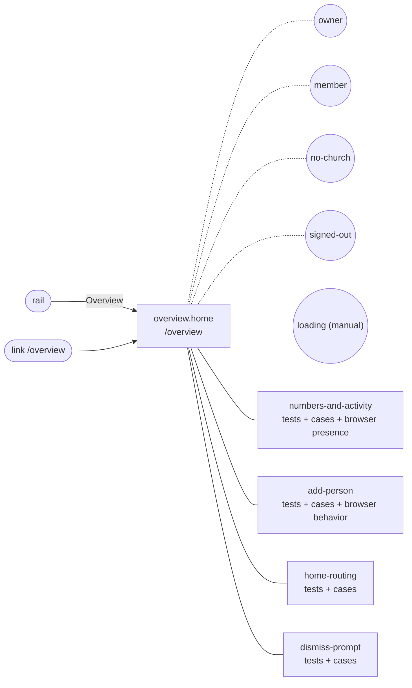

# Feature map: overview

Generated from [`apps/web/src/features/overview/feature-map.json`](../../apps/web/src/features/overview/feature-map.json) by `node tools/ci/feature-maps.ts --write`. Do not edit by hand.
Personas, sign-in and what the checker cannot catch: [README](README.md).



## Surfaces

### overview.home

A seated church's home: the first week's steps, four key numbers, recent changes, the Launch Sunday card and quick actions.

- Routes: `/overview`
- Personas: `owner` write, `admin` write, `member` read, `signup` none, `visitor` none
- Catalog: ADM-004, ADM-005, LCH-008

Reach:

- Rail "Overview" for `owner`, `admin`, `member`
- Link `/overview`

States:

- **owner**: heading "Your first week"; region "Key numbers"; heading "Recent changes"; heading "Quick actions". As `owner`, on the QA seed:

```bash
agent-browser open "$ORIGIN/overview"
agent-browser wait --load networkidle
agent-browser find role heading text --name "Your first week" --exact
agent-browser find role region text --name "Key numbers" --exact
agent-browser find role heading text --name "Recent changes" --exact
agent-browser find role heading text --name "Quick actions" --exact
```

- **member**: region "Key numbers"; no text "Quick actions". As `member`, on the QA seed:

```bash
agent-browser open "$ORIGIN/overview"
agent-browser wait --load networkidle
agent-browser find role region text --name "Key numbers" --exact
agent-browser wait --fn "!document.body.innerText.includes(\"Quick actions\")"
```

- **no-church**: URL `/onboarding?step=church`. As `signup`, on the QA seed:

```bash
agent-browser open "$ORIGIN/overview"
agent-browser wait --load networkidle
agent-browser wait --url "**/onboarding?step=church"
```

- **signed-out**: URL `/signin?returnTo=%2Foverview`. As `visitor`, on the QA seed:

```bash
agent-browser open "$ORIGIN/overview"
agent-browser wait --load networkidle
agent-browser wait --url "**/signin?returnTo=%2Foverview"
```

- **loading** (`loading.tsx`): text "Loading your overview". Not scripted: shows only while the server renders Overview.

#### overview.home#numbers-and-activity

Recruited, People, My overdue tasks and Vision Meetings count what the church holds; Recent changes shows the newest twenty.

- Operations: dashboard.metrics, dashboard.activity
- Catalog: ADM-005
- Cases: CASE-ADM-005
- Test: `tests/integration/dashboard/dashboard.test.mts`: `AC:CASE-ADM-005 four counts: recruited without the church's own logins, live People, my overdue, held Vision Meetings`
- Test: `tests/integration/dashboard/dashboard.test.mts`: `AC:CASE-ADM-005 the activity feed: 20 newest, who and when, corrections as corrections, only what the viewer can open`
- Test: `tests/unit/overview/cards.test.mts`: `AC:CASE-ADM-005 a card whose read failed says so, with no zero or empty feed in its place`
- Browser, presence proof only (the control is there; the tests prove the outcome), from state owner:

```bash
agent-browser find role link text --name "My overdue tasks"
agent-browser find role link text --name "added to People"
```

#### overview.home#add-person

Quick action Add person creates a Person from a name alone and opens their page.

- Operations: people.createPerson
- Catalog: ADM-005, PPL-002
- Cases: TARGET-PPL-002
- Test: `tests/integration/people/people.test.mts`: `AC:TARGET-PPL-002 AC:LAUNCH46-003 AC:SEC-02 AC:TEN-002 minimal contact, explicit null, current tenancy and atomic retry`
- Browser, behavior proof (acts and checks the result), from state owner:

```bash
agent-browser find role button click --name "Add person" --exact
agent-browser wait --load networkidle
agent-browser find label "Name" fill "Map Overview Person"
agent-browser press Enter
agent-browser wait --load networkidle
agent-browser wait --url "**/people/*"
agent-browser find role heading text --name "Map Overview Person" --exact
```

#### overview.home#home-routing

A seat lands here only when its church's setup is done; an account with no church goes to onboarding.

- Operations: dashboard.resolveHome
- Catalog: ADM-004
- Cases: CASE-ADM-004
- Test: `tests/integration/dashboard/dashboard.test.mts`: `AC:CASE-ADM-004 home comes from the seat and the saved setup, never from the address`

#### overview.home#dismiss-prompt

After the first week, an optional prompt can be dismissed for this person in every browser, changing no number.

- Operations: dashboard.promptState
- Catalog: ADM-005
- Cases: CASE-ADM-005
- Test: `tests/integration/dashboard/dashboard.test.mts`: `AC:CASE-ADM-005 a dismissed prompt stays dismissed for that person and changes no number or setup step`
