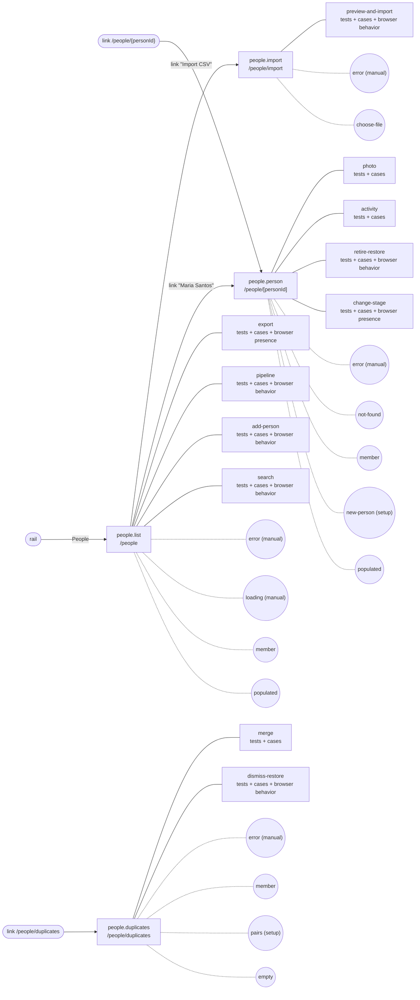

# Feature map: people

Generated from [`apps/web/src/features/people/feature-map.json`](../../apps/web/src/features/people/feature-map.json) by `node tools/ci/feature-maps.ts --write`. Do not edit by hand.
Personas, sign-in and what the checker cannot catch: [README](README.md).



## Surfaces

### people.list

The church's directory as a list, cards or the recruitment pipeline, with search and filters in the address.

- Routes: `/people`
- Endpoints: `/api/people/export`
- Personas: `owner` write, `admin` write, `member` read, `visitor` none
- Catalog: PPL-001, PPL-002, PPL-007, PPL-019

Reach:

- Rail "People" for `owner`, `admin`, `member`

States:

- **populated**: radiogroup "View"; button "Add person". As `owner`, on the QA seed:

```bash
agent-browser open "$ORIGIN/people"
agent-browser wait --load networkidle
agent-browser find role radiogroup text --name "View" --exact
agent-browser find role button text --name "Add person" --exact
```

- **member**: radiogroup "View"; no text "Import CSV". As `member`, on the QA seed:

```bash
agent-browser open "$ORIGIN/people"
agent-browser wait --load networkidle
agent-browser find role radiogroup text --name "View" --exact
agent-browser wait --fn "!document.body.innerText.includes(\"Import CSV\")"
```

- **loading** (`loading.tsx`): text "Loading people". Not scripted: shows only while the server renders the list.
- **error** (`error.tsx`): heading "We could not load your people". Not scripted: renders only when the page throws while rendering.

#### people.list#search

Typing in Search people narrows the directory after a pause and keeps the term in the address.

- Operations: people.listPeople
- Catalog: PPL-001
- Cases: TARGET-PPL-001
- Test: `tests/integration/people/people.test.mts`: `AC:TARGET-PPL-001 literal search, tag intersection, full totals and page numbers past ties`
- Test: `tests/unit/people/model.test.mjs`: `AC:TARGET-PPL-001 INV-url: the page number lives in the address; a filter change goes back to page one`
- Browser, behavior proof (acts and checks the result), from state populated:

```bash
agent-browser find label "Search people" fill "Maria"
agent-browser wait --url "**/people?q=Maria"
agent-browser find role link text --name "Maria Santos" --exact
! agent-browser find role link text --name "James Okafor" --exact
```

#### people.list#add-person

An Owner or Admin adds a person with only a name and lands on their page.

- Operations: people.createPerson
- Catalog: PPL-002
- Cases: TARGET-PPL-002
- Test: `tests/integration/people/people.test.mts`: `AC:TARGET-PPL-002 AC:LAUNCH46-003 AC:SEC-02 AC:TEN-002 minimal contact, explicit null, current tenancy and atomic retry`
- Browser, behavior proof (acts and checks the result), from state populated:

```bash
agent-browser find role button click --name "Add person" --exact
agent-browser wait --load networkidle
agent-browser find label "Name" fill "Map Proof Person"
agent-browser press Enter
agent-browser wait --load networkidle
agent-browser wait --url "**/people/*"
agent-browser find role heading text --name "Map Proof Person" --exact
```

#### people.list#pipeline

The Pipeline view shows one column per stage; the tests prove a move keeps its place and newest revision.

- Operations: people.getPipelineData, people.reorderPipeline
- Catalog: PPL-007
- Cases: TARGET-PPL-007
- Test: `tests/integration/people/people.test.mts`: `AC:TARGET-PPL-007 INV-move-round-trips: a pipeline move is one transaction with a constant round-trip count`
- Test: `tests/unit/people/model.test.mjs`: `AC:TARGET-PPL-007 INV-move-revisions: after reorder, away and back, a card keeps its newest revision and the saved order`
- Browser, behavior proof (acts and checks the result), from state populated:

```bash
agent-browser find role radio click --name "Pipeline" --exact
agent-browser wait --load networkidle
agent-browser wait --url "**/people?view=pipeline"
agent-browser find role region text --name "Prospect"
agent-browser find role region text --name "Core group"
```

#### people.list#export

Export CSV downloads the directory as it is filtered, without private fields.

- Operations: people.exportPeople
- Catalog: PPL-019
- Cases: TARGET-PPL-019
- Test: `tests/integration/people/csv/csv.test.mts`: `AC:TARGET-PPL-019 AC:PERSONREF-HOUSEHOLD-TAG-SKILL-NOTE-RETIRE INV-tenancy INV-filters the export matches the directory's filters as formula-safe CSV without private fields`
- Browser, presence proof only (the control is there; the tests prove the outcome), from state populated:

```bash
agent-browser find role button click --name "Export CSV" --exact
agent-browser wait --load networkidle
agent-browser find role heading text --name "Export people" --exact
```

### people.person

One person: profile, stage and its history, Activity, records, photo and commitment documents.

- Routes: `/people/[personId]`
- Endpoints: `/people/[personId]/photo/[versionId]`, `/people/[personId]/commitments/[commitmentId]/document`, `/people/read`
- Personas: `owner` write, `admin` write, `member` read
- Catalog: PPL-002, PPL-003, PPL-005, PPL-006, PPL-008, PPL-014

Reach:

- From people.list as `owner`:

```bash
agent-browser find role link click --name "Maria Santos" --exact
agent-browser wait --load networkidle
agent-browser wait --url "**/people/*"
```

- Link `/people/{personId}` where `{personId}` is the id in a person row's link

States:

- **populated**: heading "Maria Santos"; button "Change stage"; tablist "Person". As `owner`, on the QA seed:

```bash
agent-browser open "$ORIGIN/people"
agent-browser wait --load networkidle
agent-browser find role link click --name "Maria Santos" --exact
agent-browser wait --load networkidle
agent-browser wait --url "**/people/*"
agent-browser find role heading text --name "Maria Santos" --exact
agent-browser find role button text --name "Change stage" --exact
agent-browser find role tablist text --name "Person" --exact
```

- **new-person**: heading "Map Retire Person"; button "Change stage". As `owner`, after the setup steps below, which create what no seed holds:

```bash
agent-browser open "$ORIGIN/people"
agent-browser wait --load networkidle
agent-browser find role button click --name "Add person" --exact
agent-browser wait --load networkidle
agent-browser find label "Name" fill "Map Retire Person"
agent-browser press Enter
agent-browser wait --load networkidle
agent-browser find role heading text --name "Map Retire Person" --exact
agent-browser find role button text --name "Change stage" --exact
```

- **member**: heading "Maria Santos"; no text "Change stage". As `member`, on the QA seed:

```bash
agent-browser open "$ORIGIN/people"
agent-browser wait --load networkidle
agent-browser find role link click --name "Maria Santos" --exact
agent-browser wait --load networkidle
agent-browser wait --url "**/people/*"
agent-browser find role heading text --name "Maria Santos" --exact
agent-browser wait --fn "!document.body.innerText.includes(\"Change stage\")"
```

- **not-found** (`not-found.tsx`): heading "This person is not here"; link "Back to People". As `owner`, on the QA seed:

```bash
agent-browser open "$ORIGIN/people/00000000-0000-4000-8000-000000000000"
agent-browser wait --load networkidle
agent-browser find role heading text --name "This person is not here" --exact
agent-browser find role link text --name "Back to People" --exact
```

- **error** (`error.tsx`): heading "We could not load your people". Not scripted: renders only when the page throws while rendering.

#### people.person#change-stage

Change stage moves a person to another stage with a reason, after the recorded-evidence check.

- Operations: people.changeStatus
- Catalog: PPL-006
- Cases: TARGET-PPL-006
- Test: `tests/integration/people/people.test.mts`: `AC:TARGET-PPL-006 AC:TARGET-PPL-007 AC:TARGET-PPL-003 stage skip, no-op, complete handoffs, retirement and guarded restore`
- Browser, presence proof only (the control is there; the tests prove the outcome), from state populated:

```bash
agent-browser find role button click --name "Change stage" --exact
agent-browser wait --load networkidle
agent-browser wait --fn "((x, leaves = []) => /json/.test(document.contentType) ? (JSON.parse(document.body.firstChild.textContent, (k, v) => (v === Object(v) || leaves.push(String(v)), v)), leaves.includes(x)) : [...document.querySelectorAll(\"body *\")].some((e) => e.checkVisibility() && e.innerText?.trim() === x))(\"New stage\")"
agent-browser wait --fn "((x, leaves = []) => /json/.test(document.contentType) ? (JSON.parse(document.body.firstChild.textContent, (k, v) => (v === Object(v) || leaves.push(String(v)), v)), leaves.includes(x)) : [...document.querySelectorAll(\"body *\")].some((e) => e.checkVisibility() && e.innerText?.trim() === x))(\"Reason\")"
```

#### people.person#retire-restore

Retire person takes someone out of active lists; Restore person brings them back with their history.

- Operations: people.deletePerson, people.restorePerson
- Catalog: PPL-003
- Cases: TARGET-PPL-003
- Test: `tests/integration/people/people.test.mts`: `AC:TARGET-PPL-006 AC:TARGET-PPL-007 AC:TARGET-PPL-003 stage skip, no-op, complete handoffs, retirement and guarded restore`
- Browser, behavior proof (acts and checks the result), from state new-person:

```bash
agent-browser find role button click --name "More actions" --exact
agent-browser wait --load networkidle
agent-browser find role menuitem click --name "Retire person" --exact
agent-browser wait --load networkidle
agent-browser find label "Reason" fill "Map proof"
agent-browser find role button click --name "Retire person" --exact
agent-browser wait --load networkidle
agent-browser find role heading text --name "is retired"
agent-browser find role button text --name "Restore person" --exact
```

#### people.person#activity

Activity lists changes and notes newest first, keeping each note's author and revisions.

- Operations: people.getActivities, people.addNote, people.editNote, people.deleteNote
- Catalog: PPL-008
- Cases: TARGET-PPL-008
- Test: `tests/integration/people/people.test.mts`: `AC:TARGET-PPL-008 person Activity is newest first and pages continue with older items without gaps or duplicates`
- Test: `tests/integration/people/people.test.mts`: `AC:TARGET-PPL-008 original author and exact note revisions preserve occurrence, tombstone and removed attribution`

#### people.person#photo

A person's photo is served only to readers who may see that person, as it is now.

- Operations: people.getPersonPhoto, people.setPersonPhoto, people.removePersonPhoto
- Catalog: PPL-005
- Cases: TARGET-IDN-006
- Test: `tests/integration/people/person-photos.test.mts`: `AC:TARGET-IDN-006: a reader whose seat ended gets a refusal, and a request past one page is refused`

### people.duplicates

Possible duplicates: pairs to review, dismiss or merge; Everyfield never merges on its own.

- Routes: `/people/duplicates`
- Personas: `owner` write, `admin` write, `member` none
- Catalog: PPL-016, PPL-017

Reach:

- Link `/people/duplicates`

States:

- **empty**: heading "Possible duplicates"; heading "Nothing to review". As `owner`, on the QA seed:

```bash
agent-browser open "$ORIGIN/people/duplicates"
agent-browser wait --load networkidle
agent-browser find role heading text --name "Possible duplicates" --exact
agent-browser find role heading text --name "Nothing to review" --exact
```

- **pairs**: heading "Possible duplicates"; button containing "are not a duplicate". As `owner`, after the setup steps below, which create what no seed holds:

```bash
agent-browser open "$ORIGIN/people/import"
agent-browser wait --load networkidle
agent-browser upload "input[type=file]" "$REPO/tools/qa/fixtures/duplicate-maria.csv"
agent-browser wait --load networkidle
agent-browser find role radio click --name "Add, review later" --exact
agent-browser wait --load networkidle
agent-browser find role button click --name "Import"
agent-browser wait --load networkidle
agent-browser wait --text "added"
agent-browser open "$ORIGIN/people/duplicates"
agent-browser wait --load networkidle
agent-browser find role heading text --name "Possible duplicates" --exact
agent-browser find role button text --name "are not a duplicate"
```

- **member**: text containing "Only Owners and Admins can merge people". As `member`, on the QA seed:

```bash
agent-browser open "$ORIGIN/people/duplicates"
agent-browser wait --load networkidle
agent-browser wait --text "Only Owners and Admins can merge people"
```

- **error** (`error.tsx`): heading "We could not load your people". Not scripted: renders only when the page throws while rendering.

#### people.duplicates#dismiss-restore

Dismiss moves a pair to the Dismissed view; Restore puts it back in its import order.

- Operations: people.listDuplicatePairs, people.dismissDuplicatePair, people.restoreDuplicatePair
- Catalog: PPL-016
- Cases: TARGET-PPL-016
- Test: `tests/integration/people/csv/duplicates.test.mts`: `AC:TARGET-PPL-016 a dismissed pair leaves the list for the Dismissed view, and Restore puts it back in its import order, each with its audit row`
- Test: `tests/unit/people/duplicate-pairs.test.mjs`: `a refused dismiss puts the row back in its place and says nothing changed`
- Browser, behavior proof (acts and checks the result), from state pairs:

```bash
agent-browser find role button click --name "are not a duplicate"
agent-browser wait --load networkidle
agent-browser find role link click --name "Dismissed" --exact
agent-browser wait --load networkidle
agent-browser find role button click --name "Restore"
agent-browser wait --load networkidle
agent-browser find role heading text --name "Dismissed pairs" --exact
agent-browser find role heading text --name "Nothing dismissed" --exact
```

#### people.duplicates#merge

A reviewed merge keeps the chosen details on the survivor and refuses what history blocks.

- Operations: people.mergePeople, people.unmergePeople
- Catalog: PPL-017
- Cases: TARGET-PPL-016
- Test: `tests/unit/people/corrections-model.test.mjs`: `AC:TARGET-PPL-016 a merge blocked by past history names what blocks it and gives no advice that cannot clear it`
- Test: `tests/integration/people/corrections/merge.test.mts`: `AC:REQ-PPL-024 a write racing a merge waits for it and never leaves a current reference on the retired source`

### people.import

Import people from a CSV: upload, preview with duplicates, choose per row, then import and resume.

- Routes: `/people/import`
- Endpoints: `/api/people/import`, `/api/people/import/preview`, `/api/people/import/retry`, `/api/people/import/template`, `/api/people/import/upload`
- Personas: `owner` write, `admin` write, `member` none
- Catalog: PPL-018

Reach:

- From people.list as `owner`:

```bash
agent-browser find role link click --name "Import CSV" --exact
agent-browser wait --load networkidle
agent-browser wait --url "**/people/import"
```

States:

- **choose-file**: heading "Import people"; link "Download template". As `owner`, on the QA seed:

```bash
agent-browser open "$ORIGIN/people"
agent-browser wait --load networkidle
agent-browser find role link click --name "Import CSV" --exact
agent-browser wait --load networkidle
agent-browser wait --url "**/people/import"
agent-browser find role heading text --name "Import people" --exact
agent-browser find role link text --name "Download template" --exact
```

- **error** (`error.tsx`): heading "We could not load your people". Not scripted: renders only when the page throws while rendering.

#### people.import#preview-and-import

The server reads the stored file, previews duplicates without writing, and imports exactly the reviewed rows.

- Operations: people.previewImport, people.executeBulkImport, people.generateCsvTemplate
- Catalog: PPL-018
- Cases: TARGET-PPL-018
- Test: `tests/integration/people/csv/csv.test.mts`: `AC:TARGET-PPL-018 the server reads the file honestly, previews duplicates without writing and refuses capped or malformed files`
- Test: `tests/integration/people/csv/stored-upload.test.mts`: `AC:TARGET-PPL-018 the Owner signs one upload, and the preview and the import read the stored object, never the browser's rows`
- Test: `tests/unit/people/import-done.test.mts`: `BUG-PR551 (people/peo-7): a partial Done screen lists every row that did not save, unreached rows included`
- Browser, behavior proof (acts and checks the result), from state choose-file:

```bash
agent-browser upload "input[type=file]" "$REPO/tools/qa/fixtures/duplicate-maria.csv"
agent-browser wait --load networkidle
agent-browser find role radio click --name "Add, review later" --exact
agent-browser wait --load networkidle
agent-browser find role button click --name "Import"
agent-browser wait --load networkidle
agent-browser wait --text "added"
agent-browser find role link text --name "Duplicates" --exact
```
