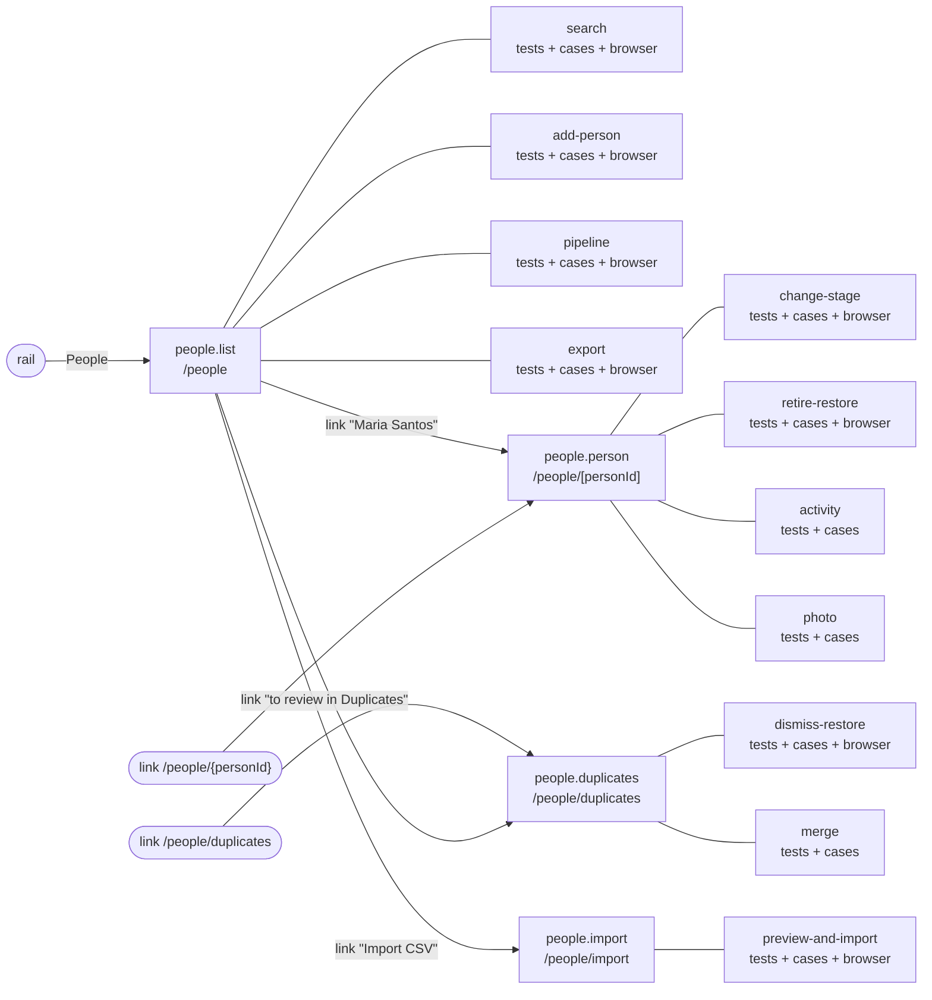

# Feature map: people

Generated from [`apps/web/src/features/people/feature-map.json`](../../apps/web/src/features/people/feature-map.json) by `node tools/ci/feature-maps.ts --write`. Do not edit by hand.



## Surfaces

### people.list

The church's directory as a list, cards or the recruitment pipeline, with search and filters in the address.

- Routes: `/people`
- Endpoints: `/api/people/export`
- Personas: plant-owner write, plant-admin write, plant-member read, visitor none
- Catalog: PPL-001, PPL-002, PPL-007, PPL-019
- Reach:
  - rail "People" (plant-owner, plant-admin, plant-member)

| State | Reach | Expect |
|---|---|---|
| populated | plant-owner opens `/people` | radiogroup "View"; button "Add person" |
| member | plant-member opens `/people` | radiogroup "View"; no text "Import CSV" |
| loading (`loading.tsx`) | manual: shows only while the server renders the list | text "Loading people" |
| error (`error.tsx`) | manual: renders only when the page throws while rendering | heading "We could not load your people" |

#### people.list#search

Typing in Search people narrows the directory after a pause and keeps the term in the address.

- Operations: people.listPeople
- Cases: TARGET-PPL-001
- Test: `tests/integration/people/people.test.mts`: `AC:TARGET-PPL-001 literal search, tag intersection, full totals and page numbers past ties`
- Test: `tests/unit/people/model.test.mjs`: `AC:TARGET-PPL-001 INV-url: the page number lives in the address; a filter change goes back to page one`
- Browser: As plant-owner, from state populated (`/people`):

```bash
agent-browser find label "Search people" fill "Maria"
agent-browser wait --load networkidle
agent-browser wait --url "**/people?q=Maria"
```

#### people.list#add-person

An Owner or Admin adds a person with only a name and lands on their page.

- Operations: people.createPerson
- Cases: TARGET-PPL-002
- Test: `tests/integration/people/people.test.mts`: `AC:TARGET-PPL-002 AC:LAUNCH46-003 AC:SEC-02 AC:TEN-002 minimal contact, explicit null, current tenancy and atomic retry`
- Browser: As plant-owner, from state populated (`/people`):

```bash
agent-browser find role button click --name "Add person" --exact
agent-browser find label "Name" fill "Map Proof Person"
agent-browser press Enter
agent-browser wait --load networkidle
agent-browser wait --url "**/people/*"
agent-browser find role heading text --name "Map Proof Person" --exact
```

#### people.list#pipeline

The Pipeline view groups people by stage, and a move keeps its place and its newest revision.

- Operations: people.getPipelineData, people.reorderPipeline
- Cases: TARGET-PPL-007
- Test: `tests/integration/people/people.test.mts`: `AC:TARGET-PPL-007 INV-move-round-trips: a pipeline move is one transaction with a constant round-trip count`
- Test: `tests/unit/people/model.test.mjs`: `AC:TARGET-PPL-007 INV-move-revisions: after reorder, away and back, a card keeps its newest revision and the saved order`
- Browser: As plant-owner, from state populated (`/people`):

```bash
agent-browser find role radio click --name "Pipeline" --exact
agent-browser wait --load networkidle
agent-browser wait --url "**/people?view=pipeline"
```

#### people.list#export

Export CSV downloads the directory as it is filtered, without private fields.

- Operations: people.exportPeople
- Cases: TARGET-PPL-019
- Test: `tests/integration/people/csv/csv.test.mts`: `AC:TARGET-PPL-019 AC:PERSONREF-HOUSEHOLD-TAG-SKILL-NOTE-RETIRE INV-tenancy INV-filters the export matches the directory's filters as formula-safe CSV without private fields`
- Browser: As plant-owner, from state populated (`/people`):

```bash
agent-browser find role button click --name "Export CSV" --exact
agent-browser wait --load networkidle
agent-browser find role heading text --name "Export people" --exact
```

### people.person

One person: profile, stage and its history, Activity, records, photo and commitment documents.

- Routes: `/people/[personId]`
- Endpoints: `/people/[personId]/photo/[versionId]`, `/people/[personId]/commitments/[commitmentId]/document`
- Personas: plant-owner write, plant-admin write, plant-member read
- Catalog: PPL-002, PPL-003, PPL-005, PPL-006, PPL-008, PPL-014
- Reach:
  - from people.list as plant-owner: click link "Maria Santos"
  - link `/people/{personId}` with `{personId}` = `<people:/people/Maria Santos>`

| State | Reach | Expect |
|---|---|---|
| populated | plant-owner opens `/people/{personId}` with `{personId}` = `<people:/people/Maria Santos>` | button "Change stage"; tablist "Person" |
| member | plant-member opens `/people/{personId}` with `{personId}` = `<people:/people/Maria Santos>` | tablist "Person"; no text "Change stage" |
| not-found (`not-found.tsx`) | plant-owner opens `/people/00000000-0000-4000-8000-000000000000` | heading "This person is not here"; link "Back to People" |
| error (`error.tsx`) | manual: renders only when the page throws while rendering | heading "We could not load your people" |

#### people.person#change-stage

Change stage moves a person to another stage with a reason, after the recorded-evidence check.

- Operations: people.changeStatus
- Cases: TARGET-PPL-006
- Test: `tests/integration/people/people.test.mts`: `AC:TARGET-PPL-006 AC:TARGET-PPL-007 AC:TARGET-PPL-003 stage skip, no-op, complete handoffs, retirement and guarded restore`
- Browser: As plant-owner, from state populated (`/people/{personId}` with `{personId}` = `<people:/people/Maria Santos>`):

```bash
agent-browser find role button click --name "Change stage" --exact
agent-browser wait --load networkidle
agent-browser find text "New stage" text --exact
agent-browser find text "Reason" text --exact
```

#### people.person#retire-restore

Retire person takes someone out of active lists; Restore person brings them back with their history.

- Operations: people.deletePerson, people.restorePerson
- Cases: TARGET-PPL-003
- Test: `tests/integration/people/people.test.mts`: `AC:TARGET-PPL-006 AC:TARGET-PPL-007 AC:TARGET-PPL-003 stage skip, no-op, complete handoffs, retirement and guarded restore`
- Browser: As plant-owner, from state populated (`/people/{personId}` with `{personId}` = `<people:/people/Maria Santos>`):

```bash
agent-browser find role button click --name "More actions" --exact
agent-browser wait --load networkidle
agent-browser find role menuitem text --name "Retire person" --exact
agent-browser find role menuitem text --name "Edit profile" --exact
```

#### people.person#activity

Activity lists changes and notes newest first, keeping each note's author and revisions.

- Operations: people.getActivities, people.addNote, people.editNote, people.deleteNote
- Cases: TARGET-PPL-008
- Test: `tests/integration/people/people.test.mts`: `AC:TARGET-PPL-008 person Activity is newest first and pages continue with older items without gaps or duplicates`
- Test: `tests/integration/people/people.test.mts`: `AC:TARGET-PPL-008 original author and exact note revisions preserve occurrence, tombstone and removed attribution`

#### people.person#photo

A person's photo is served only to readers who may see that person, as it is now.

- Operations: people.getPersonPhoto, people.setPersonPhoto, people.removePersonPhoto
- Cases: TARGET-IDN-006
- Test: `tests/integration/people/person-photos.test.mts`: `AC:TARGET-IDN-006: a reader whose seat ended gets a refusal, and a request past one page is refused`

### people.duplicates

Possible duplicates: pairs to review, dismiss or merge; Everyfield never merges on its own.

- Routes: `/people/duplicates`
- Personas: plant-owner write, plant-admin write, plant-member none
- Catalog: PPL-016, PPL-017
- Reach:
  - link `/people/duplicates`
  - from people.list as plant-owner: click link "to review in Duplicates"

| State | Reach | Expect |
|---|---|---|
| pairs | plant-owner opens `/people/duplicates` | heading "Possible duplicates"; link "Dismissed" |
| error (`error.tsx`) | manual: renders only when the page throws while rendering | heading "We could not load your people" |

#### people.duplicates#dismiss-restore

Dismiss moves a pair to the Dismissed view; Restore puts it back in its import order.

- Operations: people.listDuplicatePairs
- Cases: TARGET-PPL-016
- Test: `tests/integration/people/csv/duplicates.test.mts`: `AC:TARGET-PPL-016 a dismissed pair leaves the list for the Dismissed view, and Restore puts it back in its import order, each with its audit row`
- Test: `tests/unit/people/duplicate-pairs.test.mjs`: `a refused dismiss puts the row back in its place and says nothing changed`
- Browser: As plant-owner, from state pairs (`/people/duplicates`):

```bash
agent-browser find role link click --name "Dismissed" --exact
agent-browser wait --load networkidle
agent-browser wait --url "**/people/duplicates?view=dismissed"
```

#### people.duplicates#merge

A reviewed merge keeps the chosen details on the survivor and refuses what history blocks.

- Operations: people.mergePeople, people.unmergePeople
- Cases: TARGET-PPL-016
- Test: `tests/unit/people/corrections-model.test.mjs`: `AC:TARGET-PPL-016 a merge blocked by past history names what blocks it and gives no advice that cannot clear it`
- Test: `tests/integration/people/corrections/merge.test.mts`: `AC:REQ-PPL-024 a write racing a merge waits for it and never leaves a current reference on the retired source`

### people.import

Import people from a CSV: upload, preview with duplicates, choose per row, then import and resume.

- Routes: `/people/import`
- Endpoints: `/api/people/import`, `/api/people/import/preview`, `/api/people/import/retry`, `/api/people/import/template`, `/api/people/import/upload`
- Personas: plant-owner write, plant-admin write, plant-member none
- Catalog: PPL-018
- Reach:
  - from people.list as plant-owner: click link "Import CSV"

| State | Reach | Expect |
|---|---|---|
| choose-file | plant-owner opens `/people/import` | heading "Import people"; link "Download template" |
| error (`error.tsx`) | manual: renders only when the page throws while rendering | heading "We could not load your people" |

#### people.import#preview-and-import

The server reads the stored file, previews duplicates without writing, and imports exactly the reviewed rows.

- Operations: people.previewImport, people.executeBulkImport, people.generateCsvTemplate
- Cases: TARGET-PPL-018
- Test: `tests/integration/people/csv/csv.test.mts`: `AC:TARGET-PPL-018 the server reads the file honestly, previews duplicates without writing and refuses capped or malformed files`
- Test: `tests/integration/people/csv/stored-upload.test.mts`: `AC:TARGET-PPL-018 the Owner signs one upload, and the preview and the import read the stored object, never the browser's rows`
- Test: `tests/unit/people/import-done.test.mts`: `BUG-PR551 (people/peo-7): a partial Done screen lists every row that did not save, unreached rows included`
- Browser: As plant-owner, from state choose-file (`/people/import`):

```bash
agent-browser find role button text --name "Choose a CSV file" --exact
```
