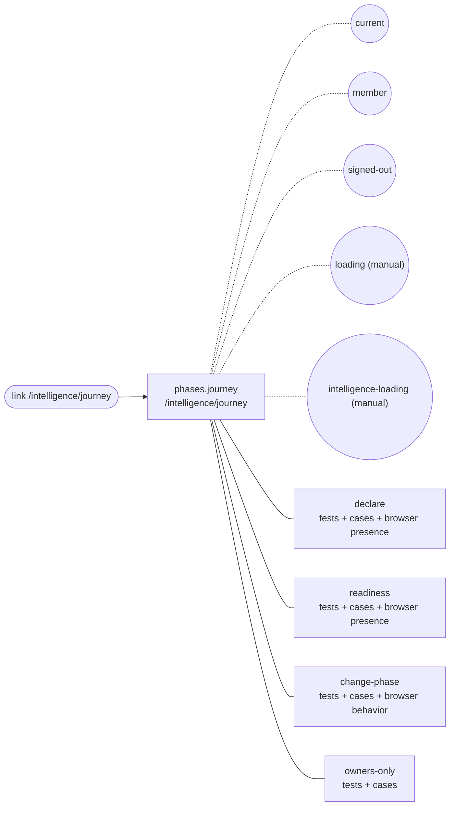

# Feature map: phases

Generated from [`apps/web/src/features/phases/feature-map.json`](../../apps/web/src/features/phases/feature-map.json) by `node tools/ci/feature-maps.ts --write`. Do not edit by hand.
Personas, sign-in and what the checker cannot catch: [README](README.md).



## Surfaces

### phases.journey

Where the church is on the Playbook's seven phases: the current phase and its signs, the journey so far, and a reasoned phase change.

- Routes: `/intelligence/journey`
- Personas: `owner` write, `admin` write, `member` none, `visitor` none
- Catalog: PHASE-001, PHASE-002, PHASE-004, PHASE-007, PHASE-008, PI-028, PI-030

Reach:

- Link `/intelligence/journey`

States:

- **current**: heading "Journey"; button "Change phase"; heading "The seven phases". As `owner`, on the QA seed:

```bash
agent-browser open "$ORIGIN/intelligence/journey"
agent-browser wait --load networkidle
agent-browser find role heading text --name "Journey" --exact
agent-browser find role button text --name "Change phase" --exact
agent-browser find role heading text --name "The seven phases" --exact
```

- **member**: heading "The journey is for Owners and Admins". As `member`, on the QA seed:

```bash
agent-browser open "$ORIGIN/intelligence/journey"
agent-browser wait --load networkidle
agent-browser find role heading text --name "The journey is for Owners and Admins" --exact
```

- **signed-out**: URL `/signin?returnTo=%2Fintelligence%2Fjourney`. As `visitor`, on the QA seed:

```bash
agent-browser open "$ORIGIN/intelligence/journey"
agent-browser wait --load networkidle
agent-browser wait --url "**/signin?returnTo=%2Fintelligence%2Fjourney"
```

- **loading** (`loading.tsx`): text "Loading the journey". Not scripted: shows only while the server renders the journey.
- **intelligence-loading** (`loading.tsx`): no text "Change phase". Not scripted: Plant Intelligence's loading screen, shown while a page outside Plant Intelligence opens this route.

#### phases.journey#declare

A church that started mid-journey declares where it was, once; two Admins at once leave one declaration.

- Operations: phases.declare
- Catalog: PHASE-001
- Cases: PHASE-CASE-001
- Test: `tests/integration/phases/phases.test.mts`: `AC:PHASE-CASE-001 AC:DC-022 AC:DC-032 AC:TARGET-IDN-015 a declaration records where the church was, once, and creation retry keeps it`
- Test: `tests/integration/phases/phases.test.mts`: `AC:PHASE-CASE-001 two Admins declaring at the same moment leave exactly one declaration`
- Browser, presence proof only (the control is there; the tests prove the outcome), from state current:

```bash
agent-browser find role button text --name "Declare phase" --exact
```

#### phases.journey#readiness

The signs that a phase is wrapping up are advice: Unknown holds readiness back without failing it.

- Operations: phases.readReadiness
- Catalog: PHASE-004, PHASE-008
- Cases: PHASE-CASE-004, PHASE-CASE-008
- Test: `tests/integration/phases/phases.test.mts`: `AC:PHASE-CASE-004 readiness is an advisory conjunction: Unknown holds it back without failing it`
- Test: `tests/integration/phases/phases.test.mts`: `AC:PHASE-CASE-008 AC:B02-032 the catalog has seven phases and the 19 reference keys; Phase 6 is terminal`
- Browser, presence proof only (the control is there; the tests prove the outcome), from state current:

```bash
agent-browser find role region text --name "Signs that Phase"
```

#### phases.journey#change-phase

Change phase moves the church to another phase with a reason; the journey shows the move with that reason.

- Operations: phases.transition
- Catalog: PHASE-002, PHASE-007
- Cases: PHASE-CASE-007, PHASE-CASE-002, PHASE-CASE-003
- Test: `tests/integration/phases/phases.test.mts`: `AC:PHASE-CASE-007 a reasoned move records from, to, direction, reason, actor and time; the history only grows`
- Test: `tests/integration/phases/phases.test.mts`: `AC:PHASE-CASE-002 two moves from the same reviewed revision: one wins from Phase 1, the other sees the change`
- Test: `tests/integration/phases/phases.test.mts`: `AC:PHASE-CASE-003 the same phase returns a noop receipt and changes nothing else`
- Browser, behavior proof (acts and checks the result), from state current:

```bash
agent-browser find role button click --name "Change phase" --exact
agent-browser wait --load networkidle
agent-browser find role combobox click --name "Move to" --exact
agent-browser wait --load networkidle
agent-browser press ArrowDown
agent-browser wait --load networkidle
agent-browser press Enter
agent-browser wait --load networkidle
agent-browser find label "Reason" fill "Map phase move"
agent-browser find role button click --name "Move to Phase"
agent-browser wait --load networkidle
agent-browser wait --text "Map phase move"
! agent-browser find role dialog text --name "Change phase" --exact
```

#### phases.journey#owners-only

Only a live Owner or Admin seat reads the journey or changes the phase.

- Operations: phases.readHistory
- Catalog: PHASE-007
- Cases: PHASE-CASE-007
- Test: `tests/integration/phases/phases.test.mts`: `AC:PHASE-CASE-007 only a live Owner or Admin seat reads the journey or changes the phase`
