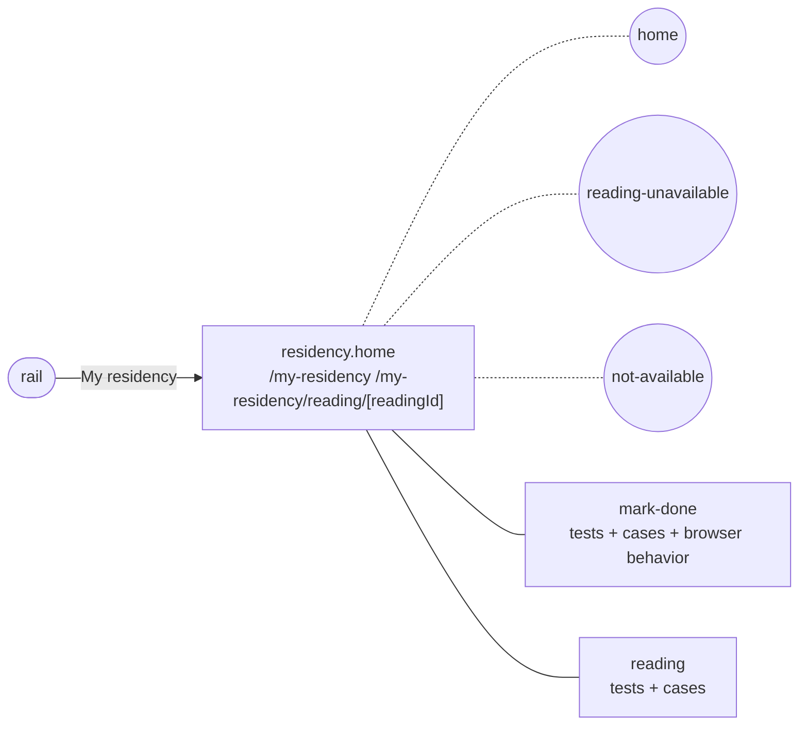

# Feature map: residency

Generated from [`apps/web/src/features/residency/feature-map.json`](../../apps/web/src/features/residency/feature-map.json) by `node tools/ci/feature-maps.ts --write`. Do not edit by hand.
Personas, sign-in and what the checker cannot catch: [README](README.md).



## Surfaces

### residency.home

My residency, for a resident with no seat: the program, stage, next meeting, what the sending church sees, milestones, feedback and reading.

- Routes: `/my-residency`, `/my-residency/reading/[readingId]`
- Personas: `resident` write, `signup` none
- Catalog: MUL-012, MUL-013, MUL-014

Reach:

- Rail "My residency" for `resident`

States:

- **home**: heading "My residency"; heading "Church planting residency"; link "Change what you share". As `resident`, on the QA seed:

```bash
agent-browser open "$ORIGIN/my-residency"
agent-browser wait --load networkidle
agent-browser find role heading text --name "My residency" --exact
agent-browser find role heading text --name "Church planting residency" --exact
agent-browser find role link text --name "Change what you share" --exact
```

- **reading-unavailable**: heading "This reading isn’t available"; link "Back to My residency". As `resident`, on the QA seed:

```bash
agent-browser open "$ORIGIN/my-residency/reading/00000000-0000-4000-8000-000000000000"
agent-browser wait --load networkidle
agent-browser find role heading text --name "This reading isn’t available" --exact
agent-browser find role link text --name "Back to My residency" --exact
```

- **not-available**: heading "This page is not available". As `signup`, on the QA seed:

```bash
agent-browser open "$ORIGIN/my-residency"
agent-browser wait --load networkidle
agent-browser find role heading text --name "This page is not available" --exact
```

#### residency.home#mark-done

A resident marks a milestone done; it waits for the director to confirm, also after a reload.

- Operations: development.completeMilestone
- Catalog: MUL-012
- Cases: ADR1-012
- Test: `tests/integration/organizations/residency.test.mts`: `AC:ADR1-012 Casey marks a milestone done; it waits; Ana confirms it; Ana cannot record Casey's milestones in one step`
- Browser, behavior proof (acts and checks the result), from state home:

```bash
agent-browser find role button click --name "Mark done" --exact
agent-browser wait --load networkidle
agent-browser open "$ORIGIN/my-residency"
agent-browser wait --load networkidle
agent-browser wait --text "Waiting for"
```

#### residency.home#reading

A reading opens only from the resident's own list; the QA residency has no reading, so the tests prove it.

- No operation: the reading is loadResidentReading; the catalog's residency.resolveReading names no code
- Catalog: MUL-014
- Cases: ADR1-014
- Test: `tests/integration/organizations/residency.test.mts`: `AC:ADR1-014 church reading opens only from Casey's own list; another church article does not; unpublished reads unavailable`
