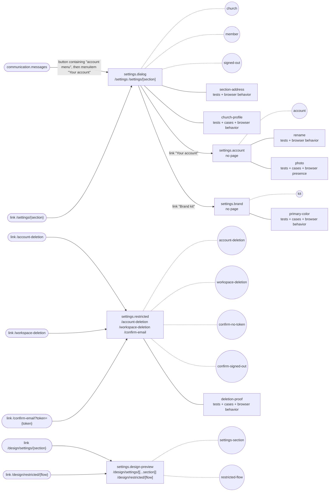

# Feature map: settings

Generated from [`apps/web/src/features/settings/feature-map.json`](../../apps/web/src/features/settings/feature-map.json) by `node tools/ci/feature-maps.ts --write`. Do not edit by hand.
Personas, sign-in and what the checker cannot catch: [README](README.md).



## Surfaces

### settings.dialog

Settings: a dialog over the page underneath, one address per section, offering the sections this seat may change.

- Routes: `/settings`, `/settings/[section]`
- Personas: `owner` write, `admin` write, `member` write, `resident` write, `visitor` none
- Catalog: IDN-010, IDN-011

Reach:

- From communication.messages as `owner`:

```bash
agent-browser find role button click --name "account menu"
agent-browser wait --load networkidle
agent-browser find role menuitem click --name "Your account" --exact
agent-browser wait --load networkidle
agent-browser wait --url "**/settings/account"
```

- Link `/settings/{section}` where `{section}` is a section key: church, brand, notifications, wiki-sources or account

States:

- **church**: dialog "Church profile"; textbox "Church name"; link "Brand kit"; link "Your account". As `owner`, on the QA seed:

```bash
agent-browser open "$ORIGIN/settings"
agent-browser wait --load networkidle
agent-browser find role dialog text --name "Church profile" --exact
agent-browser find role textbox text --name "Church name" --exact
agent-browser find role link text --name "Brand kit" --exact
agent-browser find role link text --name "Your account" --exact
```

- **member**: dialog "Notifications"; link "Your account"; no link "Church profile"; no link "Brand kit". As `member`, on the QA seed:

```bash
agent-browser open "$ORIGIN/settings"
agent-browser wait --load networkidle
agent-browser find role dialog text --name "Notifications" --exact
agent-browser find role link text --name "Your account" --exact
! agent-browser find role link text --name "Church profile" --exact
! agent-browser find role link text --name "Brand kit" --exact
```

- **signed-out**: URL `/signin?returnTo=%2Fsettings%2Faccount`. As `visitor`, on the QA seed:

```bash
agent-browser open "$ORIGIN/settings/account"
agent-browser wait --load networkidle
agent-browser wait --url "**/signin?returnTo=%2Fsettings%2Faccount"
```

#### settings.dialog#section-address

Each section has its own address; choosing one in the dialog's list writes it.

- No operation: its catalog read, settings.getSection, is a name the code does not quote or declare
- Catalog: IDN-010
- Test: `tests/integration/settings/settings.test.mts`: `INV-performance: each settings section reads in one statement on the pool, without a transaction`
- Test: `tests/unit/settings/drafts-model.test.mjs`: `INV-draft-model: random interleavings keep the invariant`
- Browser, behavior proof (acts and checks the result), from state church:

```bash
agent-browser find role link click --name "Your account" --exact
agent-browser wait --load networkidle
agent-browser wait --url "**/settings/account"
agent-browser find role dialog text --name "Your account" --exact
agent-browser find role textbox text --name "Your name" --exact
```

#### settings.dialog#church-profile

An Owner saves the church profile, and the new church name shows across the app.

- Operations: plant.updateProfile
- Catalog: IDN-011
- Cases: TARGET-IDN-010, TARGET-IDN-011
- Test: `tests/integration/settings/settings.test.mts`: `AC:TARGET-IDN-010 AC:TARGET-IDN-011 AC:ROLE43-002 AC:ROLE43-005 scoped settings preserve nullable locality and reject stale or foreign saves`
- Browser, behavior proof (acts and checks the result), from state church:

```bash
agent-browser find label "Church name" fill "Harvest Point (QA) Map"
agent-browser find role button click --name "Save" --exact
agent-browser wait --load networkidle
agent-browser find text "No unsaved changes." text --exact
agent-browser open "$ORIGIN/overview"
agent-browser wait --load networkidle
agent-browser wait --text "Harvest Point (QA) Map"
```

### settings.account

Your account: your name, photo, email, password and sessions, and deleting the account.

- Routes: none
- Endpoints: `/api/accounts/[accountId]/avatar/[versionId]`
- Personas: `owner` write, `admin` write, `member` write, `resident` write
- Catalog: IDN-006, IDN-007, IDN-010

Reach:

- From settings.dialog as `owner`:

```bash
agent-browser find role link click --name "Your account" --exact
agent-browser wait --load networkidle
agent-browser wait --url "**/settings/account"
```

States:

- **account**: dialog "Your account"; textbox "Your name"; button "Add photo"; button "Change password". As `member`, on the QA seed:

```bash
agent-browser open "$ORIGIN/settings/account"
agent-browser wait --load networkidle
agent-browser find role dialog text --name "Your account" --exact
agent-browser find role textbox text --name "Your name" --exact
agent-browser find role button text --name "Add photo" --exact
agent-browser find role button text --name "Change password" --exact
```

#### settings.account#rename

Saving Your name changes the name the app shows for you, starting with the account menu.

- Operations: settings.saveSection
- Catalog: IDN-010
- Test: `tests/integration/settings/settings.test.mts`: `INV-account-revision people/peo-3: Your account and notifications share one revision; a save in one moves the other's and the old revision is refused`
- Browser, behavior proof (acts and checks the result), from state account:

```bash
agent-browser find label "Your name" fill "Ruth Map Allen"
agent-browser find role button click --name "Save" --exact
agent-browser wait --load networkidle
agent-browser find text "No unsaved changes." text --exact
agent-browser open "$ORIGIN/overview"
agent-browser wait --load networkidle
agent-browser find role button text --name "Ruth Map Allen"
```

#### settings.account#photo

Add photo uploads a private photo that only seat holders who share a church or a current link can load.

- Operations: account.finalizeAvatar
- Catalog: IDN-006
- Cases: TARGET-IDN-006
- Test: `tests/integration/settings/settings.test.mts`: `AC:TARGET-IDN-006 AC:SEC-07 AC:PROVIDER48-002 avatar verifies private bytes, atomically changes the reference and denies old/foreign versions`
- Test: `tests/integration/settings/settings.test.mts`: `AC:TARGET-IDN-006: seat holders in the same church load each other's current photo; nobody else does`
- Browser, presence proof only (the control is there; the tests prove the outcome), from state account:

```bash
agent-browser find role button text --name "Add photo" --exact
```

### settings.brand

Brand kit: logos, colors with their contrast, fonts and letterhead that church documents use.

- Routes: none
- Endpoints: `/api/brand/assets/[id]`
- Personas: `owner` write, `admin` write, `member` none
- Catalog: BRD-001, BRD-002, BRD-003

Reach:

- From settings.dialog as `owner`:

```bash
agent-browser find role link click --name "Brand kit" --exact
agent-browser wait --load networkidle
agent-browser wait --url "**/settings/brand"
```

States:

- **kit**: dialog "Brand kit"; heading "Logos and images"; textbox "Primary color". As `owner`, on the QA seed:

```bash
agent-browser open "$ORIGIN/settings/brand"
agent-browser wait --load networkidle
agent-browser find role dialog text --name "Brand kit" --exact
agent-browser find role heading text --name "Logos and images" --exact
agent-browser find role textbox text --name "Primary color" --exact
```

#### settings.brand#primary-color

A saved primary color stays with its contrast reading when the kit opens again.

- Operations: brand.saveSettings
- Catalog: BRD-003
- Cases: CASE-BRD-003
- Test: `tests/integration/branding/branding.test.mts`: `AC:CASE-BRD-003 colors, contrast, primary required, revision conflict, audit`
- Browser, behavior proof (acts and checks the result), from state kit:

```bash
agent-browser find label "Primary color" fill "#2F6F4E"
agent-browser find role button click --name "Save" --exact
agent-browser wait --load networkidle
agent-browser find text "No unsaved changes." text --exact
agent-browser open "$ORIGIN/settings/brand"
agent-browser wait --load networkidle
agent-browser wait --text "passes text"
```

### settings.restricted

The pages outside the app that a deletion request or an email-change link opens.

- Routes: `/account-deletion`, `/workspace-deletion`, `/confirm-email`
- Personas: `visitor` write, `owner` write
- Catalog: IDN-007, IDN-026

Reach:

- Link `/account-deletion`
- Link `/workspace-deletion`
- Link `/confirm-email?token={token}` where `{token}` is the proof in the email-change message

States:

- **account-deletion**: heading "Your account deletion"; textbox "Email"; button "Continue". As `visitor`, on the QA seed:

```bash
agent-browser open "$ORIGIN/account-deletion"
agent-browser wait --load networkidle
agent-browser find role heading text --name "Your account deletion" --exact
agent-browser find role textbox text --name "Email" --exact
agent-browser find role button text --name "Continue" --exact
```

- **workspace-deletion**: heading "Church workspace deletion"; button "Continue". As `visitor`, on the QA seed:

```bash
agent-browser open "$ORIGIN/workspace-deletion"
agent-browser wait --load networkidle
agent-browser find role heading text --name "Church workspace deletion" --exact
agent-browser find role button text --name "Continue" --exact
```

- **confirm-no-token**: heading "This link does not work"; link "Open Your account". As `owner`, on the QA seed:

```bash
agent-browser open "$ORIGIN/confirm-email"
agent-browser wait --load networkidle
agent-browser find role heading text --name "This link does not work" --exact
agent-browser find role link text --name "Open Your account" --exact
```

- **confirm-signed-out**: URL `/signin?returnTo=%2Fconfirm-email`. As `visitor`, on the QA seed:

```bash
agent-browser open "$ORIGIN/confirm-email"
agent-browser wait --load networkidle
agent-browser wait --url "**/signin?returnTo=%2Fconfirm-email"
```

#### settings.restricted#deletion-proof

The deletion page opens a request only for the email and password of an account scheduled for deletion; anything else gets one refusal.

- No operation: its catalog read, account.getDeletionStatus, is a name the code does not quote or declare
- Catalog: IDN-026
- Cases: TARGET-IDN-026
- Test: `tests/integration/settings/settings.test.mts`: `AC:DEL58-002 INV-performance: a fresh password proof opens only the account's current request; status and cancel stay small`
- Test: `tests/integration/settings/settings.test.mts`: `AC:DEL58-001 AC:DEL58-002 AC:DEL58-003 AC:DEL58-005 AC:TARGET-IDN-026 AC:ROLE43-017 AC:DEL58-004 personal deletion suspends immediately and only fresh exact proof cancels`
- Browser, behavior proof (acts and checks the result), from state account-deletion:

```bash
agent-browser find label "Email" fill "nobody@example.test"
agent-browser find label "Password" fill "not-the-password-1"
agent-browser find role button click --name "Continue" --exact
agent-browser wait --load networkidle
agent-browser wait --text "This email and password do not match an account that is scheduled for deletion."
```

### settings.design-preview

Design previews of the Settings dialog and the restricted pages, with sample data and no database. Production returns 404.

- Routes: `/design/settings/[[...section]]`, `/design/restricted/[flow]`
- Personas: `visitor` read

Reach:

- Link `/design/settings/{section}` where `{section}` is a section key, or nothing for the page with Settings closed
- Link `/design/restricted/{flow}` where `{flow}` is account-deletion, workspace-deletion or confirm-email

States:

- **settings-section**: heading "Church profile"; link "Your account"; textbox "Church name". As `visitor`, on the QA seed:

```bash
agent-browser open "$ORIGIN/design/settings/church"
agent-browser wait --load networkidle
agent-browser find role heading text --name "Church profile" --exact
agent-browser find role link text --name "Your account" --exact
agent-browser find role textbox text --name "Church name" --exact
```

- **restricted-flow**: heading "Your account is scheduled for deletion"; button "Keep my account". As `visitor`, on the QA seed:

```bash
agent-browser open "$ORIGIN/design/restricted/account-deletion"
agent-browser wait --load networkidle
agent-browser find role heading text --name "Your account is scheduled for deletion" --exact
agent-browser find role button text --name "Keep my account" --exact
```

