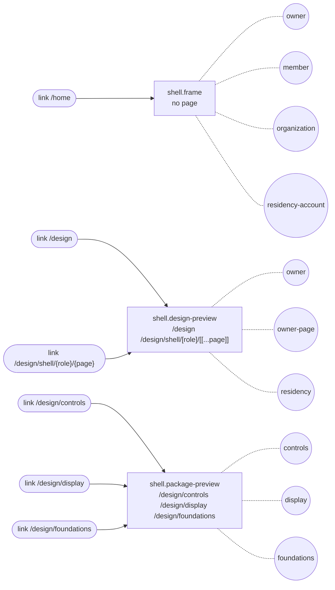

# Feature map: shell

Generated from [`apps/web/src/features/shell/feature-map.json`](../../apps/web/src/features/shell/feature-map.json) by `node tools/ci/feature-maps.ts --write`. Do not edit by hand.
Personas, sign-in and what the checker cannot catch: [README](README.md).



## Surfaces

### shell.frame

The product frame around every signed-in page: the rail with the pages this persona may open, search, notifications, Ask Evry and the account menu. Each page's own map says where its rail link leads.

- Routes: none
- Personas: `owner` read, `member` read, `network` read, `resident` read, `visitor` none

Reach:

- Link `/home`

States:

- **owner**: navigation "Main"; link "Messages"; link "Plant Intelligence"; button "Ask Evry"; button containing "account menu". As `owner`, on the QA seed:

```bash
agent-browser open "$ORIGIN/overview"
agent-browser wait --load networkidle
agent-browser find role navigation text --name "Main" --exact
agent-browser find role link text --name "Messages" --exact
agent-browser find role link text --name "Plant Intelligence" --exact
agent-browser find role button text --name "Ask Evry" --exact
agent-browser find role button text --name "account menu"
```

- **member**: link "Messages"; no link "Plant Intelligence". As `member`, on the QA seed:

```bash
agent-browser open "$ORIGIN/overview"
agent-browser wait --load networkidle
agent-browser find role link text --name "Messages" --exact
! agent-browser find role link text --name "Plant Intelligence" --exact
```

- **organization**: link "Pipeline"; link "Sent for review"; no link "Meetings". As `network`, on the QA seed:

```bash
agent-browser open "$ORIGIN/network"
agent-browser wait --load networkidle
agent-browser find role link text --name "Pipeline" --exact
agent-browser find role link text --name "Sent for review" --exact
! agent-browser find role link text --name "Meetings" --exact
```

- **residency-account**: link "My residency"; no link "People". As `resident`, on the QA seed:

```bash
agent-browser open "$ORIGIN/notifications"
agent-browser wait --load networkidle
agent-browser find role link text --name "My residency" --exact
! agent-browser find role link text --name "People" --exact
```

### shell.design-preview

A design preview of the product frame as an Owner, a Member or a residency account, with sample data and no database. Production returns 404.

- Routes: `/design`, `/design/shell/[role]/[[...page]]`
- Personas: `visitor` read

Reach:

- Link `/design`
- Link `/design/shell/{role}/{page}` where `{role}` is owner, member or residency, `{page}` is a rail page key, or nothing for the first page

States:

- **owner**: URL `/design/shell/owner`; heading "Preview as"; link "Plant Intelligence". As `visitor`, on the QA seed:

```bash
agent-browser open "$ORIGIN/design"
agent-browser wait --load networkidle
agent-browser wait --url "**/design/shell/owner"
agent-browser find role heading text --name "Preview as" --exact
agent-browser find role link text --name "Plant Intelligence" --exact
```

- **owner-page**: URL `/design/shell/owner/people`; heading "People". As `visitor`, on the QA seed:

```bash
agent-browser open "$ORIGIN/design/shell/owner"
agent-browser wait --load networkidle
agent-browser find role link click --name "People" --exact
agent-browser wait --load networkidle
agent-browser wait --url "**/design/shell/owner/people"
agent-browser find role heading text --name "People" --exact
```

- **residency**: heading "My residency"; no link "People". As `visitor`, on the QA seed:

```bash
agent-browser open "$ORIGIN/design/shell/residency"
agent-browser wait --load networkidle
agent-browser find role heading text --name "My residency" --exact
! agent-browser find role link text --name "People" --exact
```

### shell.package-preview

Design previews of the shared UI package inside the product frame as an Owner: controls, display parts and foundations, with sample data and no database. Production returns 404.

- Routes: `/design/controls`, `/design/display`, `/design/foundations`
- Personas: `visitor` read

Reach:

- Link `/design/controls`
- Link `/design/display`
- Link `/design/foundations`

States:

- **controls**: heading "Controls"; heading "Card". As `visitor`, on the QA seed:

```bash
agent-browser open "$ORIGIN/design/controls"
agent-browser wait --load networkidle
agent-browser find role heading text --name "Controls" --exact
agent-browser find role heading text --name "Card" --exact
```

- **display**: heading "Display"; heading "Badges, chips and avatars". As `visitor`, on the QA seed:

```bash
agent-browser open "$ORIGIN/design/display"
agent-browser wait --load networkidle
agent-browser find role heading text --name "Display" --exact
agent-browser find role heading text --name "Badges, chips and avatars" --exact
```

- **foundations**: heading "Foundations"; heading "Logo". As `visitor`, on the QA seed:

```bash
agent-browser open "$ORIGIN/design/foundations"
agent-browser wait --load networkidle
agent-browser find role heading text --name "Foundations" --exact
agent-browser find role heading text --name "Logo" --exact
```

