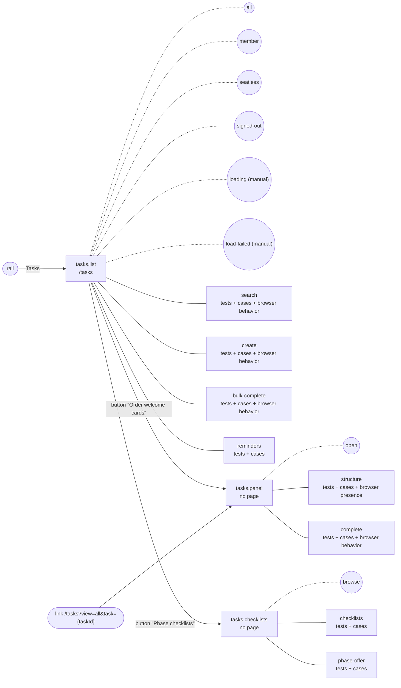

# Feature map: tasks

Generated from [`apps/web/src/features/tasks/feature-map.json`](../../apps/web/src/features/tasks/feature-map.json) by `node tools/ci/feature-maps.ts --write`. Do not edit by hand.
Personas, sign-in and what the checker cannot catch: [README](README.md).



## Surfaces

### tasks.list

The church's tasks: yours or everyone's, searched, filtered and changed in bulk.

- Routes: `/tasks`
- Endpoints: `/tasks/read`
- Personas: `owner` write, `admin` write, `member` write, `signup` none, `visitor` none
- Catalog: TSK-001, TSK-002, TSK-008, TSK-014, TSK-016

Reach:

- Rail "Tasks" for `owner`, `admin`, `member`

States:

- **all**: heading "All tasks"; button "New task"; button "Draft the first-year budget". As `owner`, on the QA seed:

```bash
agent-browser open "$ORIGIN/tasks?view=all"
agent-browser wait --load networkidle
agent-browser find role heading text --name "All tasks" --exact
agent-browser find role button text --name "New task" --exact
agent-browser find role button text --name "Draft the first-year budget" --exact
```

- **member**: heading "What your Member seat can do"; no button "New task". As `member`, on the QA seed:

```bash
agent-browser open "$ORIGIN/tasks"
agent-browser wait --load networkidle
agent-browser find role heading text --name "What your Member seat can do" --exact
! agent-browser find role button text --name "New task" --exact
```

- **seatless**: heading "Tasks are not part of your seat". As `signup`, on the QA seed:

```bash
agent-browser open "$ORIGIN/tasks"
agent-browser wait --load networkidle
agent-browser find role heading text --name "Tasks are not part of your seat" --exact
```

- **signed-out**: URL `/signin?returnTo=%2Ftasks`. As `visitor`, on the QA seed:

```bash
agent-browser open "$ORIGIN/tasks"
agent-browser wait --load networkidle
agent-browser wait --url "**/signin?returnTo=%2Ftasks"
```

- **loading** (`loading.tsx`): text "Loading tasks". Not scripted: shows only while the server renders the list.
- **load-failed**: heading "We could not load your tasks". Not scripted: renders only when the list read fails on the server.

#### tasks.list#search

Searching by title narrows the list and lives in the address.

- Operations: tasks.list
- Catalog: TSK-001
- Cases: TARGET-TSK-001
- Test: `tests/integration/tasks/tasks.test.mts`: `AC:TARGET-TSK-001 AC:B03-001 AC:B03-002 AC:B03-003 views, stable pages, counts and due state`
- Test: `tests/unit/tasks/model.test.mjs`: `AC:TARGET-TSK-001 INV-url: filters live in the address, reset the page and keep their siblings`
- Browser, behavior proof (acts and checks the result), from state all:

```bash
agent-browser find label "Search tasks by title" fill "budget"
agent-browser wait --url "**/tasks?view=all&q=budget"
agent-browser find role button text --name "Draft the first-year budget" --exact
! agent-browser find role button text --name "Order welcome cards" --exact
```

#### tasks.list#create

New task adds a task with only a title; it joins the list at once.

- Operations: tasks.create
- Catalog: TSK-002, TSK-016
- Cases: TARGET-TSK-002, TARGET-TSK-016
- Test: `tests/integration/tasks/tasks.test.mts`: `AC:TARGET-TSK-002 AC:B03-007 AC:B03-008 AC:B03-009 AC:TARGET-TSK-018 create, edit and delete keep a valid task or change nothing`
- Test: `tests/integration/tasks/templates.test.mts`: `AC:TARGET-TSK-016 create, edit and import keep the typed text, drop unsafe links and clear an empty description`
- Browser, behavior proof (acts and checks the result), from state all:

```bash
agent-browser find role button click --name "New task" --exact
agent-browser wait --load networkidle
agent-browser find label "Title" fill "Map new task"
agent-browser find role button click --name "Add task" --exact
agent-browser wait --load networkidle
agent-browser find role button text --name "Map new task" --exact
```

#### tasks.list#bulk-complete

Selecting tasks offers Complete and Reschedule for all of them in one write.

- Operations: tasks.bulkComplete, tasks.bulkReschedule
- Catalog: TSK-008
- Cases: TARGET-TSK-008
- Test: `tests/integration/tasks/tasks.test.mts`: `AC:TARGET-TSK-008 bulk changes report each task, commit all valid tasks or none, and never repeat on retry`
- Test: `tests/unit/tasks/model.test.mjs`: `AC:TARGET-TSK-008 INV-bulk-actions: complete and reschedule apply only to open tasks`
- Browser, behavior proof (acts and checks the result), from state all:

```bash
agent-browser find role checkbox click --name "Book the school gym for launch Sunday"
agent-browser wait --load networkidle
agent-browser find role button click --name "Complete" --exact
agent-browser wait --load networkidle
agent-browser wait --text "Completed"
agent-browser find role heading text --name "Closed"
```

#### tasks.list#reminders

A due or overdue task reminds each current assignee, and stops once the task is settled.

- Operations: notifications.syncTaskReminders
- Catalog: TSK-014
- Cases: TARGET-TSK-014
- Test: `tests/integration/tasks/tasks.test.mts`: `AC:TARGET-TSK-014 due and overdue reminders follow the current assignee and stop when settled`
- Test: `tests/integration/tasks/tasks.test.mts`: `AC:TARGET-TSK-014 each assignee gets their own reminders, and removing one withdraws only theirs`

### tasks.panel

One task in a side panel over the list: mark it done or reopen it, its steps, blockers, repeat rule and status history.

- Routes: none
- Personas: `owner` write, `admin` write, `member` write
- Catalog: TSK-003, TSK-005, TSK-006, TSK-007, TSK-015

Reach:

- From tasks.list as `owner`:

```bash
agent-browser find role button click --name "Order welcome cards" --exact
agent-browser wait --load networkidle
agent-browser wait --url "**/tasks?view=all&task=*"
```

- Link `/tasks?view=all&task={taskId}` where `{taskId}` is the id in an open task panel's address

States:

- **open**: heading "Order welcome cards"; button "Mark done"; button "Add a step". As `owner`, on the QA seed:

```bash
agent-browser open "$ORIGIN/tasks?view=all"
agent-browser wait --load networkidle
agent-browser find role button click --name "Order welcome cards" --exact
agent-browser wait --load networkidle
agent-browser wait --url "**/tasks?view=all&task=*"
agent-browser find role heading text --name "Order welcome cards" --exact
agent-browser find role button text --name "Mark done" --exact
agent-browser find role button text --name "Add a step" --exact
```

#### tasks.panel#structure

The panel holds one level of steps, the tasks this one waits for and a repeat rule that makes the next task.

- Operations: tasks.createSubtask, tasks.replacePrerequisites, tasks.configureRecurrence
- Catalog: TSK-005, TSK-006, TSK-007
- Cases: TARGET-TSK-005, TARGET-TSK-006, TARGET-TSK-007
- Test: `tests/integration/tasks/tasks.test.mts`: `AC:TARGET-TSK-005 AC:EVRY-REAL-CHILD-TASK-PARITY checklist rows are one-level tasks with their own assignee and history`
- Test: `tests/integration/tasks/tasks.test.mts`: `AC:TARGET-TSK-006 prerequisites never form a cycle, even proposed at once, and settled or deleted ones stop blocking`
- Test: `tests/integration/tasks/tasks.test.mts`: `AC:TARGET-TSK-007 AC:TARGET-TSK-018 completing a recurring task creates exactly one next task with a fresh checklist`
- Browser, presence proof only (the control is there; the tests prove the outcome), from state open:

```bash
agent-browser find role button text --name "Add a step" --exact
agent-browser find role button text --name "Add a task" --exact
agent-browser find role button text --name "Make it repeat" --exact
```

#### tasks.panel#complete

Mark done in the task panel closes the task; Reopen takes it back, and both land in its status history.

- Operations: tasks.complete, tasks.reopen
- Catalog: TSK-003, TSK-015
- Cases: TARGET-TSK-003, TARGET-TSK-015
- Test: `tests/integration/tasks/tasks.test.mts`: `AC:TARGET-TSK-003 AC:TARGET-TSK-015 own-duty completion, one result per request, reopen and history`
- Browser, behavior proof (acts and checks the result), from state open:

```bash
agent-browser find role button click --name "Mark done" --exact
agent-browser wait --load networkidle
agent-browser find role button text --name "Reopen" --exact
```

### tasks.checklists

The Playbook's checklists by phase, and the offer of the new phase's checklists after a phase move.

- Routes: none
- Personas: `owner` write, `admin` write, `member` none
- Catalog: TSK-009, TSK-010

Reach:

- From tasks.list as `owner`:

```bash
agent-browser find role button click --name "Phase checklists" --exact
agent-browser wait --load networkidle
```

States:

- **browse**: dialog "Phase checklists"; text containing "Current phase". As `owner`, on the QA seed:

```bash
agent-browser open "$ORIGIN/tasks?view=all"
agent-browser wait --load networkidle
agent-browser find role button click --name "Phase checklists" --exact
agent-browser wait --load networkidle
agent-browser find role dialog text --name "Phase checklists" --exact
agent-browser wait --text "Current phase"
```

#### tasks.checklists#checklists

Phase checklists lists the Playbook checklists by phase; an import adds exactly the previewed tasks.

- Operations: tasks.listTemplates, tasks.previewTemplate, tasks.importTemplate
- Catalog: TSK-009
- Cases: TARGET-TSK-009
- Test: `tests/integration/tasks/templates.test.mts`: `AC:TARGET-TSK-009 an Owner or Admin browses all 20 checklists with the current phase; a Member is refused`
- Test: `tests/integration/tasks/templates.test.mts`: `AC:TARGET-TSK-009 an import adds exactly the previewed tasks; a retry replays it and a new import adds a second set`

#### tasks.checklists#phase-offer

After a real phase move, Tasks offers the new phase's checklists once; accept or decline is answered once.

- Operations: tasks.readPhaseOffer, tasks.acceptPhaseOffer, tasks.declinePhaseOffer
- Catalog: TSK-010
- Cases: TARGET-TSK-010, PHASE-CASE-006
- Test: `tests/integration/tasks/templates.test.mts`: `AC:PHASE-CASE-006 AC:TARGET-TSK-010 the Owner accepts a subset dated from the move, and the offer is gone`
- Test: `tests/integration/tasks/templates.test.mts`: `AC:TARGET-TSK-010 INV-one-answer two devices answer at once: one answer commits and the other reads what it decided`
