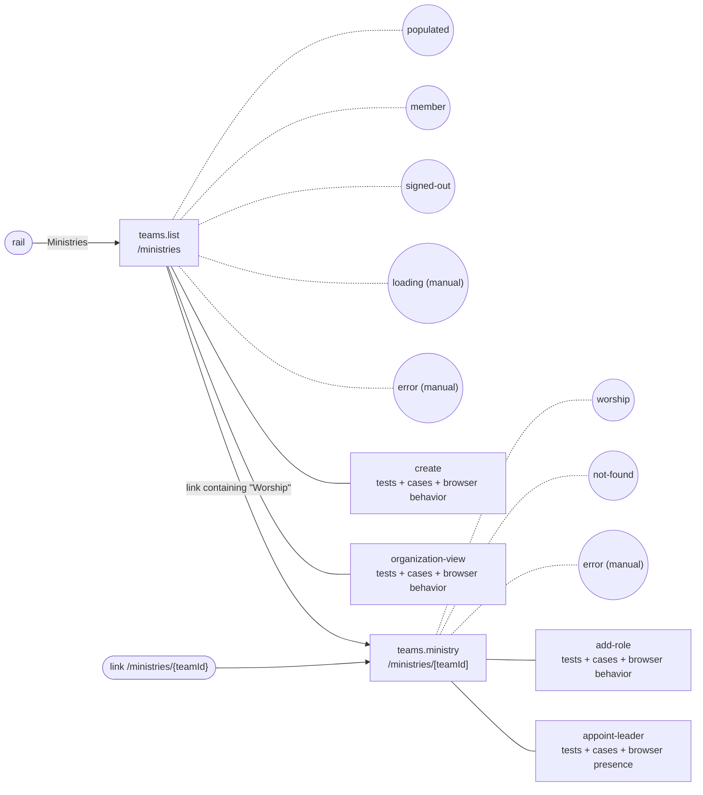

# Feature map: teams

Generated from [`apps/web/src/features/teams/feature-map.json`](../../apps/web/src/features/teams/feature-map.json) by `node tools/ci/feature-maps.ts --write`. Do not edit by hand.
Personas, sign-in and what the checker cannot catch: [README](README.md).



## Surfaces

### teams.list

Ministries: every team with its state, leader and how many serve, and the organization chart.

- Routes: `/ministries`
- Personas: `owner` write, `admin` write, `member` read, `visitor` none
- Catalog: TEAM-001, TEAM-012

Reach:

- Rail "Ministries" for `owner`, `admin`, `member`

States:

- **populated**: heading "Ministries"; link containing "Worship"; button "New ministry"; button "Set up from templates". As `owner`, on the QA seed:

```bash
agent-browser open "$ORIGIN/ministries"
agent-browser wait --load networkidle
agent-browser find role heading text --name "Ministries" --exact
agent-browser find role link text --name "Worship"
agent-browser find role button text --name "New ministry" --exact
agent-browser find role button text --name "Set up from templates" --exact
```

- **member**: heading "Ministries"; link containing "Worship"; no button "New ministry". As `member`, on the QA seed:

```bash
agent-browser open "$ORIGIN/ministries"
agent-browser wait --load networkidle
agent-browser find role heading text --name "Ministries" --exact
agent-browser find role link text --name "Worship"
! agent-browser find role button text --name "New ministry" --exact
```

- **signed-out**: URL `/signin?returnTo=%2Fministries`. As `visitor`, on the QA seed:

```bash
agent-browser open "$ORIGIN/ministries"
agent-browser wait --load networkidle
agent-browser wait --url "**/signin?returnTo=%2Fministries"
```

- **loading** (`loading.tsx`): text "Loading ministries". Not scripted: shows only while the server renders the list.
- **error** (`error.tsx`): heading "We could not load ministries". Not scripted: renders only when the page throws while rendering.

#### teams.list#create

New ministry creates a team and opens its page.

- Operations: teams.create
- Catalog: TEAM-001
- Cases: TARGET-TEAM-001
- Test: `tests/integration/teams/ministry.test.mts`: `AC:TARGET-TEAM-001 the ministries list carries each leader's name, and a stale write reads the revision alone`
- Browser, behavior proof (acts and checks the result), from state populated:

```bash
agent-browser find role button click --name "New ministry" --exact
agent-browser wait --load networkidle
agent-browser find label "Name" fill "Map Outreach"
agent-browser find role button click --name "Create ministry" --exact
agent-browser wait --load networkidle
agent-browser wait --url "**/ministries/*"
agent-browser find role heading text --name "Map Outreach" --exact
agent-browser find role button text --name "Appoint leader" --exact
```

#### teams.list#organization-view

Organization view draws the teams as a chart that downloads as SVG or PDF.

- Operations: teams.orgChart
- Catalog: TEAM-012
- Cases: TARGET-TEAM-012
- Test: `tests/integration/teams/teams.test.mts`: `AC:TARGET-TEAM-012 the org chart and its PDF use the same wrapped lines`
- Test: `tests/integration/teams/teams.test.mts`: `AC:TARGET-TEAM-012 a chart of 60 ministries fits every line inside the PDF pages and the SVG`
- Browser, behavior proof (acts and checks the result), from state populated:

```bash
agent-browser find role radio click --name "Organization view" --exact
agent-browser wait --load networkidle
agent-browser wait --url "**/ministries?view=chart"
agent-browser find role region text --name "Organization view" --exact
agent-browser find role button text --name "Download PDF" --exact
! agent-browser find role region text --name "Current ministries" --exact
```

### teams.ministry

One ministry: its roles and who fills them, responsibilities, people, training, history, leader and team meetings.

- Routes: `/ministries/[teamId]`
- Personas: `owner` write, `admin` write, `member` read
- Catalog: TEAM-001, TEAM-004, TEAM-005

Reach:

- From teams.list as `owner`:

```bash
agent-browser find role link click --name "Worship"
agent-browser wait --load networkidle
agent-browser wait --url "**/ministries/*"
```

- Link `/ministries/{teamId}` where `{teamId}` is the id in a ministry row's link

States:

- **worship**: heading "Worship"; tab containing "Roles"; button "Appoint leader"; button "Add role". As `owner`, on the QA seed:

```bash
agent-browser open "$ORIGIN/ministries"
agent-browser wait --load networkidle
agent-browser find role link click --name "Worship"
agent-browser wait --load networkidle
agent-browser wait --url "**/ministries/*"
agent-browser find role heading text --name "Worship" --exact
agent-browser find role tab text --name "Roles"
agent-browser find role button text --name "Appoint leader" --exact
agent-browser find role button text --name "Add role" --exact
```

- **not-found** (`not-found.tsx`): heading "This ministry is not here"; link "Ministries". As `owner`, on the QA seed:

```bash
agent-browser open "$ORIGIN/ministries/00000000-0000-4000-8000-000000000000"
agent-browser wait --load networkidle
agent-browser find role heading text --name "This ministry is not here" --exact
agent-browser find role link text --name "Ministries" --exact
```

- **error** (`error.tsx`): heading "We could not load ministries". Not scripted: renders only when the page throws while rendering.

#### teams.ministry#add-role

Add role, then New blank role, adds a role the ministry can fill.

- Operations: teams.createRole
- Catalog: TEAM-005
- Cases: TARGET-TEAM-005
- Test: `tests/integration/teams/teams.test.mts`: `AC:TARGET-TEAM-005 AC:TARGET-TEAM-006 AC:GAP-TEAM-014 AC:TARGET-TEAM-014 a role has one live person, and lists hide safety fields`
- Browser, behavior proof (acts and checks the result), from state worship:

```bash
agent-browser find role button click --name "Add role" --exact
agent-browser wait --load networkidle
agent-browser find role menuitem click --name "New blank role" --exact
agent-browser wait --load networkidle
agent-browser find label "Name" fill "Map greeter"
agent-browser find role button click --name "Add role" --exact
agent-browser wait --load networkidle
agent-browser find role button text --name "Map greeter"
! agent-browser find role heading text --name "No roles yet" --exact
```

#### teams.ministry#appoint-leader

Appoint leader names the ministry's leader from the church's people.

- Operations: teams.appointLeader
- Catalog: TEAM-004
- Cases: TARGET-TEAM-004
- Test: `tests/integration/teams/ministry.test.mts`: `AC:TARGET-TEAM-004 turning leadership on a role fills an empty leader from its occupant and never replaces one`
- Browser, presence proof only (the control is there; the tests prove the outcome), from state worship:

```bash
agent-browser find role button click --name "Appoint leader" --exact
agent-browser wait --load networkidle
agent-browser find role dialog text --name "Appoint leader"
```
