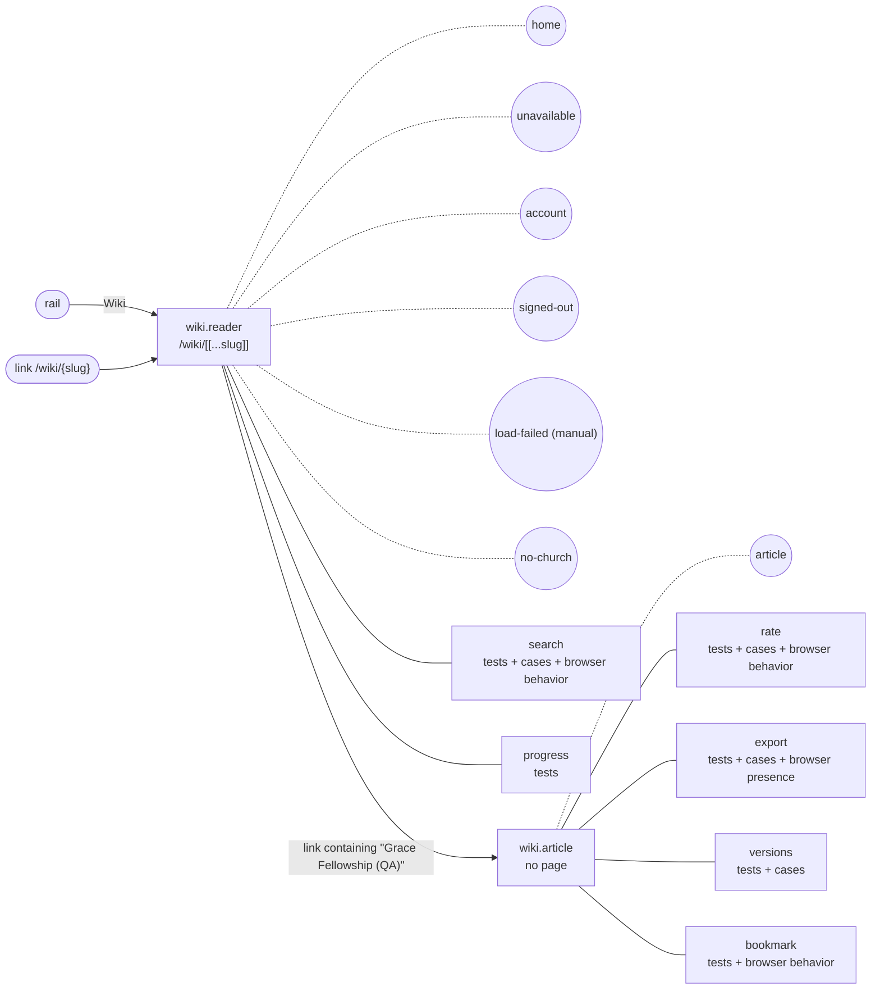

# Feature map: wiki

Generated from [`apps/web/src/features/wiki/feature-map.json`](../../apps/web/src/features/wiki/feature-map.json) by `node tools/ci/feature-maps.ts --write`. Do not edit by hand.
Personas, sign-in and what the checker cannot catch: [README](README.md).



## Surfaces

### wiki.reader

The Playbook wiki: a home with what to read next, search, and every article's address.

- Routes: `/wiki/[[...slug]]`
- Endpoints: `/api/wiki/progress`, `/api/wiki/read`
- Personas: `owner` write, `admin` write, `member` write, `resident` write, `signup` none, `triage` write, `visitor` none
- Catalog: WIKI-001, WIKI-002, WIKI-003, WIKI-004, WIKI-011

Reach:

- Rail "Wiki" for `owner`, `admin`, `member`, `resident`, `triage`
- Link `/wiki/{slug}` where `{slug}` is an article's path, as in its link in the wiki's navigation

States:

- **home**: heading "Continue reading"; heading "Recent"; link containing "Updated since you read it". As `owner`, on the QA seed:

```bash
agent-browser open "$ORIGIN/wiki"
agent-browser wait --load networkidle
agent-browser find role heading text --name "Continue reading" --exact
agent-browser find role heading text --name "Recent" --exact
agent-browser find role link text --name "Updated since you read it"
```

- **unavailable**: heading "This article is not available". As `owner`, on the QA seed:

```bash
agent-browser open "$ORIGIN/wiki/no-such-article"
agent-browser wait --load networkidle
agent-browser find role heading text --name "This article is not available" --exact
```

- **account**: heading "Suggested". As `triage`, on the QA seed:

```bash
agent-browser open "$ORIGIN/wiki"
agent-browser wait --load networkidle
agent-browser find role heading text --name "Suggested" --exact
```

- **signed-out**: URL `/signin?returnTo=%2Fwiki`. As `visitor`, on the QA seed:

```bash
agent-browser open "$ORIGIN/wiki"
agent-browser wait --load networkidle
agent-browser wait --url "**/signin?returnTo=%2Fwiki"
```

- **load-failed**: heading "We could not load the wiki". Not scripted: renders only when the wiki read fails on the server.
- **no-church**: URL `/signin?returnTo=%2Fwiki`. As `signup`, on the QA seed:

```bash
agent-browser open "$ORIGIN/wiki"
agent-browser wait --load networkidle
agent-browser wait --url "**/signin?returnTo=%2Fwiki"
```

#### wiki.reader#search

Search finds articles by their words: a second query drops the church version the first one found.

- Operations: wiki.search
- Catalog: WIKI-003
- Cases: CASE-WIKI-003
- Test: `tests/integration/wiki/wiki.test.mts`: `AC:CASE-WIKI-003 search finds an organization article by the word its last edit wrote, not the word it replaced`
- Test: `tests/integration/wiki/wiki.test.mts`: `BUG-63e46c879 AC:CASE-WIKI-003 search snippets are plain whole words with each match in <b>`
- Browser, behavior proof (acts and checks the result), from state home:

```bash
agent-browser find role searchbox click --name "Search the wiki" --exact
agent-browser wait --load networkidle
agent-browser find label "Search words" fill "cash"
agent-browser press Enter
agent-browser wait --load networkidle
agent-browser find role link text --name "Grace Fellowship (QA)"
agent-browser find label "Search words" fill "Designated"
agent-browser press Enter
agent-browser wait --load networkidle
agent-browser find role link text --name "Designated"
! agent-browser find role link text --name "Grace Fellowship (QA)"
```

#### wiki.reader#progress

Reading records progress; the home resumes it and marks an article changed since it was read.

- Operations: wiki.reading.updateProgress, wiki.reading.recordView
- Catalog: WIKI-004
- Test: `tests/integration/wiki/wiki.test.mts`: `two tabs write progress and views from stale revisions without a conflict; bookmark still works`

### wiki.article

One article: its church versions and their order, rating, bookmark, print and PDF.

- Routes: none
- Personas: `owner` write, `admin` write, `member` write, `resident` write, `triage` write
- Catalog: WIKI-001, WIKI-005, WIKI-006, WIKI-007

Reach:

- From wiki.reader as `owner`:

```bash
agent-browser find role link click --name "Grace Fellowship (QA)"
agent-browser wait --load networkidle
agent-browser wait --url "**/wiki/*"
```

States:

- **article**: heading containing "Grace Fellowship (QA)"; button "Download PDF"; button "Helpful". As `owner`, on the QA seed:

```bash
agent-browser open "$ORIGIN/wiki"
agent-browser wait --load networkidle
agent-browser find role link click --name "Grace Fellowship (QA)"
agent-browser wait --load networkidle
agent-browser wait --url "**/wiki/*"
agent-browser find role heading text --name "Grace Fellowship (QA)"
agent-browser find role button text --name "Download PDF" --exact
agent-browser find role button text --name "Helpful" --exact
```

#### wiki.article#rate

Helpful or Unhelpful records the reader's one rating.

- Operations: wiki.feedback.setMine, wiki.feedback.getMine
- Catalog: WIKI-006
- Cases: CASE-WIKI-006
- Test: `tests/integration/wiki/wiki.test.mts`: `AC:CASE-WIKI-006 own feedback reads only while the reader's plant seat and lifecycle are live, as setMine writes`
- Browser, behavior proof (acts and checks the result), from state article:

```bash
agent-browser find role button click --name "Helpful" --exact
agent-browser wait --load networkidle
agent-browser wait --fn "((x,l=[])=>/json/.test(document.contentType)?(JSON.parse(document.body.firstChild.textContent,(k,v)=>(v===Object(v)||l.push(String(v)),v)),l.includes(x)):[...document.querySelectorAll('body *')].some(e=>e.checkVisibility()&&e.innerText?.trim()===x))(\"Marked as helpful.\")"
```

#### wiki.article#export

Print and Download PDF render the visible text, diagrams as text, code verbatim, a human credit.

- Operations: wiki.article.exportPdf
- Catalog: WIKI-007
- Cases: CASE-WIKI-007
- Test: `tests/integration/wiki/wiki.test.mts`: `AC:CASE-WIKI-007 PDF and print export render diagrams as text and code fences verbatim in Courier`
- Test: `tests/integration/wiki/wiki.test.mts`: `AC:CASE-WIKI-007 the export footer shows a human credit and never a source path or digest`
- Browser, presence proof only (the control is there; the tests prove the outcome), from state article:

```bash
agent-browser find role button text --name "Download PDF" --exact
agent-browser find role button text --name "Print" --exact
```

#### wiki.article#versions

Churches and networks sharing the wiki publish their own versions; the reader picks which comes first.

- Operations: wiki.setSourceOrder
- Catalog: WIKI-001
- Cases: CASE-WIKI-001
- Test: `tests/integration/wiki/wiki.test.mts`: `AC:CASE-WIKI-001 organization draft edit and hide keep every prior revision`
- Test: `tests/unit/wiki/preferred-source.test.mts`: `INV-wiki-prefer-head: setting church C preferred stores C, A, B and leaves the networks as they were`

#### wiki.article#bookmark

Bookmark keeps an article in Bookmarks; Remove bookmark takes it out.

- Operations: wiki.bookmarks.set
- Catalog: WIKI-005
- Test: `tests/integration/wiki/wiki.test.mts`: `two tabs write progress and views from stale revisions without a conflict; bookmark still works`
- Browser, behavior proof (acts and checks the result), from state article:

```bash
agent-browser find role button click --name "Bookmark" --exact
agent-browser wait --load networkidle
agent-browser find role button text --name "Remove bookmark" --exact
```
