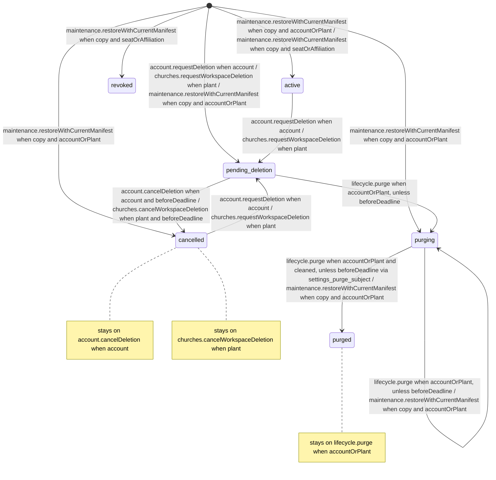

# Deletion lifecycle machine

Generated from `packages/contracts/src/machines/deletion-lifecycle.ts` by `node tools/ci/machines.ts --write`.
`node tools/ci/machines.ts --check` fails when this page differs from the table, and when the writer census below
finds a write of the column that does not carry the machine's guard.

- Column: `lifecycle_witness.state`
- States: `active`, `pending_deletion`, `purging`, `purged`, `cancelled`, `revoked`
- Subjects the guards tell apart: `account`, `dueAccount`, `uncleanedAccount`, `plant`, `duePlant`, `uncleanedPlant`
- Guards that describe the moment, not the subject: `beforeDeadline`, `cleaned`
- Refusal for every move the chart does not show: `deadline_passed`
- `unavailable` instead for `account.requestDeletion`
- `unavailable` instead for `churches.requestWorkspaceDeletion`
- `unavailable` instead for `churches.cancelWorkspaceDeletion` from `purging`, `purged`

- `copy` is a witness inside a restore target. The proof restores every live witness once and requests deletion of an active account and church copy there.
- No product code writes `active` or `revoked`: only a restore copies them. The proof seeds one live witness in each so the restore has them to copy.
- A request from a closed account or church is refused by the write gate (`unavailable`) before the witness check.



## Refused moves

| Subject | Event | From | To | Refusal |
|---|---|---|---|---|
| `account` | `account.requestDeletion` | pending_deletion | pending_deletion | `unavailable` |
| `account` | `account.requestDeletion` | purging | pending_deletion | `unavailable` |
| `account` | `account.requestDeletion` | purged | pending_deletion | `unavailable` |
| `account` | `account.cancelDeletion` | purging | purging | `deadline_passed` |
| `account` | `account.cancelDeletion` | purged | purged | `deadline_passed` |
| `account` | `lifecycle.purge` | pending_deletion | pending_deletion | `deadline_passed` |
| `account` | `lifecycle.purge` | purging | purging | `deadline_passed` |
| `account` | `lifecycle.purge` | cancelled | cancelled | `deadline_passed` |
| `dueAccount` | `account.requestDeletion` | pending_deletion | pending_deletion | `unavailable` |
| `dueAccount` | `account.requestDeletion` | purging | pending_deletion | `unavailable` |
| `dueAccount` | `account.requestDeletion` | purged | pending_deletion | `unavailable` |
| `dueAccount` | `account.cancelDeletion` | pending_deletion | pending_deletion | `deadline_passed` |
| `dueAccount` | `account.cancelDeletion` | purging | purging | `deadline_passed` |
| `dueAccount` | `account.cancelDeletion` | purged | purged | `deadline_passed` |
| `dueAccount` | `lifecycle.purge` | cancelled | cancelled | `deadline_passed` |
| `uncleanedAccount` | `account.requestDeletion` | pending_deletion | pending_deletion | `unavailable` |
| `uncleanedAccount` | `account.requestDeletion` | purging | pending_deletion | `unavailable` |
| `uncleanedAccount` | `account.requestDeletion` | purged | pending_deletion | `unavailable` |
| `uncleanedAccount` | `account.cancelDeletion` | pending_deletion | pending_deletion | `deadline_passed` |
| `uncleanedAccount` | `account.cancelDeletion` | purging | purging | `deadline_passed` |
| `uncleanedAccount` | `account.cancelDeletion` | purged | purged | `deadline_passed` |
| `uncleanedAccount` | `lifecycle.purge` | cancelled | cancelled | `deadline_passed` |
| `plant` | `churches.requestWorkspaceDeletion` | pending_deletion | pending_deletion | `unavailable` |
| `plant` | `churches.requestWorkspaceDeletion` | purging | pending_deletion | `unavailable` |
| `plant` | `churches.requestWorkspaceDeletion` | purged | pending_deletion | `unavailable` |
| `plant` | `churches.cancelWorkspaceDeletion` | purging | purging | `unavailable` |
| `plant` | `churches.cancelWorkspaceDeletion` | purged | purged | `unavailable` |
| `plant` | `lifecycle.purge` | pending_deletion | pending_deletion | `deadline_passed` |
| `plant` | `lifecycle.purge` | purging | purging | `deadline_passed` |
| `plant` | `lifecycle.purge` | cancelled | cancelled | `deadline_passed` |
| `duePlant` | `churches.requestWorkspaceDeletion` | pending_deletion | pending_deletion | `unavailable` |
| `duePlant` | `churches.requestWorkspaceDeletion` | purging | pending_deletion | `unavailable` |
| `duePlant` | `churches.requestWorkspaceDeletion` | purged | pending_deletion | `unavailable` |
| `duePlant` | `churches.cancelWorkspaceDeletion` | pending_deletion | pending_deletion | `deadline_passed` |
| `duePlant` | `churches.cancelWorkspaceDeletion` | purging | purging | `unavailable` |
| `duePlant` | `churches.cancelWorkspaceDeletion` | purged | purged | `unavailable` |
| `duePlant` | `lifecycle.purge` | cancelled | cancelled | `deadline_passed` |
| `uncleanedPlant` | `churches.requestWorkspaceDeletion` | pending_deletion | pending_deletion | `unavailable` |
| `uncleanedPlant` | `churches.requestWorkspaceDeletion` | purging | pending_deletion | `unavailable` |
| `uncleanedPlant` | `churches.requestWorkspaceDeletion` | purged | pending_deletion | `unavailable` |
| `uncleanedPlant` | `churches.cancelWorkspaceDeletion` | pending_deletion | pending_deletion | `deadline_passed` |
| `uncleanedPlant` | `churches.cancelWorkspaceDeletion` | purging | purging | `unavailable` |
| `uncleanedPlant` | `churches.cancelWorkspaceDeletion` | purged | purged | `unavailable` |
| `uncleanedPlant` | `lifecycle.purge` | cancelled | cancelled | `deadline_passed` |

## Writers of the column

| File | Statement | Guard |
|---|---|---|
| `ops/maintenance/restore.mts` | insert | entry-state filter |
| `ops/maintenance/restore.mts` | update | from-state filter |
| `packages/db/migrations/0011_settings_privileges.sql` | update | locked purging in settings_purge_subject |
| `packages/domain/src/settings/deletion.ts` | drizzle | from-state filter |
| `packages/domain/src/settings/deletion.ts` | drizzle | initial state |

The census is a static scan of git-tracked product code and SQL files under apps, packages, ops, scripts and
tools. It reads SQL literals (with an optional schema prefix), SET fragments in a file that also holds a dynamic
`SET ${…}` on the table, Drizzle `update`/`insert` calls, and `.sql` files. A guarded UPDATE filters on
`state = ANY(${fromStates(deletionMachine, …)})` in the same statement, or a Drizzle update on
`inArray(<table>.state, fromStates(deletionMachine, …))` in its `where` (alone or inside `and`). A guarded
INSERT writes an initial state as a literal; in a Drizzle object literal that is the last property that names
the column, after any spread. An INSERT that copies rows without a column list is guarded when it filters on
`state = ANY(${entryStates(deletionMachine, …)})`. An UPDATE in a `.sql` file is guarded only inside a
function that an edge names with `sql`, after a `SELECT * INTO … FROM <table> WHERE … FOR UPDATE; IF NOT FOUND
THEN RAISE` whose required states are exactly that edge's from-states, and only when it writes that edge's
target as a literal. A column name or statement start built at runtime, or a Drizzle object that is not a
literal, counts as an unguarded writer.

It cannot see: a SET fragment passed in from another file, SQL text assembled from variables that hold no
literal naming the table, statements sent outside this repository, or writes made by hand in a database
session. Only a database trigger generated from this table would refuse those.

It is strict where it cannot tell: any other write in a `.sql` file counts as unguarded (a data backfill
needs its own edge and function), and so does a bare
`state = …` fragment of any table in a file that also holds a dynamic `UPDATE lifecycle_witness SET ${…}`.

## Proof

`tests/integration/settings/deletion-machine.test.mts` walks every edge and every refused move against Postgres through the public operations and
reads each state back from the row. Run it with `EVF_MACHINE_COVERAGE=<file>` set, then attach this chart and
the report below to a change that touches this machine:

```sh
node tools/ci/machines.ts coverage <file>
```
