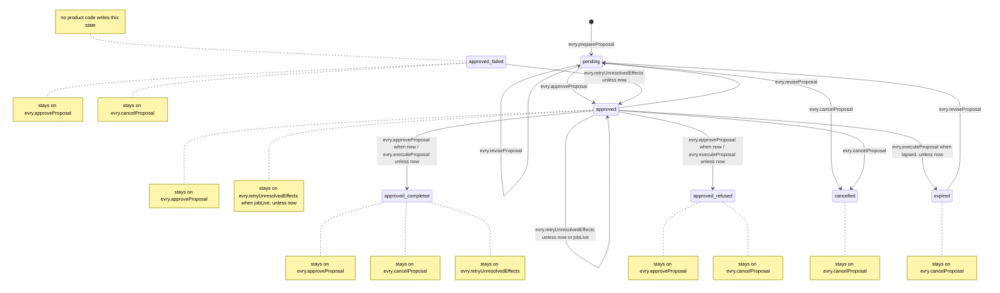

# Evry proposal machine

Generated from `packages/contracts/src/machines/evry-proposal.ts` by `node tools/ci/machines.ts --write`.
`node tools/ci/machines.ts --check` fails when this page differs from the table, and when the writer census below
finds a write of the column that does not carry the machine's guard.

- Columns: `proposal.state` and `proposal.outcome`. A state is one pair the code allows, named `concat_ws('_', state, outcome)`:

| State | state | outcome |
|---|---|---|
| `pending` | pending | NULL |
| `approved` | approved | NULL |
| `approved_completed` | approved | completed |
| `approved_refused` | approved | refused |
| `approved_failed` | approved | failed |
| `cancelled` | cancelled | NULL |
| `expired` | expired | NULL |

- Every other pair is a state the code never writes.
- States no product code writes (the schema and readers allow them): `approved_failed`
- Subjects the guards tell apart: `queued`, `now`
- Guards that describe the moment, not the subject: `lapsed`, `jobLive`
- Refusal for every move the chart does not show: `review_closed`
- `review_expired` instead for `evry.approveProposal` from `expired`
- `review_expired` instead for `evry.retryUnresolvedEffects` from `expired`
- `lost` instead for `evry.executeProposal` from `pending`
- `closed` instead for `evry.executeProposal`

- Subject `now` is a write that runs at approval (`approveNow`); `queued` runs later as an `evry_effect` job.
- For `now`, one approval moves `pending` to `approved` and, in its next statement, to `approved_completed` or `approved_refused`. If that run throws, the row stays `approved`.
- A `pending` row whose `expires_at` has passed reads as expired but stays `pending`: only the effect job writes `expired`, from `approved`.
- A stay answers without writing: approve replays, cancel answers `cancelled: false`, retry answers `retried: false`.
- `executeProposal` is the effect job's step; its answers `closed` and `lost` leave the row unchanged.



## Refused moves

| Subject | Event | From | To | Refusal |
|---|---|---|---|---|
| `queued` | `evry.reviseProposal` | approved_completed | approved_completed | `review_closed` |
| `queued` | `evry.reviseProposal` | approved_refused | approved_refused | `review_closed` |
| `queued` | `evry.reviseProposal` | approved_failed | approved_failed | `review_closed` |
| `queued` | `evry.reviseProposal` | cancelled | cancelled | `review_closed` |
| `queued` | `evry.approveProposal` | cancelled | cancelled | `review_closed` |
| `queued` | `evry.approveProposal` | expired | expired | `review_expired` |
| `queued` | `evry.retryUnresolvedEffects` | pending | pending | `review_closed` |
| `queued` | `evry.retryUnresolvedEffects` | approved_refused | approved_refused | `review_closed` |
| `queued` | `evry.retryUnresolvedEffects` | cancelled | cancelled | `review_closed` |
| `queued` | `evry.retryUnresolvedEffects` | expired | expired | `review_expired` |
| `queued` | `evry.executeProposal` | pending | pending | `lost` |
| `queued` | `evry.executeProposal` | approved_completed | approved_completed | `closed` |
| `queued` | `evry.executeProposal` | approved_refused | approved_refused | `closed` |
| `queued` | `evry.executeProposal` | approved_failed | approved_failed | `closed` |
| `queued` | `evry.executeProposal` | cancelled | cancelled | `closed` |
| `queued` | `evry.executeProposal` | expired | expired | `closed` |
| `now` | `evry.reviseProposal` | approved_completed | approved_completed | `review_closed` |
| `now` | `evry.reviseProposal` | approved_refused | approved_refused | `review_closed` |
| `now` | `evry.reviseProposal` | approved_failed | approved_failed | `review_closed` |
| `now` | `evry.reviseProposal` | cancelled | cancelled | `review_closed` |
| `now` | `evry.approveProposal` | cancelled | cancelled | `review_closed` |
| `now` | `evry.retryUnresolvedEffects` | pending | pending | `review_closed` |
| `now` | `evry.retryUnresolvedEffects` | approved | approved | `review_closed` |
| `now` | `evry.retryUnresolvedEffects` | approved_refused | approved_refused | `review_closed` |
| `now` | `evry.retryUnresolvedEffects` | approved_failed | approved_failed | `review_closed` |
| `now` | `evry.retryUnresolvedEffects` | cancelled | cancelled | `review_closed` |

## Writers of the column

| File | Statement | Guard |
|---|---|---|
| `packages/evry/src/execution/execute.ts` | update | from-state filter |
| `packages/evry/src/proposals/store.ts` | insert | initial state |
| `packages/evry/src/proposals/store.ts` | update | from-state filter |

The census is a static scan of git-tracked product code and SQL files under apps, packages, ops, scripts and
tools. It reads SQL literals (with an optional schema prefix), SET fragments in a file that also holds a dynamic
`SET ${…}` on the table, Drizzle `update`/`insert`/`onConflictDoUpdate` calls (a table or query held in a
`const` of the same file is followed), and `.sql` files. A statement ends at its `;` or at the parenthesis
that closes its CTE, so a guard elsewhere in the same SQL text does not count. A guarded UPDATE filters on
`concat_ws('_',state,outcome) = ANY(${fromStates(proposalMachine, …)})` inside its own statement, or a Drizzle update on
`inArray(<table>.state, fromStates(proposalMachine, …))` in its `where` (alone or inside `and`). When
the guard names its event or target as a string literal, or the write sets the state as a literal, the event
must have a move to that state and the two targets must agree. A guarded INSERT writes an initial state as a
literal; in a Drizzle object literal that is the last property that names the column, after any spread. An
insert that updates the column on conflict is unguarded. An INSERT that copies rows without a column list is
guarded when its own statement filters on `state = ANY(${entryStates(proposalMachine, …)})`. An UPDATE in
a `.sql` file is guarded only inside a function that an edge names with `sql`, after a
`SELECT * INTO … FROM <table> WHERE … FOR UPDATE; IF NOT FOUND THEN RAISE` whose required states are exactly
that edge's from-states, only when it writes that edge's target as a literal, and only when its `WHERE` is
`id = <the id the lock read>`. A column name or statement start built at runtime, or a Drizzle object that is
not a literal, counts as an unguarded writer.

This machine spans two columns, so a write of either one is a writer. A literal written to one column must fit
the guard's target state. A guarded INSERT names each column as a literal or leaves it out (NULL), in `VALUES`
or in its `SELECT` list, and the pair is an initial state. A Drizzle update cannot filter on the pair, so any
Drizzle update of either column is unguarded, and so is any write of the second column in a `.sql` file.

It cannot see: a SET fragment passed in from another file; SQL text assembled from variables that hold no
literal naming the table; a table or query handed through a parameter, a `let` or another file; whether an
event or target passed as a variable fits the write (only literal ones are checked); statements sent outside
this repository; or writes made by hand in a database session. Only a database trigger generated from this
table would refuse those.

It is strict where it cannot tell: any other write in a `.sql` file counts as unguarded (a data backfill
needs its own edge and function), and so does a bare
`state = …` fragment of any table in a file that also holds a dynamic `UPDATE proposal SET ${…}`.

## Proof

`tests/evry/execution/proposal-machine.test.mts` walks every edge and every refused move against Postgres through the public operations and
reads each state back from the row. Run it with `EVF_MACHINE_COVERAGE=<file>` set, then attach this chart and
the report below to a change that touches this machine:

```sh
node tools/ci/machines.ts coverage <file>
```
