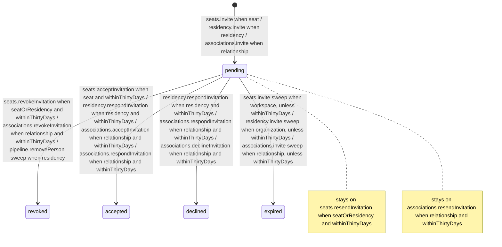

# Invitation machine

Generated from `packages/contracts/src/machines/invitation.ts` by `node tools/ci/machines.ts --write`.
`node tools/ci/machines.ts --check` fails when this page differs from the table, and when the writer census below
finds a write of the column that does not carry the machine's guard.

- Column: `invitation.state`
- States: `pending`, `accepted`, `declined`, `expired`, `revoked`
- Subjects the guards tell apart: `seat`, `staleSeat`, `organizationSeat`, `staleOrganizationSeat`, `residency`, `staleResidency`, `plantRelationship`, `stalePlantRelationship`, `churchRelationship`, `staleChurchRelationship`, `discoveryRelationship`, `staleDiscoveryRelationship`
- Guards that describe the moment, not the subject: `withinThirtyDays`
- Refusal for every move the chart does not show: `invitation_unavailable`
- `already_linked` instead for `residency.respondInvitation` from `accepted`
- `unavailable` instead for `associations.resendInvitation`
- `unavailable` instead for `associations.revokeInvitation`
- `unavailable` instead for `associations.acceptInvitation`
- `unavailable` instead for `associations.respondInvitation`
- `unavailable` instead for `associations.declineInvitation`
- A sweep changes only the rows in its from-states and leaves every other row as it is

- `withinThirtyDays`: a seat or residency invitation was created, and a relationship invitation was last sent, less than 720 hours before the database clock. Resending a relationship invitation restarts its 30 days. Nothing expires an invitation on a timer: an invite to the same address in the same tenant sweeps the older stale ones.



## Refused moves

| Subject | Event | From | To | Refusal |
|---|---|---|---|---|
| `seat` | `seats.resendInvitation` | accepted | accepted | `invitation_unavailable` |
| `seat` | `seats.resendInvitation` | expired | expired | `invitation_unavailable` |
| `seat` | `seats.resendInvitation` | revoked | revoked | `invitation_unavailable` |
| `seat` | `seats.revokeInvitation` | accepted | revoked | `invitation_unavailable` |
| `seat` | `seats.revokeInvitation` | expired | revoked | `invitation_unavailable` |
| `seat` | `seats.revokeInvitation` | revoked | revoked | `invitation_unavailable` |
| `seat` | `seats.acceptInvitation` | accepted | accepted | `invitation_unavailable` |
| `seat` | `seats.acceptInvitation` | expired | accepted | `invitation_unavailable` |
| `seat` | `seats.acceptInvitation` | revoked | accepted | `invitation_unavailable` |
| `staleSeat` | `seats.resendInvitation` | pending | pending | `invitation_unavailable` |
| `staleSeat` | `seats.resendInvitation` | accepted | accepted | `invitation_unavailable` |
| `staleSeat` | `seats.resendInvitation` | expired | expired | `invitation_unavailable` |
| `staleSeat` | `seats.resendInvitation` | revoked | revoked | `invitation_unavailable` |
| `staleSeat` | `seats.revokeInvitation` | pending | revoked | `invitation_unavailable` |
| `staleSeat` | `seats.revokeInvitation` | accepted | revoked | `invitation_unavailable` |
| `staleSeat` | `seats.revokeInvitation` | expired | revoked | `invitation_unavailable` |
| `staleSeat` | `seats.revokeInvitation` | revoked | revoked | `invitation_unavailable` |
| `staleSeat` | `seats.acceptInvitation` | pending | accepted | `invitation_unavailable` |
| `staleSeat` | `seats.acceptInvitation` | accepted | accepted | `invitation_unavailable` |
| `staleSeat` | `seats.acceptInvitation` | expired | accepted | `invitation_unavailable` |
| `staleSeat` | `seats.acceptInvitation` | revoked | accepted | `invitation_unavailable` |
| `organizationSeat` | `seats.resendInvitation` | accepted | accepted | `invitation_unavailable` |
| `organizationSeat` | `seats.resendInvitation` | expired | expired | `invitation_unavailable` |
| `organizationSeat` | `seats.resendInvitation` | revoked | revoked | `invitation_unavailable` |
| `organizationSeat` | `seats.revokeInvitation` | accepted | revoked | `invitation_unavailable` |
| `organizationSeat` | `seats.revokeInvitation` | expired | revoked | `invitation_unavailable` |
| `organizationSeat` | `seats.revokeInvitation` | revoked | revoked | `invitation_unavailable` |
| `organizationSeat` | `seats.acceptInvitation` | accepted | accepted | `invitation_unavailable` |
| `organizationSeat` | `seats.acceptInvitation` | expired | accepted | `invitation_unavailable` |
| `organizationSeat` | `seats.acceptInvitation` | revoked | accepted | `invitation_unavailable` |
| `staleOrganizationSeat` | `seats.resendInvitation` | pending | pending | `invitation_unavailable` |
| `staleOrganizationSeat` | `seats.resendInvitation` | accepted | accepted | `invitation_unavailable` |
| `staleOrganizationSeat` | `seats.resendInvitation` | expired | expired | `invitation_unavailable` |
| `staleOrganizationSeat` | `seats.resendInvitation` | revoked | revoked | `invitation_unavailable` |
| `staleOrganizationSeat` | `seats.revokeInvitation` | pending | revoked | `invitation_unavailable` |
| `staleOrganizationSeat` | `seats.revokeInvitation` | accepted | revoked | `invitation_unavailable` |
| `staleOrganizationSeat` | `seats.revokeInvitation` | expired | revoked | `invitation_unavailable` |
| `staleOrganizationSeat` | `seats.revokeInvitation` | revoked | revoked | `invitation_unavailable` |
| `staleOrganizationSeat` | `seats.acceptInvitation` | pending | accepted | `invitation_unavailable` |
| `staleOrganizationSeat` | `seats.acceptInvitation` | accepted | accepted | `invitation_unavailable` |
| `staleOrganizationSeat` | `seats.acceptInvitation` | expired | accepted | `invitation_unavailable` |
| `staleOrganizationSeat` | `seats.acceptInvitation` | revoked | accepted | `invitation_unavailable` |
| `residency` | `seats.resendInvitation` | accepted | accepted | `invitation_unavailable` |
| `residency` | `seats.resendInvitation` | declined | declined | `invitation_unavailable` |
| `residency` | `seats.resendInvitation` | expired | expired | `invitation_unavailable` |
| `residency` | `seats.resendInvitation` | revoked | revoked | `invitation_unavailable` |
| `residency` | `seats.revokeInvitation` | accepted | revoked | `invitation_unavailable` |
| `residency` | `seats.revokeInvitation` | declined | revoked | `invitation_unavailable` |
| `residency` | `seats.revokeInvitation` | expired | revoked | `invitation_unavailable` |
| `residency` | `seats.revokeInvitation` | revoked | revoked | `invitation_unavailable` |
| `residency` | `residency.respondInvitation` | accepted | accepted | `already_linked` |
| `residency` | `residency.respondInvitation` | accepted | declined | `already_linked` |
| `residency` | `residency.respondInvitation` | declined | accepted | `invitation_unavailable` |
| `residency` | `residency.respondInvitation` | declined | declined | `invitation_unavailable` |
| `residency` | `residency.respondInvitation` | expired | accepted | `invitation_unavailable` |
| `residency` | `residency.respondInvitation` | expired | declined | `invitation_unavailable` |
| `residency` | `residency.respondInvitation` | revoked | accepted | `invitation_unavailable` |
| `residency` | `residency.respondInvitation` | revoked | declined | `invitation_unavailable` |
| `staleResidency` | `seats.resendInvitation` | pending | pending | `invitation_unavailable` |
| `staleResidency` | `seats.resendInvitation` | accepted | accepted | `invitation_unavailable` |
| `staleResidency` | `seats.resendInvitation` | declined | declined | `invitation_unavailable` |
| `staleResidency` | `seats.resendInvitation` | expired | expired | `invitation_unavailable` |
| `staleResidency` | `seats.resendInvitation` | revoked | revoked | `invitation_unavailable` |
| `staleResidency` | `seats.revokeInvitation` | pending | revoked | `invitation_unavailable` |
| `staleResidency` | `seats.revokeInvitation` | accepted | revoked | `invitation_unavailable` |
| `staleResidency` | `seats.revokeInvitation` | declined | revoked | `invitation_unavailable` |
| `staleResidency` | `seats.revokeInvitation` | expired | revoked | `invitation_unavailable` |
| `staleResidency` | `seats.revokeInvitation` | revoked | revoked | `invitation_unavailable` |
| `staleResidency` | `residency.respondInvitation` | pending | accepted | `invitation_unavailable` |
| `staleResidency` | `residency.respondInvitation` | pending | declined | `invitation_unavailable` |
| `staleResidency` | `residency.respondInvitation` | accepted | accepted | `already_linked` |
| `staleResidency` | `residency.respondInvitation` | accepted | declined | `already_linked` |
| `staleResidency` | `residency.respondInvitation` | declined | accepted | `invitation_unavailable` |
| `staleResidency` | `residency.respondInvitation` | declined | declined | `invitation_unavailable` |
| `staleResidency` | `residency.respondInvitation` | expired | accepted | `invitation_unavailable` |
| `staleResidency` | `residency.respondInvitation` | expired | declined | `invitation_unavailable` |
| `staleResidency` | `residency.respondInvitation` | revoked | accepted | `invitation_unavailable` |
| `staleResidency` | `residency.respondInvitation` | revoked | declined | `invitation_unavailable` |
| `plantRelationship` | `associations.resendInvitation` | accepted | accepted | `unavailable` |
| `plantRelationship` | `associations.resendInvitation` | declined | declined | `unavailable` |
| `plantRelationship` | `associations.resendInvitation` | expired | expired | `unavailable` |
| `plantRelationship` | `associations.resendInvitation` | revoked | revoked | `unavailable` |
| `plantRelationship` | `associations.revokeInvitation` | accepted | revoked | `unavailable` |
| `plantRelationship` | `associations.revokeInvitation` | declined | revoked | `unavailable` |
| `plantRelationship` | `associations.revokeInvitation` | expired | revoked | `unavailable` |
| `plantRelationship` | `associations.revokeInvitation` | revoked | revoked | `unavailable` |
| `plantRelationship` | `associations.acceptInvitation` | accepted | accepted | `unavailable` |
| `plantRelationship` | `associations.acceptInvitation` | declined | accepted | `unavailable` |
| `plantRelationship` | `associations.acceptInvitation` | expired | accepted | `unavailable` |
| `plantRelationship` | `associations.acceptInvitation` | revoked | accepted | `unavailable` |
| `plantRelationship` | `associations.respondInvitation` | accepted | accepted | `unavailable` |
| `plantRelationship` | `associations.respondInvitation` | accepted | declined | `unavailable` |
| `plantRelationship` | `associations.respondInvitation` | declined | accepted | `unavailable` |
| `plantRelationship` | `associations.respondInvitation` | declined | declined | `unavailable` |
| `plantRelationship` | `associations.respondInvitation` | expired | accepted | `unavailable` |
| `plantRelationship` | `associations.respondInvitation` | expired | declined | `unavailable` |
| `plantRelationship` | `associations.respondInvitation` | revoked | accepted | `unavailable` |
| `plantRelationship` | `associations.respondInvitation` | revoked | declined | `unavailable` |
| `plantRelationship` | `associations.declineInvitation` | accepted | declined | `unavailable` |
| `plantRelationship` | `associations.declineInvitation` | declined | declined | `unavailable` |
| `plantRelationship` | `associations.declineInvitation` | expired | declined | `unavailable` |
| `plantRelationship` | `associations.declineInvitation` | revoked | declined | `unavailable` |
| `stalePlantRelationship` | `associations.resendInvitation` | pending | pending | `unavailable` |
| `stalePlantRelationship` | `associations.resendInvitation` | accepted | accepted | `unavailable` |
| `stalePlantRelationship` | `associations.resendInvitation` | declined | declined | `unavailable` |
| `stalePlantRelationship` | `associations.resendInvitation` | expired | expired | `unavailable` |
| `stalePlantRelationship` | `associations.resendInvitation` | revoked | revoked | `unavailable` |
| `stalePlantRelationship` | `associations.revokeInvitation` | pending | revoked | `unavailable` |
| `stalePlantRelationship` | `associations.revokeInvitation` | accepted | revoked | `unavailable` |
| `stalePlantRelationship` | `associations.revokeInvitation` | declined | revoked | `unavailable` |
| `stalePlantRelationship` | `associations.revokeInvitation` | expired | revoked | `unavailable` |
| `stalePlantRelationship` | `associations.revokeInvitation` | revoked | revoked | `unavailable` |
| `stalePlantRelationship` | `associations.acceptInvitation` | pending | accepted | `unavailable` |
| `stalePlantRelationship` | `associations.acceptInvitation` | accepted | accepted | `unavailable` |
| `stalePlantRelationship` | `associations.acceptInvitation` | declined | accepted | `unavailable` |
| `stalePlantRelationship` | `associations.acceptInvitation` | expired | accepted | `unavailable` |
| `stalePlantRelationship` | `associations.acceptInvitation` | revoked | accepted | `unavailable` |
| `stalePlantRelationship` | `associations.respondInvitation` | pending | accepted | `unavailable` |
| `stalePlantRelationship` | `associations.respondInvitation` | pending | declined | `unavailable` |
| `stalePlantRelationship` | `associations.respondInvitation` | accepted | accepted | `unavailable` |
| `stalePlantRelationship` | `associations.respondInvitation` | accepted | declined | `unavailable` |
| `stalePlantRelationship` | `associations.respondInvitation` | declined | accepted | `unavailable` |
| `stalePlantRelationship` | `associations.respondInvitation` | declined | declined | `unavailable` |
| `stalePlantRelationship` | `associations.respondInvitation` | expired | accepted | `unavailable` |
| `stalePlantRelationship` | `associations.respondInvitation` | expired | declined | `unavailable` |
| `stalePlantRelationship` | `associations.respondInvitation` | revoked | accepted | `unavailable` |
| `stalePlantRelationship` | `associations.respondInvitation` | revoked | declined | `unavailable` |
| `stalePlantRelationship` | `associations.declineInvitation` | pending | declined | `unavailable` |
| `stalePlantRelationship` | `associations.declineInvitation` | accepted | declined | `unavailable` |
| `stalePlantRelationship` | `associations.declineInvitation` | declined | declined | `unavailable` |
| `stalePlantRelationship` | `associations.declineInvitation` | expired | declined | `unavailable` |
| `stalePlantRelationship` | `associations.declineInvitation` | revoked | declined | `unavailable` |
| `churchRelationship` | `associations.resendInvitation` | accepted | accepted | `unavailable` |
| `churchRelationship` | `associations.resendInvitation` | declined | declined | `unavailable` |
| `churchRelationship` | `associations.resendInvitation` | expired | expired | `unavailable` |
| `churchRelationship` | `associations.resendInvitation` | revoked | revoked | `unavailable` |
| `churchRelationship` | `associations.revokeInvitation` | accepted | revoked | `unavailable` |
| `churchRelationship` | `associations.revokeInvitation` | declined | revoked | `unavailable` |
| `churchRelationship` | `associations.revokeInvitation` | expired | revoked | `unavailable` |
| `churchRelationship` | `associations.revokeInvitation` | revoked | revoked | `unavailable` |
| `churchRelationship` | `associations.acceptInvitation` | accepted | accepted | `unavailable` |
| `churchRelationship` | `associations.acceptInvitation` | declined | accepted | `unavailable` |
| `churchRelationship` | `associations.acceptInvitation` | expired | accepted | `unavailable` |
| `churchRelationship` | `associations.acceptInvitation` | revoked | accepted | `unavailable` |
| `churchRelationship` | `associations.respondInvitation` | accepted | accepted | `unavailable` |
| `churchRelationship` | `associations.respondInvitation` | accepted | declined | `unavailable` |
| `churchRelationship` | `associations.respondInvitation` | declined | accepted | `unavailable` |
| `churchRelationship` | `associations.respondInvitation` | declined | declined | `unavailable` |
| `churchRelationship` | `associations.respondInvitation` | expired | accepted | `unavailable` |
| `churchRelationship` | `associations.respondInvitation` | expired | declined | `unavailable` |
| `churchRelationship` | `associations.respondInvitation` | revoked | accepted | `unavailable` |
| `churchRelationship` | `associations.respondInvitation` | revoked | declined | `unavailable` |
| `churchRelationship` | `associations.declineInvitation` | accepted | declined | `unavailable` |
| `churchRelationship` | `associations.declineInvitation` | declined | declined | `unavailable` |
| `churchRelationship` | `associations.declineInvitation` | expired | declined | `unavailable` |
| `churchRelationship` | `associations.declineInvitation` | revoked | declined | `unavailable` |
| `staleChurchRelationship` | `associations.resendInvitation` | pending | pending | `unavailable` |
| `staleChurchRelationship` | `associations.resendInvitation` | accepted | accepted | `unavailable` |
| `staleChurchRelationship` | `associations.resendInvitation` | declined | declined | `unavailable` |
| `staleChurchRelationship` | `associations.resendInvitation` | expired | expired | `unavailable` |
| `staleChurchRelationship` | `associations.resendInvitation` | revoked | revoked | `unavailable` |
| `staleChurchRelationship` | `associations.revokeInvitation` | pending | revoked | `unavailable` |
| `staleChurchRelationship` | `associations.revokeInvitation` | accepted | revoked | `unavailable` |
| `staleChurchRelationship` | `associations.revokeInvitation` | declined | revoked | `unavailable` |
| `staleChurchRelationship` | `associations.revokeInvitation` | expired | revoked | `unavailable` |
| `staleChurchRelationship` | `associations.revokeInvitation` | revoked | revoked | `unavailable` |
| `staleChurchRelationship` | `associations.acceptInvitation` | pending | accepted | `unavailable` |
| `staleChurchRelationship` | `associations.acceptInvitation` | accepted | accepted | `unavailable` |
| `staleChurchRelationship` | `associations.acceptInvitation` | declined | accepted | `unavailable` |
| `staleChurchRelationship` | `associations.acceptInvitation` | expired | accepted | `unavailable` |
| `staleChurchRelationship` | `associations.acceptInvitation` | revoked | accepted | `unavailable` |
| `staleChurchRelationship` | `associations.respondInvitation` | pending | accepted | `unavailable` |
| `staleChurchRelationship` | `associations.respondInvitation` | pending | declined | `unavailable` |
| `staleChurchRelationship` | `associations.respondInvitation` | accepted | accepted | `unavailable` |
| `staleChurchRelationship` | `associations.respondInvitation` | accepted | declined | `unavailable` |
| `staleChurchRelationship` | `associations.respondInvitation` | declined | accepted | `unavailable` |
| `staleChurchRelationship` | `associations.respondInvitation` | declined | declined | `unavailable` |
| `staleChurchRelationship` | `associations.respondInvitation` | expired | accepted | `unavailable` |
| `staleChurchRelationship` | `associations.respondInvitation` | expired | declined | `unavailable` |
| `staleChurchRelationship` | `associations.respondInvitation` | revoked | accepted | `unavailable` |
| `staleChurchRelationship` | `associations.respondInvitation` | revoked | declined | `unavailable` |
| `staleChurchRelationship` | `associations.declineInvitation` | pending | declined | `unavailable` |
| `staleChurchRelationship` | `associations.declineInvitation` | accepted | declined | `unavailable` |
| `staleChurchRelationship` | `associations.declineInvitation` | declined | declined | `unavailable` |
| `staleChurchRelationship` | `associations.declineInvitation` | expired | declined | `unavailable` |
| `staleChurchRelationship` | `associations.declineInvitation` | revoked | declined | `unavailable` |
| `discoveryRelationship` | `associations.resendInvitation` | accepted | accepted | `unavailable` |
| `discoveryRelationship` | `associations.resendInvitation` | declined | declined | `unavailable` |
| `discoveryRelationship` | `associations.resendInvitation` | expired | expired | `unavailable` |
| `discoveryRelationship` | `associations.resendInvitation` | revoked | revoked | `unavailable` |
| `discoveryRelationship` | `associations.revokeInvitation` | accepted | revoked | `unavailable` |
| `discoveryRelationship` | `associations.revokeInvitation` | declined | revoked | `unavailable` |
| `discoveryRelationship` | `associations.revokeInvitation` | expired | revoked | `unavailable` |
| `discoveryRelationship` | `associations.revokeInvitation` | revoked | revoked | `unavailable` |
| `discoveryRelationship` | `associations.acceptInvitation` | accepted | accepted | `unavailable` |
| `discoveryRelationship` | `associations.acceptInvitation` | declined | accepted | `unavailable` |
| `discoveryRelationship` | `associations.acceptInvitation` | expired | accepted | `unavailable` |
| `discoveryRelationship` | `associations.acceptInvitation` | revoked | accepted | `unavailable` |
| `discoveryRelationship` | `associations.respondInvitation` | accepted | accepted | `unavailable` |
| `discoveryRelationship` | `associations.respondInvitation` | accepted | declined | `unavailable` |
| `discoveryRelationship` | `associations.respondInvitation` | declined | accepted | `unavailable` |
| `discoveryRelationship` | `associations.respondInvitation` | declined | declined | `unavailable` |
| `discoveryRelationship` | `associations.respondInvitation` | expired | accepted | `unavailable` |
| `discoveryRelationship` | `associations.respondInvitation` | expired | declined | `unavailable` |
| `discoveryRelationship` | `associations.respondInvitation` | revoked | accepted | `unavailable` |
| `discoveryRelationship` | `associations.respondInvitation` | revoked | declined | `unavailable` |
| `discoveryRelationship` | `associations.declineInvitation` | accepted | declined | `unavailable` |
| `discoveryRelationship` | `associations.declineInvitation` | declined | declined | `unavailable` |
| `discoveryRelationship` | `associations.declineInvitation` | expired | declined | `unavailable` |
| `discoveryRelationship` | `associations.declineInvitation` | revoked | declined | `unavailable` |
| `staleDiscoveryRelationship` | `associations.resendInvitation` | pending | pending | `unavailable` |
| `staleDiscoveryRelationship` | `associations.resendInvitation` | accepted | accepted | `unavailable` |
| `staleDiscoveryRelationship` | `associations.resendInvitation` | declined | declined | `unavailable` |
| `staleDiscoveryRelationship` | `associations.resendInvitation` | expired | expired | `unavailable` |
| `staleDiscoveryRelationship` | `associations.resendInvitation` | revoked | revoked | `unavailable` |
| `staleDiscoveryRelationship` | `associations.revokeInvitation` | pending | revoked | `unavailable` |
| `staleDiscoveryRelationship` | `associations.revokeInvitation` | accepted | revoked | `unavailable` |
| `staleDiscoveryRelationship` | `associations.revokeInvitation` | declined | revoked | `unavailable` |
| `staleDiscoveryRelationship` | `associations.revokeInvitation` | expired | revoked | `unavailable` |
| `staleDiscoveryRelationship` | `associations.revokeInvitation` | revoked | revoked | `unavailable` |
| `staleDiscoveryRelationship` | `associations.acceptInvitation` | pending | accepted | `unavailable` |
| `staleDiscoveryRelationship` | `associations.acceptInvitation` | accepted | accepted | `unavailable` |
| `staleDiscoveryRelationship` | `associations.acceptInvitation` | declined | accepted | `unavailable` |
| `staleDiscoveryRelationship` | `associations.acceptInvitation` | expired | accepted | `unavailable` |
| `staleDiscoveryRelationship` | `associations.acceptInvitation` | revoked | accepted | `unavailable` |
| `staleDiscoveryRelationship` | `associations.respondInvitation` | pending | accepted | `unavailable` |
| `staleDiscoveryRelationship` | `associations.respondInvitation` | pending | declined | `unavailable` |
| `staleDiscoveryRelationship` | `associations.respondInvitation` | accepted | accepted | `unavailable` |
| `staleDiscoveryRelationship` | `associations.respondInvitation` | accepted | declined | `unavailable` |
| `staleDiscoveryRelationship` | `associations.respondInvitation` | declined | accepted | `unavailable` |
| `staleDiscoveryRelationship` | `associations.respondInvitation` | declined | declined | `unavailable` |
| `staleDiscoveryRelationship` | `associations.respondInvitation` | expired | accepted | `unavailable` |
| `staleDiscoveryRelationship` | `associations.respondInvitation` | expired | declined | `unavailable` |
| `staleDiscoveryRelationship` | `associations.respondInvitation` | revoked | accepted | `unavailable` |
| `staleDiscoveryRelationship` | `associations.respondInvitation` | revoked | declined | `unavailable` |
| `staleDiscoveryRelationship` | `associations.declineInvitation` | pending | declined | `unavailable` |
| `staleDiscoveryRelationship` | `associations.declineInvitation` | accepted | declined | `unavailable` |
| `staleDiscoveryRelationship` | `associations.declineInvitation` | declined | declined | `unavailable` |
| `staleDiscoveryRelationship` | `associations.declineInvitation` | expired | declined | `unavailable` |
| `staleDiscoveryRelationship` | `associations.declineInvitation` | revoked | declined | `unavailable` |

## Rows a sweep leaves unchanged

| Subject | Event | From | Not moved to |
|---|---|---|---|
| `seat` | `seats.invite` | pending | expired |
| `seat` | `seats.invite` | accepted | expired |
| `seat` | `seats.invite` | expired | expired |
| `seat` | `seats.invite` | revoked | expired |
| `staleSeat` | `seats.invite` | accepted | expired |
| `staleSeat` | `seats.invite` | expired | expired |
| `staleSeat` | `seats.invite` | revoked | expired |
| `organizationSeat` | `seats.invite` | pending | expired |
| `organizationSeat` | `seats.invite` | accepted | expired |
| `organizationSeat` | `seats.invite` | expired | expired |
| `organizationSeat` | `seats.invite` | revoked | expired |
| `organizationSeat` | `residency.invite` | pending | expired |
| `organizationSeat` | `residency.invite` | accepted | expired |
| `organizationSeat` | `residency.invite` | expired | expired |
| `organizationSeat` | `residency.invite` | revoked | expired |
| `staleOrganizationSeat` | `seats.invite` | accepted | expired |
| `staleOrganizationSeat` | `seats.invite` | expired | expired |
| `staleOrganizationSeat` | `seats.invite` | revoked | expired |
| `staleOrganizationSeat` | `residency.invite` | accepted | expired |
| `staleOrganizationSeat` | `residency.invite` | expired | expired |
| `staleOrganizationSeat` | `residency.invite` | revoked | expired |
| `residency` | `seats.invite` | pending | expired |
| `residency` | `seats.invite` | accepted | expired |
| `residency` | `seats.invite` | declined | expired |
| `residency` | `seats.invite` | expired | expired |
| `residency` | `seats.invite` | revoked | expired |
| `residency` | `residency.invite` | pending | expired |
| `residency` | `residency.invite` | accepted | expired |
| `residency` | `residency.invite` | declined | expired |
| `residency` | `residency.invite` | expired | expired |
| `residency` | `residency.invite` | revoked | expired |
| `residency` | `pipeline.removePerson` | accepted | revoked |
| `residency` | `pipeline.removePerson` | declined | revoked |
| `residency` | `pipeline.removePerson` | expired | revoked |
| `residency` | `pipeline.removePerson` | revoked | revoked |
| `staleResidency` | `seats.invite` | accepted | expired |
| `staleResidency` | `seats.invite` | declined | expired |
| `staleResidency` | `seats.invite` | expired | expired |
| `staleResidency` | `seats.invite` | revoked | expired |
| `staleResidency` | `residency.invite` | accepted | expired |
| `staleResidency` | `residency.invite` | declined | expired |
| `staleResidency` | `residency.invite` | expired | expired |
| `staleResidency` | `residency.invite` | revoked | expired |
| `staleResidency` | `pipeline.removePerson` | accepted | revoked |
| `staleResidency` | `pipeline.removePerson` | declined | revoked |
| `staleResidency` | `pipeline.removePerson` | expired | revoked |
| `staleResidency` | `pipeline.removePerson` | revoked | revoked |
| `plantRelationship` | `seats.invite` | pending | expired |
| `plantRelationship` | `seats.invite` | accepted | expired |
| `plantRelationship` | `seats.invite` | declined | expired |
| `plantRelationship` | `seats.invite` | expired | expired |
| `plantRelationship` | `seats.invite` | revoked | expired |
| `plantRelationship` | `associations.invite` | pending | expired |
| `plantRelationship` | `associations.invite` | accepted | expired |
| `plantRelationship` | `associations.invite` | declined | expired |
| `plantRelationship` | `associations.invite` | expired | expired |
| `plantRelationship` | `associations.invite` | revoked | expired |
| `stalePlantRelationship` | `seats.invite` | accepted | expired |
| `stalePlantRelationship` | `seats.invite` | declined | expired |
| `stalePlantRelationship` | `seats.invite` | expired | expired |
| `stalePlantRelationship` | `seats.invite` | revoked | expired |
| `stalePlantRelationship` | `associations.invite` | accepted | expired |
| `stalePlantRelationship` | `associations.invite` | declined | expired |
| `stalePlantRelationship` | `associations.invite` | expired | expired |
| `stalePlantRelationship` | `associations.invite` | revoked | expired |
| `churchRelationship` | `seats.invite` | pending | expired |
| `churchRelationship` | `seats.invite` | accepted | expired |
| `churchRelationship` | `seats.invite` | declined | expired |
| `churchRelationship` | `seats.invite` | expired | expired |
| `churchRelationship` | `seats.invite` | revoked | expired |
| `churchRelationship` | `residency.invite` | pending | expired |
| `churchRelationship` | `residency.invite` | accepted | expired |
| `churchRelationship` | `residency.invite` | declined | expired |
| `churchRelationship` | `residency.invite` | expired | expired |
| `churchRelationship` | `residency.invite` | revoked | expired |
| `churchRelationship` | `associations.invite` | pending | expired |
| `churchRelationship` | `associations.invite` | accepted | expired |
| `churchRelationship` | `associations.invite` | declined | expired |
| `churchRelationship` | `associations.invite` | expired | expired |
| `churchRelationship` | `associations.invite` | revoked | expired |
| `staleChurchRelationship` | `seats.invite` | accepted | expired |
| `staleChurchRelationship` | `seats.invite` | declined | expired |
| `staleChurchRelationship` | `seats.invite` | expired | expired |
| `staleChurchRelationship` | `seats.invite` | revoked | expired |
| `staleChurchRelationship` | `residency.invite` | accepted | expired |
| `staleChurchRelationship` | `residency.invite` | declined | expired |
| `staleChurchRelationship` | `residency.invite` | expired | expired |
| `staleChurchRelationship` | `residency.invite` | revoked | expired |
| `staleChurchRelationship` | `associations.invite` | accepted | expired |
| `staleChurchRelationship` | `associations.invite` | declined | expired |
| `staleChurchRelationship` | `associations.invite` | expired | expired |
| `staleChurchRelationship` | `associations.invite` | revoked | expired |
| `discoveryRelationship` | `associations.invite` | pending | expired |
| `discoveryRelationship` | `associations.invite` | accepted | expired |
| `discoveryRelationship` | `associations.invite` | declined | expired |
| `discoveryRelationship` | `associations.invite` | expired | expired |
| `discoveryRelationship` | `associations.invite` | revoked | expired |
| `staleDiscoveryRelationship` | `associations.invite` | accepted | expired |
| `staleDiscoveryRelationship` | `associations.invite` | declined | expired |
| `staleDiscoveryRelationship` | `associations.invite` | expired | expired |
| `staleDiscoveryRelationship` | `associations.invite` | revoked | expired |

## Writers of the column

| File | Statement | Guard |
|---|---|---|
| `packages/domain/src/identity/invitations.ts` | update | from-state filter |
| `packages/domain/src/identity/invitations.ts` | drizzle | initial state |
| `packages/domain/src/identity/invitations.ts` | drizzle | from-state filter |
| `packages/domain/src/organizations/data.ts` | update | from-state filter |
| `packages/domain/src/organizations/relationships.ts` | update | from-state filter |
| `packages/domain/src/organizations/relationships.ts` | drizzle | initial state |
| `packages/domain/src/organizations/relationships.ts` | drizzle | from-state filter |

The census is a static scan of git-tracked product code and SQL files under apps, packages, ops, scripts and
tools. It reads SQL literals (with an optional schema prefix), SET fragments in a file that also holds a dynamic
`SET ${…}` on the table, Drizzle `update`/`insert`/`onConflictDoUpdate` calls (a table or query held in a
`const` of the same file is followed), and `.sql` files. A statement ends at its `;` or at the parenthesis
that closes its CTE, so a guard elsewhere in the same SQL text does not count. A guarded UPDATE filters on
`state = ANY(${fromStates(invitationMachine, …)})` inside its own statement, or a Drizzle update on
`inArray(<table>.state, fromStates(invitationMachine, …))` in its `where` (alone or inside `and`). When
the guard names its event or target as a string literal, or the write sets the state as a literal, the event
must have a move to that state and the two targets must agree. A guarded INSERT writes an initial state as a
literal; in a Drizzle object literal that is the last property that names the column, after any spread. An
insert that updates the column on conflict is unguarded. An INSERT that copies rows without a column list is
guarded when its own statement filters on `state = ANY(${entryStates(invitationMachine, …)})`. An UPDATE in
a `.sql` file is guarded only inside a function that an edge names with `sql`, after a
`SELECT * INTO … FROM <table> WHERE … FOR UPDATE; IF NOT FOUND THEN RAISE` whose required states are exactly
that edge's from-states, only when it writes that edge's target as a literal, and only when its `WHERE` is
`id = <the id the lock read>`. A column name or statement start built at runtime, or a Drizzle object that is
not a literal, counts as an unguarded writer.

It cannot see: a SET fragment passed in from another file; SQL text assembled from variables that hold no
literal naming the table; a table or query handed through a parameter, a `let` or another file; whether an
event or target passed as a variable fits the write (only literal ones are checked); statements sent outside
this repository; or writes made by hand in a database session. Only a database trigger generated from this
table would refuse those.

It is strict where it cannot tell: any other write in a `.sql` file counts as unguarded (a data backfill
needs its own edge and function), and so does a bare
`state = …` fragment of any table in a file that also holds a dynamic `UPDATE invitation SET ${…}`.

## Proof

`tests/integration/identity/invitation-machine.test.mts` walks every edge and every refused move against Postgres through the public operations and
reads each state back from the row. Run it with `EVF_MACHINE_COVERAGE=<file>` set, then attach this chart and
the report below to a change that touches this machine:

```sh
node tools/ci/machines.ts coverage <file>
```
