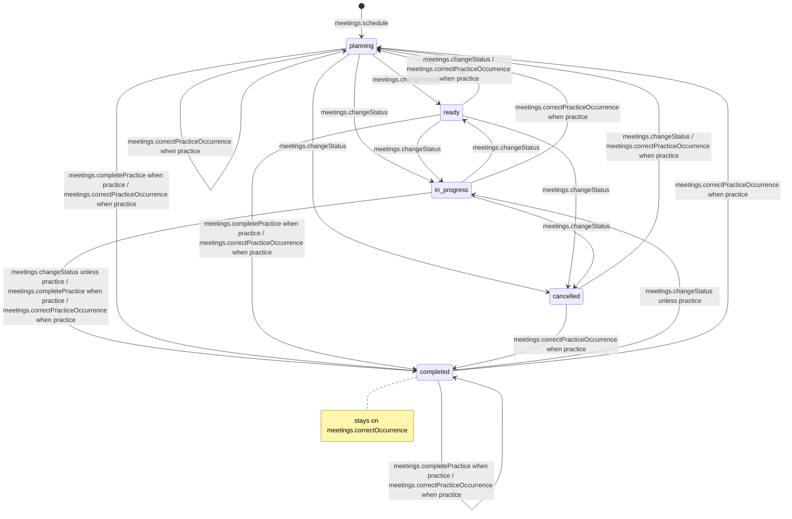

# Meeting status machine

Generated from `packages/contracts/src/machines/meeting-status.ts` by `node tools/ci/machines.ts --write`.
`node tools/ci/machines.ts --check` fails when this page differs from the table, and when the writer census below
finds a write of the column that does not carry the machine's guard.

- Column: `meeting.status`
- States: `planning`, `ready`, `in_progress`, `completed`, `cancelled`
- Subjects the guards tell apart: `vision`, `orientation`, `team`, `practice`
- Refusal for every move the chart does not show: `status_transition`
- A request for the current state writes nothing: `meetings.changeStatus`



## Refused moves

| Subject | Event | From | To | Refusal |
|---|---|---|---|---|
| `vision` | `meetings.changeStatus` | planning | completed | `status_transition` |
| `vision` | `meetings.changeStatus` | ready | completed | `status_transition` |
| `vision` | `meetings.changeStatus` | in_progress | planning | `status_transition` |
| `vision` | `meetings.changeStatus` | completed | ready | `status_transition` |
| `vision` | `meetings.changeStatus` | completed | cancelled | `status_transition` |
| `vision` | `meetings.changeStatus` | completed | planning | `status_transition` |
| `vision` | `meetings.changeStatus` | cancelled | ready | `status_transition` |
| `vision` | `meetings.changeStatus` | cancelled | in_progress | `status_transition` |
| `vision` | `meetings.changeStatus` | cancelled | completed | `status_transition` |
| `vision` | `meetings.correctOccurrence` | planning | planning | `status_transition` |
| `vision` | `meetings.correctOccurrence` | ready | ready | `status_transition` |
| `vision` | `meetings.correctOccurrence` | in_progress | in_progress | `status_transition` |
| `vision` | `meetings.correctOccurrence` | cancelled | cancelled | `status_transition` |
| `orientation` | `meetings.changeStatus` | planning | completed | `status_transition` |
| `orientation` | `meetings.changeStatus` | ready | completed | `status_transition` |
| `orientation` | `meetings.changeStatus` | in_progress | planning | `status_transition` |
| `orientation` | `meetings.changeStatus` | completed | ready | `status_transition` |
| `orientation` | `meetings.changeStatus` | completed | cancelled | `status_transition` |
| `orientation` | `meetings.changeStatus` | completed | planning | `status_transition` |
| `orientation` | `meetings.changeStatus` | cancelled | ready | `status_transition` |
| `orientation` | `meetings.changeStatus` | cancelled | in_progress | `status_transition` |
| `orientation` | `meetings.changeStatus` | cancelled | completed | `status_transition` |
| `orientation` | `meetings.correctOccurrence` | planning | planning | `status_transition` |
| `orientation` | `meetings.correctOccurrence` | ready | ready | `status_transition` |
| `orientation` | `meetings.correctOccurrence` | in_progress | in_progress | `status_transition` |
| `orientation` | `meetings.correctOccurrence` | cancelled | cancelled | `status_transition` |
| `team` | `meetings.changeStatus` | planning | completed | `status_transition` |
| `team` | `meetings.changeStatus` | ready | completed | `status_transition` |
| `team` | `meetings.changeStatus` | in_progress | planning | `status_transition` |
| `team` | `meetings.changeStatus` | completed | ready | `status_transition` |
| `team` | `meetings.changeStatus` | completed | cancelled | `status_transition` |
| `team` | `meetings.changeStatus` | completed | planning | `status_transition` |
| `team` | `meetings.changeStatus` | cancelled | ready | `status_transition` |
| `team` | `meetings.changeStatus` | cancelled | in_progress | `status_transition` |
| `team` | `meetings.changeStatus` | cancelled | completed | `status_transition` |
| `team` | `meetings.correctOccurrence` | planning | planning | `status_transition` |
| `team` | `meetings.correctOccurrence` | ready | ready | `status_transition` |
| `team` | `meetings.correctOccurrence` | in_progress | in_progress | `status_transition` |
| `team` | `meetings.correctOccurrence` | cancelled | cancelled | `status_transition` |
| `practice` | `meetings.changeStatus` | planning | completed | `status_transition` |
| `practice` | `meetings.changeStatus` | ready | completed | `status_transition` |
| `practice` | `meetings.changeStatus` | in_progress | planning | `status_transition` |
| `practice` | `meetings.changeStatus` | in_progress | completed | `status_transition` |
| `practice` | `meetings.changeStatus` | completed | ready | `status_transition` |
| `practice` | `meetings.changeStatus` | completed | in_progress | `status_transition` |
| `practice` | `meetings.changeStatus` | completed | cancelled | `status_transition` |
| `practice` | `meetings.changeStatus` | completed | planning | `status_transition` |
| `practice` | `meetings.changeStatus` | cancelled | ready | `status_transition` |
| `practice` | `meetings.changeStatus` | cancelled | in_progress | `status_transition` |
| `practice` | `meetings.changeStatus` | cancelled | completed | `status_transition` |
| `practice` | `meetings.completePractice` | cancelled | completed | `status_transition` |
| `practice` | `meetings.correctOccurrence` | planning | planning | `status_transition` |
| `practice` | `meetings.correctOccurrence` | ready | ready | `status_transition` |
| `practice` | `meetings.correctOccurrence` | in_progress | in_progress | `status_transition` |
| `practice` | `meetings.correctOccurrence` | cancelled | cancelled | `status_transition` |

## Writers of the column

| File | Statement | Guard |
|---|---|---|
| `packages/domain/src/meetings/meetings.ts` | update | from-state filter |
| `packages/domain/src/meetings/meetings.ts` | insert | initial state |

The census is a static scan of git-tracked product code and SQL files under apps, packages, ops, scripts and
tools. It reads SQL literals (with an optional schema prefix), SET fragments in a file that also holds a dynamic
`SET ${…}` on the table, Drizzle `update`/`insert` calls, and `.sql` files. A guarded UPDATE filters on
`status = ANY(${fromStates(meetingStatusMachine, …)})` in the same statement, or a Drizzle update on
`inArray(<table>.status, fromStates(meetingStatusMachine, …))` in its `where` (alone or inside `and`). A guarded
INSERT writes an initial state as a literal; in a Drizzle object literal that is the last property that names
the column, after any spread. An INSERT that copies rows without a column list is guarded when it filters on
`status = ANY(${entryStates(meetingStatusMachine, …)})`. An UPDATE in a `.sql` file is guarded only inside a
function that an edge names with `sql`, after a `SELECT * INTO … FROM <table> WHERE … FOR UPDATE; IF NOT FOUND
THEN RAISE` whose required states are exactly that edge's from-states, and only when it writes that edge's
target as a literal. A column name or statement start built at runtime, or a Drizzle object that is not a
literal, counts as an unguarded writer.

It cannot see: a SET fragment passed in from another file, SQL text assembled from variables that hold no
literal naming the table, statements sent outside this repository, or writes made by hand in a database
session. Only a database trigger generated from this table would refuse those.

It is strict where it cannot tell: any other write in a `.sql` file counts as unguarded (a data backfill
needs its own edge and function), and so does a bare
`status = …` fragment of any table in a file that also holds a dynamic `UPDATE meeting SET ${…}`.

## Proof

`tests/integration/meetings/status-machine.test.mts` walks every edge and every refused move against Postgres through the public operations and
reads each state back from the row. Run it with `EVF_MACHINE_COVERAGE=<file>` set, then attach this chart and
the report below to a change that touches this machine:

```sh
node tools/ci/machines.ts coverage <file>
```
