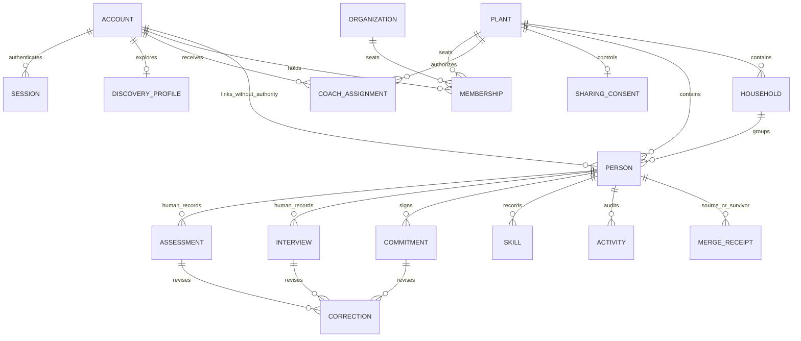

# Identity, oversight, onboarding and People audit/specification

The controller `src/app/(dashboard)/dashboard/actions.ts#confirmLeadership` maps explicitly to IDN-014's leadership attestation/vacant-owner behavior. Its supporting dashboard/account files do not replace that semantic link, and its source name does not require an additional public v3 API.

Documentation only. Evidence inspected on 2026-10-03. Primary checkout `/Users/sebastian/dev/everyfield_v2` at `18fc1a50`; alpha checkout `/private/tmp/everyfield-alpha-implementation` at `2107df58885c883960422ce7e60719f0adbac0e4`, clean when checked. Alpha is a separate implemented but unmerged evidence baseline; its existence does not establish production deployment. No v2 code, database, environment values or local memories were mutated, and no database-dependent proof was run. Repository AGENTS.md, memory/invariants.md and relevant boundary/type/idempotency/proof skills were read through filesystem. Existing source tests are indexed as evidence, not reported as passing here.

This specification preserves the SME Launch Playbook and its person qualification methodology. `product-docs/launch-playbook.md` (especially qualification, formalize commitment and the four C’s) is the product foundation; `product-docs/features/people-crm/frd.md` is interpreted against it. The four person C’s are Committed, Compelled, Contagious and Courageous. Interviews retain Maturity, Gifted, Chemistry, Right Reasons and Season. These human-recorded qualification records are different from the church Plant Intelligence rubric. Software organization, event plumbing, permissions representation, UI mechanics and historical implementation invariants may be replaced. The playbook’s pastoral judgments may not be silently replaced with AI scores or new gates.

Every listed implemented capability is in the full v3 target unless a decision explicitly says otherwise. `partial` means the record distinguishes its implemented portion from missing UI/intended behavior. `dead` is an exported internal helper with no src callers, not an approved removal of its related product capability. No feature removal is assumed approved. Stable IDs here intentionally differ from legacy FRD P-/AS-/OB-/OV-/CS- IDs; source FRDs remain provenance. Placeholder work packages WP-identity and WP-people must be refined into the master DAG.

## Scope and evidence interpretation

The implemented layer is extensive: account/tenancy lifecycle, three independent grant types, five organization invitation shapes, a settings data API/modal, account recovery, private images, oversight aggregate read models, coached collection/detail routes, recruitment stages, households, assessments/interviews/commitments, CSV exchange and collision-aware merging. Routes alone omit most of it. This module inventory also covers service-only restore and no-op follow-up handlers instead of pretending navigation exhausts capability.

A flat role model is still proportionate. A tenant seat is Owner/Admin/Member in one plant, sending church or network; a coach assignment is read access to a chosen plant; a Discovery association gives relationship context without a seat. These grants must never lend authority to one another. V3 may represent memberships in a cleaner table rather than users’ three nullable FKs, but its first release should preserve the current one-seat-tenancy rule until changed explicitly. A tenant membership is not a church’s external oversight association. Better Auth should own authentication primitives and sessions, while domain policy owns these distinctions.

The authority split is concrete: Owner chooses association/sharing, manages seats and schedules launch; Admin performs ordinary plant writes; Member reads and acts only on authenticated own duties; all org seats read their org’s aggregate portfolio; coach reads assigned records and writes none. Platform administration is an independent allowlist (ops audit owns it). Source tests often enforce literal import/export/guard shapes. Those are useful historical drift alarms but not a reason to copy v2 architecture or claim broad product coverage. V3 acceptance should exercise public requests and authoritative transactions with forged IDs, races and failures.

## Fine-grained capability preservation matrix

The compact matrix points to detailed contracts below and the machine-readable audit. Every feature has an acceptance ID. Complete capability rows are not a substitute for the export-support appendix: a pure parse helper is indexed there without being promoted to a user-facing feature.

| Feature | Existing status | V3 owner | Acceptance | Work package | Disposition |
|---|---|---|---|---|---|
| IDN-001 Sign-in, session lifecycle, logout and safe return navigation | implemented-main | identity | AC-IDN-001 | WP-identity | Preserve outcomes; replace custom session/password plumbing with Better Auth. Confirm freshness/re-auth policy explicitly; do not treat unused fresh metadata as implemented security. |
| IDN-002 Registration and account-entity provisioning | implemented-main | identity | AC-IDN-002 | WP-identity | Preserve all account types; redesign atomic grant and invitation redemption. No customer data migration. |
| IDN-003 Beta gate and meaningful invitation-origin registration | implemented-main | identity | AC-IDN-003 | WP-identity | Preserve optional controlled rollout; decide whether alpha beta-code gate is needed in fresh v3 before activation. |
| IDN-004 Development and managed-preview account switching | implemented-main | identity | AC-IDN-004 | WP-identity | Keep isolated developer tooling; require fresh v3 fixture accounts, never clone customers or enable in production. |
| IDN-005 Seat, tenancy, capability guards and read-only affordances | implemented-main | identity | AC-IDN-005 | WP-identity | Keep flat role policy and real isolation. Simplify source-text capability drift tests into runtime permission contracts; do not build a configurable per-module permission grid. |
| IDN-006 Account avatar upload, replacement, removal and authenticated delivery | implemented-main | identity | AC-IDN-006 | WP-identity | Preserve private delivery/order; share upload policy/storage adapter with person photos, use cleanup jobs rather than generic event infrastructure. |
| IDN-007 Email change request, proof, confirmation and security notice | implemented-main | identity | AC-IDN-007 | WP-identity | Keep safety semantics via Better Auth or thin domain adapter; implement credential-operation concurrency and explicit CRM email policy, avoiding duplicate auth workflows. |
| IDN-008 Authenticated password change and other-session revocation | implemented-main | identity | AC-IDN-008 | WP-identity | Preserve behavior; adopt Better Auth, verify its revocation and reset-token invalidation rather than assuming plugin defaults suffice. |
| IDN-009 Mailbox password recovery | implemented-local-only | identity | AC-IDN-009 | WP-identity | Include in full target and early identity slice; use Better Auth recovery after proving equivalent concurrency and no-enumeration semantics. |
| IDN-010 Settings modal, deep links, draft protection and section API | implemented-main | identity | AC-IDN-010 | WP-identity | Keep settings capabilities and draft safety. Compare modal with simple route UI during design; changing shell is allowed, losing deep links or drafts is not. |
| IDN-011 Church profile, locality, timezone, inactivity and digest schedule | implemented-main | identity | AC-IDN-011 | WP-identity | Preserve fields/preferences; standardize LocalDate, Instant, ZonedSchedule. Avoid address-based inferred timezone or redundant launch-date church column. |
| IDN-012 Per-account notification preferences, cadence and self suppression recovery | implemented-main | identity | AC-IDN-012 | WP-identity | Retain settings and integrate with notification-owned contracts; no parallel preference engine. |
| IDN-013 Church creation, onboarding basics and account-person bootstrap | implemented-main | identity | AC-IDN-013 | WP-identity | Preserve flow; use one true transaction with locked account/unique membership and idempotency key. Do not carry compensate-after-commit as required design. |
| IDN-014 Leadership attestation, vacant-owner claim and prompts | implemented-main | identity | AC-IDN-014 | WP-identity | Preserve attestation/claim; explicitly resolve Owner versus lead-pastor modeling before schema freeze. Do not let Evry appoint pastoral authority. |
| IDN-015 Journey declaration, launch-date setup, completion and resume | implemented-main | identity | AC-IDN-015 | WP-identity | Keep journey and human judgment; consolidate typed domain orchestration rather than calling one Next server action from another. |
| IDN-016 Discovery identity, associations and conversion to plant | implemented-main | identity | AC-IDN-016 | WP-identity | Preserve distinct exploration identity; model lifecycle explicitly with atomic conversion, not a broad null-FK fallback. |
| IDN-017 Seat invitation create, pending list, resend, revoke, expire and first-seat acceptance | implemented-main | identity | AC-IDN-017 | WP-identity | Preserve full lifecycle; choose dedicated MembershipInvitation domain despite Better Auth organization plugin, because association and coach grants remain different. |
| IDN-018 Coach invitation and assignment lifecycle | implemented-main | identity | AC-IDN-018 | WP-identity | Keep explicit grants; add assigned_by/end actor/date audit in fresh v3, decide whether creator-specific end authority is product-needed. |
| IDN-019 Seat roster, Admin appointment/demotion and authority removal | implemented-main | identity | AC-IDN-019 | WP-identity | Preserve authority removal/reconciliation; stamp grants and changes in audit. Adopt membership table while retaining one-current-seat product rule unless separately approved. |
| IDN-020 Organization relationship invitations across five subject types | implemented-main | identity | AC-IDN-020 | WP-identity | Retain every relationship variant. Split focused invitation policy, transaction repository and delivery adapter; no generic nullable subject mega-service. |
| IDN-021 Relationship leaving, organization severing and association history | implemented-main | identity | AC-IDN-021 | WP-identity | Preserve lifecycle/history; make relationship transaction plus delivery outbox atomic, implement subject-aware history UI. |
| IDN-022 Privacy pull sharing, push consent and first-invitation defaults | implemented-main | identity | AC-IDN-022 | WP-identity | Preserve actual consent needs; decide granularity/defaults openly. Remove dead toggle from v3 schema only through explicit decision; do not resurrect facilities simply because column exists. |
| IDN-023 Oversight dashboard, plant directory, consent-gated aggregates and health entry | implemented-main | identity | AC-IDN-023 | WP-identity | Keep aggregate-only oversight; shared domain reporting queries prevent parallel inconsistent counts. Phase owner must finalize health consent contract. |
| IDN-024 Network sending-church roster and member detail | implemented-main | identity | AC-IDN-024 | WP-identity | Preserve dedicated scoped reporting, avoid generic graph hierarchy authorization. |
| IDN-025 Coach plant, collection and detail surfaces | partial | identity | AC-IDN-025 | WP-identity | Preserve implemented read surfaces and close promised omissions. Confirm scope of communications/activity, assessments and private documents with product owner; no silent downgrade. |
| IDN-026 Unwired organization settings, ownership transfer and account deletion boundaries | partial | identity | AC-IDN-026 | WP-identity | Explicit decision required; preserve boundary and expose gap. Do not count future billing/transfer as implemented. |
| IDN-027 Unused direct disassociation helpers | dead | identity | AC-IDN-027 | WP-identity | Replace/remove internal dead helpers as implementation cleanup; preserve actual sever capability IDN-021. |
| IDN-028 Request boundary, CSRF exceptions, trusted routing and expired-session recovery | implemented-main | identity | AC-IDN-028 | WP-identity | Preserve secure outcomes and recoverable navigation. Choose backend/CORS/proxy deployment policy explicitly; do not preserve cookie-presence authentication, host-only comparison or internal routing headers as architectural dogma. Wiki preview content and email capability semantics are owned by their module specs. |
| PPL-001 People directory, search, filters, cursor pagination and views | implemented-main | people | AC-PPL-001 | WP-people | Preserve read affordances; one typed query DTO reused by UI, exports and Evry; use scalable pipeline pagination/virtualization without changing stages. |
| PPL-002 Person creation, quick add, profile editing and background-check tracking | implemented-main | people | AC-PPL-002 | WP-people | Preserve manual background tracking and all fields. Boundary DTOs should allow explicit null and trimmed validation; screening provider remains separate unapproved scope. |
| PPL-003 Person retirement and service-only restore | partial | people | AC-PPL-003 | WP-people | Retain soft retirement/recovery requirement; implement safe operator/user restore only with product-approved policy, never hard-delete history. |
| PPL-004 Account-linked contacts and recruited-contact identity | implemented-main | people | AC-PPL-004 | WP-people | Keep separate human contact and account identity. Use explicit contact-account link exclusively for authority-related matching; decide email fallback compatibility with fresh data and duplicate-review UX. |
| PPL-005 Private person photo lifecycle | implemented-main | people | AC-PPL-005 | WP-people | Rename v3 column photoObjectId/key; retain secure delivery and ordering, shared storage adapter. |
| PPL-006 Manual recruitment-stage movement, warnings, reasons and handoff | implemented-main | people | AC-PPL-006 | WP-people | Keep authoritative status methodology; decide auto-regression behavior explicitly. Use atomic stage+audit and version precondition; Evry proposes stage changes for reviewed human writes. |
| PPL-007 Recruitment pipeline grouping, ordering, inactivity and follow-up warnings | implemented-main | people | AC-PPL-007 | WP-people | Preserve board and warning enhancement; avoid exposing giant raw row graph to client, use paged cards with stable stage ordering. |
| PPL-008 Activity timeline and authored-note create/edit/delete | implemented-main | people | AC-PPL-008 | WP-people | Preserve notes and history; separate mutable note content/revisions from immutable activity/audit rather than adopting unconstrained polymorphic Note blindly. |
| PPL-009 Household lifecycle, member roles and deliberate address propagation | implemented-main | people | AC-PPL-009 | WP-people | Preserve workflow; transaction locks and household-person ownership constraints; simplify address duplication only if override/propagate semantics preserved. |
| PPL-010 Church-defined tags and person assignment | implemented-main | people | AC-PPL-010 | WP-people | Keep tenant tag system; unique normalized-name decision explicit, no needless generic classification engine. |
| PPL-011 Skills, gifts, proficiency and category grouping | implemented-main | people | AC-PPL-011 | WP-people | Preserve flexible inventory; simple table/domain operations suffice. |
| PPL-012 SME 4 C’s assessment recording, latest result and history | implemented-main | people | AC-PPL-012 | WP-people | Keep methodology unchanged; version canonical rubric labels and preserve date-only values. Atomic assessment+audit, typed qualification domain. |
| PPL-013 SME five-criterion interview, result, next steps and progression | implemented-main | people | AC-PPL-013 | WP-people | Preserve methodology/result meaning. PD-003 / OD-004 accepts preservation of an advanced stage when recording another interview or commitment; only an explicit stage-change action may demote. Optional next-step-task UX remains an open partial requirement. |
| PPL-014 Commitment recording, private document and Core Group entry | implemented-main | people | AC-PPL-014 | WP-people | Preserve authoritative commitment→Core Group semantics; fix file transport and history atomicity; preserve an advanced stage on repeated commitment recording under accepted PD-003 / OD-004; demotion requires an explicit stage-change action. |
| PPL-015 Alpha corrections of assessment, interview and commitment records | implemented-local-only | people | AC-PPL-015 | WP-people | Include full target and qualification slice; prefer explicit row revision numbers and domain-owned revision history over hash-specific architecture. Decide correction reason/undo policy. |
| PPL-016 Duplicate hints and duplicate-pair review directory | implemented-main | people | AC-PPL-016 | WP-people | Preserve human review; no AI automatic identity merge. Data quality hints remain advisory. |
| PPL-017 Field-choice duplicate merge, blockers, reference transfer, receipt and redirects | implemented-main | people | AC-PPL-017 | WP-people | Preserve reconciliation; reviewed destructive write default for Evry, human field choice. Own transaction with relation registry/schema coverage, explicit reversal design rather than naive undo. |
| PPL-018 CSV template, preview, row validation, duplicate resolutions and partial import | implemented-main | people | AC-PPL-018 | WP-people | Preserve contact import as new-customer workflow, unrelated to v2 customer migration. Choose proven CSV library or pure parser with tests; add run/row receipts if partial resumability retained. |
| PPL-019 Filtered CSV export and file serialization | implemented-main | people | AC-PPL-019 | WP-people | Keep full export. Decide formula-neutralization and lossless roundtrip requirements explicitly; never advertise existing import/export as a backup. |
| PPL-020 Recorded events and cross-domain recruitment auto-advancement | implemented-main | people | AC-PPL-020 | WP-people | Keep domain outcomes; use direct in-transaction calls for critical changes and durable job/outbox only for external/asynchronous effects. Do not preserve generic event bus for its own sake. |
| PPL-021 Person teams, training and communication tabs | implemented-main | people | AC-PPL-021 | WP-people | Preserve tabs and cross-domain read DTOs; keep writes in owning domain operations; no duplicate person-specific send engine. |
| PPL-022 Deferred follow-up initiation handler and incomplete task suggestions | partial | people | AC-PPL-022 | WP-people | Replace no-op; preserve real follow-up capabilities through Tasks inventory, mark suggestion requirement for decision. |
| PPL-023 Unused pipeline conversion analytics service and component | dead | people | AC-PPL-023 | WP-people | Explicit product decision: implement transparent cohort-aware analytics if required, or retire unused internal artifact while preserving active Phase Intelligence metrics; do not claim delivered UI. |

## Capability contracts

### IDN-001 — Sign-in, session lifecycle, logout and safe return navigation

**Status:** implemented-main. **Owning work package:** WP-identity. **V3 owner:** `identity`.

Custom auth generates 20 random bytes encoded base32, stores SHA-256 session IDs, uses 30-day expiry with sliding refresh below 15 days. verifyFreshSession re-reads the session; it does not enforce the schema comment’s ten-minute fresh flag. Session metadata columns exist but normal login createsSession without IP/user-agent/geolocation. The production shared limiter counts only success=false auth_attempts newer than the strict sliding-window cutoff. Login permits fewer than 5 failures per normalized email and fewer than 20 per resolved IP in 15 minutes; at either threshold it refuses before lookup/password verification. recordAttempt writes/prunes older-than-24-hour rows in a batch, and success clears this identifier/kind’s failed rows within its window (also reducing that identifier’s contribution to its IP). REAL_ATTEMPT_LIMITER merely binds the same production counter/recorder for self-service injection; it is not a second limiter. getRequestIp prefers trimmed x-real-ip, otherwise the last x-forwarded-for hop, otherwise null; a null IP skips that axis. This relies on the deployment overwriting trusted proxy headers. Count/check and later record are separate, so concurrent attempts can exceed the nominal threshold. Request-boundary behavior is separately preserved by IDN-028.

**Routes/screens/API:** /login.

**Implemented operations:** login; generateSessionToken; hashToken; createSession; validateSessionToken; invalidateSession; getCurrentSession; verifySession; verifyFreshSession; getCurrentUserChurch; setSessionCookie; deleteSessionCookie; getSessionToken; logout; safeRedirectPath; loginPathFor; getRequestIp; countAuthAttemptFailures; checkRateLimit; recordAttempt.

**Tables/important consumers:** users; sessions; auth_attempts.

**Authority:** Public sign-in; authenticated self-session operations.

**States/transitions:** unknown→authenticated→expired/revoked; logout converges without a live session.

**Validation/data contract:** Zod login; normalized email; password verification; local safe redirect.

**Integrations:** Argon2; Next cookies/navigation.

**Failure/recovery/edge cases:** Invalid address/password uses one message; limiter refusal; expired rows removed; cookie/session creation can fail after account auth; Untrusted deployment forwarding headers can defeat IP attribution; concurrent check/record is not a hard reservation; limiter database errors are not independently recovered here..

**V3 operations:** `identity.login`; `identity.generateSessionToken`; `identity.hashToken`; `identity.createSession`; `identity.validateSessionToken`; `identity.invalidateSession`; `identity.getCurrentSession`; `identity.verifySession`; `identity.verifyFreshSession`; `identity.getCurrentUserChurch`; `identity.setSessionCookie`; `identity.deleteSessionCookie`; `identity.getSessionToken`; `identity.logout`; `identity.safeRedirectPath`; `identity.buildSafeReturnPath`; `identity.checkAuthAttemptBudget`; `identity.recordAuthAttempt`. Names are domain-contract suggestions, not an instruction to preserve framework Action suffixes.

**Acceptance AC-IDN-001:** Correct/incorrect credentials, return-path attacks, expiry, revoke, repeated logout and credential rotation are exercised through real requests. Better Auth must provide equivalent renewal/revocation without relying on stale request-cached actors. Exercise identifier/IP isolation, normalized casing, exact window boundary, null IP, success cleanup without clearing other identifiers, and concurrent bursts using the real attempt store. Deployment tests prove a client cannot choose trusted IP headers; declare whether v3 limits failures, requests or both. IDN-028 covers cookie-presence versus validated-session routing and forged request headers.

**Decision:** Preserve outcomes; replace custom session/password plumbing with Better Auth. Confirm freshness/re-auth policy explicitly; do not treat unused fresh metadata as implemented security.

**Evidence:** `src/app/(auth)/login/actions.ts`, `src/lib/auth/session.ts`, `src/lib/auth/cookies.ts`, `src/lib/auth/actions.ts`, `src/lib/auth/safe-redirect.ts`, `src/lib/auth/rate-limit.ts`, `src/lib/auth/attempt-limiter.ts`.

**Tests/proofs inspected as references:** `src/lib/auth/safe-redirect.test.ts`, `src/app/(auth)/login/authenticated-bounce.test.ts`, `src/lib/auth/unauthorized.test.ts`, `src/lib/auth/rate-limit.test.ts`.

### IDN-002 — Registration and account-entity provisioning

**Status:** implemented-main. **Owning work package:** WP-identity. **V3 owner:** `identity`.

Registration provisions orgs and their Owner or a preplant Owner; Discovery has an explicit profile and no seat. Invited planter may provision its plant immediately. Seat registration batches account and claim; org invitation redemption is a later best-effort operation. The accepted revoke race can leave an account with authority after the invite was revoked. Its shared register policy has a 1-hour window, 3 failures per IP and no identifier threshold. The action records duplicate-address/unique-conflict failures, records successful registration as success, and returns on malformed input/beta-gate/invitation refusals without uniformly recording them. Therefore this source does not enforce a maximum of 3 successful registrations per IP/hour despite the policy comment’s mass-account-creation intent. Success also clears in-window register failures for that identifier; no-IP requests skip the sole axis.

**Routes/screens/API:** /register.

**Implemented operations:** register; createAccountEntities.

**Tables/important consumers:** users; sessions; churches; sending_churches; sending_networks; discovery_profiles; persons; user_invitations; organization_invitations; auth_attempts.

**Authority:** Public, constrained by invite/beta rules.

**States/transitions:** account type planter/sending-church/network/discovery; invited seat/coach overrides ordinary standing.

**Validation/data contract:** Email/password/name/account type; required org name for relevant account types; unique email.

**Integrations:** Argon2; Invitation redemption; Account-person linking.

**Failure/recovery/edge cases:** Existing-email error disclosed here; unique-email race caught; association redemption failures logged after account creation; registration/invitation revocation race accepted in v2; Failed-attempt policy is not a successful-registration volume cap; early validation/beta refusals can be uncounted; concurrent check and insert do not reserve a budget slot..

**V3 operations:** `identity.register`; `identity.createAccountEntities`. Names are domain-contract suggestions, not an instruction to preserve framework Action suffixes.

**Acceptance AC-IDN-002:** Each type provisions only intended entities. Revoke/expire racing registration yields either a valid complete grant or no grant; no orphan authority. Failure between account creation and relationship redemption has a retryable reconciliation receipt. Prove policy against real successful, duplicate, beta-refused, malformed and concurrent registrations; resolve the intended account-creation/request-volume cap before relying on library defaults. Null/untrusted IP behavior is covered by IDN-001.

**Decision:** Preserve all account types; redesign atomic grant and invitation redemption. No customer data migration.

**Evidence:** `src/app/(auth)/register/actions.ts`, `src/app/(auth)/register/account-entities.ts`, `src/lib/validations/auth.ts`, `src/lib/auth/rate-limit.ts`, `src/lib/auth/attempt-limiter.ts`.

**Tests/proofs inspected as references:** `src/app/(auth)/register/account-entities.test.ts`, `src/lib/invitations/register-path.test.ts`, `src/lib/auth/rate-limit.test.ts`.

### IDN-003 — Beta gate and meaningful invitation-origin registration

**Status:** implemented-main. **Owning work package:** WP-identity. **V3 owner:** `identity`.

Registration has separate account-type choice policy and beta invitation bypass. Invitation information must describe inviter sufficiently for informed consent without exposing target account existence to senders.

**Routes/screens/API:** /register?invitationId=….

**Implemented operations:** isBetaGateEnabled; isBetaCodeValid; describeInvitationForRegistration; hasValidInvitationBypass; invitationActedOnAtRegistration.

**Tables/important consumers:** organization_invitations; user_invitations.

**Authority:** Public; bypass only valid addressed invitation.

**States/transitions:** gate disabled/enabled; code absent/invalid/valid; open invitation addressed/unaddressed.

**Validation/data contract:** Email and pending unexpired invitation; account-type relationship.

**Integrations:** Deployment beta flag/code.

**Failure/recovery/edge cases:** Forged invitation does not bypass; invalid code field error; linked invitation can expire during form review.

**V3 operations:** `identity.isBetaGateEnabled`; `identity.isBetaCodeValid`; `identity.describeInvitationForRegistration`; `identity.hasValidInvitationBypass`; `identity.invitationActedOnAtRegistration`. Names are domain-contract suggestions, not an instruction to preserve framework Action suffixes.

**Acceptance AC-IDN-003:** Bypass matrix covers unrelated email, expired/revoked invite, each account type and disabled gate. Public response contains no secret gate value.

**Decision:** Preserve optional controlled rollout; decide whether alpha beta-code gate is needed in fresh v3 before activation.

**Evidence:** `src/app/(auth)/register/beta-gate.ts`, `src/lib/invitations/register-path.ts`, `src/app/(auth)/register/account-type-choices.ts`.

**Tests/proofs inspected as references:** `src/app/(auth)/register/account-type-choices.test.ts`.

### IDN-004 — Development and managed-preview account switching

**Status:** implemented-main. **Owning work package:** WP-identity. **V3 owner:** `identity`.

Hidden login helpers support reproducible persona/role UI checks. They are not a production identity feature. Preview account catalog and role matrix are evidence assets.

**Routes/screens/API:** /login.

**Implemented operations:** devLoginAs; isPreviewAccountPickerEnabled; listPreviewAccounts.

**Tables/important consumers:** users; sessions.

**Authority:** Public only under development/owned-preview flag.

**States/transitions:** disabled→unreachable; enabled→fixture selection→session.

**Validation/data contract:** Allowlisted fixture account; explicit environment guard.

**Integrations:** Managed local preview fixtures.

**Failure/recovery/edge cases:** Refuse outside selected environment; no user-submitted arbitrary privilege.

**V3 operations:** `identity.devLoginAs`; `identity.isPreviewAccountPickerEnabled`; `identity.listPreviewAccounts`. Names are domain-contract suggestions, not an instruction to preserve framework Action suffixes.

**Acceptance AC-IDN-004:** Production build with flags absent cannot obtain a fixture session via forged action POST. Owned test environment can switch only seeded personas.

**Decision:** Keep isolated developer tooling; require fresh v3 fixture accounts, never clone customers or enable in production.

**Evidence:** `src/app/(auth)/login/dev-actions.ts`, `src/app/(auth)/login/dev-accounts.ts`, `src/app/(auth)/login/preview-accounts.ts`, `src/app/(auth)/login/dev-account-switcher.tsx`, `src/app/(auth)/login/preview-account-picker.tsx`.

**Tests/proofs inspected as references:** `src/app/(auth)/login/dev-accounts.test.ts`, `src/app/(auth)/login/preview-accounts.test.ts`.

### IDN-005 — Seat, tenancy, capability guards and read-only affordances

**Status:** implemented-main. **Owning work package:** WP-identity. **V3 owner:** `identity`.

Flat seats: Owner relationship/privacy/seat changes; Admin ordinary writes; Member reads and own-duty writes. Org seats read aggregates, never individual CRM. Coach is read-only by assignment. General access helper returns org reach first, otherwise plant seat or assignment reach; scoped coaching readers explicitly check assignments, so an org-seated coach can read assigned plants through coaching routes. Schema users lacks exactly-one-tenancy and seat-tenancy CHECKs because historical rows were tolerated.

**Routes/screens/API:** all authenticated surfaces.

**Implemented operations:** tenancyOf; tenancyColumns; oversightOrgOf; isOversightUser; isChurchLevelUser; isPlantOwner; isOrgOwner; isChurchLevelOwner; holdsSeatFor; heldCapabilities; requiresPlantTenancy; isOwnerSeat; assertSeatFor; requireSeat; getAccessibleChurchIds; requireChurchAccess; canAccessChurch; canAccessFeatureData.

**Tables/important consumers:** users; churches; coach_assignments; church_privacy_settings.

**Authority:** Owner/Admin/Member scoped to exactly one tenancy; coach assignments separate.

**States/transitions:** seated/seatless/discovery/misprovisioned; multiple-tenancy rows fail closed.

**Validation/data contract:** Tenancy plus seat, not seat alone; operation-specific own-duty subject guard.

**Integrations:** All domain adapters; Client viewer capabilities.

**Failure/recovery/edge cases:** Stale actors; two tenancy FKs; hidden control is not server authorization; canAccessFeatureData is consent only and does not prove church reach.

**V3 operations:** `identity.tenancyOf`; `identity.tenancyColumns`; `identity.oversightOrgOf`; `identity.isOversightUser`; `identity.isChurchLevelUser`; `identity.isPlantOwner`; `identity.isOrgOwner`; `identity.isChurchLevelOwner`; `identity.holdsSeatFor`; `identity.heldCapabilities`; `identity.requiresPlantTenancy`; `identity.isOwnerSeat`; `identity.assertSeatFor`; `identity.requireSeat`; `identity.getAccessibleChurchIds`; `identity.requireChurchAccess`; `identity.canAccessChurch`; `identity.canAccessFeatureData`. Names are domain-contract suggestions, not an instruction to preserve framework Action suffixes.

**Acceptance AC-IDN-005:** Role×tenancy×operation and foreign-ID matrices are executable contracts. Explicit grant contexts distinguish own seat, assigned coach read, oversight aggregate. Malformed membership cannot widen read/write; clients cannot forge capability arrays.

**Decision:** Keep flat role policy and real isolation. Simplify source-text capability drift tests into runtime permission contracts; do not build a configurable per-module permission grid.

**Evidence:** `src/lib/auth/tenancy.ts`, `src/lib/auth/seat-rules.ts`, `src/lib/auth/seats.ts`, `src/lib/auth/access.ts`, `src/lib/auth/capability-map.ts`, `src/lib/auth/read-only-surfaces.ts`.

**Tests/proofs inspected as references:** `src/lib/auth/seats.test.ts`, `src/lib/auth/access.test.ts`, `src/lib/auth/tenancy.test.ts`, `src/lib/auth/seat-guard.test.ts`, `src/lib/auth/read-only-surfaces.test.ts`, `src/lib/auth/seat-leaf.test.ts`.

### IDN-006 — Account avatar upload, replacement, removal and authenticated delivery

**Status:** implemented-main. **Owning work package:** WP-identity. **V3 owner:** `identity`.

users.avatar_key stores a private key. Browser receives session-gated route with version segment, never a raw storage key or signed photo URL. Account name is displayed but no account-name mutation exists in the audited account action file.

**Routes/screens/API:** #settings/account; /api/account/avatar.

**Implemented operations:** uploadAvatarAction; removeAvatarAction; uploadUserAvatar; removeUserAvatar; setUserAvatar; GET account avatar.

**Tables/important consumers:** users.

**Authority:** Authenticated self only.

**States/transitions:** no avatar→uploaded→replaced/removed.

**Validation/data contract:** JPG/JPEG/PNG/WebP; nonempty; max 3 MiB; generated key.

**Integrations:** Private object storage.

**Failure/recovery/edge cases:** Upload before row; write before old-object delete; cleanup failure logged; upload followed by failed write may orphan new object.

**V3 operations:** `identity.uploadAvatarAction`; `identity.removeAvatarAction`; `identity.uploadUserAvatar`; `identity.removeUserAvatar`; `identity.setUserAvatar`; `identity.GET account avatar`. Names are domain-contract suggestions, not an instruction to preserve framework Action suffixes.

**Acceptance AC-IDN-006:** Unauthorized route 401; user A cannot request user B avatar by arbitrary key; changed photo visible despite browser cache; failed deletion keeps new photo usable; failed write retains old photo.

**Decision:** Preserve private delivery/order; share upload policy/storage adapter with person photos, use cleanup jobs rather than generic event infrastructure.

**Evidence:** `src/lib/auth/avatar.ts`, `src/lib/profile-photo.ts`, `src/app/(dashboard)/settings/account/actions.ts`, `src/app/api/account/avatar/route.ts`.

**Tests/proofs inspected as references:** `src/lib/auth/avatar.test.ts`, `src/app/api/account/avatar/route.test.ts`.

### IDN-007 — Email change request, proof, confirmation and security notice

**Status:** implemented-main. **Owning work package:** WP-identity. **V3 owner:** `identity`.

Confirmation is mailbox proof for changing login identifier, not initial-registration email verification. Alpha locks account and checks current email/password snapshots, fixes timestamp predicates, invalidates password-reset requests after confirmed change. Main does not synchronize the CRM contact email with new login email. The shared email_change policy uses the authenticated account’s current normalized email, not the target address: 3 outstanding/failed attempts per identifier and 10 per IP in 1 hour. Wrong current password and valid unconfirmed requests are recorded false; successful confirmation records true for the previous login identifier and clears its in-window failures. Malformed/same-address refusals do not record an attempt. The settings adapter obtains actor from requireSeat("self.write"); token confirmation verifies request.userId equals that actor, and SQL swaps only that actor’s row/current email. A request-supplied user ID cannot select the account.

**Routes/screens/API:** #settings/account; /verify-email?token=…; /verify-email/confirmed.

**Implemented operations:** requestEmailChangeAction; confirmEmailChangeAction; requestEmailChange; liveEmailChangeRequest; confirmEmailChange; supersedeLiveRequestsStatement; consumeRequestStatement; swapLoginIdentifierStatement.

**Tables/important consumers:** users; email_change_requests; auth_attempts.

**Authority:** Authenticated own account and current password.

**States/transitions:** new request supersedes live request; pending→consumed or expired; duplicate new address refuses swap.

**Validation/data contract:** Normalized valid address; different address; current password; token hash; unique login email.

**Integrations:** Resend verification/new-address email; Old-address security notice.

**Failure/recovery/edge cases:** Provider failure surfaced as emailSent; superseded/wrong-account/dead links refused; unique address collision; main raw Date predicates have host-zone risk repaired in alpha.

**V3 operations:** `identity.requestEmailChangeAction`; `identity.confirmEmailChangeAction`; `identity.requestEmailChange`; `identity.liveEmailChangeRequest`; `identity.confirmEmailChange`; `identity.supersedeLiveRequestsStatement`; `identity.consumeRequestStatement`; `identity.swapLoginIdentifierStatement`. Names are domain-contract suggestions, not an instruction to preserve framework Action suffixes.

**Acceptance AC-IDN-007:** Expired/superseded links and concurrent password reset/change cannot resurrect credentials. Confirmation takes effect exactly once and preserves account/person identity; storage timestamps round-trip under non-UTC process zone. Vary target mailboxes without evading the own-account threshold; malformed and wrong-secret cases match the chosen policy. Forged account IDs/tokens for another user cannot confirm or change the actor; successful confirmation clears only the previous identifier/kind budget.

**Decision:** Keep safety semantics via Better Auth or thin domain adapter; implement credential-operation concurrency and explicit CRM email policy, avoiding duplicate auth workflows.

**Evidence:** `src/lib/auth/email-change.ts`, `src/lib/auth/email-change-email.ts`, `src/lib/auth/account-email.ts`, `src/db/schema/email-change-request.ts`, `src/app/(dashboard)/settings/account/actions.ts`, `src/app/(dashboard)/verify-email/page.tsx`, `src/app/(dashboard)/verify-email/confirmed/page.tsx`, `src/lib/auth/rate-limit.ts`, `src/lib/auth/attempt-limiter.ts`.

**Tests/proofs inspected as references:** `src/lib/auth/email-change.test.ts`, `src/lib/auth/email-change-live.test.ts`, `src/lib/auth/rate-limit.test.ts`.

### IDN-008 — Authenticated password change and other-session revocation

**Status:** implemented-main. **Owning work package:** WP-identity. **V3 owner:** `identity`.

Password change counts own current-email failures and returns number of other sessions ended. Alpha adds credential-race protection; password_reset_requests is alpha-only. Its shared password_change policy is separate from login counts but has the same 15-minute window, 5 failures per own current-email identifier and 20 per IP. Wrong current password records false; a successful change records true and clears that identifier/kind; short/unchanged-password refusals do not record. The server adapter obtains user and currentSessionId from requireSeat("self.write"), never input. Hash update is scoped to actor.id; session deletion is scoped to sessions.userId=actor.id AND session.id!=currentSessionId. Alpha adds locked email/hash snapshot predicates around that scope.

**Routes/screens/API:** #settings/account.

**Implemented operations:** changePasswordAction; changeOwnPassword.

**Tables/important consumers:** users; sessions; auth_attempts; email_change_requests; password_reset_requests.

**Authority:** Authenticated self with current password.

**States/transitions:** unchanged/refused; new hash committed; other sessions ended; current session retained.

**Validation/data contract:** At least 8 characters; current secret; disallow identical password; throttle before expensive hash.

**Integrations:** Argon2.

**Failure/recovery/edge cases:** Main writes hash without stale-snapshot compare; alpha locks user and validates email/hash snapshot, conditionally revokes other sessions and outstanding reset/email tokens.

**V3 operations:** `identity.changePasswordAction`; `identity.changeOwnPassword`. Names are domain-contract suggestions, not an instruction to preserve framework Action suffixes.

**Acceptance AC-IDN-008:** Two stale tabs, reset/change/email-change races preserve only winning credentials; current session remains if requested, other sessions invalidated immediately. Wrong current password cannot test new-secret equivalence. Exercise password-change budget independently of login, at both identifier/IP thresholds and with null IP. A forged currentSessionId or actor ID in JSON cannot spare another account’s session or update another user; only the actual authenticated session survives. Verify the chosen treatment of malformed/unchanged new passwords.

**Decision:** Preserve behavior; adopt Better Auth, verify its revocation and reset-token invalidation rather than assuming plugin defaults suffice.

**Evidence:** `src/lib/auth/password-change.ts`, `src/lib/auth/password-policy.ts`, `src/app/(dashboard)/settings/account/actions.ts`, `src/lib/auth/rate-limit.ts`, `src/lib/auth/attempt-limiter.ts`.

**Tests/proofs inspected as references:** `src/lib/auth/password-change.test.ts`, `src/lib/auth/rate-limit.test.ts`.

### IDN-009 — Mailbox password recovery

**Status:** implemented-local-only. **Owning work package:** WP-identity. **V3 owner:** `identity`.

Verified only at alpha2107df58, absent main. One live request/account, hashed token, transaction locks and snapshot predicates revoke every session plus pending email/reset requests on success. No automatic signed-in session after reset. Alpha adds password_reset to the shared limiter: 1 hour, 3 requests per normalized requested email and 10 per IP. A syntactically mailable request records false before account lookup, so missing/existing accounts consume the same budget and return the same generic response. Invalid addresses bypass lookup/record. Successful reset records true and clears that identifier/kind’s window. Recovery authority comes from the hashed, live, unconsumed token bound to its request/user plus email/password snapshots; no session actor or client-supplied account ID is accepted.

**Routes/screens/API:** /forgot-password; /reset-password?token=….

**Implemented operations:** forgotPassword; finishPasswordReset; requestPasswordReset; resetPassword; newPasswordResetToken; hashPasswordResetToken; invalidatePasswordResetRequestsStatement.

**Tables/important consumers:** users; sessions; auth_attempts; password_reset_requests; email_change_requests.

**Authority:** Public generic request; expiring mailbox capability authorizes reset.

**States/transitions:** request→superseded/expired/consumed; reset→all sessions revoked.

**Validation/data contract:** 64 lowercase hex token; 1-hour expiry; 8–1024 char password; confirmation match; email/password snapshot.

**Integrations:** Resend recovery and notice; Next deferred email send.

**Failure/recovery/edge cases:** Generic response even absent account/mail failure; stale or reused token refused; DB errors swallowed on request; reset success survives notice failure.

**V3 operations:** `identity.forgotPassword`; `identity.finishPasswordReset`; `identity.requestPasswordReset`; `identity.resetPassword`; `identity.newPasswordResetToken`; `identity.hashPasswordResetToken`; `identity.invalidatePasswordResetRequestsStatement`. Names are domain-contract suggestions, not an instruction to preserve framework Action suffixes.

**Acceptance AC-IDN-009:** Replay, concurrent redemption, changed email/hash, non-UTC process, provider outage and all-session revocation pass. Request latency/output does not expose account existence. Existing/nonexistent addresses consume equal budgets, threshold refusals remain generic, and expired/foreign/purpose-mismatched tokens cannot select another user. Assert token-derived account/session/token invalidation predicates and concurrency with credential changes against disposable PostgreSQL.

**Decision:** Include in full target and early identity slice; use Better Auth recovery after proving equivalent concurrency and no-enumeration semantics.

**Evidence:** `src/lib/auth/password-reset.ts`, `src/lib/auth/password-reset-policy.ts`, `src/lib/auth/password-reset-email.ts`, `src/db/schema/password-reset-request.ts`, `src/app/(auth)/forgot-password/actions.ts`, `src/app/(auth)/reset-password/actions.ts`, `src/lib/auth/rate-limit.ts`, `src/lib/auth/attempt-limiter.ts`.

**Tests/proofs inspected as references:** `src/lib/auth/password-reset.test.ts`, `src/lib/auth/password-reset-live.test.ts`, `src/lib/auth/password-reset-email.test.ts`, `src/lib/auth/rate-limit.test.ts`.

### IDN-010 — Settings modal, deep links, draft protection and section API

**Status:** implemented-main. **Owning work package:** WP-identity. **V3 owner:** `identity`.

Hash modal preserves current workspace. Legacy settings routes redirect to dashboard hash. Server supplies typed section DTOs; preferences autosave, account/church edits have explicit drafts. Re-evaluate modal complexity as UX choice, not immutable architecture.

**Routes/screens/API:** #settings/account; #settings/church; #settings/team; #settings/association; #settings/notifications; /settings/[section]; /api/settings/sections/[section].

**Implemented operations:** settingsSectionsFor; resolveSettingsDestination; settingsSectionFromHash; settingsSectionHref; settingsSectionUrl; GET settings section.

**Tables/important consumers:** users; churches; church_privacy_settings; user_invitations; organization_invitations.

**Authority:** Section visibility/read from server actor; account/notifications all accounts; church Admin+; team Admin+; association subject Owner/discovery.

**States/transitions:** closed/open; idle/draft/dirty/saving/error; deprecated sharing→church.

**Validation/data contract:** Known section IDs; safe default; source-owned authorization per section.

**Integrations:** Modal focus/history; Settings data API.

**Failure/recovery/edge cases:** Blocked navigation/dismissal while dirty; forbidden section withheld; fetch/cache refresh/stale draft risks.

**V3 operations:** `identity.settingsSectionsFor`; `identity.resolveSettingsDestination`; `identity.settingsSectionFromHash`; `identity.settingsSectionHref`; `identity.settingsSectionUrl`; `identity.GET settings section`. Names are domain-contract suggestions, not an instruction to preserve framework Action suffixes.

**Acceptance AC-IDN-010:** Deep link/back/forward, Escape, focus trap/restore, dirty switching and server refusal work across personas; rejected save retains draft; cached settings never show another account’s state.

**Decision:** Keep settings capabilities and draft safety. Compare modal with simple route UI during design; changing shell is allowed, losing deep links or drafts is not.

**Evidence:** `src/lib/settings/sections.ts`, `src/lib/settings/settings-hash.ts`, `src/lib/settings/section-data.ts`, `src/lib/settings/section-view.ts`, `src/app/api/settings/sections/[section]/route.ts`, `src/app/(dashboard)/settings/page.tsx`, `src/app/(dashboard)/settings/[section]/page.tsx`.

**Tests/proofs inspected as references:** `src/lib/settings/settings-hash.test.ts`, `src/lib/settings/sections.test.ts`, `src/app/(dashboard)/settings/actions.test.ts`.

### IDN-011 — Church profile, locality, timezone, inactivity and digest schedule

**Status:** implemented-main. **Owning work package:** WP-identity. **V3 owner:** `identity`.

Plant name, street, city, region, country independently editable. Default America/Chicago; digest Sunday16:00. Street excluded from oversight. Date-only meeting/task/commitment semantics need a unified v3 date contract.

**Routes/screens/API:** #settings/church.

**Implemented operations:** setChurchProfileFieldAction; setChurchTimeZoneAction; setChurchDigestScheduleAction; setChurchInactivityThresholdsAction; setChurchProfileField; setChurchTimeZone; setChurchDigestSchedule; setChurchInactivityThresholds.

**Tables/important consumers:** churches.

**Authority:** Plant Owner/Admin; sharing remains Owner only.

**States/transitions:** profile fields editable; local-zone/schedule effective after save.

**Validation/data contract:** Field lengths/name required; IANA zone; weekday0–6/hour0–23; warning/alert1–365 with warning<alert.

**Integrations:** People inactivity badges; Notifications local schedules.

**Failure/recovery/edge cases:** Invalid zone/schedule refused; changing zone must not reinterpret legacy meeting wall-clock storage; raw UTC calendar conversions.

**V3 operations:** `identity.setChurchProfileFieldAction`; `identity.setChurchTimeZoneAction`; `identity.setChurchDigestScheduleAction`; `identity.setChurchInactivityThresholdsAction`; `identity.setChurchProfileField`; `identity.setChurchTimeZone`; `identity.setChurchDigestSchedule`; `identity.setChurchInactivityThresholds`. Names are domain-contract suggestions, not an instruction to preserve framework Action suffixes.

**Acceptance AC-IDN-011:** Each field can be cleared where nullable. Invalid thresholds/schedule fail before write and at DB where arithmetic. DST transitions and zone change produce intended local scheduled delivery and badges.

**Decision:** Preserve fields/preferences; standardize LocalDate, Instant, ZonedSchedule. Avoid address-based inferred timezone or redundant launch-date church column.

**Evidence:** `src/lib/churches/profile.ts`, `src/lib/churches/settings.ts`, `src/app/(dashboard)/settings/actions.ts`.

**Tests/proofs inspected as references:** `src/app/(dashboard)/settings/actions.test.ts`, `src/lib/churches/settings.test.ts`.

### IDN-012 — Per-account notification preferences, cadence and self suppression recovery

**Status:** implemented-main. **Owning work package:** WP-identity. **V3 owner:** `identity`.

Audience-specific preference matrix differs for plant and oversight users. Suppression state reported and self-clear control exists. Execution/notification pipeline owned in ops/communication audit; this record preserves settings entry points.

**Routes/screens/API:** #settings/notifications.

**Implemented operations:** setNotificationPreferenceAction; setDigestCadenceAction; clearMyEmailSuppressionAction.

**Tables/important consumers:** notification_preferences; email_suppressions; users.

**Authority:** Authenticated self; org preferences cannot widen church consent.

**States/transitions:** per category/channel on/off; daily/weekly cadence; suppressed→self cleared.

**Validation/data contract:** Closed categories/channels/cadences; caller’s current email.

**Integrations:** Notification dispatch/Resend bounce suppression.

**Failure/recovery/edge cases:** Saving failure must restore UI; clearing suppression is not consent to unrelated email; caller cannot clear another address.

**V3 operations:** `identity.setNotificationPreferenceAction`; `identity.setDigestCadenceAction`; `identity.clearMyEmailSuppressionAction`. Names are domain-contract suggestions, not an instruction to preserve framework Action suffixes.

**Acceptance AC-IDN-012:** User A preference changes never affect B; unsupported audience category refused; consent gate still applies despite enabled org push preference; self-clear affects only own current address.

**Decision:** Retain settings and integrate with notification-owned contracts; no parallel preference engine.

**Evidence:** `src/app/(dashboard)/settings/actions.ts`, `src/lib/settings/section-data.ts`, `src/lib/notifications/preferences.ts`, `src/lib/notifications/channels/suppression.ts`.

**Tests/proofs inspected as references:** `src/app/(dashboard)/settings/actions.test.ts`.

### IDN-013 — Church creation, onboarding basics and account-person bootstrap

**Status:** implemented-main. **Owning work package:** WP-identity. **V3 owner:** `identity`.

Creates plant, links Owner, adds all-off privacy and account-linked Person in one batch. Basics step becomes nonreenterable after success. Initial current_phase0 is default, not attestation. New v3 bootstrap initializes canonical global data independently from this customer-facing operation.

**Routes/screens/API:** /dashboard?step=basics.

**Implemented operations:** createChurchBasics; runCreateChurch; churchCreationStatements; discardChurchStatements; createChurchDeps; noUserLinkedTo; linkUserToChurchFilter.

**Tables/important consumers:** churches; users; church_privacy_settings; persons.

**Authority:** Church-level preplant Owner; discovery uses separate conversion.

**States/transitions:** uncreated→created; duplicate request→existing plant; lost link→best-effort discard.

**Validation/data contract:** Required trimmed name; optional independent locality parts.

**Integrations:** Account-person mint; Privacy defaults.

**Failure/recovery/edge cases:** Main batched create can lose link race and leave disposable orphan before cleanup; no DB work should use shared production-like branch for proofs.

**V3 operations:** `identity.createChurchBasics`; `identity.runCreateChurch`; `identity.churchCreationStatements`; `identity.discardChurchStatements`; `identity.createChurchDeps`; `identity.noUserLinkedTo`; `identity.linkUserToChurchFilter`. Names are domain-contract suggestions, not an instruction to preserve framework Action suffixes.

**Acceptance AC-IDN-013:** Double submit produces one owned plant; failed creation leaves no orphan authority/people/settings; locality can be partly supplied; default phase is visibly unattested.

**Decision:** Preserve flow; use one true transaction with locked account/unique membership and idempotency key. Do not carry compensate-after-commit as required design.

**Evidence:** `src/lib/onboarding/create-church.ts`, `src/lib/churches/link-user.ts`, `src/app/(dashboard)/dashboard/actions.ts`, `src/lib/validations/onboarding.ts`.

**Tests/proofs inspected as references:** `src/lib/onboarding/create-church.test.ts`, `src/lib/onboarding/seeded-churches.test.ts`.

### IDN-014 — Leadership attestation, vacant-owner claim and prompts

**Status:** implemented-main. **Owning work package:** WP-identity. **V3 owner:** `identity`.

Leadership answer and actual Owner assignment are distinct. Owner may declare no_planter yet retain owner authority; role labels and pastoral responsibility must be shown consistently. Claim is a grant operation, not ordinary write capability.

**Routes/screens/API:** /dashboard?step=leadership.

**Implemented operations:** confirmLeadership; runConfirmLeadership; canAnswerLeadershipQuestion; resolvedLeadershipStatus; leadershipWritePlan; shouldPromptPastorConfirmation; shouldShowNoPlanterNudge.

**Tables/important consumers:** churches; users; persons.

**Authority:** Current Owner or Member when plant has no Owner; Admin explicitly excluded.

**States/transitions:** unanswered/legacy owner-inferred; planter_confirmed/no_planter; confirm/claim/decline.

**Validation/data contract:** yes/no; same church; unique Owner indexes.

**Integrations:** Task/meeting planter recipient selection; Account-person bootstrap.

**Failure/recovery/edge cases:** Concurrent claims one winner; no planter means some follow-up/evaluation tasks/owner notifications cannot be created; legacy unknown differs from no.

**V3 operations:** `identity.confirmLeadership`; `identity.runConfirmLeadership`; `identity.canAnswerLeadershipQuestion`; `identity.resolvedLeadershipStatus`; `identity.leadershipWritePlan`; `identity.shouldPromptPastorConfirmation`; `identity.shouldShowNoPlanterNudge`. Names are domain-contract suggestions, not an instruction to preserve framework Action suffixes.

**Acceptance AC-IDN-014:** Racing Members cannot both become Owner; Admin cannot claim; no_planter and unanswered render distinct prompts; missing recipients produce observable deferred work rather than silent task loss.

**Decision:** Preserve attestation/claim; explicitly resolve Owner versus lead-pastor modeling before schema freeze. Do not let Evry appoint pastoral authority.

**Evidence:** `src/lib/onboarding/leadership.ts`, `src/app/(dashboard)/dashboard/confirm-leadership.ts`, `src/app/(dashboard)/dashboard/pastor-confirmation-prompt.tsx`, `src/app/(dashboard)/dashboard/confirm-leadership.test.ts`.

**Tests/proofs inspected as references:** `src/lib/onboarding/leadership.test.ts`, `src/app/(dashboard)/dashboard/confirm-leadership.test.ts`.

### IDN-015 — Journey declaration, launch-date setup, completion and resume

**Status:** implemented-main. **Owning work package:** WP-identity. **V3 owner:** `identity`.

Completion is idempotent (IS NULL) and atomically marks the plant materially dirty for later scheduled Plant Intelligence, without synchronous generation. Four steps; completion sets onboarding_completed_at independent of all facts being filled. Incomplete indicator surfaces missing facts later. Initial phase is planter attestation and never automated judgment; launch plan accepts no-date and cannot clear existing schedule during onboarding.

**Routes/screens/API:** /dashboard?step=journey; /dashboard?step=people; /dashboard?churchCreated=true.

**Implemented operations:** declareJourney; runDeclareJourney; completeOnboarding; completeOnboardingStatement; resolveResumeStep; onboardingStepComplete; incompleteOnboardingSteps; resolveOnboardingStepRequest; historyWriteFor; onboardingFinishScreen.

**Tables/important consumers:** churches; phase_transitions; launches; persons.

**Authority:** Church-level Owner; declaration distinct from later phase transition.

**States/transitions:** basics→leadership→journey→people→finish; optional steps skippable; persisted missing-facts resume.

**Validation/data contract:** Known journey stages; not_sure→phase0 attestation; launch date owned by launches; existing date cannot be removed by setup.

**Integrations:** Phase Engine; Launch; People import/quick-add.

**Failure/recovery/edge cases:** Launch schedule can succeed before initial-phase declaration fails; repeat must converge; browser history after first step and finish must not reopen invalid state.

**V3 operations:** `identity.declareJourney`; `identity.runDeclareJourney`; `identity.completeOnboarding`; `identity.completeOnboardingStatement`; `identity.resolveResumeStep`; `identity.onboardingStepComplete`; `identity.incompleteOnboardingSteps`; `identity.resolveOnboardingStepRequest`; `identity.historyWriteFor`; `identity.onboardingFinishScreen`. Names are domain-contract suggestions, not an instruction to preserve framework Action suffixes.

**Acceptance AC-IDN-015:** All skip/resume/back/finish routes follow persisted facts; initial attestation is exactly once; partial launch/phase save is recoverable; v3 no data migration/backfill.

**Decision:** Keep journey and human judgment; consolidate typed domain orchestration rather than calling one Next server action from another.

**Evidence:** `src/lib/onboarding/steps.ts`, `src/lib/onboarding/declare-journey.ts`, `src/lib/onboarding/complete-onboarding.ts`, `src/app/(dashboard)/dashboard/actions.ts`, `src/app/(dashboard)/dashboard/incomplete-onboarding.ts`.

**Tests/proofs inspected as references:** `src/lib/onboarding/steps.test.ts`, `src/lib/onboarding/declare-journey.test.ts`, `src/lib/onboarding/complete-onboarding.test.ts`, `src/app/(dashboard)/dashboard/incomplete-onboarding.test.ts`.

### IDN-016 — Discovery identity, associations and conversion to plant

**Status:** implemented-main. **Owning work package:** WP-identity. **V3 owner:** `identity`.

Row existence defines Discovery, never inference from tenancy absence. Can associate with sending church/network without org seat. Conversion carries chosen org links, retires profile and audits transfer; consent is explicit in conversion UI. Seatless former Member is not automatically Discovery.

**Routes/screens/API:** /dashboard; #settings/association.

**Implemented operations:** createDiscoveryPlant; getDiscoveryAssociations; getPendingDiscoveryInvitations; getDiscoveryAssociatesForOrg; respondDiscoveryInvitationAs; leaveDiscoveryOrgAs; removeDiscoveryFromOrgAs; discoveryConversionDecision; discoveryPlantCreationStatements; completeDiscoveryTransferStatement.

**Tables/important consumers:** users; discovery_profiles; churches; church_privacy_settings; organization_invitations; association_events; persons.

**Authority:** Explicit own Discovery profile; org Owner may sever own discovery association.

**States/transitions:** unassociated/associated discovery→plant Owner; associated discovery must leave before first seat.

**Validation/data contract:** No seat/tenant; fresh profile/account lock; preserve association and disclosed sharing choice on plant conversion.

**Integrations:** Org portfolio discovery directory; Invitation notices.

**Failure/recovery/edge cases:** Racing first seat/conversion/association must not create competing identity; retained coach assignments unaffected.

**V3 operations:** `identity.createDiscoveryPlant`; `identity.getDiscoveryAssociations`; `identity.getPendingDiscoveryInvitations`; `identity.getDiscoveryAssociatesForOrg`; `identity.respondDiscoveryInvitationAs`; `identity.leaveDiscoveryOrgAs`; `identity.removeDiscoveryFromOrgAs`; `identity.discoveryConversionDecision`; `identity.discoveryPlantCreationStatements`; `identity.completeDiscoveryTransferStatement`. Names are domain-contract suggestions, not an instruction to preserve framework Action suffixes.

**Acceptance AC-IDN-016:** Foreign profile reads denied; conversion versus association/seat acceptance race has one consistent result; leave association allows first seat; coaching survives conversion without granting writes elsewhere.

**Decision:** Preserve distinct exploration identity; model lifecycle explicitly with atomic conversion, not a broad null-FK fallback.

**Evidence:** `src/lib/discovery/profile.ts`, `src/lib/discovery/profile-repository.ts`, `src/lib/discovery/associations.ts`, `src/lib/discovery/conversion-policy.ts`, `src/lib/discovery/create-plant.ts`, `src/app/(dashboard)/dashboard/discovery-actions.ts`, `src/app/(dashboard)/dashboard/discovery-home.tsx`.

**Tests/proofs inspected as references:** `src/lib/discovery/associations.test.ts`, `src/lib/discovery/conversion-policy.test.ts`, `src/lib/discovery/profile-repository-live.test.ts`, `src/lib/discovery/association-notice.test.ts`.

### IDN-017 — Seat invitation create, pending list, resend, revoke, expire and first-seat acceptance

**Status:** implemented-main. **Owning work package:** WP-identity. **V3 owner:** `identity`.

Signed-in acceptance supports existing seatless accounts and keeps coaching. Registration path separate from signed-in guarded INSERT/UPDATE claims. Settings listing redacts sensitive internal resolution data. Expiry is performed when loading settings, not solely a scheduler.

**Routes/screens/API:** #settings/team; /seat-invitation?token=…; /register?invitationId=….

**Implemented operations:** createSeatInvitationAction; resendSeatInvitationEmailAction; revokeSeatInvitationAction; acceptSeatInvitationAction; createUserInvitationAs; listUserInvitationsFor; resendUserInvitationEmailAs; revokeUserInvitationAs; expireLapsedUserInvitations; describeUserInvitationForRegistration; acceptSeatInvitationAs; claimUserInvitationStatement.

**Tables/important consumers:** user_invitations; users; persons; sessions; discovery_profiles.

**Authority:** Owner/Admin invites Admin/Member into own plant/sending church/network; token bound to invitee address; Owner never invitable.

**States/transitions:** pending→accepted/expired/revoked; resend rotates token; existing seatless account may gain first seat.

**Validation/data contract:** Exactly one tenancy; seat kind has non-null admin/member; 30-day expiry; sha256 token; addressed live token; limiter.

**Integrations:** Resend; Registration; Account-person reuse/mint.

**Failure/recovery/edge cases:** Sender results must not expose account existence; refuse tenancy moves/associated discovery; concurrent resends supersede old token; v2 cooldown not globally reliable.

**V3 operations:** `identity.createSeatInvitationAction`; `identity.resendSeatInvitationEmailAction`; `identity.revokeSeatInvitationAction`; `identity.acceptSeatInvitationAction`; `identity.createUserInvitationAs`; `identity.listUserInvitationsFor`; `identity.resendUserInvitationEmailAs`; `identity.revokeUserInvitationAs`; `identity.expireLapsedUserInvitations`; `identity.describeUserInvitationForRegistration`; `identity.acceptSeatInvitationAs`; `identity.claimUserInvitationStatement`. Names are domain-contract suggestions, not an instruction to preserve framework Action suffixes.

**Acceptance AC-IDN-017:** All tenancy types, new/existing account, wrong-address, already seated, associated Discovery, concurrent revoke/accept/resend and duplicate request cases. Pending list/email action never leaks whether recipient has account.

**Decision:** Preserve full lifecycle; choose dedicated MembershipInvitation domain despite Better Auth organization plugin, because association and coach grants remain different.

**Evidence:** `src/lib/invitations/seat.ts`, `src/lib/invitations/accept-seat.ts`, `src/lib/invitations/seat-email.ts`, `src/lib/invitations/list-row.ts`, `src/app/(dashboard)/settings/team/actions.ts`, `src/app/(auth)/seat-invitation/actions.ts`.

**Tests/proofs inspected as references:** `src/lib/invitations/seat.test.ts`, `src/lib/invitations/seat-invitations-live.test.ts`, `src/lib/invitations/org-seat-invitations.test.ts`, `src/lib/invitations/invite-rate-limit.test.ts`.

### IDN-018 — Coach invitation and assignment lifecycle

**Status:** implemented-main. **Owning work package:** WP-identity. **V3 owner:** `identity`.

Coaches may also hold a separate tenancy seat. Acceptance changes no seat/tenant and mints no person row in coached plant. Main and alpha carry author-provenance limitation.

**Routes/screens/API:** /coach-invitation?token=…; #settings/team.

**Implemented operations:** createCoachInvitationAction; acceptCoachInvitationAction; describeCoachInvitationForViewer; acceptCoachInvitationAs; assignCoachOnAcceptStatement; assignedPlantsFor; assignedChurchIds; coachesPlant; endCoachAssignmentAction; endCoachAssignment.

**Tables/important consumers:** user_invitations; coach_assignments; users.

**Authority:** Plant Owner/Admin invites/ends; any addressed authenticated account accepts; assignment grants read only.

**States/transitions:** pending→accepted/revoked/expired; assignment active→inactive/reactivated.

**Validation/data contract:** Coach kind no seat; plant target; user+church unique assignment; no tenancy move.

**Integrations:** Invitation email; Coaching read UI.

**Failure/recovery/edge cases:** Any Admin may end assignment despite FRD creator-Admin wording because assigned_by absent; cannot duplicate active grant; ended assignment immediately loses read.

**V3 operations:** `identity.createCoachInvitationAction`; `identity.acceptCoachInvitationAction`; `identity.describeCoachInvitationForViewer`; `identity.acceptCoachInvitationAs`; `identity.assignCoachOnAcceptStatement`; `identity.assignedPlantsFor`; `identity.assignedChurchIds`; `identity.coachesPlant`; `identity.endCoachAssignmentAction`; `identity.endCoachAssignment`. Names are domain-contract suggestions, not an instruction to preserve framework Action suffixes.

**Acceptance AC-IDN-018:** Org Member, plant Member, coach-only account can accept without gaining plant writes; revoke assignment removes every scoped read; repeated invite cannot duplicate grant.

**Decision:** Keep explicit grants; add assigned_by/end actor/date audit in fresh v3, decide whether creator-specific end authority is product-needed.

**Evidence:** `src/lib/invitations/coach.ts`, `src/lib/coaching/assignments.ts`, `src/app/(auth)/coach-invitation/actions.ts`, `src/app/(dashboard)/settings/team/actions.ts`.

**Tests/proofs inspected as references:** `src/lib/invitations/seat.test.ts`, `src/lib/coaching/coach-invite.test.ts`.

### IDN-019 — Seat roster, Admin appointment/demotion and authority removal

**Status:** implemented-main. **Owning work package:** WP-identity. **V3 owner:** `identity`.

Joined date uses accepted invite or account created fallback. Removal revokes sessions, clears tenancy/seat, assigns unfinished duties to removing Owner and clears access-dependent team leader. Retains Person.user_id history, contact and ordinary team membership; removal is not ownership transfer or account deletion.

**Routes/screens/API:** #settings/team.

**Implemented operations:** listSeatRoster; listPlantCoaches; appointAdminAction; demoteToMemberAction; removeSeatAction; appointAdmin; demoteToMember; removeSeat; seatActorFromSession.

**Tables/important consumers:** users; sessions; persons; tasks; ministry_teams; user_invitations; leadership_versions.

**Authority:** Own tenancy Owner changes Member/Admin; cannot remove own/Owner seat.

**States/transitions:** Member↔Admin; seated→seatless; coach grants independent.

**Validation/data contract:** Same tenancy; expected prior role; target UUID; explicit remove confirmation.

**Integrations:** Task reassignment; Team leader release; Session revocation.

**Failure/recovery/edge cases:** Racing role changes/refused stale target; main task effect includes noncomplete tasks, alpha actionable statuses only; CRM and memberships preserved.

**V3 operations:** `identity.listSeatRoster`; `identity.listPlantCoaches`; `identity.appointAdminAction`; `identity.demoteToMemberAction`; `identity.removeSeatAction`; `identity.appointAdmin`; `identity.demoteToMember`; `identity.removeSeat`; `identity.seatActorFromSession`. Names are domain-contract suggestions, not an instruction to preserve framework Action suffixes.

**Acceptance AC-IDN-019:** Owner protection, foreign targets, two removals and race with leadership appointment. Person/assessment/team history survives; released duties reassignable; alpha terminal waived/cancelled tasks not reopened or reassigned as outstanding.

**Decision:** Preserve authority removal/reconciliation; stamp grants and changes in audit. Adopt membership table while retaining one-current-seat product rule unless separately approved.

**Evidence:** `src/lib/seats/roster.ts`, `src/app/(dashboard)/settings/team/actions.ts`, `src/lib/ministry-teams/leadership-lock.ts`.

**Tests/proofs inspected as references:** `src/lib/seats/roster.test.ts`, `src/lib/seats/seat-removal-live.test.ts`.

### IDN-020 — Organization relationship invitations across five subject types

**Status:** implemented-main. **Owning work package:** WP-identity. **V3 owner:** `identity`.

Organization association is not account seating. Plant may relate independently to sending church/network; sending-church to network; Discovery to either. Invitation core is a large mixed policy/persistence/mail module; typed discriminated subjects make most SQL variant boilerplate avoidable.

**Routes/screens/API:** /oversight/invitations; #settings/association; /register?invitationId=….

**Implemented operations:** createInvitationAction; resendInvitationEmailAction; revokeInvitationAction; createInvitation; resendInvitationEmail; acceptInvitation; declineInvitation; revokeInvitation; createInvitationAs; acceptInvitationAs; declineInvitationAs; revokeInvitationAs; insertInvitation; getInvitation; getInvitationsForOrg; bindOpenInvitationTarget; acceptAssociationInvitation; declineAssociationInvitation.

**Tables/important consumers:** organization_invitations; churches; sending_churches; sending_networks; discovery_profiles; association_events; church_privacy_settings.

**Authority:** Org Owner creates; plant Owner/sending-church Owner/own Discovery answer their addressed subject; org Admin/Member read only.

**States/transitions:** pending→accepted/declined/expired/revoked; first-association defaults only on accepted claim.

**Validation/data contract:** Five type/target variants; normalized mailable email; UUIDs; 30-day window;3 invites/address/window; no duplicate pending; slot cannot silently replace association.

**Integrations:** Resend; Registration bypass/redemption; Relationship notifications.

**Failure/recovery/edge cases:** Concurrent competing accepts/revoke guarded with target lock; mail failure cannot undo invite; sender redaction; nullable expiry historical rows; no persisted delivery status.

**V3 operations:** `identity.createInvitationAction`; `identity.resendInvitationEmailAction`; `identity.revokeInvitationAction`; `identity.createInvitation`; `identity.resendInvitationEmail`; `identity.acceptInvitation`; `identity.declineInvitation`; `identity.revokeInvitation`; `identity.createInvitationAs`; `identity.acceptInvitationAs`; `identity.declineInvitationAs`; `identity.revokeInvitationAs`; `identity.insertInvitation`; `identity.getInvitation`; `identity.getInvitationsForOrg`; `identity.bindOpenInvitationTarget`; `identity.acceptAssociationInvitation`; `identity.declineAssociationInvitation`. Names are domain-contract suggestions, not an instruction to preserve framework Action suffixes.

**Acceptance AC-IDN-020:** Each variant can create/read/answer/resend/revoke with scoped actors; competing associations never replace consent; inviter description meaningful; no sender account enumeration; email retry preserves one invitation.

**Decision:** Retain every relationship variant. Split focused invitation policy, transaction repository and delivery adapter; no generic nullable subject mega-service.

**Evidence:** `src/lib/invitations/core.ts`, `src/lib/invitations/service.ts`, `src/lib/invitations/resend.ts`, `src/lib/invitations/email.ts`, `src/app/(dashboard)/oversight/invitations/actions.ts`, `src/app/(dashboard)/settings/association/actions.ts`.

**Tests/proofs inspected as references:** `src/lib/invitations/service.test.ts`, `src/lib/invitations/association.test.ts`, `src/lib/invitations/forged-target.test.ts`, `src/lib/invitations/resend.test.ts`, `src/lib/invitations/core-email.test.ts`.

### IDN-021 — Relationship leaving, organization severing and association history

**Status:** implemented-main. **Owning work package:** WP-identity. **V3 owner:** `identity`.

Audit records actor/org/subject/source invite/time. Ending association is not delete or seat move. History is private/scoped and cannot reconstruct arbitrary church feature toggle. Direct legacy sever helpers are inventoried separately as unused.

**Routes/screens/API:** #settings/association; /oversight/invitations; /oversight/plants/[id].

**Implemented operations:** leaveOversightOrg; leaveNetwork; leaveDiscoveryOrg; removePlantFromOrg; removeDiscoveryAssociate; leaveOversightOrgAs; removePlantFromOrgAs; leaveNetworkAsSendingChurchAdmin; recordAssociationEvent; severAssociationWithAuditStatement; getAssociationHistoryForOrg; getDiscoveryAssociationHistoryForOrg.

**Tables/important consumers:** churches; sending_churches; discovery_profiles; association_events; organization_invitations.

**Authority:** Subject Owner/own Discovery may leave; org Owner severs own relationship; deliberate confirmation.

**States/transitions:** associated→disassociated; append-only associated/disassociated events; rejoin keeps prior consent.

**Validation/data contract:** Exactly one event subject; matching org reach; confirmation strings validated in actions.

**Integrations:** Consent-exempt relationship notices.

**Failure/recovery/edge cases:** Notification failure logged after committed sever; sending-church subject history written but omitted by existing plant-filter reader; imported legacy relationships have no invented audit.

**V3 operations:** `identity.leaveOversightOrg`; `identity.leaveNetwork`; `identity.leaveDiscoveryOrg`; `identity.removePlantFromOrg`; `identity.removeDiscoveryAssociate`; `identity.leaveOversightOrgAs`; `identity.removePlantFromOrgAs`; `identity.leaveNetworkAsSendingChurchAdmin`; `identity.recordAssociationEvent`; `identity.severAssociationWithAuditStatement`; `identity.getAssociationHistoryForOrg`; `identity.getDiscoveryAssociationHistoryForOrg`. Names are domain-contract suggestions, not an instruction to preserve framework Action suffixes.

**Acceptance AC-IDN-021:** Both sides sever exactly their own link, repeated sever benign/no-new event, opposite side notified retryably; history shows all three subject kinds in v3 without inventing missing provenance.

**Decision:** Preserve lifecycle/history; make relationship transaction plus delivery outbox atomic, implement subject-aware history UI.

**Evidence:** `src/lib/invitations/core.ts`, `src/lib/invitations/audit.ts`, `src/lib/invitations/history.ts`, `src/app/(dashboard)/settings/association/actions.ts`, `src/app/(dashboard)/oversight/plants/[id]/actions.ts`, `src/app/(dashboard)/oversight/discovery-actions.ts`.

**Tests/proofs inspected as references:** `src/lib/invitations/audit.test.ts`, `src/lib/invitations/org-sever.test.ts`, `src/lib/invitations/sending-church-sever.test.ts`.

### IDN-022 — Privacy pull sharing, push consent and first-invitation defaults

**Status:** implemented-main. **Owning work package:** WP-identity. **V3 owner:** `identity`.

Current active aggregates: People/Meetings/Tasks/Teams/Wiki, plus activity push. Financials deferred; facilities removed direction but schema/toggle still present. Invite defaults are shared plant-wide, not per-org; changing any off emits coarse consent-exempt notice without naming toggle.

**Routes/screens/API:** #settings/church; /oversight/plants/[id].

**Implemented operations:** setSharingToggleAction; setSharingToggle; privacyColumnFor; getChurchPrivacySettings; canAccessFeatureData; allSharingOn; sharingDefaultsStatement.

**Tables/important consumers:** church_privacy_settings; churches; organization_invitations; association_events.

**Authority:** Plant Owner controls disclosure; oversight read is additionally relationship scoped.

**States/transitions:** all-off self-start; disclosed first invite enables defaults; later associations preserve choices; off sends coarse notice.

**Validation/data contract:** Known feature keys/boolean; one settings row/church; updated_by; pull distinct from activity push.

**Integrations:** Oversight reads; Notification consent.

**Failure/recovery/edge cases:** Missing settings fails closed; main rejoining after last org can reset consent, alpha guards accepted invites/audit; finance/facility toggles persist without active modules.

**V3 operations:** `identity.setSharingToggleAction`; `identity.setSharingToggle`; `identity.privacyColumnFor`; `identity.getChurchPrivacySettings`; `identity.canAccessFeatureData`; `identity.allSharingOn`; `identity.sharingDefaultsStatement`. Names are domain-contract suggestions, not an instruction to preserve framework Action suffixes.

**Acceptance AC-IDN-022:** Rejoin and simultaneous different org association never overwrite existing choices. Sharing-off does not remove relationship listing. Org notification preference cannot authorize private pull. No individual CRM through oversight, even sharePeople on.

**Decision:** Preserve actual consent needs; decide granularity/defaults openly. Remove dead toggle from v3 schema only through explicit decision; do not resurrect facilities simply because column exists.

**Evidence:** `src/lib/privacy/sharing-defaults.ts`, `src/lib/auth/access.ts`, `src/lib/notifications/oversight-sharing.ts`, `src/app/(dashboard)/settings/actions.ts`, `src/db/schema/church-privacy-settings.ts`.

**Tests/proofs inspected as references:** `src/lib/privacy/sharing-defaults.test.ts`.

### IDN-023 — Oversight dashboard, plant directory, consent-gated aggregates and health entry

**Status:** implemented-main. **Owning work package:** WP-identity. **V3 owner:** `identity`.

Directory name/locality/planter/phase/launch/provenance is relationship context. Feature sections contain totals, status distribution, meeting recent12 cadence/attendance, task status/overdue, teams/leader coverage, wiki reading totals. /oversight/health delegates to Phase Engine owner; do not confuse section share settings with intelligence data-consent rail.

**Routes/screens/API:** /oversight; /oversight/plants; /oversight/plants/[id]; /oversight/health.

**Implemented operations:** getOversightPortfolio; listOversightPlants; getOversightPlantDetail; portfolioPlantsStatement; readWikiProgressAggregate; wikiProgressAggregateQuery.

**Tables/important consumers:** churches; users; organization_invitations; persons; church_meetings; tasks; ministry_teams; team_memberships; church_privacy_settings; wiki_progress; launches.

**Authority:** Own org Owner/Admin/Member aggregate reads only.

**States/transitions:** relationship listed regardless sharing; section withheld/shared-empty/shared-populated.

**Validation/data contract:** Org reach before consent; person totals never identify individuals; locality excludes street.

**Integrations:** Launch countdown; Phase Intelligence oversight read.

**Failure/recovery/edge cases:** Unknown/foreign church indistinguishable; empty differs withheld; alpha task open/overdue excludes cancelled/waived; UTC date counting needs church-local contract.

**V3 operations:** `identity.getOversightPortfolio`; `identity.listOversightPlants`; `identity.getOversightPlantDetail`; `identity.portfolioPlantsStatement`; `identity.readWikiProgressAggregate`; `identity.wikiProgressAggregateQuery`. Names are domain-contract suggestions, not an instruction to preserve framework Action suffixes.

**Acceptance AC-IDN-023:** Sharing matrix includes each aggregate and empty/withheld copy; network never inherits private person DTO; task checklist/terminal semantics agree with domain totals; launch countdown evaluated in intentional date zone.

**Decision:** Keep aggregate-only oversight; shared domain reporting queries prevent parallel inconsistent counts. Phase owner must finalize health consent contract.

**Evidence:** `src/lib/oversight/read.ts`, `src/lib/oversight/presentation.ts`, `src/lib/oversight/sections.ts`, `src/lib/oversight/wiki-progress.ts`, `src/app/(dashboard)/oversight/health/page.tsx`.

**Tests/proofs inspected as references:** `src/lib/oversight/read.test.ts`, `src/lib/oversight/presentation.test.ts`, `src/lib/oversight/sections.test.ts`.

### IDN-024 — Network sending-church roster and member detail

**Status:** implemented-main. **Owning work package:** WP-identity. **V3 owner:** `identity`.

Roster summarizes associated sending churches and pending invitations; member detail lists only same-network plants, links to existing aggregate-only plant route. Empty states are explanatory.

**Routes/screens/API:** /oversight/sending-churches; /oversight/sending-churches/[id].

**Implemented operations:** listNetworkSendingChurches; getNetworkSendingChurchDetail; sendingChurchesInNetwork.

**Tables/important consumers:** sending_churches; sending_networks; churches; organization_invitations.

**Authority:** Network seats read; sending-church seats cannot enumerate network roster.

**States/transitions:** no members/roster; member with plant/pending counts.

**Validation/data contract:** Own network FK; UUID; plant requires sending church AND same network; pending expiry.

**Integrations:** Aggregate plant detail links.

**Failure/recovery/edge cases:** Foreign/unknown member null; counts must not include outside-network plants; no hierarchy walk grants access.

**V3 operations:** `identity.listNetworkSendingChurches`; `identity.getNetworkSendingChurchDetail`; `identity.sendingChurchesInNetwork`. Names are domain-contract suggestions, not an instruction to preserve framework Action suffixes.

**Acceptance AC-IDN-024:** Network A cannot list/detail B; sending-church user rejected; inactive/expired pending invitations excluded; link targets still honor per-plant consent.

**Decision:** Preserve dedicated scoped reporting, avoid generic graph hierarchy authorization.

**Evidence:** `src/lib/oversight/sending-churches.ts`, `src/lib/oversight/sending-church-detail.ts`, `src/lib/oversight/org-label.ts`.

**Tests/proofs inspected as references:** `src/lib/oversight/sending-churches.test.ts`.

### IDN-025 — Coach plant, collection and detail surfaces

**Status:** partial. **Owning work package:** WP-identity. **V3 owner:** `identity`.

Actual coached record details include contacts/address/background-check/tags/skills; task steps; meeting attendance/evaluation; team roles/roster. It is not full parity with plant’s own records. No write controls. Own-seat plus assignment can coexist; explicit grant context avoids accidental mixing.

**Routes/screens/API:** /coaching/[churchId]; /coaching/[churchId]/[collection]; /coaching/[churchId]/[collection]/[recordId].

**Implemented operations:** readCoachedPlant; readCoachedCollection; readCoachedRecord; parseCoachedCollection; parseCoachedPage.

**Tables/important consumers:** coach_assignments; churches; persons; households; person_tags; tags; skills_inventory; tasks; church_meetings; meeting_attendance; meeting_evaluations; ministry_teams; team_roles; team_memberships.

**Authority:** Active own assignment; read only independent of oversight sharing; separate seat lends no write.

**States/transitions:** 25-row paged collections; assignment active/inactive; unknown→not found.

**Validation/data contract:** UUIDs; closed collection names; bounded positive page; tenant joins; deleted records excluded.

**Integrations:** People/Tasks/Meetings/Teams reads.

**Failure/recovery/edge cases:** FRD promises full People assessments/interviews/commitments, implemented coached people DTO omits them; no scoped photo route/communication/activity UI in audited coach surface.

**V3 operations:** `identity.readCoachedPlant`; `identity.readCoachedCollection`; `identity.readCoachedRecord`; `identity.parseCoachedCollection`; `identity.parseCoachedPage`. Names are domain-contract suggestions, not an instruction to preserve framework Action suffixes.

**Acceptance AC-IDN-025:** Inactive/wrong assignment, foreign records and malformed pages disclose nothing. Full People qualification/history/document reads required by FRD are designed as explicit coach read operations; sensitive photo/document access follows grant.

**Decision:** Preserve implemented read surfaces and close promised omissions. Confirm scope of communications/activity, assessments and private documents with product owner; no silent downgrade.

**Evidence:** `src/lib/coaching/read.ts`, `src/lib/coaching/record-read.ts`, `src/lib/coaching/collections.ts`, `src/app/(dashboard)/coaching/[churchId]/page.tsx`, `src/app/(dashboard)/coaching/[churchId]/[collection]/[recordId]/page.tsx`, `product-docs/features/people-crm/frd.md`.

**Tests/proofs inspected as references:** `src/app/(dashboard)/coaching/[churchId]/record-content.test.ts`, `src/lib/coaching/coach-invite.test.ts`, `src/lib/coaching/collections.test.ts`.

### IDN-026 — Unwired organization settings, ownership transfer and account deletion boundaries

**Status:** partial. **Owning work package:** WP-identity. **V3 owner:** `identity`.

org.settings exists only as policy declaration. Settings has account/church/team/association/notifications, no org profile/billing authoring. Church deletion through support; transfer needs own audit/notification design. These are documented nonimplemented directions, not full implemented capabilities.

**Routes/screens/API:** .

**Implemented operations:** org.settings declared capability.

**Tables/important consumers:** users; sending_churches; sending_networks.

**Authority:** org.settings Owner-only declared; transfer/delete not implemented.

**States/transitions:** capability declared but no route; ownership transfer/delete deferred.

**Validation/data contract:** No existing API contract to reuse.

**Integrations:** Support/operator workflow.

**Failure/recovery/edge cases:** Do not mistake removing seat for deleting CRM or transferring ownership.

**V3 operations:** `identity.org.settings declared capability`. Names are domain-contract suggestions, not an instruction to preserve framework Action suffixes.

**Acceptance AC-IDN-026:** Complete target accounts for org profile/transfer/delete as open explicit product decisions. Until approved, no UI/tool can transfer/delete underlying tenancy merely by removing a seat.

**Decision:** Explicit decision required; preserve boundary and expose gap. Do not count future billing/transfer as implemented.

**Evidence:** `src/lib/auth/seat-rules.ts`, `src/lib/settings/sections.ts`, `product-docs/decisions.md`, `product-docs/features/accounts-and-seats/frd.md`.

**Tests/proofs inspected as references:** `src/lib/auth/seats.test.ts`.

### IDN-027 — Unused direct disassociation helpers

**Status:** dead. **Owning work package:** WP-identity. **V3 owner:** `identity`.

Static search found each name only at its exported definition, with no src caller. Their exports exist but are not implemented product flows. Audited sever operations with receipt/audit remain the authoritative behavior.

**Routes/screens/API:** .

**Implemented operations:** disassociateChurchFromSendingChurch; disassociateChurchFromNetwork; disassociateSendingChurchFromNetwork.

**Tables/important consumers:** churches; sending_churches.

**Authority:** No actor parameter; no callers found in src.

**States/transitions:** direct FK→null without audit.

**Validation/data contract:** Identifier only; no public guarded route.

**Integrations:** None.

**Failure/recovery/edge cases:** Would bypass authorization/audit if used as service surface.

**V3 operations:** `identity.disassociateChurchFromSendingChurch`; `identity.disassociateChurchFromNetwork`; `identity.disassociateSendingChurchFromNetwork`. Names are domain-contract suggestions, not an instruction to preserve framework Action suffixes.

**Acceptance AC-IDN-027:** V3 exposes only audited actor-bearing sever operations; no unguarded direct-FK helper becomes an Evry tool.

**Decision:** Replace/remove internal dead helpers as implementation cleanup; preserve actual sever capability IDN-021.

**Evidence:** `src/lib/invitations/core.ts`.

**Tests/proofs inspected as references:** No dedicated automated test/proof located for this capability; shared tests or source alone do not establish end-to-end coverage.

### IDN-028 — Request boundary, CSRF exceptions, trusted routing and expired-session recovery

**Status:** implemented-main. **Owning work package:** WP-identity. **V3 owner:** `identity`.

The proxy performs early GET routing on cookie presence for /, /register, /dashboard, /oversight and the Wiki preview prefixes. It deliberately leaves /login reachable; the login page validates the session before redirecting, and the dashboard layout validates the session for the entire authenticated group including routes absent from the proxy prefix list. Every continued request overwrites x-routed-url with actual pathname+query. Layout re-derives crawler scope from UA and that trusted route stamp; x-is-crawler is ignored and never emitted. Forging a crawler UA can reach only the deliberately previewable real Wiki path, not People/settings/other private routes. GET cookie renewal (30 days, HttpOnly, SameSite Lax, Secure in production) is not session validity. Every matched non-GET request requires Origin and Host with parsed host equality, except the two exact independently authenticated routes. Resend verifies the raw body against Svix headers/secret. Unsubscribe GET redirects to a confirmation page without writing; POST derives only user/category from its sealed disable-only token and changes only that email preference, with uniform invalid-token 200 behavior. The one-click body marker is diagnostic, not authority. Normal confirmation/undo server actions remain under the ordinary origin guard; enable-only undo uses a separately purposed short-lived token. Detailed public Wiki and email workflows remain with communications/notifications owners.

**Routes/screens/API:** matched dynamic routes (static/image matcher exclusions); /login; /dashboard; /oversight; authenticated dashboard group including /people, /settings, /tasks, /teams, /meetings, /notifications; /wiki public crawler-preview allowlist; POST /api/webhooks/resend; GET/POST /api/notifications/unsubscribe; /unsubscribe.

**Implemented operations:** proxy; routedPathname; safeRedirectPath; loginPathFor.

**Tables/important consumers:** users; sessions.

**Authority:** Cookie presence is an early routing hint only; a validated session/current domain grant authorizes private routes and operations.; Public preview is limited to the real routed Wiki path and deliberately public content; a user-agent or client header never grants private authority.; CSRF-exempt writes derive authority exclusively from the verified provider signature or sealed disable-only unsubscribe token, never ambient sessions..

**States/transitions:** no cookie protected GET → safe local login return path; cookie present + invalid/expired/revoked session → layout login redirect → reachable login form; valid session → authenticated shell; login page bounces only after session validation; real allowlisted Wiki path + crawler UA + no user → metadata shell only; non-GET missing/malformed/cross-host Origin → 403 unless exact self-authenticating exception.

**Validation/data contract:** All continued requests overwrite x-routed-url with actual pathname+search; layout derives route scope from that stamped value and UA, never x-is-crawler.; Current proxy compares parsed Origin.host to Host; scheme is not compared. Missing Origin/Host refuses, including HEAD/OPTIONS in this matched path policy. Forwarded/Host trust is a deployment assumption to verify.; Exact CSRF exceptions only /api/webhooks/resend and /api/notifications/unsubscribe; lookalike child paths and other machine APIs are not exempt.; Safe return path rejects non-relative/external, protocol-relative, leading slash-backslash and control-character values, preserving valid query paths..

**Integrations:** Next proxy request-header override and dashboard layout; Better Auth replacement must retain outcome without copying Next-specific middleware; Resend raw-body Svix signature verifier (communications owner); Sealed unsubscribe capability and confirmation/undo (notifications owner).

**Failure/recovery/edge cases:** Expired cookie can be renewed at proxy without a live DB session; keeping /login reachable prevents the historical redirect loop.; Changing crawler allowlist or trusting a client-supplied routed URL could bypass the intended shell boundary; current header overwrite and shared predicate prevent this.; Host-only Origin comparison is narrower than full scheme/host/port same-origin validation; separate backend/reverse-proxy topology requires an explicit tested policy.; Originless signed job/API callers outside the exact two exceptions currently receive 403; do not broaden the bypass to accommodate them without defining self-authentication.; The webhook route evidence includes import-graph tests rather than full signature/failure integration; v3 must add request-level adversarial tests..

**V3 operations:** `identity.resolveRequestActor`; `identity.validateMutationOrigin`; `identity.buildSafeReturnPath`; `identity.authorizeSelfAuthenticatingRoute`. Names are domain-contract suggestions, not an instruction to preserve framework Action suffixes.

**Acceptance AC-IDN-028:** Issue real requests with no cookie, forged cookie, expired/deleted/revoked session and a valid session for every authenticated route family; stale-cookie login must render without loops and preserve safe path/query. Forge x-routed-url=/wiki and x-is-crawler with ordinary/crawler UAs on People/settings/tasks/teams/meetings/notifications/dashboard/oversight: private data stays unavailable, and the internal route stamp always reflects actual URL. A genuine Wiki preview returns only its approved public projection. Test missing/malformed Origin, cross-host, same-host different scheme/port, HEAD/OPTIONS/CORS preflight and deployment Host/forwarded-header handling against the declared v3 policy. Exact originless webhook/unsubscribe requests work only with valid signature/sealed token; forged/expired/wrong-purpose tokens or signatures never mutate. Unsubscribe GET stays read-only, POST cannot enable email or change another category/account, and originless lookalike/dispatch/revalidate paths receive the declared refusal. Test source-backed safe-return attacks including protocol-relative/backslash/control characters and valid nested query paths. Domain action/API authority is checked again after route admission; private access cannot rely on proxy or UI checks.

**Decision:** Preserve secure outcomes and recoverable navigation. Choose backend/CORS/proxy deployment policy explicitly; do not preserve cookie-presence authentication, host-only comparison or internal routing headers as architectural dogma. Wiki preview content and email capability semantics are owned by their module specs.

**Evidence:** `src/proxy.ts`, `src/lib/routed-url.ts`, `src/lib/auth/safe-redirect.ts`, `src/lib/crawler.ts`, `src/app/(dashboard)/layout.tsx`, `src/app/(auth)/login/page.tsx`, `src/app/api/webhooks/resend/route.ts`, `src/app/api/notifications/unsubscribe/route.ts`, `src/lib/notifications/channels/unsubscribe.ts`, `src/app/unsubscribe/actions.ts`.

**Tests/proofs inspected as references:** `src/proxy.test.ts`, `src/lib/crawler.test.ts`, `src/lib/auth/safe-redirect.test.ts`, `src/app/(auth)/login/authenticated-bounce.test.ts`, `src/app/api/webhooks/resend/route.test.ts`, `src/app/api/notifications/unsubscribe/route.test.ts`.

### PPL-001 — People directory, search, filters, cursor pagination and views

**Status:** implemented-main. **Owning work package:** WP-people. **V3 owner:** `people`.

Directory search includes full name/email/phone; status/source/tag filters retained in URL and load-more. Soft-deleted excluded by default. No high test count substitutes for browser/filter interaction proofs.

**Routes/screens/API:** /people.

**Implemented operations:** listPeople; getPerson; assertPersonInChurch; buildPeopleConditions; peopleTextSearch; paginatePeopleByCreatedAtCursor; loadMorePeopleAction; parsePeopleListSearchParams; peopleListQueryWith; peopleListFilterQuery.

**Tables/important consumers:** persons; person_tags; tags; person_activities.

**Authority:** Own plant seated readers; mutations separate; oversight never directory.

**States/transitions:** list/card/pipeline view; filter/bookmark→paged results.

**Validation/data contract:** Closed status/source; canonical UUID tag IDs; all-selected-tags AND; bounded1–100 limit;24-page UI.

**Integrations:** Church inactivity thresholds.

**Failure/recovery/edge cases:** Foreign/invalid cursor ignored; equal createdAt uses ID tie-break; search SQL wildcards not escaped unlike duplicate matcher; entire pipeline loads all contacts.

**V3 operations:** `people.listPeople`; `people.getPerson`; `people.assertPersonInChurch`; `people.buildPeopleConditions`; `people.peopleTextSearch`; `people.paginatePeopleByCreatedAtCursor`; `people.loadMorePeopleAction`; `people.parsePeopleListSearchParams`; `people.peopleListQueryWith`; `people.peopleListFilterQuery`. Names are domain-contract suggestions, not an instruction to preserve framework Action suffixes.

**Acceptance AC-PPL-001:** Changing each filter/search/view resets pagination while preserving siblings; equal-time rows neither duplicate nor vanish; foreign cursor cannot disclose data; inactive badges use church-local policy.

**Decision:** Preserve read affordances; one typed query DTO reused by UI, exports and Evry; use scalable pipeline pagination/virtualization without changing stages.

**Evidence:** `src/lib/people/service.ts`, `src/lib/people/list-params.ts`, `src/app/(dashboard)/people/page.tsx`, `src/app/(dashboard)/people/actions.ts`.

**Tests/proofs inspected as references:** `src/lib/people/pagination.test.ts`, `src/lib/people/list-params.test.ts`.

### PPL-002 — Person creation, quick add, profile editing and background-check tracking

**Status:** implemented-main. **Owning work package:** WP-people. **V3 owner:** `people`.

Fields include contact/address/source/sourceDetails/notes/background status; manual tracking only, no screening-provider integration. Quick add defaults prospect/US/source other. UserId and storage keys stripped at client boundary.

**Routes/screens/API:** /people/new; /people/[id].

**Implemented operations:** createPersonAction; quickAddPersonAction; updatePersonAction; createPerson; updatePerson; backgroundCheckBadge.

**Tables/important consumers:** persons; person_activities.

**Authority:** Plant Owner/Admin; Member/coach read only.

**States/transitions:** new prospect or selected status; background not_started/in_progress/cleared/flagged.

**Validation/data contract:** Required first/last max255; optional email/phone/address/source; status enum; background DB CHECK.

**Integrations:** Creation/status events; Teams child safety roster.

**Failure/recovery/edge cases:** Zod min before trim can accept whitespace-only name; form blank→undefined prevents clearing some fields; update emits no generic person_updated activity; separate event/history writes partial.

**V3 operations:** `people.createPersonAction`; `people.quickAddPersonAction`; `people.updatePersonAction`; `people.createPerson`; `people.updatePerson`; `people.backgroundCheckBadge`. Names are domain-contract suggestions, not an instruction to preserve framework Action suffixes.

**Acceptance AC-PPL-002:** Whitespace-only names rejected; nullable contact fields clear explicitly; immutable account link cannot be supplied; all profile changes have actor/version audit; flagged is never automatically treated cleared.

**Decision:** Preserve manual background tracking and all fields. Boundary DTOs should allow explicit null and trimmed validation; screening provider remains separate unapproved scope.

**Evidence:** `src/lib/people/service.ts`, `src/lib/validations/people.ts`, `src/app/(dashboard)/people/actions.ts`, `src/lib/people/background-check.ts`.

**Tests/proofs inspected as references:** `src/lib/people/service.test.ts`, `src/lib/people/background-check.test.ts`, `src/lib/people/client-boundary.test.ts`.

### PPL-003 — Person retirement and service-only restore

**Status:** partial. **Owning work package:** WP-people. **V3 owner:** `people`.

Actual delete is deleted_at, preserving all CRM relational history and storage. Source search found restorePerson only definition; no delivered restore workflow. Retired merge redirects resolve to survivor.

**Routes/screens/API:** /people/[id].

**Implemented operations:** deletePersonAction; deletePerson; restorePerson.

**Tables/important consumers:** persons; person_merges.

**Authority:** Delete Owner/Admin; restore exported service lacks action/UI.

**States/transitions:** active→soft-deleted→restored at service level; merged source retired separately.

**Validation/data contract:** Same church; restore requires deleted person; preserve references.

**Integrations:** Teams/meetings/tasks/history still linked.

**Failure/recovery/edge cases:** Soft deletion does not reconcile all assigned duties; merged sources could be restored by raw restore service despite merge semantics; deleted household FK retained.

**V3 operations:** `people.deletePersonAction`; `people.deletePerson`; `people.restorePerson`. Names are domain-contract suggestions, not an instruction to preserve framework Action suffixes.

**Acceptance AC-PPL-003:** Full target defines recovery action and audited restore, excluding merged sources or requiring explicit merge reversal review. Deleted records hidden from active queries yet history/receipts retained.

**Decision:** Retain soft retirement/recovery requirement; implement safe operator/user restore only with product-approved policy, never hard-delete history.

**Evidence:** `src/lib/people/service.ts`, `src/app/(dashboard)/people/actions.ts`.

**Tests/proofs inspected as references:** `src/lib/people/service.test.ts`.

### PPL-004 — Account-linked contacts and recruited-contact identity

**Status:** implemented-main. **Owning work package:** WP-people. **V3 owner:** `people`.

Auto Owner Person at church creation is leader status; invited seat attempts oldest active same-email contact before minting account-linked person. Coach acceptance mints no contact. Recruited-contact exclusion prevents staff fixture/owner records inflating planting metrics. DTO strips userId/storage key but keeps operational person fields.

**Routes/screens/API:** /people/[id].

**Implemented operations:** accountPersonName; accountPersonValues; findLinkablePersonId; accountPersonLinkStatements; isRecruitedContact; personIsUserInChurch; personHoldsLoginFilter; toPersonForClient.

**Tables/important consumers:** persons; users.

**Authority:** Account link conveys addressability, never permission; plant grant only mints/links.

**States/transitions:** unlinked contact→linked account; seat removal retains link/history.

**Validation/data contract:** Unique church+user partial index; same email/active/unlinked rechecked; one-word name keeps empty last name.

**Integrations:** Registration/first-seat acceptance; Team leadership; Intelligence metrics.

**Failure/recovery/edge cases:** Email-based fallback helper plus explicit userId can diverge after email change; ambiguous email picks oldest match; concurrent link races protected by index.

**V3 operations:** `people.accountPersonName`; `people.accountPersonValues`; `people.findLinkablePersonId`; `people.accountPersonLinkStatements`; `people.isRecruitedContact`; `people.personIsUserInChurch`; `people.personHoldsLoginFilter`; `people.toPersonForClient`. Names are domain-contract suggestions, not an instruction to preserve framework Action suffixes.

**Acceptance AC-PPL-004:** Each church gain creates exactly one contact; same-email duplicates do not steal account authority; changed email/removed seat preserves intended recruited-contact classification; no client assignment writes userId.

**Decision:** Keep separate human contact and account identity. Use explicit contact-account link exclusively for authority-related matching; decide email fallback compatibility with fresh data and duplicate-review UX.

**Evidence:** `src/lib/people/account-person.ts`, `src/lib/people/account-person-link.ts`, `src/lib/people/person-user.ts`, `src/lib/people/types.ts`.

**Tests/proofs inspected as references:** `src/lib/people/account-person.test.ts`, `src/lib/people/person-user.test.ts`, `src/lib/people/person-link-live.test.ts`.

### PPL-005 — Private person photo lifecycle

**Status:** implemented-main. **Owning work package:** WP-people. **V3 owner:** `people`.

persons.photo_url misleadingly stores storage key. Client DTO replaces with session route/version. Merge picks stored row value, never user-provided object key.

**Routes/screens/API:** /people/[id]; /api/people/[personId]/photo.

**Implemented operations:** uploadPersonPhotoAction; removePersonPhotoAction; getPersonPhotoKey; setPersonPhoto; personPhotosDiffer; personPhotoMergeAssignment; GET person photo.

**Tables/important consumers:** persons.

**Authority:** Plant Owner/Admin upload; own-plant authenticated read; coached photo not supplied by implemented route.

**States/transitions:** none/upload/replacement/removal; merge chooses stored side.

**Validation/data contract:** Same3 MiB image policy; generated key; live same-plant person.

**Integrations:** Private object storage; Duplicate merge.

**Failure/recovery/edge cases:** Delete old blob only after saved reference; failure cleanup logged; chosen merge photo may share retained source object; no public raw key.

**V3 operations:** `people.uploadPersonPhotoAction`; `people.removePersonPhotoAction`; `people.getPersonPhotoKey`; `people.setPersonPhoto`; `people.personPhotosDiffer`; `people.personPhotoMergeAssignment`; `people.GET person photo`. Names are domain-contract suggestions, not an instruction to preserve framework Action suffixes.

**Acceptance AC-PPL-005:** Foreign/deleted person photo404; no keys/raw signed URL in client; upload replacement visible; garbage cleanup never deletes referenced source/survivor blob; approved coach read protected by assignment.

**Decision:** Rename v3 column photoObjectId/key; retain secure delivery and ordering, shared storage adapter.

**Evidence:** `src/lib/people/person-photo.ts`, `src/lib/profile-photo.ts`, `src/app/(dashboard)/people/actions.ts`, `src/app/api/people/[personId]/photo/route.ts`.

**Tests/proofs inspected as references:** `src/lib/people/photo-ordering.test.ts`.

### PPL-006 — Manual recruitment-stage movement, warnings, reasons and handoff

**Status:** implemented-main. **Owning work package:** WP-people. **V3 owner:** `people`.

Preserve all7 statuses and human override. Soft ordering reflects playbook, not a hard eligibility gate. Skips show warnings and skipped statuses; backwards confirmation UI; server accepts valid status. Same status no-op.

**Routes/screens/API:** /people; /people/[id].

**Implemented operations:** changeStatusAction; changeStatusWithReasonAction; changeStatus; recordStatusChange; validateStatusTransition; getStatusWarnings; getNextStatus; getAvailableStatuses; isForwardProgression; isBackwardProgression.

**Tables/important consumers:** persons; person_activities; tasks.

**Authority:** Owner/Admin; warnings are soft, server does not hard-gate methodology.

**States/transitions:** prospect→attendee→following_up→interviewed→core_group→launch_team→leader; backwards/skips permitted.

**Validation/data contract:** Closed status; optional reason; active same-plant person.

**Integrations:** Status events; Phase material event; Follow-up ownership handoff.

**Failure/recovery/edge cases:** Main profile-edit status bypasses warning flow; no optimistic version update; activity/event writes after status can fail; leaving committed set returns handoff proposal.

**V3 operations:** `people.changeStatusAction`; `people.changeStatusWithReasonAction`; `people.changeStatus`; `people.recordStatusChange`; `people.validateStatusTransition`; `people.getStatusWarnings`; `people.getNextStatus`; `people.getAvailableStatuses`; `people.isForwardProgression`; `people.isBackwardProgression`. Names are domain-contract suggestions, not an instruction to preserve framework Action suffixes.

**Acceptance AC-PPL-006:** Skipped/backward/manual status keeps reason/actor; concurrent edits cannot lose audit; moving from committed set presents/executes explicit duty handoff; no mandatory new theological gate.

**Decision:** Keep authoritative status methodology; decide auto-regression behavior explicitly. Use atomic stage+audit and version precondition; Evry proposes stage changes for reviewed human writes.

**Evidence:** `src/lib/people/status.shared.ts`, `src/lib/people/status.ts`, `src/app/(dashboard)/people/actions.ts`.

**Tests/proofs inspected as references:** No dedicated automated test/proof located for this capability; shared tests or source alone do not establish end-to-end coverage.

### PPL-007 — Recruitment pipeline grouping, ordering, inactivity and follow-up warnings

**Status:** implemented-main. **Owning work package:** WP-people. **V3 owner:** `people`.

Five columns deliberately coexist with seven statuses. Alpha adds actionable parent follow-up tasks to each card and overdue/no-follow-up warnings. This record is main grouping with alpha enhancement, not separate lost feature.

**Routes/screens/API:** /people?view=pipeline.

**Implemented operations:** getPipelineData; reorderPipelineAction.

**Tables/important consumers:** persons; person_tags; tags; person_activities; tasks.

**Authority:** All plant seats read; drag/reorder/status write Owner/Admin.

**States/transitions:** 5 columns; final core_group column includes launch_team/leader milestone badges.

**Validation/data contract:** Ordered person IDs scoped to plant; empty reorder no-op; active parent follow-up statuses only.

**Integrations:** Inactivity thresholds; Task follow-up links.

**Failure/recovery/edge cases:** No optimistic reorder version; loads all contacts; alpha active follow-up overdue/missing indicators absent main; cancelled/waived excluded in alpha.

**V3 operations:** `people.getPipelineData`; `people.reorderPipelineAction`. Names are domain-contract suggestions, not an instruction to preserve framework Action suffixes.

**Acceptance AC-PPL-007:** Five-column grouping/badges exact; read-only no drag targets; reorder foreign IDs harmless/refused; missing/overdue follow-up uses due-date church-local boundary and terminal-state exclusion.

**Decision:** Preserve board and warning enhancement; avoid exposing giant raw row graph to client, use paged cards with stable stage ordering.

**Evidence:** `src/lib/people/pipeline.ts`, `src/app/(dashboard)/people/pipeline-actions.ts`, `src/components/people/pipeline-card.tsx`, `src/lib/people/follow-up-warning.ts` (alpha only).

**Tests/proofs inspected as references:** `src/components/people/pipeline-card.test.ts`, `src/lib/people/follow-up-warning.test.ts` (alpha only).

### PPL-008 — Activity timeline and authored-note create/edit/delete

**Status:** implemented-main. **Owning work package:** WP-people. **V3 owner:** `people`.

Timeline stores typed activity plus JSON metadata and performer display. Edit preserves timestamp, sets editedAt. Note is stored as activity metadata while persons.notes is separate summary field; per-feature notes are duplicated elsewhere.

**Routes/screens/API:** /people/[id]/activity.

**Implemented operations:** logPersonActivity; getActivities; authoredNoteCondition; addNoteAction; editNoteAction; deleteNoteAction; getMoreActivitiesAction; formatActivityMessage.

**Tables/important consumers:** person_activities; users; persons.

**Authority:** Plant reads; Owner/Admin write notes; edit/delete only original author.

**States/transitions:** note create→edited metadata; deleted note hard-removed; chronological activity.

**Validation/data contract:** Nonblank note; church+ID+note kind+author predicate.

**Integrations:** Status/assessment/skill/tag/household producers.

**Failure/recovery/edge cases:** Date-only cursor excludes tied timestamps and pops extra row cursor, risking skipped timeline entries; edit/delete personId ignored after note predicate; delete has no note revision history.

**V3 operations:** `people.logPersonActivity`; `people.getActivities`; `people.authoredNoteCondition`; `people.addNoteAction`; `people.editNoteAction`; `people.deleteNoteAction`; `people.getMoreActivitiesAction`; `people.formatActivityMessage`. Names are domain-contract suggestions, not an instruction to preserve framework Action suffixes.

**Acceptance AC-PPL-008:** Equal-time activities fully paginate via composite cursor; authorship and exact person association checked; note edits/deletes preserve accountable revision/tombstone policy; ordinary audit entries never user-editable.

**Decision:** Preserve notes and history; separate mutable note content/revisions from immutable activity/audit rather than adopting unconstrained polymorphic Note blindly.

**Evidence:** `src/lib/people/activity.ts`, `src/lib/people/activity.shared.ts`, `src/app/(dashboard)/people/activity-actions.ts`.

**Tests/proofs inspected as references:** `src/lib/people/note-authorization.test.ts`.

### PPL-009 — Household lifecycle, member roles and deliberate address propagation

**Status:** implemented-main. **Owning work package:** WP-people. **V3 owner:** `people`.

Create copies person address when requested and installs head; joining copies household address only if person lacks meaningful address; leaving preserves address. Propagate intentionally overwrites all active members’ address and returns count. UI/actions log lifecycle changes.

**Routes/screens/API:** /people/[id].

**Implemented operations:** getHousehold; listHouseholds; getHouseholdMembers; getHouseholdMemberCount; createHouseholdWithHeadAction; createHouseholdWithHead; buildCreateHouseholdWithHeadStatements; updateHouseholdAction; updateHousehold; deleteHouseholdAction; deleteHousehold; addToHouseholdAction; addToHousehold; removeFromHouseholdAction; removeFromHousehold; propagateAddressAction; propagateAddress; getHouseholdMembersAction; listHouseholdsAction.

**Tables/important consumers:** households; persons; person_activities.

**Authority:** Owner/Admin writes; own-plant reads.

**States/transitions:** ungrouped→head/spouse/child/other; joined/left/role changed; household delete only empty active roster.

**Validation/data contract:** Same-plant active person and household; required name; optional address; role enum.

**Integrations:** Activity timeline.

**Failure/recovery/edge cases:** Accepted READ COMMITTED create can leave orphan after concurrent soft-delete; deleted members excluded from count but retain FK may block deletion; address overwrite deliberate bulk action.

**V3 operations:** `people.getHousehold`; `people.listHouseholds`; `people.getHouseholdMembers`; `people.getHouseholdMemberCount`; `people.createHouseholdWithHeadAction`; `people.createHouseholdWithHead`; `people.buildCreateHouseholdWithHeadStatements`; `people.updateHouseholdAction`; `people.updateHousehold`; `people.deleteHouseholdAction`; `people.deleteHousehold`; `people.addToHouseholdAction`; `people.addToHousehold`; `people.removeFromHouseholdAction`; `people.removeFromHousehold`; `people.propagateAddressAction`; `people.propagateAddress`; `people.getHouseholdMembersAction`; `people.listHouseholdsAction`. Names are domain-contract suggestions, not an instruction to preserve framework Action suffixes.

**Acceptance AC-PPL-009:** Concurrent create/delete/join produce no orphan or cross-plant grouping; inactive member retention handled explicitly; propagate preview/confirm shows affected people; leaving does not erase address.

**Decision:** Preserve workflow; transaction locks and household-person ownership constraints; simplify address duplication only if override/propagate semantics preserved.

**Evidence:** `src/lib/people/household.ts`, `src/app/(dashboard)/people/household-actions.ts`, `src/lib/validations/people.ts`.

**Tests/proofs inspected as references:** `src/lib/people/household.test.ts`.

### PPL-010 — Church-defined tags and person assignment

**Status:** implemented-main. **Owning work package:** WP-people. **V3 owner:** `people`.

Tags are tenant-defined labels, not global canonical taxonomy; junction carries church_id and unique person+tag. Delete cascades links; separate use check powers deliberate UI.

**Routes/screens/API:** /people; /people/[id].

**Implemented operations:** listTagsAction; createTagAction; updateTagAction; assignTagAction; removeTagAction; deleteTagAction; listTags; getPersonTags; createTag; updateTag; assignTag; removeTag; deleteTag; getTag; isTagInUse; getTagsForPeople.

**Tables/important consumers:** tags; person_tags; person_activities.

**Authority:** Owner/Admin manage and assign; plant readers.

**States/transitions:** tag exists→renamed/recolored/deleted; link absent↔present.

**Validation/data contract:** Name max100 trim; named/hex colors; own tag/person; unique pair.

**Integrations:** Directory filters; CSV export; Activity.

**Failure/recovery/edge cases:** Repeated assign conflict no-op still writes tag_added activity; repeated removal may log nonexistent link; DB tag name not unique; nullable color DTO mismatch potential.

**V3 operations:** `people.listTagsAction`; `people.createTagAction`; `people.updateTagAction`; `people.assignTagAction`; `people.removeTagAction`; `people.deleteTagAction`; `people.listTags`; `people.getPersonTags`; `people.createTag`; `people.updateTag`; `people.assignTag`; `people.removeTag`; `people.deleteTag`; `people.getTag`; `people.isTagInUse`; `people.getTagsForPeople`. Names are domain-contract suggestions, not an instruction to preserve framework Action suffixes.

**Acceptance AC-PPL-010:** Foreign tag/person cannot link; retry logs one semantic assignment/removal; rename updates all views/export; deletion explains affected count and preserves audit facts.

**Decision:** Keep tenant tag system; unique normalized-name decision explicit, no needless generic classification engine.

**Evidence:** `src/lib/people/tags.ts`, `src/app/(dashboard)/people/tag-actions.ts`, `src/lib/validations/people.ts`.

**Tests/proofs inspected as references:** No dedicated automated test/proof located for this capability; shared tests or source alone do not establish end-to-end coverage.

### PPL-011 — Skills, gifts, proficiency and category grouping

**Status:** implemented-main. **Owning work package:** WP-people. **V3 owner:** `people`.

Skills inventory is practical contact data alongside SME interview gifted criterion; it does not replace that criterion or infer calling/fit. Category grouping done server-side.

**Routes/screens/API:** /people/[id].

**Implemented operations:** getSkill; getPersonSkills; getPersonSkillsByCategory; addSkillAction; updateSkillAction; removeSkillAction; getPersonSkillsAction; addSkill; updateSkill; removeSkill.

**Tables/important consumers:** skills_inventory; person_activities.

**Authority:** Plant readers; Owner/Admin writes.

**States/transitions:** skill added/updated/removed; optional proficiency.

**Validation/data contract:** Categories worship/tech/admin/teaching/hospitality/leadership/other; beginner/intermediate/advanced/expert; name1–100.

**Integrations:** Teams candidate read; Activity.

**Failure/recovery/edge cases:** Skill mutation/history separate; remove hard-deletes item; arbitrary notes/content length needs bounded contract.

**V3 operations:** `people.getSkill`; `people.getPersonSkills`; `people.getPersonSkillsByCategory`; `people.addSkillAction`; `people.updateSkillAction`; `people.removeSkillAction`; `people.getPersonSkillsAction`; `people.addSkill`; `people.updateSkill`; `people.removeSkill`. Names are domain-contract suggestions, not an instruction to preserve framework Action suffixes.

**Acceptance AC-PPL-011:** All enums/null clears/grouping and foreign IDs; revisions visible; skill removal does not rewrite qualification record; Evry may search recorded skills but never judge calling.

**Decision:** Preserve flexible inventory; simple table/domain operations suffice.

**Evidence:** `src/lib/people/skills.ts`, `src/app/(dashboard)/people/skill-actions.ts`, `src/lib/validations/people.ts`.

**Tests/proofs inspected as references:** No dedicated automated test/proof located for this capability; shared tests or source alone do not establish end-to-end coverage.

### PPL-012 — SME 4 C’s assessment recording, latest result and history

**Status:** implemented-main. **Owning work package:** WP-people. **V3 owner:** `people`.

These four lenses are authoritative product methodology. This is a human-recorded person assessment, distinct from automated church Plant Intelligence rubric. Warning for earlier-than-Core Group is advisory, never a hard gate. Alpha correction preserves same lenses.

**Routes/screens/API:** /people/[id]/assessments; /people/[id]/assessments/new.

**Implemented operations:** createAssessmentAction; createAssessment; getAssessments; getLatestAssessment.

**Tables/important consumers:** assessments; persons; person_activities.

**Authority:** Plant readers; Owner/Admin human assessors; coach promised scope partial IDN-025.

**States/transitions:** append new dated assessment; latest by assessmentDate then createdAt; no stage change.

**Validation/data contract:** Committed/Compelled/Contagious/Courageous each integer1–5; total recomputed4–20; date valid.

**Integrations:** SME Playbook4Cs; Activity; Plant Intelligence inputs.

**Failure/recovery/edge cases:** No DB score/sum constraints; JS Date→UTC day; separate insert/activity failure; equal-time latest needs tie-break.

**V3 operations:** `people.createAssessmentAction`; `people.createAssessment`; `people.getAssessments`; `people.getLatestAssessment`. Names are domain-contract suggestions, not an instruction to preserve framework Action suffixes.

**Acceptance AC-PPL-012:** All four notes/scores/date/history survive; total cannot be supplied forged; out-of-order historical dates show correct latest; human authorship recorded; no AI substitutes pastoral/person qualification judgment.

**Decision:** Keep methodology unchanged; version canonical rubric labels and preserve date-only values. Atomic assessment+audit, typed qualification domain.

**Evidence:** `src/lib/people/assessments.ts`, `src/app/(dashboard)/people/assessment-actions.ts`, `src/lib/validations/people.ts`, `src/app/(dashboard)/people/[id]/assessments/new/page.tsx`, `product-docs/launch-playbook.md`.

**Tests/proofs inspected as references:** No dedicated automated test/proof located for this capability; shared tests or source alone do not establish end-to-end coverage.

### PPL-013 — SME five-criterion interview, result, next steps and progression

**Status:** implemented-main. **Owning work package:** WP-people. **V3 owner:** `people`.

interviewed means interview happened, not qualified. FRD explicitly ANY result (:650,874). Criteria/result remain human judgment. Skipping prior stages is allowed with guidance. Main action sets interviewed irrespective current status, while FRD depicts forward event progression; regression needs explicit decision.

**Routes/screens/API:** /people/[id]/assessments/interview; /people/[id]/assessments.

**Implemented operations:** createInterviewAction; createInterview; getInterviews; getLatestInterview.

**Tables/important consumers:** interviews; persons; person_activities.

**Authority:** Owner/Admin records human interview; reads same scope as qualification.

**States/transitions:** append interview then status interviewed ANY result; history latest by interviewDate/createdAt.

**Validation/data contract:** Maturity/Gifted/Chemistry/Right Reasons/Season each pass/fail/concern; qualified/qualified_with_notes/not_qualified/follow_up; dated notes/nextSteps.

**Integrations:** SME Playbook criteria; Status history.

**Failure/recovery/edge cases:** Unconditional status update can regress core_group/launch_team/leader; record may commit before status/history failure; FRD suggests task creation prompt not found in action.

**V3 operations:** `people.createInterviewAction`; `people.createInterview`; `people.getInterviews`; `people.getLatestInterview`. Names are domain-contract suggestions, not an instruction to preserve framework Action suffixes.

**Acceptance AC-PPL-013:** All criteria and results preserved; any result records interviewed evidence; advanced-person repeat interview does not silently regress without approved rule; next-step task suggestion must be tracked as partial requirement, not invented implemented automation.

**Decision:** Preserve methodology/result meaning. PD-003 / OD-004 accepts preservation of an advanced stage when recording another interview or commitment; only an explicit stage-change action may demote. Optional next-step-task UX remains an open partial requirement.

**Evidence:** `src/lib/people/assessments.ts`, `src/app/(dashboard)/people/assessment-actions.ts`, `src/lib/validations/people.ts`, `src/app/(dashboard)/people/[id]/assessments/interview/page.tsx`, `product-docs/launch-playbook.md`, `product-docs/features/people-crm/frd.md`.

**Tests/proofs inspected as references:** No dedicated automated test/proof located for this capability; shared tests or source alone do not establish end-to-end coverage.

### PPL-014 — Commitment recording, private document and Core Group entry

**Status:** implemented-main. **Owning work package:** WP-people. **V3 owner:** `people`.

Signing is Core Group entry per Playbook/FRD; no committed status. Both commitment types currently set core_group; advanced repeat-record can regress. document_url stores private key, unlike name. Document download uses signed URL rather than photo proxy.

**Routes/screens/API:** /people/[id]/assessments/commitment; /people/[id]/assessments.

**Implemented operations:** createCommitmentAction; createCommitment; getCommitments; getLatestCommitment; getCommitment; getCommitmentDownloadUrlAction.

**Tables/important consumers:** commitments; persons; person_activities.

**Authority:** Owner/Admin creates; same-plant readers download; witnessedBy supplied optional user UUID.

**States/transitions:** dated core_group/launch_team record→person core_group; history append; document optional.

**Validation/data contract:** Core-group/launch-team type; valid signed date; optional witness;PDF/JPG/PNG max10 MiB.

**Integrations:** Private object storage; SME commitment template; Status.

**Failure/recovery/edge cases:** 10 MiB promised commitment action exceeds v2 serverless request body cap noted by photo policy; upload may orphan on insert failure; witness UUID not shown to be same-plant; signed URL bearer1h.

**V3 operations:** `people.createCommitmentAction`; `people.createCommitment`; `people.getCommitments`; `people.getLatestCommitment`; `people.getCommitment`; `people.getCommitmentDownloadUrlAction`. Names are domain-contract suggestions, not an instruction to preserve framework Action suffixes.

**Acceptance AC-PPL-014:** Private upload/download checked across plant/coach contexts; platform supports advertised10 MiB or uses approved direct-upload flow; same-plant witness or explicitly external witness model; record/status/audit atomic; repeat record follows approved regression rule.

**Decision:** Preserve authoritative commitment→Core Group semantics; fix file transport and history atomicity; preserve an advanced stage on repeated commitment recording under accepted PD-003 / OD-004; demotion requires an explicit stage-change action.

**Evidence:** `src/lib/people/commitments.ts`, `src/app/(dashboard)/people/assessment-actions.ts`, `src/lib/validations/people.ts`, `src/app/(dashboard)/people/[id]/assessments/commitment/page.tsx`, `product-docs/features/people-crm/frd.md`.

**Tests/proofs inspected as references:** No dedicated automated test/proof located for this capability; shared tests or source alone do not establish end-to-end coverage.

### PPL-015 — Alpha corrections of assessment, interview and commitment records

**Status:** implemented-local-only. **Owning work package:** WP-people. **V3 owner:** `people`.

Alpha2107df58 only; one SQL locked CTE compares original row version, updates allowed fields and appends before/after/actor audit atomically. Corrections do not rewrite actor/date provenance columns or replay stage effects. No reversal/undo tool implemented.

**Routes/screens/API:** /people/[id]/assessments/correct/[kind]/[recordId].

**Implemented operations:** getPersonRecordCorrection; correctPersonRecord; correctPersonRecordAction; listRecordCorrections.

**Tables/important consumers:** assessments; interviews; commitments; persons; record_corrections.

**Authority:** Owner/Admin correct live own-plant person records; history private.

**States/transitions:** before snapshot→corrected row+after snapshot; stale version→reload refusal.

**Validation/data contract:** Record/person UUID; closed kind;32-hex md5 version; original domain schema; assessment total recompute.

**Integrations:** Correction UI/history.

**Failure/recovery/edge cases:** No document/witness/assessor replacement correction fields; no status re-advancement on correction; version hash depends raw JSON representation; entityId polymorphic without FK.

**V3 operations:** `people.getPersonRecordCorrection`; `people.correctPersonRecord`; `people.correctPersonRecordAction`; `people.listRecordCorrections`. Names are domain-contract suggestions, not an instruction to preserve framework Action suffixes.

**Acceptance AC-PPL-015:** Stale/cross-person/cross-plant correction refused; total recomputed; history ordered with actor/time; correcting interview result or commitment date does not rerun recruitment automation; append duplicate submission safely or reject replay.

**Decision:** Include full target and qualification slice; prefer explicit row revision numbers and domain-owned revision history over hash-specific architecture. Decide correction reason/undo policy.

**Evidence:** `src/lib/people/corrections.ts` (alpha only), `src/lib/corrections/history.ts` (alpha only), `src/app/(dashboard)/people/correction-actions.ts` (alpha only), `src/app/(dashboard)/people/[id]/assessments/correct/[kind]/[recordId]/page.tsx` (alpha only), `src/db/schema/record-corrections.ts` (alpha only).

**Tests/proofs inspected as references:** `scripts/proofs/person-corrections-audit.ts` (alpha only), `scripts/alpha-corrections-training-proof.ts` (alpha only).

### PPL-016 — Duplicate hints and duplicate-pair review directory

**Status:** implemented-main. **Owning work package:** WP-people. **V3 owner:** `people`.

Duplicate checker returns current active candidate set and redacts import hints to ID/display name. Duplicate directory provides review rather than destructive deduplication.

**Routes/screens/API:** /people/duplicates; /people/new.

**Implemented operations:** duplicatePredicates; findDuplicateMatches; checkForDuplicates; listDuplicatePairs; checkForDuplicatesAction.

**Tables/important consumers:** persons.

**Authority:** Own-plant readers; merge Owner/Admin.

**States/transitions:** exact/potential/no-match; hints never force merge.

**Validation/data contract:** Normalized email/phone/name; literal wildcard escaping; blank/short contact ignores; soft-deleted omitted.

**Integrations:** Person form; CSV preview; Merge review.

**Failure/recovery/edge cases:** Shared address/family names can be false positives; no universal unique email for contacts; detection does not prove same human.

**V3 operations:** `people.duplicatePredicates`; `people.findDuplicateMatches`; `people.checkForDuplicates`; `people.listDuplicatePairs`; `people.checkForDuplicatesAction`. Names are domain-contract suggestions, not an instruction to preserve framework Action suffixes.

**Acceptance AC-PPL-016:** Blank/short/wildcard inputs, same name family, email casing and phone forms match documented predicates; no foreign contact exposed; user can intentionally create duplicate.

**Decision:** Preserve human review; no AI automatic identity merge. Data quality hints remain advisory.

**Evidence:** `src/lib/people/duplicate-match.ts`, `src/lib/people/duplicates.ts`, `src/app/(dashboard)/people/actions.ts`, `src/app/(dashboard)/people/duplicates/page.tsx`.

**Tests/proofs inspected as references:** `src/lib/people/merge-model.test.ts`.

### PPL-017 — Field-choice duplicate merge, blockers, reference transfer, receipt and redirects

**Status:** implemented-main. **Owning work package:** WP-people. **V3 owner:** `people`.

Transfers19 FK/polymorphic references; shared tags deduped; source retained; survivorBefore and choices private receipt. Recursive redirect follows merge chains with cycle guard. Receipt unique source provides retry convergence. Photo choices operate on stored keys. Merge scope must incorporate alpha correction references/history policy; new v3 relation cannot be forgotten.

**Routes/screens/API:** /people/duplicates/[leftId]/[rightId]; /people/[id].

**Implemented operations:** getMergeReview; mergeChecks; blockerArray; mergeFieldText; mergePeopleAction; mergePeople; mergedPersonDestination.

**Tables/important consumers:** persons; person_merges; households; person_tags; assessments; interviews; commitments; skills_inventory; person_activities; meeting_attendance; meeting_responses; invitations; meeting_checklist_items; team_memberships; ministry_teams; training_completions; communication_recipients; meeting_confirmation_tokens; tasks; notifications; leadership_versions.

**Authority:** Owner/Admin; account-linked profile must survive; two linked profiles cannot merge.

**States/transitions:** review→versioned locked merge→source soft-retired/survivor; repeat same source/survivor success.

**Validation/data contract:** Distinct active own-plant profiles; all differing fields choose stored left/right; no userId/storage arbitrary inputs; ownership consistency.

**Integrations:** All reference owners; Team leadership lock; Photo.

**Failure/recovery/edge cases:** Block same-meeting attendance/response, training collision, live same-date follow-up, pending RSVP, self-referral and leadership authority change. Stale review refused; no automatic undo..

**V3 operations:** `people.getMergeReview`; `people.mergeChecks`; `people.blockerArray`; `people.mergeFieldText`; `people.mergePeopleAction`; `people.mergePeople`; `people.mergedPersonDestination`. Names are domain-contract suggestions, not an instruction to preserve framework Action suffixes.

**Acceptance AC-PPL-017:** Every relation transfer/collision tested on disposable DB; repeated command and stale version safe; no authority gained by merge; source docs/receipts retained; chain redirects stable; correction history remains discoverable for transferred person records.

**Decision:** Preserve reconciliation; reviewed destructive write default for Evry, human field choice. Own transaction with relation registry/schema coverage, explicit reversal design rather than naive undo.

**Evidence:** `src/lib/people/merge.ts`, `src/lib/people/merge-model.ts`, `src/lib/people/merge-checks.ts`, `src/lib/people/merge-references.ts`, `src/db/schema/person-merges.ts`, `src/app/(dashboard)/people/duplicates/actions.ts`.

**Tests/proofs inspected as references:** `src/lib/people/merge-model.test.ts`, `src/lib/people/person-link-live.test.ts`.

### PPL-018 — CSV template, preview, row validation, duplicate resolutions and partial import

**Status:** implemented-main. **Owning work package:** WP-people. **V3 owner:** `people`.

Bulk import creates sequentially, counts per-row errors, allows intentional create or create-and-review, never overwrites matched contact. Review inserts new row then returns pair. Import accepts12 contact columns; it ignores exported status/tags/createdAt, so not lossless roundtrip.

**Routes/screens/API:** /people import dialog.

**Implemented operations:** generateCsvTemplate; downloadCsvTemplateAction; previewImportAction; parseCsvImport; parseCsvString; executeBulkImportAction; executeBulkImport.

**Tables/important consumers:** persons; person_activities.

**Authority:** Owner/Admin imports; all plant seats download blank template.

**States/transitions:** file→valid/invalid/duplicate rows→skip/create/review→created/skipped/errors+reviewPairs.

**Validation/data contract:** Required names/email/source; defaults prospect; resolutions closed enum; reparse client-returned raw rows.

**Integrations:** Duplicate detection; Post-import merge review.

**Failure/recovery/edge cases:** Main line-split breaks quoted multiline; alpha BOM/quoted multiline/CRLF+malformed quote handling. No server file-size/row-count guard shown; no import-run receipt; replay duplicates partial successes; preview checks existing DB not intra-file duplicates.

**V3 operations:** `people.generateCsvTemplate`; `people.downloadCsvTemplateAction`; `people.previewImportAction`; `people.parseCsvImport`; `people.parseCsvString`; `people.executeBulkImportAction`; `people.executeBulkImport`. Names are domain-contract suggestions, not an instruction to preserve framework Action suffixes.

**Acceptance AC-PPL-018:** Alpha parser acceptance includes commas/escaped quotes/multiline/BOM/bad quoting. Invalid/duplicate choices preserve user intent; server caps bytes/rows; resumable import-run row idempotency prevents duplicate successful rows on retry; report error reasons, not counts only.

**Decision:** Preserve contact import as new-customer workflow, unrelated to v2 customer migration. Choose proven CSV library or pure parser with tests; add run/row receipts if partial resumability retained.

**Evidence:** `src/lib/people/import.ts`, `src/app/(dashboard)/people/import-export-actions.ts`, `src/components/people/import-wizard.tsx`.

**Tests/proofs inspected as references:** `src/lib/people/import-csv.test.ts` (alpha only).

### PPL-019 — Filtered CSV export and file serialization

**Status:** implemented-main. **Owning work package:** WP-people. **V3 owner:** `people`.

Export15 columns with tags semicolon-joined and UTCcreatedAt, notes/contact/address/status/source. Filenames people-export-YYYY-MM-DD.csv. Photo/userId/private keys never exported.

**Routes/screens/API:** /people export control.

**Implemented operations:** exportPeopleAction; getPeopleForExport; getTagsForPeople; serializePeopleToCsv; escapeCsvField; buildExportFilename.

**Tables/important consumers:** persons; tags; person_tags.

**Authority:** Plant seated read permission; oversight no raw export; coach export not implemented surface.

**States/transitions:** filtered set→header+rows; empty→header-only.

**Validation/data contract:** Same list filters; CSV RFC4180 escaping; no server parse of arbitrary filter UUIDs shown.

**Integrations:** Client file download.

**Failure/recovery/edge cases:** All rows in memory; no formula-injection neutralization; status/tags/date export cannot roundtrip through narrower importer.

**V3 operations:** `people.exportPeopleAction`; `people.getPeopleForExport`; `people.getTagsForPeople`; `people.serializePeopleToCsv`; `people.escapeCsvField`; `people.buildExportFilename`. Names are domain-contract suggestions, not an instruction to preserve framework Action suffixes.

**Acceptance AC-PPL-019:** Filter equivalence including tags, empty export, comma/newline/quotes and formula-like content. Permission prevents org/foreign export; large export bounded/streamed; document deliberate formula-safe format tradeoff.

**Decision:** Keep full export. Decide formula-neutralization and lossless roundtrip requirements explicitly; never advertise existing import/export as a backup.

**Evidence:** `src/lib/people/export.ts`, `src/lib/people/service.ts`, `src/lib/people/tags.ts`, `src/app/(dashboard)/people/import-export-actions.ts`.

**Tests/proofs inspected as references:** `src/lib/people/export.test.ts`.

### PPL-020 — Recorded events and cross-domain recruitment auto-advancement

**Status:** implemented-main. **Owning work package:** WP-people. **V3 owner:** `people`.

Concrete callbacks only advance from designated prior state and do not regress advanced contacts. This differs from interview/commitment unconditional actions. Events are implementation plumbing, not permission authority or pastoral judgment.

**Routes/screens/API:** meeting/team/task operations.

**Implemented operations:** emitPersonCreated; emitPersonStatusChanged; handleVisionMeetingAttendance; handleTeamMemberAssigned; handleTeamLeaderAssigned.

**Tables/important consumers:** persons; person_activities; meeting_attendance; team_memberships; ministry_teams.

**Authority:** Domain operation actor should retain authenticated performer; current event helper uses original createdBy.

**States/transitions:** vision attendance prospect→attendee; team membership core_group→launch_team; leadership launch_team→leader only.

**Validation/data contract:** Expected prior status; active own-plant person; out-of-order effects soft constrained.

**Integrations:** Meetings; Teams; Phase material events; Notifications.

**Failure/recovery/edge cases:** Auto-advance catches/logs failure after original action; attribution uses person.createdBy instead of current performer; process-local event delivery not durable.

**V3 operations:** `people.emitPersonCreated`; `people.emitPersonStatusChanged`; `people.handleVisionMeetingAttendance`; `people.handleTeamMemberAssigned`; `people.handleTeamLeaderAssigned`. Names are domain-contract suggestions, not an instruction to preserve framework Action suffixes.

**Acceptance AC-PPL-020:** Each integration’s committed action/status/audit visible despite retry/crash; exact prior-status behavior preserved per approved methodology; authenticated actor retained; no event failure silently loses critical follow-up/assessment dirtying.

**Decision:** Keep domain outcomes; use direct in-transaction calls for critical changes and durable job/outbox only for external/asynchronous effects. Do not preserve generic event bus for its own sake.

**Evidence:** `src/lib/people/events.ts`, `src/lib/events/event-bus.ts`.

**Tests/proofs inspected as references:** No dedicated automated test/proof located for this capability; shared tests or source alone do not establish end-to-end coverage.

### PPL-021 — Person teams, training and communication tabs

**Status:** implemented-main. **Owning work package:** WP-people. **V3 owner:** `people`.

Person-centric operational history joins modules rather than only profile fields. Training date/status and team assignments visible. Communication tab distinguishes actual delivery from logged contact and hides send control for read-only account. Domain operation ownership remains Teams/Communication.

**Routes/screens/API:** /people/[id]/teams; /people/[id]/communication.

**Implemented operations:** getPersonTeams; getPersonTraining; getPersonCommunications.

**Tables/important consumers:** persons; ministry_teams; team_memberships; training_programs; training_completions; communications; communication_recipients.

**Authority:** Own-plant readers; compose control uses communication.send, not people.write.

**States/transitions:** team memberships/training list; sent/delivered/opened/clicked/bounced/failed versus logged contact.

**Validation/data contract:** Same person/plant; date display intentional church zone.

**Integrations:** Teams/Training; Communication and completed-task contact log.

**Failure/recovery/edge cases:** Logged contact recipient status sent must not claim email delivery; empty history explanatory; profile wrapper controls missing/merged person.

**V3 operations:** `people.getPersonTeams`; `people.getPersonTraining`; `people.getPersonCommunications`. Names are domain-contract suggestions, not an instruction to preserve framework Action suffixes.

**Acceptance AC-PPL-021:** Per-person lists match owning modules; logged contact badge never says delivered email; foreign/deleted/merged person behavior consistent; no widened permission by cross-module tab.

**Decision:** Preserve tabs and cross-domain read DTOs; keep writes in owning domain operations; no duplicate person-specific send engine.

**Evidence:** `src/app/(dashboard)/people/[id]/teams/page.tsx`, `src/app/(dashboard)/people/[id]/communication/page.tsx`, `src/lib/ministry-teams/service.ts`, `src/lib/communication/service.ts`.

**Tests/proofs inspected as references:** `src/app/(dashboard)/people/[id]/communication/page.test.ts`.

### PPL-022 — Deferred follow-up initiation handler and incomplete task suggestions

**Status:** partial. **Owning work package:** WP-people. **V3 owner:** `people`.

Static source has exported handleFollowUpInitiated warning only. Following-up status is available manually and actual follow-up assignment exists in Tasks owner scope. FRD interview next-step creation suggestions are intended UX, not proven delivered here.

**Routes/screens/API:** .

**Implemented operations:** handleFollowUpInitiated.

**Tables/important consumers:** persons; tasks.

**Authority:** No functioning public follow-up handler grant.

**States/transitions:** no-op warning; FRD task suggestions not implemented by qualification action.

**Validation/data contract:** No active subscriber.

**Integrations:** Tasks follow-up domain owns actual workflows.

**Failure/recovery/edge cases:** Function logs DEFERRED; do not count it as implemented status/task automation.

**V3 operations:** `people.handleFollowUpInitiated`. Names are domain-contract suggestions, not an instruction to preserve framework Action suffixes.

**Acceptance AC-PPL-022:** Full target includes actual Tasks follow-up operations and explicit decision on qualification-driven suggestions; no no-op tool registered to Evry.

**Decision:** Replace no-op; preserve real follow-up capabilities through Tasks inventory, mark suggestion requirement for decision.

**Evidence:** `src/lib/people/events.ts`, `product-docs/features/people-crm/frd.md`.

**Tests/proofs inspected as references:** No dedicated automated test/proof located for this capability; shared tests or source alone do not establish end-to-end coverage.

### PPL-023 — Unused pipeline conversion analytics service and component

**Status:** dead. **Owning work package:** WP-people. **V3 owner:** `people`.

Static search found getPipelineMetrics only its definition and explanatory comment, and PipelineMetrics only its own component. No caller/import mounts this analytics. It counts active status population, then forward status_changed events, then computes exact adjacent transitions divided by current source-stage count plus all moves forward from that stage. Optional dates filter events but not population. This is a historical implemented helper/component, distinct from actual Phase Intelligence conversion calculations.

**Implemented operations:** getPipelineMetrics; PipelineMetrics.

**Tables:** persons; person_activities.

**Authority:** Internal church-scoped read; no reachable route/action found.

**States:** statusCounts and four forward-conversion pairs computed; no mounted UI.

**Validation:** Optional activity date range; ordered known statuses; same church.

**Failure/recovery/edge cases:** Historical repeat transitions can count same person multiple times; current source-stage population mixed with event-window denominator; account-linked people included; all activity metadata loaded in memory.

**Acceptance AC-PPL-023:** Decision records whether to expose analytics. If activated, rates have explicit cohort/window/unit definition, exclude repeat moves and inappropriate staff attribution, handle zero evidence and match tested examples. No false claim of deployed conversion UI.

**Decision:** Explicit product decision: implement transparent cohort-aware analytics if required, or retire unused internal artifact while preserving active Phase Intelligence metrics; do not claim delivered UI.

**Evidence:** `src/lib/people/metrics.ts`, `src/components/people/pipeline-metrics.tsx`; static src caller search found no runtime consumer. No dedicated test located.

## V3 domain contracts and transaction boundaries

Use a focused `identity` domain for grants, invitations, onboarding and associations, and a `people` domain for contact lifecycle/recruitment/qualification. Oversight and coaching are explicitly typed read projections over these domains, not competing repositories that write the same rows. UI and Evry call the same actor-bearing domain operations. Suggested ownership paths are `packages/domain/src/identity/`, `packages/domain/src/people/`, `packages/contracts/src/identity/`, `packages/contracts/src/people/`, `apps/web/` for Next adapters/screens and `apps/api/` for the separately chosen HTTP transport. Final architecture ADR may move paths; operation semantics and acceptance IDs survive.

A command context contains authenticated user ID, explicit current grant context, selected plant/org, request/idempotency ID and clock. Resolve current grant from storage at execution, not client capabilities or stale conversation memory. Read projections separately name `PlantSeatRead`, `CoachAssignmentRead`, `OversightAggregateRead`; narrowing is mandatory before any private contact detail/object byte. `canAccessFeatureData` in v2 only checks consent, so v3 must not expose it as a complete authorization function. Relationship reach plus consent plus permissible projection together authorize an oversight read.

Freeze contracts before parallel UI/backend work: normalized AccountEmail, TenantId/PlantId/PersonId distinctions, LocalDate as validated YYYY-MM-DD, Instant as timezone-aware timestamp, ZonedSchedule as IANA zone+weekday+hour, discriminated invitation subject/grant kinds, recruitment status enum, canonical qualification labels/scoring and audited command result/error types. Date coercion into JS Date followed by `toISOString().slice(0,10)` is not the date-only contract. Preserve local recorded dates under client/server/process timezone variation. Better Auth schema ownership must be finalized before membership foreign keys and object-download guards are built.

Request-boundary contract IDN-028 is shared by every adapter. Session validation/current grants authorize requests; cookie presence and an assistant conversation do not. Define trusted ingress headers and full permitted web origins for the selected topology, with route-specific independently verified webhook/capability exceptions and authenticated machine-API treatment. A Next frontend plus Hono/Elysia backend needs an explicit cookie domain, CORS, preflight and CSRF design; neither permissive CORS nor a proxy prefix list is a private-data authorization boundary. Keep safe return navigation and recovery from expired/revoked sessions. Public preview projects only approved Wiki data even with a forged crawler user-agent.

Critical same-transaction changes are: account grant/claim/contact linking; plant creation/link/privacy/contact; vacant-owner claim; association claim/relationship/first-defaults/audit; relationship sever/audit; seat removal/session revoke/duty release; person profile/stage/activity; qualification record/approved status effect/activity; household/member creation; merge snapshot/blocked reference transfer/source retirement; correction/current row/revision. Small domain functions called within one transaction are sufficient. SQL row locks, unique constraints, optimistic revisions and idempotency receipts apply where concrete contention exists. Do not invent distributed event sourcing or a global permissions policy service.

External email, private storage cleanup, intelligence scheduling and noncritical notification fan-out use a small durable outbox/job mechanism when a transaction must commit before delivery. A delivery failure becomes a visible retryable job result; it cannot leave the action reporting failure after a successful mutation such that a retry duplicates a commitment or contact. Credential request generic responses can hide delivery status from unauthenticated users while logging correlation IDs for operators. Do not persist provider-accepted as delivered; Resend webhook state and deduplication belong to the email owner.

Use integer `revision` for stale-write protection where needed instead of copying raw-row MD5. Audited corrections keep before/after or explicit typed field patches plus actor/time/reason. Avoid unrestricted generic JSON audit objects as the only recovery mechanism. Person notes are editable content with revisions; activity and security history are immutable. A polymorphic record_corrections table in alpha is implemented evidence, but it has no entity FK, and a new entity type can escape schema/reference coverage. Fresh v3 may use domain-owned revisions with a shared audit view if that preserves every correction affordance.

## Table ownership and disposition

The following tables are directly owned or materially consumed here. Cross-domain reference tables in merge/coach projections remain owned by the corresponding module; merge must account for them at schema freeze. The global database map must include these names and relations, not assume one feature per schema file. Global reference/wiki/templates are canonical bootstrap data; all rows here representing accounts, plants or contacts start empty in v3. No customer import/migration from v2.

| V2 table | Relation/feature | V3 disposition |
|---|---|---|
| users | Current seat+three tenancy FKs, auth credentials; IDN-001/002/005/019 | Better Auth account/session ownership plus explicit one-current-tenancy membership; preserve identity, separate contact |
| sessions | user FK; hash ID, expiry, unused freshness metadata; IDN-001/008/009 | Better Auth sessions with proven revoke/renewal semantics; no migration |
| auth_attempts | identifier/IP/kind result; IDN-001/007/008/009 | Auth limiter/security telemetry with retention policy and trusted proxy contract |
| email_change_requests | user FK, tokenHash, one live request; IDN-007 | Auth-owned verification lifecycle; discard historical compatibility shapes |
| password_reset_requests | alpha-only user FK and credential/email snapshots; IDN-009 | Better Auth recovery plus verified equivalent concurrency; no customer copy |
| churches | plant metadata/zone/leadership/onboarding/phase/association FKs; IDN-011–016 | Plants domain table; auth memberships separated, launch date only Launch entity |
| sending_churches | network association FK; IDN-002/020/024 | Organization subtype or simple explicit organizations, evaluated proportionately |
| sending_networks | organization root; IDN-002/024 | Organizations domain; no recursive organization graph needed |
| discovery_profiles | explicit user identity + two association FKs; IDN-016 | Explicit exploration lifecycle/profile; not fallback for all seatless accounts |
| coach_assignments | unique user+plant/status; IDN-018/025 | Read grants with issuer/end provenance and no tenant membership side effect |
| user_invitations | one tenancy, seat/coach discriminator; IDN-017/018 | MembershipInvitation and CoachingInvitation typed variants; hashed mailbox capability |
| organization_invitations | five subject relationships; IDN-020 | Relationship invitations; enforce shape/expiry/database constraints on fresh schema |
| association_events | exactly one church/sending-church/discovery subject; IDN-021 | Append-only scoped relationship audit with subject-aware history and referential policy for org IDs |
| church_privacy_settings | one plant row; pull fields+push+updatedBy; IDN-022 | Active consent fields explicit; finance/facilities need documented decision; preserve audit/default distinction |
| leadership_versions | church keyed serialization/version row; IDN-019/PPL-017 | Keep locking/version guarantee; replace physical helper table if ordinary locked plant/grant rows suffice |
| persons | plant FK, optional account/household, soft-delete; PPL-001–007 | People contact table with explicit account link, object key, optimistic revision and active/retired/merged semantics |
| households | plant FK/address; persons.householdId; PPL-009 | Household table; decide overrides/propagation without silent semantics loss |
| tags | plant-defined label/color; PPL-010 | Small tenant table; optional normalized uniqueness decided explicitly |
| person_tags | person+tag unique; duplicate church column; PPL-010/017 | Junction with same-tenant relational integrity and idempotent link audit |
| skills_inventory | person/plant, category/proficiency; PPL-011 | Contact skills table with revisions if needed; not replace interview gifts judgment |
| assessments | person/plant/assessor;4C score/date; PPL-012/015 | Human 4C assessment history, canonical method version, database valid range/total |
| interviews | person/plant/interviewer;5 criteria/result/date; PPL-013/015 | Human interview history; recorded outcome distinct from recruitment status |
| commitments | person/plant/witness/date/object; PPL-014/015 | Commitment history/private object; witness model and signed-Date contract explicit |
| person_activities | person/plant/performer+metadata; PPL-008 | Immutable activity entries plus note content/revisions; do not retain duplicate JSON note as sole audit |
| person_merges | source unique/survivor/actor/snapshot; PPL-017 | Private merge receipt retaining retired source, choices and reversal policy |
| record_corrections | alpha polymorphic entityID/before/after/actor; PPL-015 | Domain-owned revision or typed correction log; complete correction feature preserved |

Important consumed relations: Person is referenced by meeting attendance both attendee and inviter, meeting response cards, relational `invitations` both inviter/invitee (different from organization/user invitations), meeting checklist assignment, team memberships, team leader, training completion, communication recipient, RSVP token, task related person, notification related person. V2 merge registry enumerates **19 reference columns** across **17 tables**. Shared tags are deduped; other uniqueness collisions block for separate review. `record_corrections.entity_id` points to assessment/interview/commitment rows rather than Person; after merge those rows move, so history must resolve via their surviving relation. Polymorphic task/notification references have discriminator predicates. No automatic undo currently exists.

This ERD is a proposed logical ownership view, not v3 DDL. It deliberately does not imply authorization traverses organization→plant→person. Oversight consumes aggregate projections only. Membership one-current-seat rule, exactly one Owner per tenant, linked Person uniqueness, same-plant references and valid invitation shapes are database constraints for fresh data; historical v2 row anomalies are lessons, not reasons to omit constraints in an empty v3.

## Concrete simplification lessons and open contradictions

1. **Custom identity plumbing:** custom session/token/cookie/Argon2/change/reset machinery duplicates Better Auth’s intended responsibilities. Replace with Better Auth and prove matching outcomes. Alpha’s snapshot-based credential race work demonstrates security semantics worth retaining; do not assume an authentication library automatically handles domain invite acceptance or tenancy.
2. **Guard abstractions grow around nullable state:** three nullable tenant FKs and separate nullable seat forced leaf resolution, multiple actor brands, source-text capability maps and defensive malformed-state branches. Fresh membership schema can encode shape constraints. Keep a small operation policy table and subject guards; remove structural regex dogma when stronger runtime contracts exist.
3. **Next coupling leaks into domain:** People service imports React cache, actions own status/history orchestration/revalidation, journey calls another server action. Put one actor-bearing command per use case in domain module; Next UI, typed HTTP and Evry adapters call it. Reads can use framework cache outside domain. Hono/Elysia/modular-Next decision need not alter capability contract.
4. **Partial writes make retry ambiguous:** person insert then event then history; status update then history/event; interview/commitment then status. A late failure can report failure after data committed. Use one transaction for facts/audit and operation IDs, outbox only for genuinely asynchronous external effects.
5. **Process-local events are not recovery:** attendance/team callbacks catch/log failures and attribute to original contact creator. Preserve method-driven advancement, use authenticated actor and transactional critical calls. A generic event bus is optional, not an invariant.
6. **Soft rules differ from accidental regression:** ANY interview result means interviewed by intended FRD; signing commitment means Core Group by Playbook. Those are not defects. Unconditionally repeating them on a Leader currently lowers status, unlike guarded attendance/team callbacks. Decide repeat-record effect with SMEs; do not introduce a new hard gate or silently redefine statuses.
7. **Date representations conflict:** qualification dates coerced to Date→UTC date, settings schedules church-local, meetings have legacy wall-clock-in-UTC comments, oversight overdue uses UTCtoday. Use LocalDate/Instant/ZonedSchedule at boundaries and tests around DST/process zones. Alpha’s email-change fix shows raw SQL Date interpolation was not temporally neutral.
8. **Notes/history are mixed:** persons.notes, activity note metadata, meeting notes and communication logged contacts coexist. Generalized Note is historical direction, not proven better. A small note/revision model plus immutable activity views avoids loss of authorship and edit/delete history. Audit and pastoral narrative have different retention/edit semantics.
9. **Consent is an explicit workflow:** all-sharing defaults were intended for disclosed first invitation; alpha fixes rejoining-reset bug via accepted invite/event history. Preserve choices independent of current empty org FKs. Future per-org consent changes are product decisions and must ship disclosure with behavior.
10. **Reference completeness is operational:** merge transfers19 columns, blocks collisions and retains receipt. This is substantial implemented capability. One new Person reference can invalidate reconciliation, so schema/reference coverage belongs in tests at contract freeze. Simple delete or blind generic merge would lose functionality.
11. **CSV is not migration:** exported15 columns versus imported12, status/tags/createdAt ignored; main parser cannot handle multiline quoted export. Alpha repairs parser. Use proven parsing, explicit exchange contract and import-run idempotency rather than assume backup/roundtrip. No v2 customer migration is needed or authorized.
12. **Upload boundary contradicts promised size:**3MiB photos deliberately below serverless body cap; commitment upload promises10MiB through server action. Direct private signed upload plus verified object claim or an API with known limit solves it. Tests against storage helper alone cannot prove actual HTTP upload works.
13. **Hidden partial UI:** restore service, unwired org.settings, no-op follow-up callback and coach records missing assessments/commitments must be labeled. Source existence is not delivered product reach. All full-target acceptance gates specify whether to restore promised UI or request explicit decision.
14. **Generalized/dead schema does not invent features:** finance/facilities consent fields and raw unguarded sever helpers remain source facts. Facilities is removed historical direction; finance deferred. Inventory them, obtain explicit disposition, and never infer implementation from table/enum alone.

15. **Boundary policies need actual semantics:** cookie presence was once mistaken for a live session and caused redirect loops; trusted route stamping replaced client-forgeable crawler metadata. Preserve those outcomes without retaining framework coupling. The attempt limiter is one policy with a test seam, not duplicated production logic, but registration counts failures rather than successful account volume and concurrent checks do not reserve slots. Select the intended budget and trusted ingress contract explicitly; add real-request and concurrent-store proofs rather than trusting comments or unit counts.

Decisions required before contract freeze: lead-pastor attestation versus administrative Owner modeling; repeated interview/commitment effect on advanced status; coach qualification/document/history parity and whether communications/activity are chosen scope; invite-origin default wording/granularity and dead toggles; recovery/merge reversal authority; same-plant/external witness model; formula-safe CSV and exchange roundtrip expectation; note revision retention; credential change re-auth/current-session policy; successful-registration/request versus failed-attempt budgets and concurrency; trusted ingress/origin/cookie/CORS topology; org profile/billing/transfer/delete directions. Authoritative SME methodology remains fixed while these software choices are considered.

## Evry operational assistant surface

Evry receives the same typed reads/commands, each with a current actor and explicit grant context. Read tools cover own account, seats/invitations, Discovery standing, onboarding facts, plant profile/sharing, oversight aggregates, assigned coach records, filtered people, individual profile, stages/inactivity/follow-up, household, tags/skills, qualification/history, duplicate candidates, merge review, correction history, person team/training/communication facts and export scope. Private data can enter conversation only after corresponding read guard; no broad “all church rows” tool.

Accepted PD-001 / OD-003 requires **draft/propose→human review/approval→execute** before every durable Evry change; authorized reads and non-persistent drafts may run immediately. Autonomous mutation classes are deferred and require a new user decision. Draft tools may prepare contact edits, stage changes with rationale, household propagation previews, CSV import plans, invitation messages, correction patches and merge field choices. Execution names the concrete affected person/tenant/version/action, displays changed fields, reevaluates current authority and creates an auditable receipt. Merge, association changes, role grants/removal, sharing toggles, private export and credential changes should require explicit human approval unless a later policy explicitly chooses an automation class. Recovery secrets/passwords/tokens stay in dedicated secure auth UI rather than a model tool payload.

Undo is operation-specific: reopen a mutable draft, restore an eligible retired person, compensate an ordinary edit using audited revision, revoke a pending invitation. A merge has no automatic safe undo in v2; v3 cannot advertise it without a separate reviewed reversal algorithm for later edits/reference transfers. Sharing/association changes may have consequences already disclosed; reversal does not delete audit or retract delivered email. Failed commands return typed stale/forbidden/validation/retryable results with a correlation ID, not raw SQL/log/secrets.

Conversation context is bounded to explicitly selected plant and relevant person IDs/proven facts, with freshness timestamps/revisions. A seat in an org and a coach assignment must not widen the tool’s chosen context. Evaluations include foreign-ID prompt injection, stale permissions, revoked coach/seat, stage advice versus execute, duplicate false positives, consent changes, multi-step correction/merge and absence of current evidence. A named human owns each commitment, interview judgment, qualification score, leadership decision and recruitment action. Evry provides recorded operational facts and drafts; no pastoral judgment, prayer or biblical counsel.

## Work slices, interfaces and acceptance dependencies

These are documentation work-package proposals for the master plan; WP-identity/WP-people placeholders in JSON map to this detailed decomposition. Implementation is not started.

| Proposed slice | Inputs/prerequisites | Outputs/owning contracts | Gate |
|---|---|---|---|
| ID-S1 auth/grant contract freeze | Stack/Better Auth ADR; methodology and privacy decisions | AuthenticatedActor, explicit grants, error/result/date contracts, empty auth+membership schema | AC-IDN-001/005/028 plus cross-tenant, forged-header, expired-session, origin and request/race suite |
| ID-S2 registration/recovery | ID-S1; transactional mail adapter | Every account type, beta gate, private avatar, email/password change/recovery | AC-IDN-002–009; deployment flags absent test |
| ID-S3 plant/onboarding/Discovery | ID-S1; Plants/Launch/Phase contracts | Atomic plant/contact/privacy bootstrap, four steps, attestations and conversion | AC-IDN-013–016; double-submit/resume/race suite |
| ID-S4 seats/coaching | ID-S1/2; People account-link and task/team duty contract freeze | Typed seat/coach invites, roster role changes, removal reconciliation, coach projection | AC-IDN-017–019/025; forged grants and session revocation |
| ID-S5 relationships/privacy/oversight | ID-S1/3; read projections and notifications outbox | Five association variants, leave/sever/history, consent and aggregate reads | AC-IDN-020–024; first-association/rejoin/race gates |
| ID-S6 settings/finish | ID-S2–5; approved UI shell | Account/church/team/association/notification settings, deep links/drafts | AC-IDN-010–012; focus/dirty navigation persona browser suite |
| PP-S1 directory/contact contract | ID-S1/3; People schema/DTO/reference freeze | contact CRUD/search/filter/retirement/private photos/account-link | AC-PPL-001–005; same-tenant/nullable field/HTTP upload |
| PP-S2 recruitment and annotations | PP-S1; method status/event/date freeze | stages/board/activity/households/tags/skills | AC-PPL-006–011; source-state/actor/audit/race |
| PP-S3 qualification vertical slice | PP-S1/2; canonical method labels; storage transport |4Cs/interview/commitment/history/alpha corrections/coach read parity | AC-PPL-012–015 and IDN-025; human judgment/history/stale version |
| PP-S4 exchange and reconciliation | PP-S1–3; every Person consumer reference frozen | CSV preview/import/export, duplicate directory, safe merge/redirect/recovery | AC-PPL-016–019; collision19-column registry, resumability, file transport |
| PP-S5 domain integration and Evry | PP-S2–4; Meetings/Teams/Tasks/Communication owners and assistant policy freeze | reliable advancement, person tabs, operational tools/proposals/receipts | AC-PPL-020–022 plus assistant cross-context authorization evaluations |

Parallelism: ID-S2 and PP-S1 can proceed after ID-S1/schema contracts; ID-S3 and the People directory UI can proceed after shared create/contact API freeze; ID-S4 waits for task/team removal side effects; ID-S5 waits for read/notification consent contracts. PP-S3 depends on approved repeat-record behavior and document transport; PP-S4 cannot safely finish until all reference owners freeze. Integrate backend transaction/contract tests before UI/assistant adapters, then browser persona scenarios, then failure/race suite and operator recovery drill. Full release needs all listed slices; ordering early vertical slices does not drop later capabilities.

Test strategy: pure tests for dates/validation/stage warnings/CSV; disposable PostgreSQL tests for real unique constraints, row locks, conditional claims, merge collisions and rollback; typed API integration tests for current authority, request IDs and revoked grants; browser persona tests for onboarding history, settings drafts/focus, People filters/board and file flows; fake/provider-owned email/storage fault injection with no shared prod-like database. Fixtures use canonical method/reference bootstrap plus synthetic plants/contacts; test count is not coverage. Final checks report features×personas×failure classes and unresolved requirement gaps, not merely assertion totals.

## Exported implementation support manifest

This static manifest covers every top-level exported function/const/class in the audited `src/lib/{auth,people,oversight,privacy,seats,invitations,coaching,discovery,onboarding,settings,churches}` files at the alpha baseline when present, otherwise main. Re-exports/types are source topology, not extra actions; framework action/API exports are explicitly listed in feature records above and separately covered by the global surface manifest. Pure presentation/parser/constants remain indexed without being counted as product features. Some support files map to a broad owning feature; that mapping does not mean each helper is a public v3 operation. Evidence is reproducible with the two recorded checkout commits and static `export` search.

| Source path | Feature owner | Baseline | Exported implementation symbols |
|---|---|---|---|
| `src/lib/auth/actions.ts` | IDN-001 | main-and-alpha | `logout` |
| `src/lib/auth/cookies.ts` | IDN-001 | main-and-alpha | `SESSION_COOKIE_NAME`, `setSessionCookie`, `deleteSessionCookie`, `getSessionToken` |
| `src/lib/auth/safe-redirect.ts` | IDN-001 | main-and-alpha | `safeRedirectPath`, `loginPathFor` |
| `src/lib/auth/session.ts` | IDN-001 | main-and-alpha | `generateSessionToken`, `hashToken`, `createSession`, `validateSessionToken`, `invalidateSession`, `getCurrentSession`, `verifySession`, `verifyFreshSession`, `getCurrentUserChurch` |
| `src/lib/auth/attempt-limiter.ts` | IDN-001 | main-and-alpha | `REAL_ATTEMPT_LIMITER` |
| `src/lib/auth/rate-limit.ts` | IDN-001 | main-and-alpha | `getRequestIp`, `countAuthAttemptFailures`, `checkRateLimit`, `recordAttempt` |
| `src/lib/invitations/register-path.ts` | IDN-003 | main-and-alpha | `INVITATION_REGISTER_PATH`, `invitationRegisterPath`, `COACH_INVITATION_PATH`, `coachInvitationPath`, `seatInvitationPath` |
| `src/lib/auth/access.ts` | IDN-005 | main-and-alpha | `getAccessibleChurchIds`, `requireChurchAccess`, `canAccessChurch`, `privacyColumnFor`, `getChurchPrivacySettings`, `canAccessFeatureData` |
| `src/lib/auth/admin.ts` | IDN-005 | main-and-alpha | `isPlatformAdmin`, `requirePlatformAdmin` |
| `src/lib/auth/capability-map.ts` | IDN-005 | main-and-alpha | `CAPABILITY_BY_EXPORT` |
| `src/lib/auth/password.ts` | IDN-005 | main-and-alpha | `hashPassword`, `verifyPassword` |
| `src/lib/auth/read-only-surfaces.ts` | IDN-005 | main-and-alpha | `WALL_IS_NOT_THE_WHOLE_STORY`, `REACH`, `readsAsAnImperative`, `READ_ONLY_SURFACE_CHECKLIST` |
| `src/lib/auth/seat-rules.ts` | IDN-005 | main-and-alpha | `OWNER_ONLY`, `ADMIN_PLUS`, `ALL_CAPABILITIES`, `UNSEATED_EXPORTS`, `holdsSeatFor`, `requiresPlantTenancy`, `heldCapabilities`, `isOwnerSeat`, `SeatRefusalError`, `assertSeatFor` |
| `src/lib/auth/seats.ts` | IDN-005 | main-and-alpha | `requireSeat` |
| `src/lib/auth/server-action-surface.ts` | IDN-005 | main-and-alpha | `SRC`, `TS_FILES`, `codeOf`, `rel`, `staticValueSpecifiers`, `valueSpecifiers`, `resolveModule`, `declaresDirective`, `isUseServerModule`, `isUseClientModule`, `functionBodies`, `catchBlocks`, `UNAUTHORIZED_RETHROW`, `valueExportStatements`, `SESSION_READS`, `importedBindings`, `reachingNames`, `reachingExportsOf`, `mintingNames`, `mintingExportsOf`, `parsingServerActionExports`, `isPublicRouteGroup`, `SEAT_GUARD`, `inlineServerDirectives`, `guardedServerActionExports` |
| `src/lib/auth/tenancy.ts` | IDN-005 | main-and-alpha | `oversightOrgOf`, `tenancyOf`, `tenancyColumns`, `isOversightUser`, `isChurchLevelUser`, `isPlantOwner`, `isOrgOwner`, `isChurchLevelOwner` |
| `src/lib/auth/unauthorized.ts` | IDN-005 | main-and-alpha | `SESSION_EXPIRED_DIGEST`, `UNAUTHORIZED_MESSAGE`, `UnauthorizedError`, `isUnauthorized`, `rethrowUnauthorized`, `isSessionExpiry` |
| `src/lib/auth/avatar.ts` | IDN-006 | main-and-alpha | `setUserAvatar`, `uploadUserAvatar`, `removeUserAvatar` |
| `src/lib/auth/account-email.ts` | IDN-007 | main-and-alpha | `EMAIL_CHANGE_EXPIRY_HOURS`, `newEmailChangeToken`, `hashEmailChangeToken`, `emailChangeVerifyPath`, `normalizeAccountEmail`, `isMailableAddress` |
| `src/lib/auth/email-change-email.ts` | IDN-007 | main-and-alpha | `emailChangeConfirmUrl`, `buildEmailChangeVerification`, `buildEmailChangeNotice`, `sendEmailChangeVerification`, `sendEmailChangeNotice` |
| `src/lib/auth/email-change.ts` | IDN-007 | main-and-alpha | `EMAIL_CHANGE_LINK_DEAD_MESSAGE`, `EMAIL_CHANGE_SAME_ADDRESS_MESSAGE`, `EMAIL_CHANGE_INVALID_ADDRESS_MESSAGE`, `EMAIL_CHANGE_ADDRESS_TAKEN_MESSAGE`, `EMAIL_CHANGE_RATE_LIMITED_MESSAGE`, `supersedeLiveRequestsStatement`, `requestEmailChange`, `consumeRequestStatement`, `swapLoginIdentifierStatement`, `liveEmailChangeRequest`, `confirmEmailChange` |
| `src/lib/auth/password-change.ts` | IDN-008 | main-and-alpha | `changeOwnPassword` |
| `src/lib/auth/password-policy.ts` | IDN-008 | main-and-alpha | `MIN_PASSWORD_LENGTH`, `PASSWORD_TOO_SHORT_MESSAGE`, `CURRENT_PASSWORD_WRONG_MESSAGE`, `PASSWORD_UNCHANGED_MESSAGE`, `PASSWORD_CHANGE_RATE_LIMITED_MESSAGE` |
| `src/lib/auth/password-reset-email.ts` | IDN-009 | alpha-only | `buildPasswordResetLink`, `buildPasswordResetNotice`, `sendPasswordResetLink`, `sendPasswordResetNotice` |
| `src/lib/auth/password-reset-policy.ts` | IDN-009 | alpha-only | `PASSWORD_RESET_REQUEST_MESSAGE`, `PASSWORD_RESET_LINK_DEAD_MESSAGE`, `PASSWORD_RESET_EXPIRY_MS`, `PASSWORD_RESET_PASSWORD_MAX_LENGTH`, `isPasswordResetToken` |
| `src/lib/auth/password-reset.ts` | IDN-009 | alpha-only | `newPasswordResetToken`, `hashPasswordResetToken`, `invalidatePasswordResetRequestsStatement`, `requestPasswordReset`, `resetPassword` |
| `src/lib/settings/sections.ts` | IDN-010 | main-and-alpha | `SETTINGS_SECTIONS`, `DEFAULT_SETTINGS_SECTION`, `RETIRED_SETTINGS_SECTIONS`, `isSettingsSectionId`, `settingsSectionHref`, `SETTINGS_HOST_PATH`, `settingsSectionUrl`, `settingsSectionFromHash`, `resolveSettingsDestination`, `resolveSettingsSection`, `settingsSectionsFor`, `sectionMatchesQuery` |
| `src/lib/settings/settings-hash.ts` | IDN-010 | main-and-alpha | `subscribeToSettingsHash`, `settingsHashSnapshot`, `useSettingsSection`, `settingsHashServerSnapshot`, `openSettings`, `showSection`, `closeSettings`, `readSection`, `sectionRequest`, `cachedSectionView`, `__resetSettingsHashForTest` |
| `src/lib/churches/profile.ts` | IDN-011 | main-and-alpha | `CHURCH_PROFILE_FIELDS`, `churchProfileFieldIds`, `churchProfileWriteSchema`, `INACTIVITY_DAYS_MIN`, `INACTIVITY_DAYS_MAX`, `INACTIVITY_ORDER_MESSAGE`, `inactivityThresholdsSchema`, `inactivityRefusal`, `firstIssueMessage` |
| `src/lib/churches/settings.ts` | IDN-011 | main-and-alpha | `setChurchTimeZoneQuery`, `setChurchTimeZone`, `InvalidTimeZoneError`, `setChurchDigestScheduleQuery`, `setChurchDigestSchedule`, `InvalidDigestScheduleError`, `setChurchProfileFieldQuery`, `setChurchProfileField`, `setChurchInactivityThresholdsQuery`, `setChurchInactivityThresholds`, `InvalidInactivityThresholdsError` |
| `src/lib/onboarding/create-church.ts` | IDN-013 | main-and-alpha | `CHURCH_SAVE_FAILED_MESSAGE`, `runCreateChurch`, `churchCreationStatements`, `noUserLinkedTo`, `discardChurchStatements`, `createChurchDeps` |
| `src/lib/churches/link-user.ts` | IDN-013 | main-and-alpha | `linkUserToChurchFilter` |
| `src/lib/onboarding/leadership.ts` | IDN-014 | main-and-alpha | `CHURCH_LEADERSHIP_STATUSES`, `DEFAULT_LEADERSHIP_ANSWER`, `isLeadershipAnswer`, `leadershipStatusForAnswer`, `leadershipAnswerForStatus`, `leadershipAnswered`, `churchHasNoPlanter`, `resolvedLeadershipStatus`, `canAnswerLeadershipQuestion`, `shouldPromptPastorConfirmation`, `shouldShowNoPlanterNudge`, `viewerHoldsPlanterSeat`, `leadershipWritePlan`, `NO_PLANTER_LIMITS`, `LEADERSHIP_STEP_HREF` |
| `src/lib/onboarding/complete-onboarding.ts` | IDN-015 | main-and-alpha | `completeOnboardingStatement` |
| `src/lib/onboarding/declare-journey.ts` | IDN-015 | main-and-alpha | `runDeclareJourney` |
| `src/lib/onboarding/steps.ts` | IDN-015 | main-and-alpha | `ONBOARDING_STEP_IDS`, `ONBOARDING_STEP_PARAM`, `isOnboardingStepId`, `resolveOnboardingStepRequest`, `addressableOnboardingStep`, `onboardingStepUrl`, `historyWriteFor`, `onboardingFinishScreen`, `resolveFinishedDashboardStepRequest`, `ONBOARDING_STEPS`, `FIRST_ONBOARDING_STEP`, `onboardingStep`, `onboardingStepIndex`, `isFirstOnboardingStep`, `isLastOnboardingStep`, `isSkippableOnboardingStep`, `LAST_ONBOARDING_STEP`, `nextOnboardingStep`, `previousOnboardingStep`, `shouldShowOnboarding`, `onboardingStepComplete`, `incompleteOnboardingSteps`, `resolveResumeStep`, `LAUNCH_DATE_CHOICES`, `isLaunchDateChoice`, `JOURNEY_STAGE_NOT_SURE`, `JOURNEY_STAGE_NOT_SURE_PHASE`, `JOURNEY_STAGE_OPTIONS`, `phaseForJourneyStage`, `journeyStageForPhase` |
| `src/lib/discovery/association-notice.ts` | IDN-016 | main-and-alpha | `announceDiscoveryAssociationChange` |
| `src/lib/discovery/associations.ts` | IDN-016 | main-and-alpha | `discoveryStanding`, `getDiscoveryAssociations`, `getPendingDiscoveryInvitations`, `getDiscoveryAssociatesForOrg`, `discoveryInvitationResponseStatement`, `respondDiscoveryInvitationAs`, `severDiscoveryAssociationStatement`, `leaveDiscoveryOrgAs`, `removeDiscoveryFromOrgAs` |
| `src/lib/discovery/conversion-policy.ts` | IDN-016 | main-and-alpha | `discoveryConversionDecision` |
| `src/lib/discovery/create-plant.ts` | IDN-016 | main-and-alpha | `completeDiscoveryTransferStatement`, `discoveryPlantCreationStatements` |
| `src/lib/discovery/profile-repository.ts` | IDN-016 | main-and-alpha | `lockDiscoveryAccountStatement`, `createDiscoveryProfileStatement`, `readDiscoveryProfileStatement`, `retireEmptyDiscoveryProfileStatement` |
| `src/lib/discovery/profile.ts` | IDN-016 | main-and-alpha | `hasDiscoveryProfile` |
| `src/lib/invitations/accept-seat.ts` | IDN-017 | main-and-alpha | `SEAT_INVITATION_NOT_ANSWERABLE_MESSAGE`, `acceptSeatInvitationStatements`, `acceptSeatInvitationAs` |
| `src/lib/invitations/list-row.ts` | IDN-017 | main-and-alpha | `toInvitationListRow`, `toSeatInvitationListRow` |
| `src/lib/invitations/seat-email.ts` | IDN-017 | main-and-alpha | `seatInvitationEmailIdempotencyKey`, `seatInvitationRegisterUrl`, `buildSeatInvitationEmail`, `sendSeatInvitationEmail` |
| `src/lib/invitations/seat.ts` | IDN-017 | main-and-alpha | `newUserInvitationToken`, `hashUserInvitationToken`, `inviteeRefusalFor`, `USER_INVITE_RATE_LIMITED_MESSAGE`, `USER_INVITE_DUPLICATE_MESSAGE`, `ALREADY_COACHING_MESSAGE`, `invitesFromTenancyToAddressQuery`, `createUserInvitationAs`, `listUserInvitationsFor`, `revokeUserInvitationAs`, `resendUserInvitationEmailAs`, `describeUserInvitationForRegistration`, `userInvitationActedOnAtRegistration`, `claimUserInvitationStatement`, `expireLapsedUserInvitations` |
| `src/lib/invitations/coach.ts` | IDN-018 | main-and-alpha | `COACH_INVITATION_NOT_ANSWERABLE_MESSAGE`, `describeCoachInvitationForViewer`, `acceptCoachInvitationAs` |
| `src/lib/coaching/assignments.ts` | IDN-018 | main-and-alpha | `assignedPlantsFor`, `assignedChurchIds`, `coachesPlant`, `assignCoachOnAcceptStatement` |
| `src/lib/seats/roster.ts` | IDN-019 | main-and-alpha | `SeatManagementError`, `seatActorFromSession`, `listSeatRoster`, `listPlantCoaches`, `appointAdmin`, `demoteToMember`, `removeSeat`, `endCoachAssignment` |
| `src/lib/invitations/core.ts` | IDN-020 | main-and-alpha | `INVITATION_EXPIRY_DAYS`, `INVITES_PER_INVITEE_PER_WINDOW`, `InvitationError`, `NOT_AUTHORIZED_MESSAGE`, `ALREADY_ASSOCIATED_MESSAGE`, `invitationActorFromSession`, `invitationView`, `invitationTargetKinds`, `isInvitationTargetKind`, `normalizeInviteeEmail`, `INVALID_EMAIL_MESSAGE`, `isInvitableEmailAddress`, `ACCOUNT_NOT_INVITABLE_MESSAGE`, `isUuid`, `resolveInvitationRequest`, `resolveInvitationForResolvedTarget`, `insertInvitation`, `inviteeAccountTarget`, `resolveInvitationTarget`, `assertTargetSlotFree`, `slotRefusalMessage`, `targetReachFilter`, `afterTheLastAssociationEventFilter`, `INVITE_RATE_LIMITED_MESSAGE`, `invitesFromOrgToAddressQuery`, `invitesFromOrgToTargetQuery`, `assertInviteRateLimit`, `rateLimitWindowStart`, `assertTargetInviteRateLimit`, `createInvitationAs`, `emailInvitee`, `emailInviteeOutcome`, `orgInvitationQuery`, `lookupInvitingOrgName`, `acceptInvitationAs`, `declineInvitationAs`, `respondToInvitationQuery`, `requireAssociationPair`, `lockTargetRow`, `unboundTargetSlot`, `revokeInvitationQuery`, `revokeInvitationAs`, `disassociateChurchFromSendingChurch`, `disassociateChurchFromNetwork`, `disassociateSendingChurchFromNetwork`, `oversightOrgTypes`, `isAssociationOrgType`, `NOT_ASSOCIATED_MESSAGE`, `PLANTER_ONLY_SEVER_MESSAGE`, `leaveOversightOrgAs`, `ORG_ADMIN_ONLY_SEVER_MESSAGE`, `PLANT_NOT_IN_ORG_MESSAGE`, `oversightOrgOfUser`, `plantHeldByOrg`, `removePlantFromOrgAs`, `SENDING_CHURCH_ADMIN_ONLY_SEVER_MESSAGE`, `NOT_IN_A_NETWORK_MESSAGE`, `leaveNetworkAsSendingChurchAdmin`, `getInvitation`, `invitationsForOrgQuery`, `getInvitationsForOrg`, `bindOpenInvitationTargetQuery`, `bindOpenInvitationTarget`, `expireInvitationQuery`, `associationStatement`, `verifyInvitationAuthority` |
| `src/lib/invitations/create-notice.ts` | IDN-020 | main-and-alpha | `INVITATION_EMAIL_FAILED_HEADLINE`, `invitationCreatedNotice` |
| `src/lib/invitations/email.ts` | IDN-020 | main-and-alpha | `invitationRegisterUrl`, `invitationEmailIdempotencyKey`, `invitationOrgKinds`, `buildInvitationEmail`, `sendInvitationEmail` |
| `src/lib/invitations/resend-window.ts` | IDN-020 | main-and-alpha | `RESEND_DEDUPE_WINDOW_MS`, `resendDedupeWindowAt`, `resendCooldownRemainingMs`, `resendCooldownSecondsLeft`, `resendCooldownLabel` |
| `src/lib/invitations/resend.ts` | IDN-020 | main-and-alpha | `INVITATION_NOT_OURS_MESSAGE`, `INVITATION_EXPIRED_MESSAGE`, `INVITATION_SEND_FAILED_MESSAGE`, `resendRefusalMessage`, `resendInvitationEmailAs` |
| `src/lib/invitations/seat-copy.ts` | IDN-020 | main-and-alpha | `invitedAsKey`, `INVITED_AS_COPY`, `invitedAsWithArticle`, `TENANCY_NOUN` |
| `src/lib/invitations/service.ts` | IDN-020 | main-and-alpha | `createInvitation`, `resendInvitationEmail`, `acceptInvitation`, `declineInvitation`, `revokeInvitation` |
| `src/lib/invitations/audit.ts` | IDN-021 | main-and-alpha | `churchSubject`, `sendingChurchSubject`, `subjectId`, `discoverySubject`, `toSubjectColumns`, `associationEventStatement`, `recordAssociationEvent`, `acceptedAssociationEventStatement`, `severAssociationWithAuditStatement`, `associationOrg`, `auditableAssociationOrg` |
| `src/lib/invitations/history.ts` | IDN-021 | main-and-alpha | `associationHistoryQuery`, `getAssociationHistoryForOrg`, `getDiscoveryAssociationHistoryForOrg` |
| `src/lib/privacy/sharing-defaults.ts` | IDN-022 | main-and-alpha | `SHARING_TOGGLE_COLUMNS`, `allSharingOn`, `sharingDefaultsStatement` |
| `src/lib/oversight/presentation.ts` | IDN-023 | main-and-alpha | `NOT_RECORDED`, `formatPlantLocation`, `formatPhase`, `LAUNCH_PHASE`, `PHASE_SEQUENCE`, `summarizePortfolioPhases`, `portfolioSpreadCaption`, `PRE_LAUNCH_CAPTION`, `LAUNCHED_CAPTION`, `EMPTY_PORTFOLIO_HEADLINE`, `emptyPortfolioCaption`, `formatLaunchCountdown`, `formatAssociationProvenance`, `peopleStats`, `meetingsStats`, `tasksStats`, `ministryTeamsStats`, `isPeopleEmpty`, `isMeetingsEmpty`, `isTasksEmpty`, `isMinistryTeamsEmpty`, `summarizeSendingChurchRoster` |
| `src/lib/oversight/read.ts` | IDN-023 | main-and-alpha | `RECENT_MEETING_WINDOW`, `portfolioPlantsStatement`, `getOversightPortfolio`, `listOversightPlants`, `getOversightPlantDetail`, `sendingChurchesInNetwork` |
| `src/lib/oversight/sections.ts` | IDN-023 | main-and-alpha | `OVERSIGHT_SECTIONS`, `OVERSIGHT_SECTIONS_BY_KEY`, `WITHHELD_HEADLINE`, `EMPTY_HEADLINE`, `emptyExplanation`, `sectionsIntro` |
| `src/lib/oversight/session.ts` | IDN-023 | main-and-alpha | `requireOversightUser` |
| `src/lib/oversight/wiki-progress.ts` | IDN-023 | main-and-alpha | `wikiProgressAggregateQuery`, `readWikiProgressAggregate` |
| `src/lib/oversight/org-label.ts` | IDN-024 | main-and-alpha | `scopeLabelForOrgType` |
| `src/lib/oversight/sending-church-detail.ts` | IDN-024 | main-and-alpha | `getNetworkSendingChurchDetail` |
| `src/lib/oversight/sending-churches.ts` | IDN-024 | main-and-alpha | `listNetworkSendingChurches` |
| `src/lib/coaching/collections.ts` | IDN-025 | main-and-alpha | `coachedCollections`, `COACHED_PAGE_SIZE`, `parseCoachedCollection`, `parseCoachedPage` |
| `src/lib/coaching/read.ts` | IDN-025 | main-and-alpha | `readCoachedPlant`, `readCoachedCollection` |
| `src/lib/coaching/record-read.ts` | IDN-025 | main-and-alpha | `readCoachedRecord` |
| `src/proxy.ts` | IDN-028 | main-and-alpha | `proxy`, `config` |
| `src/lib/routed-url.ts` | IDN-028 | main-and-alpha | `ROUTED_URL_HEADER`, `routedPathname` |
| `src/lib/people/list-params.ts` | PPL-001 | main-and-alpha | `parsePeopleListSearchParams`, `parsePeopleListQuery`, `peopleListQueryWith`, `peopleListFilterQuery`, `PEOPLE_PAGE_SIZE` |
| `src/lib/people/presentation.ts` | PPL-001 | main-and-alpha | `peopleDirectorySubtitle` |
| `src/lib/people/service.ts` | PPL-001 | main-and-alpha | `getPerson`, `assertPersonInChurch`, `buildPeopleConditions`, `peopleTextSearch`, `paginatePeopleByCreatedAtCursor`, `listPeople`, `getPeopleForExport`, `getLatestPersonNote`, `createPerson`, `updatePerson`, `deletePerson`, `restorePerson` |
| `src/lib/people/status-colors.ts` | PPL-001 | main-and-alpha | `STATUS_BADGE_CONFIG`, `STATUS_DESCRIPTIONS` |
| `src/lib/people/background-check.ts` | PPL-002 | main-and-alpha | `BACKGROUND_CHECK_BADGE_CONFIG`, `backgroundCheckBadge` |
| `src/lib/people/account-person-link.ts` | PPL-004 | main-and-alpha | `findLinkablePersonId`, `accountPersonLinkStatements` |
| `src/lib/people/account-person.ts` | PPL-004 | main-and-alpha | `accountPersonName`, `accountPersonValues` |
| `src/lib/people/person-user.ts` | PPL-004 | main-and-alpha | `isRecruitedContact`, `personIsUserInChurch`, `personHoldsLoginFilter` |
| `src/lib/people/types.ts` | PPL-004 | main-and-alpha | `toPersonForClient` |
| `src/lib/people/person-photo.ts` | PPL-005 | main-and-alpha | `getPersonPhotoKey`, `setPersonPhoto`, `personPhotosDiffer`, `personPhotoMergeAssignment` |
| `src/lib/people/status.shared.ts` | PPL-006 | main-and-alpha | `STATUS_ORDER`, `COMMITTED_STATUSES`, `isCommittedStatus`, `FOLLOW_UP_STATUSES`, `STATUS_LABELS`, `getStatusIndex`, `isForwardProgression`, `isBackwardProgression`, `validateStatusTransition`, `getNextStatus`, `getAvailableStatuses` |
| `src/lib/people/status.ts` | PPL-006 | main-and-alpha | `getStatusWarnings`, `recordStatusChange`, `changeStatus` |
| `src/lib/people/follow-up-warning.ts` | PPL-007 | alpha-only | `getFollowUpInfo` |
| `src/lib/people/pipeline.ts` | PPL-007 | main-and-alpha | `getPipelineData` |
| `src/lib/people/activity.shared.ts` | PPL-008 | main-and-alpha | `isStatusChangeBackward`, `formatActivityMessage` |
| `src/lib/people/activity.ts` | PPL-008 | main-and-alpha | `logPersonActivity`, `authoredNoteCondition`, `getActivities` |
| `src/lib/people/household.ts` | PPL-009 | main-and-alpha | `getHousehold`, `listHouseholds`, `getHouseholdMembers`, `getHouseholdMemberCount`, `updateHousehold`, `deleteHousehold`, `addToHousehold`, `removeFromHousehold`, `propagateAddress`, `buildCreateHouseholdWithHeadStatements`, `createHouseholdWithHead` |
| `src/lib/people/tags.ts` | PPL-010 | main-and-alpha | `listTags`, `getPersonTags`, `createTag`, `assignTag`, `removeTag`, `deleteTag`, `getTag`, `updateTag`, `isTagInUse`, `getTagsForPeople` |
| `src/lib/people/skills.ts` | PPL-011 | main-and-alpha | `getSkill`, `getPersonSkills`, `getPersonSkillsByCategory`, `addSkill`, `updateSkill`, `removeSkill` |
| `src/lib/people/assessments.ts` | PPL-012 | main-and-alpha | `createAssessment`, `getAssessments`, `getLatestAssessment`, `createInterview`, `getInterviews`, `getLatestInterview` |
| `src/lib/people/commitments.ts` | PPL-014 | main-and-alpha | `createCommitment`, `getCommitments`, `getLatestCommitment`, `getCommitment` |
| `src/lib/people/corrections.ts` | PPL-015 | alpha-only | `personRecordKinds`, `getPersonRecordCorrection`, `correctPersonRecord` |
| `src/lib/people/duplicate-match.ts` | PPL-016 | main-and-alpha | `duplicatePredicates` |
| `src/lib/people/duplicates.ts` | PPL-016 | main-and-alpha | `findDuplicateMatches`, `checkForDuplicates`, `listDuplicatePairs` |
| `src/lib/people/merge-checks.ts` | PPL-017 | main-and-alpha | `mergeChecks`, `blockerArray` |
| `src/lib/people/merge-model.ts` | PPL-017 | main-and-alpha | `mergeFields`, `mergeRequestSchema`, `mergeFieldText` |
| `src/lib/people/merge-references.ts` | PPL-017 | main-and-alpha | `personMergeReferences` |
| `src/lib/people/merge.ts` | PPL-017 | main-and-alpha | `getMergeReview`, `mergePeople`, `mergedPersonDestination` |
| `src/lib/people/import.ts` | PPL-018 | main-and-alpha | `generateCsvTemplate`, `parseCsvString`, `parseCsvImport`, `executeBulkImport` |
| `src/lib/people/export.ts` | PPL-019 | main-and-alpha | `EXPORT_CSV_HEADERS`, `escapeCsvField`, `serializePeopleToCsv`, `buildExportFilename` |
| `src/lib/people/events.ts` | PPL-020 | main-and-alpha | `emitPersonCreated`, `emitPersonStatusChanged`, `handleVisionMeetingAttendance`, `handleTeamMemberAssigned`, `handleTeamLeaderAssigned`, `handleFollowUpInitiated` |
| `src/lib/people/metrics.ts` | PPL-023 | main-and-alpha | `getPipelineMetrics` |

## Audit limitations

This is a source/test/schema audit, not a live production usage measurement or proof that every referenced test passes. Source-free actual deployed schema anomalies, provider configuration, operator practices and unmerged work newer than alpha2107df58 require the master source manifest’s reconciliation. Diagnostics branch81abfcc7 is checked by the parent audit; if it changes these domains the corresponding feature baseline must be amended. No private credentials or database rows were read. Tests not present in the chosen sources were not listed as evidence. Dedicated end-to-end test gaps are stated per capability. All open software/method-source contradictions remain decisions, with the SME methodology preserved.

## Accepted target amendments · 2026-10-03

PD-003 resolves OD-004: recording another interview or commitment preserves an already advanced person stage; only an explicit stage-change action may demote. Preserve human interview results and commitment meaning. PPL-013/014/015/020 future acceptance must exercise advanced-stage records, negative interviews, repeated commitments, stale corrections and explicit authorized stage demotion. No new forward progression rule is inferred. The inventory above describes v2 source behavior, including its unconditional writes. These observations do not override the accepted target.

Authority and exact discussion provenance: [five accepted product rulings](../decisions/user-rulings.md). Central feature target decisions and acceptance gates are amended; detailed source audit JSON remains the original observed evidence. These five decisions do not establish holistic architectural readiness or approve starting implementation.
