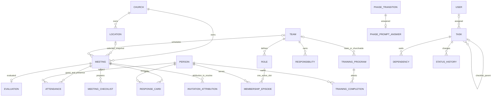

# Meetings, tasks, and ministry teams: preservation specification

Documentation only. Audit date: 2026-10-03. Primary source: `/Users/sebastian/dev/everyfield_v2` at `18fc1a505c64615fe9ef197dba0e2cd037063d31` (main). Compared source: `/private/tmp/everyfield-alpha-implementation` at `2107df58885c883960422ce7e60719f0adbac0e4` (unmerged alpha, clean when inspected). References below are repository-relative paths and symbols; line numbers in the generated operation ledger refer to alpha. Main contains unrelated local marketing/skill changes; this audit never writes either checkout, reads secrets, connects to a database, runs migrations, sends email, or runs live tests. The diagnostics descendant `81abfcc7` was reported by the parent as four Plant Intelligence files outside this ownership; no meetings/tasks/teams delta is inferred from it.

The companion [capability ledger](../../audits/meetings-tasks-teams.json) is the machine-readable preservation matrix. Each feature has stable IDs, source operations, tests, tables, permissions, state/validation/failure notes, target operations, acceptance IDs, and work-package ownership. Status means source presence, not deployed verification. `implemented-main` includes capabilities also present in alpha; `implemented-local-only` is verified alpha work absent from main; `partial` means a real implemented part plus a named unresolved or unimplemented part. No removal is approved by this document.

## Product authority and source reconciliation

The SME Launch Playbook and Plant Intelligence rubric are authoritative product foundations. Software simplification must not change vision-meeting purpose, church phases, eight ministry responsibilities, interviews, commitments, 4Cs, or rubric judgments. Resolve the canonical Playbook/rubric source and hash at the shared content freeze before coding. `product-docs/launch-playbook.md`, `product-docs/features/phase-engine/rubric-v1.md`, `src/lib/phase-engine/rubric.ts`, and the source manifest establish source candidates, not a license to pick a convenient copy. This module's operational catalogs are `src/lib/meetings/agenda.ts`, `kit-template.ts`, `evaluation-factors.ts`, `src/lib/ministry-teams/role-templates.ts`, and `src/lib/tasks/templates.ts`. Their fidelity must be checked against the selected SME version. Team description text split on commas is an implementation-derived responsibility catalog, not an independently authoritative methodology source.

Current `product-docs/decisions.md` distinguishes: guidance advises and tasks commit; first-time vision-meeting attendees receive automatic follow-ups; calendar due day is meeting day + 2; the separately labeled completion measure is exact 48 hours from the generating meeting; actual-contact freshness is 14 days; manual or untraceable tasks do not become meeting-derived measurements; Unknown is distinct from measured success; checklist ticks do not finish their parent; deleted offered responsibilities stay deleted. The user-approved alpha intent also closes obligations as `no_longer_needed` without successful-completion credit. These meanings survive the rebuild.

The FRDs remain evidence with conflicts:

- Meetings/tasks FRD language describing follow-ups for *all* attendees and generic “48h due” is older than the first-time-only and calendar-day rule. Do not silently implement that old prose.
- Ministry FRD describes weekly automated health checks, team leader alerts, welcome messages, calendar/task creation on `training.scheduled`, formal team/role reporting relationships, and specialized ministry workflows. Source implements only parts; future subscriptions are comments in `src/lib/events/subscriptions.ts`. They are not implemented jobs.
- Task FRD describes timeline/Gantt arrows, stored checklist entities, manual reordering, and assigning ownership to teams. Source has task relation to a team, not a team assignee; templates are code-defined; no checklist/checklist-item tables exist in the audited schema. Expanded timeline/manual ordering were provisionally deferred in alpha intent. Track them as open scope, not as quietly removed functionality.
- Eight primary Playbook responsibilities are the phase gate. Ten tracked operational teams add Senior Pastor/Leadership and Launch Coordinator; do not replace the eight-responsibility gate with “ten leaders required.” The People/Plant Intelligence module owns the phase-gate implementation and its separate acceptance tests.
- Main team health fills missing training/attendance denominators with 100%; alpha changes them to Unknown and keeps composite engagement Unknown until all components are measured. Keep alpha's accepted correction, not main's misleading positive result.

## Capability inventory and acceptance matrix

Each acceptance row below is a minimum future gate. All relevant gates run through the shared domain operation and its UI/API/Evry adapter; test an unauthorized direct request as well as screen visibility. Source test files are evidence, not claimed execution or full coverage.

### Meetings

| ID | Capability and actual evidence | Source state | Preservation acceptance |
|---|---|---|---|
| MTG-001 | List/detail/history: `service.ts#getMeeting,listMeetings,hasMeetingHistory`; `/meetings` supports upcoming/past/all, type and paging; detail and breadcrumb/title derive one display title. Team listing reuses same meeting store. | main | AC-MTG-001: stable scoped paging, unknown/repeated type falls to documented default; canceled upcoming records remain distinguishable from scheduled records. Browse defaults all; analytics defaults vision. Empty list does not falsely claim no prior history. |
| MTG-002 | Create/edit/delete/status: `service.ts#createMeeting,updateMeeting,deleteMeeting,updateMeetingStatus`; `/meetings/new`, detail editor/header. Exact type values `vision_meeting`/`orientation`/`team_meeting`; subtypes regular/training/planning/special/rehearsal. Status enum planning/ready/in_progress/completed/cancelled. Vision numbers are `MAX+1`; type/team linkage immutable through normal edit. Deletes are hard deletes cascading child meeting records. | main | AC-MTG-002: concurrent creation allocates distinct numbers; meeting + selected venue snapshot + agenda + kit + roster commit together; tenant/team/location validation precedes effects; status changes are explicit and retry-safe; deletion presents dependent-history consequences and records audit. No unexplained ghost meeting on failed create. |
| MTG-003 | Locations: `locations.ts#listLocations,getLocation,createLocation,updateLocation,deactivateLocation`; picker can select/create venue; name/address/contact/cost/capacity/notes, active state. Meeting stores location FK plus copied name/address. | main | AC-MTG-003: venue snapshots preserve past meeting facts after location edit, while future location selection uses current active venue. Capacity >=1 when provided; address/contact lengths/email valid; cross-tenant references refused. |
| MTG-004 | Alpha location management `/meetings/locations`: explicit archived inclusion, restore, correction history, stale-write guard; active tenant location required on selection but unchanged archived selection may remain on existing meeting. | local-only | AC-MTG-004: archive/restore retains all meeting records; stale correction writes neither record nor history; before/after and actor appear; repeating active-state request converges. Keep discoverable archived venues. |
| MTG-005 | Structured agenda: `agenda.ts` + `service.ts#setMeetingAgenda`; detail agenda builder adds/removes/reorders/retimes; six vision default sections; non-vision gets empty agenda. JSON column; max40 sections, title120, minutes0..600, invalid items normalized/dropped. | main | AC-MTG-005: canonical six-section default and total preserved; empty agenda allowed; order/timing round trip; invalid API input gets named validation rather than silent truncation. Persist source version for copied defaults without making later reference updates overwrite a user's agenda. |
| MTG-006 | Vision kit logistics checklist: `populateChecklist,getChecklist,updateChecklistItem,getChecklistSummary`, `/meetings/[id]/logistics`; categories essential/materials/setup/av/organization, assigned person, check, notes. Other meeting types denied vision feature. | main | AC-MTG-006: initial kit exactly once atomically; same-tenant live assignee; checked count correct, uncheck reversible; forbidden non-vision request writes nothing. |
| MTG-007 | Guest list/inviter/roster population: `guest-list.ts#getGuestList,addToGuestList,removeFromGuestList,listActiveTeamMemberIds,addTeamMembersToGuestList`; `/meetings/[id]/invitations`; absent invited row distinct from attendance. Team create snapshots unique active roster, excludes soft-deleted people. Email tracking joins communication records. | main | AC-MTG-007: one meeting/person row even with multiple team roles or retried import; newly invited guests are absent, never pre-attended; roster changes after create have explicit reconciliation choice; removal cancels pending reminders and removes card without changing unrelated person history. |
| MTG-008 | Admin RSVP confirmed/declined/reset Pending: `updateRsvpStatusAction`, `guest-list.ts#updateRsvpStatus`; nullable RSVP means pending; invitation records/token state are distinct linked artifacts. | main | AC-MTG-008: authorized admin can correct/reset RSVP; person/meeting/tenant proven; define whether reset synchronizes or supersedes token state and invitation artifact, then test it. Current admin update changes attendance RSVP only. |
| MTG-009 | Own RSVP and public token page/API: `own-rsvp.ts#getOwnRsvp,saveOwnRsvp`; POST `/api/meetings/[id]/rsvp`; `/rsvp/[token]`, POST `/api/rsvp/[token]`, `communication/confirmation.ts`. Own endpoint accepts strict confirmed/declined, binds linked person inside write, locks pending tokens and updates matching invitations. Public links expire and are single-response. | main | AC-MTG-009: wrong account/plant, not-on-list, stale/expired/answered token, invalid body denied; no client person/account link; response leaves attendance, card, notes, email-delivery facts alone; missing session401, denied403, unavailable404, invalid400; direct page view has no response effect. |
| MTG-010 | Attendance/check-in/batch/walk-in/excused/removal: action wrappers plus `addAttendee,listAttendees,getAttendanceSummary,recordAttendanceBatch`; `/attendance`. Classification: committed status => core_group; otherwise any prior attended meeting => returning; else first_time. Chronological prior datetime matters, not entry order; attendance includes actual planter attendance. | main | AC-MTG-010: batch validates entire person set before effects; one row per guest; team leader can write only own team's attendance, cannot administer RSVP/card/guest deletion; leader removal clears attendance but preserves guest/RSVP/card; returning classification explicitly resolves cross-type past-attendance policy. Late correction updates all summaries. |
| MTG-011 | Quick add existing/new attendee and guest/walk-in: `quickAddAttendeeAction,quickAddPersonToGuestListAction,quickAddWalkInAction`; People creation uses source meeting_guest_list/prospect and countryUS. | main | AC-MTG-011: person + membership/check-in one transaction; input lengths/email and duplicate/merge rules match People; no orphan person after invalid meeting failure; new contacts don't acquire a login/consent or commitment by being added. |
| MTG-012 | Finalize/reconcile: `runFinalizeAttendance,finalizeAttendance`; outcomes finalized/already_finalized/reconciled, attendance events replay before marker and count reconciliation; generates first-timer follow-ups and evaluation task. Not the same action as completed meeting status. | main | AC-MTG-012: zero-attendee vision finalization still creates evaluation task; repeat and concurrent calls create no duplicate obligation; late additions/replacements of same count top up; removal can reconcile to0; failure has retry receipt. No-planter case must report missing follow-up ownership rather than marking all work fulfilled. |
| MTG-013 | Response cards capture/correct/clear + Outcomes breakdown: `response-queries.ts#recordMeetingResponse,clearMeetingResponse,listMeetingResponses,getMeetingResponseBreakdown`; one card per meeting/person, timestamp/recorder, optional prayer/question notes. Five values ready_commit/interested/prayer_request/stay_informed/not_interested; no row means unknown/no card. | main | AC-MTG-013: only same-tenant existing attendance subject, explicit clear returns to “no card”; zero rows and denominator Unknown; no-card distinct from negative answer; absent guest holding card uses an explicit reported population; do not infer email consent or commitment from card alone. Correction retains original evidence in v3 audit. |
| MTG-014 | Vision evaluation: `createEvaluation,getEvaluation,getEvaluationTrend`; eight SME-related quality factors, integer1..5, arithmetic average1decimal; one evaluation per meeting; emits evaluation-completed and completes managed evaluation task. `/evaluation`. | main | AC-MTG-014: factor labels/descriptions and scoring preserved against canonical source; one record under concurrent submits; non-vision denied; malformed/coerced input rejected; successful recording and auto-completion consistent. Evaluation's subjective scores remain human-owned. |
| MTG-015 | Alpha evaluation correction: `updateEvaluationAction,service.ts#updateEvaluation`, before/after `record_corrections`, expectedUpdatedAt plus row fingerprint; correction does not re-emit completion. | local-only | AC-MTG-015: concurrent stale correction rejected without audit insert; actor/original/version retained; corrected score feeds comparisons/PI; existing auto-completion is not repeated. |
| MTG-016 | Analytics/evaluation comparison: attendance trend, new-vs-returning, completed-meeting summary/growth; type filter; `compareEvaluationToHistory` compares earlier records within latest50 evaluated window, excludes self/same datetime, rounds baseline then delta. Early meeting may have no baseline even with earlier history outside global window. `/analytics`, summary cards. | main | AC-MTG-016: denominator counts attended population consistently; zero last attendance handled explicitly; Unknown not0; current meeting excludes self; baseline scope and truncation labeled. Preserve trend/growth/quality comparison even if queried efficiently instead of global-window workaround. |
| MTG-017 | Meeting attendee note to person history: `addAttendeeNoteAction` writes `person_activities.note_added` metadata meeting ID/type, performedBy; note1..5000 after trim; `/evaluation` attendee notes. | main | AC-MTG-017: validate meeting/person/attendance tenant relation; derive type server-side; record readable provenance and correct/delete-history policy. Existing action has no explicit subject relationship check. |
| MTG-018 | Notification + Communication Hub composition/tracking: `notifications.ts` scheduled announcement to linked Core Group accounts, reminders7/3/1days to creator+linked guest accounts, dedupe; skips past offsets/canceled/completed; reschedule/guest removal cancel+replan. `communication/meeting-compose.ts`, email invitation/reminder templates and token RSVP are separate outgoing delivery. | main | AC-MTG-018: held consent and suppression policy through Communication/Notifications; correct church-local instants/DST; creator+guest dedupe; re-read audience; removed recipient canceled; failure does not misreport committed meeting; delivery/open tracking never used as attendance. |
| MTG-019 | Invitation attribution artifact: `invitations` table remains; own/token RSVP and person merge read/write it. Old standalone invitation-tree feature removed, proven by `invitation-subtree-removed.test.ts`; schema/validation enums survive. Inviter on attendance is still implemented. | partial | AC-MTG-019: preserve inviter attribution, invitation status/token coordination, merge integrity; no runtime create writer was found by scoped source search, so decide legacy attribution/name-only data shape before target-table disposition. Do not invent standalone tree feature from surviving schema. |

### Tasks and follow-up obligations

| ID | Capability and actual evidence | Source state | Preservation acceptance |
|---|---|---|---|
| TSK-001 | `/tasks` My/All/Assignments, typed filters, search(title), stable keyset page50/max100, sort due/priority/status/title/created; counts share filters, subtask counts separate; `list-page.ts`, `list-params.ts`, `service.ts`. Alpha adds explicit team relation filter to paging and counts, excluding Assignments. | main, alpha extension | AC-TSK-001: null due date last, equal-key stable IDs, deleted cursor policy, same count/query scope, unavailable team gives no foreign names; all filters preserved on navigation/clear; no hidden tasks counted as top-level. |
| TSK-002 | Full/quick create, edit, delete; rich title/description/status/priority/date/time/assignee/category/person/meeting/team relation/parent/recurrence/prerequisites. `/tasks/new`, detail editor. `createTask,updateTask,deleteTask`; soft delete parent+children; general related enum still includes facility but write guard allows person/meeting/team only. | main | AC-TSK-002: actor/tenant checked inside operation, live assignee belongs to plant, relation pair valid or clear, protected generated relation cannot change, title checked after trim, date/time real; edit+status+prerequisites commit all-or-none; delete+children/audit/outbox consistent. |
| TSK-003 | Complete/reopen/status/own-duty: `completeTask,reopenTask,mayActOnTask,assertMayActOnTask`; Members act assigned tasks, Admin/Owner all; CAS completion stamp+actor, emits task.completed; reopening clears completion, recurring collision identifies open occurrence. | main | AC-TSK-003: retry convergence; stale authority/assignee rechecked under transaction; completed outcome reaches communication log/PI; reopening does not forge past success; generated auto-completion uses same semantics. Parent completion remains human judgment. |
| TSK-004 | Alpha `no_longer_needed`: closed without completion credit; no due/overdue notifications, no open follow-up warning; immutable meeting/person obligation suppresses regeneration even after edit/soft deletion, legacy person/day fallback. | local-only | AC-TSK-004: waiver never increases successful-completion measures, repeat same obligation stays waived; different meeting remains distinct; reopen permitted only under recurrence and permission rules; audit reason/actor, preserve source provenance. |
| TSK-005 | One-level subtasks/checklists: parent FK/cascade, nesting/self/depth/children guards, inherited assignee unless explicitly assigned, detail `listSubtasks`; ticks independently complete/reopen; parent not auto-finished. `subtask-list.tsx`, actions add/set completion. | main | AC-TSK-005: cross-tenant parent denied; no child-of-child/self/reparent-with-own-children; parent delete covers concurrent children; counts/reports exclude independent subtask credit; child assignee must live in tenant. |
| TSK-006 | Prerequisite DAG: `dependencies.ts#setTaskPrerequisites,listTaskPrerequisites,listPrerequisiteCandidates,blockedTaskIdsAmong`; unique edges, no self, composite same-tenant FKs, longer cycle app check; prerequisite candidates are top-level tasks. Blocked is a derived badge, distinct from manual blocked status; completion not prevented by badge. | main | AC-TSK-006: validate graph after lock, reject concurrent inverse edges; full replacement preserves old set on invalid ID; soft-deleted and alpha waived prerequisite release blocking; define whether hard enforcement is ever desired, keeping advisory behavior until decision. |
| TSK-007 | Recurrence daily/weekly/biweekly/monthly/quarterly/yearly with inclusive end date, series ID in JSON; advances one interval from due or completion day, clamps month end, next only when completed; copies all checklist items reset with no child due dates and no completion hook. One open instance per series DB index; reopen older instance refused if successor open. | main | AC-TSK-007: month/year/leap/end/late completion cases; atomic successor+fresh checklist; retry one successor; stopping recurrence preserves history; deliberate overdue successor when late remains documented rather than skip-ahead assumption. |
| TSK-008 | Bulk complete/reschedule max100, dedupe selected IDs, per-row failures(missing/deleted/foreign/closed/unauthorized), single write+RETURNING reconciliation; bulk completion uses tasks.own, rescheduling requires tasks.write; sequential events and recurrence; reschedule updates reminders. | main | AC-TSK-008: every requested ID accounted for; no false success on failed write; own-duty enforced per row; due calendar validation; outbox receipt clearly distinguishes durable mutation and delayed projection; repeated identical request safe. |
| TSK-009 | Phase/category checklist template browse/preview/import: `TASK_TEMPLATES` code catalog, per-item key/offset/category/priority; import creates ordinary top-level tasks assigned importer with plain-text-to-sanitized-markdown conversion; explicit repeat import intentionally duplicates. `/tasks/templates`. | main | AC-TSK-009: canonical template content/version count verified; relative calendar days stable; preview exact inserted count; retry same request idempotent while deliberate *new* import creates new set; reference edits never silently change existing tasks. |
| TSK-010 | Phase transition offer: latest transition + unanswered durable `phase_prompt_answers`, accepts selected valid current-phase keys or declines; any selected subset answers transition; claim unique transition; transition date anchors tasks; partial import keeps claim and one-time browser receipt(cookie2min), zero-effect failure releases claim. Phase event creates no tasks. | main | AC-TSK-010: concurrent devices create one claimed import; stale transition/forged keys harmless; atomic selected import and answer eliminates current partial/crash ambiguity, or durable resumable receipt names remaining templates; decline never auto-imports. |
| TSK-011 | Automatic vision first-timer follow-up generation + managed evaluation task: `tasks/events.ts#handleMeetingAttendanceFinalized`, first-time cohort, due meeting calendar day+2, owner seat planter, one live evaluation task and person/day unique guard. Alpha adds source meeting/start/obligation key; measured exact48h separate from due day. | main, alpha provenance | AC-TSK-011: repeated/concurrent/late finalize converges; no-planter records unmet ownership; two distinct meetings on same day remain distinct obligations (current person/day guard can collapse them); exact48h uses immutable resolved instant, DST uncertainty Unknown; manual tasks excluded. |
| TSK-012 | Follow-up assignments: committed linked accounts only; current demotion/removal resolves task as unowned; list contacts(open follow-up statuses), open tasks, unowned contact coverage, grouped owner views; assign and create+assign(undated) actions. Source `follow-up-ownership.ts` + shared helpers, people linkage. | main | AC-TSK-012: unlinked/shared-email contact cannot own; demoted stale stored assignee is Needs owner; uncovered contact doesn't become urgent without an explicit task; no invented due date; labels resolve from stored person, not client name. |
| TSK-013 | Status demotion handoff plan + move all owner's open follow-ups: `planFollowUpHandoff,listFollowUpTaskIdsOwnedBy`, `handOffFollowUpsAction`; decline leaves unresolved Needs owner; current loop updates one-by-one, partial failure generic. | main | AC-TSK-013: same-tenant recipient currently eligible; atomic move or durable per-task receipt with moved/remaining IDs; declining no write, all unresolved tasks visible; leaving-member linked identity remains history. |
| TSK-014 | Due/overdue notices: `notifications.ts` two types, scheduled due instant, overdue+1day, skip settled/deleted/unassigned/undated; dedupe task/time; cancel on status/delete/reassign; still-live predicate on dispatch. Current due date/time concatenated with Z, unlike accepted church-local preference. | main | AC-TSK-014: define all-day due time, convert using church zone, DST policy explicit; date-only deadline separate from exact meeting48h metric; reassign cancels old recipient; queued failures recover; dispatch revalidates current version/assignee to prevent stale notices. |
| TSK-015 | Alpha durable task status history: `task_status_history`, DB trigger migration0081 (`src/db/migrations/0081_thin_ultragirl.sql`), `listTaskStatusHistory` in detail; previous/status/time recorded for every write path, including auto-completion. No actor column in this table. | local-only | AC-TSK-015: all domain writes append attributable outcome history; no status-change history on no-op retry; tenant/live-task scope; do not render before/after versions as anonymous explanations where actor is required. |
| TSK-016 | Task description markdown: `descriptions.ts#normalizeTaskDescription,taskDescriptionPreview,withDescriptionPreviews`, safe Markdown renderer, preview snippet; create/edit/template path normalized. | main | AC-TSK-016: dangerous HTML/URLs sanitized, multiline plain text preserved, safe full text and derived preview consistent, empty clears explicitly; no database import pulled into UI types. |

### Teams, staffing, training, responsibilities, and organization chart

| ID | Capability and actual evidence | Source state | Preservation acceptance |
|---|---|---|---|
| TEAM-001 | `/teams`, team workspace tabs, list/staffing counts/leader, custom create/edit name/description/icon/status; predefined template identity survives renames. States forming/active/paused. | main | AC-TEAM-001: scoped reads and authorization; names aren't template identity; custom teams supported, no empty-template dead end; current-staffing calculation can't drift from memberships. |
| TEAM-002 | Alpha edit correction history + archived state/list include archived/restore via updateTeam; hides archived teams from operational list/aggregate health but preserves records. | local-only | AC-TEAM-002: discover/archive/restore without record loss; stale edit refused; history before/after actor; archived inclusion consistent in org-chart, selectors, PI and person profile (current paths differ). |
| TEAM-003 | Ten predefined teams, ~role catalog imported separately; initialization optional subset; onboarding initialize-with-roles skips existing teams and imports only rows created by current winner; partial role failure reported. `initializePredefinedTeams,importRoleTemplates,initializeTeamsWithRolesAction`. | main | AC-TEAM-003: unique church/templateKey, not display name; retried same import no duplicates; intentional explicit extra role possible; bootstrap carries canonical version; partial retry resumes missing work; confirmed lead pastor fills Senior Pastor via ordinary membership, preserves occupied seat. |
| TEAM-004 | Explicit leader appointment, role-derived auto-fill if no leader, provenance explicit/role/legacy; explicit outranks role and survives role removal; revoke seat clears access-dependent leadership. Person without login eligible; linked account lacking plant seat ineligible. Candidate search DB-backed. | main | AC-TEAM-004: race assign/vacate/disable/delete/access-removal coherent; no fabricated legacy provenance; designated leader uses live person/account link for permission; authoritative appointment+history+PI effects atomic; appointment of contact grants no login seat. |
| TEAM-005 | Role CRUD/import with leadership flag, description, time commitment, desired-skills text, sort order, open/filled; deleting role cascades membership history. | main | AC-TEAM-005: create/edit/clear description; single slot; derive staffing from live membership; preserve history using retirement semantics with explicit behavior decision for deletion; display ordering remains even without manual reorder UI. |
| TEAM-006 | Assign/remove/re-activate membership, one active person per role DB arbiter; start/end dates; person multiple roles/teams allowed, warning2+teams, no hard limit. Role fill and leader synchronization in locked batch, events advance People. Removal inactive/endDate retains row; reactivation overwrites prior episode dates. | main | AC-TEAM-006: competing assignees exactly one success with named refusal; cross-tenant/team mismatch denied; duplicate self distinct from occupied-other refusal; explicit new membership episode history instead of rewriting prior tenure; no automatic status demotion without approved People policy. |
| TEAM-007 | Responsibilities CRUD/tick/untick for custom and predefined teams; Playbook description split/seed offered once on first read via team stamp; edits/deletes never resurrect. | main | AC-TEAM-007: canonical responsibility lines explicitly structured and versioned; offer+rows atomic during setup/explicit acceptance, read side-effect-free; deletion survives reload/re-bootstrap; complete date is one state; custom items supported. |
| TEAM-008 | Training programs(team/null churchwide), required flag, completion matrix, Person training progress includes current-team/churchwide/earned-program records; mark complete with uniqueness/verifiedBy; team leaders may create programs for their own team and attest/revoke training for active members of that team; program correction requires teams.write and churchwide programs require that wider authority. | main | AC-TEAM-008: one completion per person/program; program/person/team tenant proven; matrix unique people rather than repeated-role member rows; previously earned completion stays visible after team exit; churchwide program authority explicit. |
| TEAM-009 | Alpha program correction + training revoke/redo preserving row and record_corrections; revocation excluded from matrix, health, PI; stale program update denied. Re-completion rewrites completion timestamp/verifier and clears revokedAt. | local-only | AC-TEAM-009: revoke/redo audit both, original date/evidence retained; reject already incomplete/completed; derived metrics update; revocation no deletion, privacy access same as completion. |
| TEAM-010 | Person team assignments/training cross-link: `getPersonTeams,getTeamCountsForPeople,getPersonTraining`, `/people/[id]/teams`, overload warning candidate search, link to team. | main | AC-TEAM-010: active membership scoped; former training retained, history accessible; archived/team-retired behavior labeled; 101st directory person remains searchable and selectable. |
| TEAM-011 | Team/aggregate health and staffing dashboard: staffing filled roles/roles, required training completion, last4 completed team meetings attendance, weighted engagement40/35/25%, thresholds staffing<40red/<60yellow, attendance<50yellow. On-demand query, no automated weekly job. Alpha Unknown empty evidence; measured-only summary. | main, alpha correction | AC-TEAM-011: preserve accepted weights pending SME measurement review; people-versus-role denominator consistent, guests can't inflate attendance, Unknown vs N/A vs measured0, archived exclusions; explicitly label measured-team denominator. Never use invented score to pass phase gate. |
| TEAM-012 | `/teams/org-chart`: tenant DTO, all-team or single-team, Leadership template root and every other team children, roles/leader/vacancies; responsive SVG/pan plus downloaded SVG/PDF (PNG is not implemented), common draw model wraps long names/no spaces. Schema reportsTo fields are not used for layout/editing. | main | AC-TEAM-012: all teams/roles/vacancies names legible in screen/exports, single-team selection faithful, no contact/account/storage IDs exposed; label diagram as organization view until formal reporting hierarchy decision. Archived inclusion explicit. |
| TEAM-013 | Team meetings/training sessions through shared meeting type/subtype, team roster snapshots, team tab and global list, location/date/notes. Leader can schedule own team via teams.own while general meeting admin stays Admin/Owner. | main | AC-TEAM-013: exactly one shared meeting, two projections; linked roster distinct people; team leader sees authorized control/attendance; training.scheduled fact is not falsely reported as calendar integration/task generation. |
| TEAM-014 | Children's roster shows People background-check status selected by templateKey, including renamed team; multi-team warning, desired skill metadata. Specialized safety acknowledgment/ratio/curriculum/rooms, worship songs/service rotations, facility inventory, small group apprenticeship are FRD ideas without implemented domain operations here. | partial | AC-TEAM-014: preserve actual background-status visibility with sensitive-field permissions; no software-generated safety clearance; future specialization only after explicit scoped decision, retain named backlog. |
| TEAM-015 | Cross-feature events: assignment => People core_group→launch_team, leadership => launch_team→leader; staffing and training-scheduled emitted but no consumers currently; material assignment dirties PI; Communication Hub owns team communication. | partial | AC-TEAM-015: approved People transitions happen exactly once transactionally, status history retained; staffing/PI projection freshness recoverable; don't claim emails/calendar/onboarding task creation merely because event emitted. |

## Tables, relations, and v3 disposition

All tenant-facing target tables carry `church_id`. V2 FKs generally establish existence but not same-church relation: preserve actual access needs using tenant-aware keys or transaction-scoped relation checks. Source model names alone never establish complete enforcement. Fresh v3 initializes only canonical global reference/Wiki/template content and synthetic tests; there are no customer records to migrate.

| Actual table | Feature ownership and important relations | Target disposition / integrity gate |
|---|---|---|
| `locations` | MTG-003/004. Church; meeting FK and name/address snapshot. | Keep as venue registry with archival, revision/audit, active-selection rule. Preserve meeting snapshots; do not dynamically substitute renamed current venue for past facts. |
| `church_meetings` | MTG-001..018/TEAM-013. Church, location, optional team, createdBy; numbered visions; timestamps naive/no timezone. | Keep bounded Meetings aggregate, discriminated type contract; explicit local datetime+IANA zone+chosen offset/resolved instant; transactional number allocation. Store finalized receipt/version rather than infer only from actualAttendance nullable marker. |
| `meeting_attendance` | MTG-007..013. Meeting/person unique, invitedBy person, createdBy; guestlist/attendance/RSVP overloaded row. | Preserve invitation and attendance facts separately at contract level. A single row remains proportional if independent typed fields and clear states suffice; split invitation/attendance tables only if lifecycle evidence justifies. Composite tenant integrity. |
| `meeting_responses` | MTG-013. Meeting/person unique, response type CHECK, recorder/date; no FK to attendance relationship. | Keep response artifact; absence remains no card. Add composite attendance-subject integrity or lock coherent aggregate; corrections append audit instead of destroying original. Prayer/question notes are sensitive human material. |
| `invitations` | MTG-019. Meeting, inviter/person or name-only invitee, RSVP/token writes and person merge. | No runtime create writer found; RSVP and merge still update surviving rows. Resolve overlap with attendance.invitedBy before consolidation. Preserve existing inviter capability and possible name-only attribution; no removal approval inferred from old tree retirement. |
| `meeting_evaluations` | MTG-014/015/016. Unique meeting, eight factor scores/average string, evaluator; alpha shared correction history. | Keep human evaluation, numeric calculated score or derived projection, canonical factor version; atomic record+managed task settlement, correction CAS. Don't turn subjective quality into autonomous pastoral evaluation. |
| `meeting_checklist_items` | MTG-006. Meeting, assigned person, category/check/notes. | Keep Meetings checklist; no generic task framework required solely to share checkbox UI. Tenant assignment/check transitions audited. |
| `tasks` | TSK-001..016. User assignee/creator/completer; parent self-FK; polymorphic person/meeting/team/facility IDs; recurrence JSON, managed completion event; alpha source meeting/start/key. | Keep Task aggregate with explicit relation union and generated obligation identity; use actual optional typed FKs or checked relation-table only if useful. Facility relation dormant/unusable in current writes is an open decision. Explicit series column is simpler than JSON-expression identity if retaining recurrence. |
| `phase_prompt_answers` | TSK-010. Unique phase transition, church, answer accepted/declined, actor. | Keep durable once-per-transition consent. Add imported template IDs/version/request receipt for replay/resume, or make answer+selected imports one transaction. |
| `task_dependencies` | TSK-006. Two composite task+church FKs, unique edge/no self, cascade. | Keep edges; check cycle inside serializable/locked mutation. No distributed workflow engine needed. |
| `task_status_history` | TSK-015, alpha. Task/church, previous/new status/time; database trigger. | Keep history, add actor/cause/operation ID. Decide common audit vs table only after ensuring meaningful all-path evidence. DB trigger alone doesn't provide human attribution. |
| `ministry_teams` | TEAM-001..004/007/011. Church, leader person/source/role token, templateKey, seeded marker, reportsTo (FK absent in TypeScript declaration; migration0013 installs self-FK), status. | Keep template identity and leader provenance; unique church/templateKey for predefined. Archive instead of destruction. reportsTo is dormant feature intent, not permission. Resolve formal hierarchy explicitly. |
| `team_roles` | TEAM-005/006. Team, leadership flag, filled state, sort/time/skill text, reportsToRole (FK absent in TypeScript declaration; migration0013 installs self-FK). | Keep single-slot roles; derive filled state from current active membership to remove duplicated write invariant; retire with history. Formal reporting pointers remain open design decision. |
| `team_memberships` | TEAM-004/006/010. Team/role/person, active/inactive/pending, one active membership per role index; dates/history. | Keep assignment episodes with immutable ended tenure. Composite tenant/team/role identity; unique active slot. Current pending has no normal action path; preserve schema-level intent as explicit decision. |
| `team_responsibilities` | TEAM-007. Team, title/order/completedAt, author. | Keep practical checklist with user edits/deletion preserved; template version provenance/offer receipt prevents crash and unwanted resurrection; no requirement to generalize into Tasks. |
| `training_programs` | TEAM-008/009. Optional team; deleting team SET NULL converts scope to churchwide. | Keep required/team/churchwide definition and revisions; archive/retire team, never silently broaden team program to churchwide by delete. |
| `training_completions` | TEAM-008/009/010/011. Person+program unique, completion/verifier/notes; alpha revokedAt. | Keep completion/revocation/recompletion evidence with append-only versions/events. Don't overwrite earned history on redo; active projection unique. |
| `record_corrections` | Shared alpha: location/evaluation/team/program/completion; entity type/id, before/after, actor/time. | Shared Audit ownership, minimum scoped API used by each domain; typed patch/schema revisions and integer versions, avoid copied SQL JSON key conversions/fingerprint conventions. |
| Shared `persons`, `users`, `churches`, `phase_transitions`, `person_activities`, `communications`, `communication_recipients`, `meeting_confirmation_tokens`, and notification tables | Cross-module relation, consent, account-person link, ownership, playbook phase facts, audit/contact/scheduling. | Cross-reference their owning specs. Never duplicate person identity or treat shared-email bridge as authentication; no tenant or privacy widening through assistant/exports. |

Manual `src/db/migrations/0013_schema_hardening.sql` installs self-FKs for `ministry_teams.reports_to_team_id` and `team_roles.reports_to_role_id`, both ON DELETE SET NULL. They are absent from TypeScript table references, and no later committed DROP was found. The live catalog was not queried; preserve this existing integrity intention and align the v3 declaration/migration rather than assuming the pointers are unprotected.

Diagram presents relationships, not an implied approval of generalized storage. V3 FK/key decisions belong to the database ADR; response-card attachment, generated task source meeting, invitation consolidation, and phase import receipt need explicit keys.

## Proportional target design

Use three bounded modules, each with a service operation API, repository, pure policy/calculation functions, typed contracts and UI adapter. Suggested owning paths: `packages/domain/src/meetings`, `packages/domain/src/tasks`, `packages/domain/src/teams`; shared `packages/contracts/src/{meetings,tasks,teams}`; repositories in `apps/api/src/modules/{meetings,tasks,teams}` for the separate-backend candidate (or `apps/web/src/server/modules/...` for modular Next). UI in `apps/web/src/features/...`. Freeze public contracts before parallel implementation; do not freeze database rows as transport contracts.

Every operation takes a server-created actor context (`userId`, current tenant/access scope, capabilities and subject policies), validated domain input, `operationId`, and `expectedVersion` for writes that could overwrite human work. UI and Evry invoke the same operations. A submitted church/user/role boolean never establishes authority. Read DTOs project only needed fields; People sensitive fields and oversight aggregates are deliberately separate projections. Team leaders manage authorized team subjects; attendance permission doesn't broaden meeting, invitation, card or evaluation authority. Admin/Owner manage all local subjects; ordinary Members act assigned Tasks and own RSVP. The repository’s current wrappers are evidence for baseline permissions, not the final autonomy policy. Coach/oversight detailed/aggregate disclosures remain with their owning privacy specification.

Start with typed commands and queries, not a generic action-plan engine. Example command groups: Meetings schedule/edit/status/delete/agenda/kit/guestlist/check-in/finalize/card/evaluation/venue; Tasks create/edit/outcome/delete/checklist/prerequisites/recurrence/bulk/template offer/import/follow-up ownership; Teams create/edit/archive/initialize/roles/leader/memberships/responsibilities/training. Domain errors distinguish denied/not-found/stale/invalid/conflict/committed-with-projection-pending. Avoid “please try again” on a rejected ownership rule or success that hides partial durable work.

### Transaction boundaries and recovery

1. **Meeting schedule**: validate type/team/active location; allocate vision number under church counter/row lock; create selected venue only if requested, meeting, default agenda/kit and roster in one transaction. Outbox stores notification intents after authoritative data. API request ID prevents duplicate new meeting; deliberate repeated scheduling uses a new ID.
2. **Check-in**: validate all people/meeting/authority under transaction. Upsert full batch or explicit partial receipt; do not mix prevalidated all-or-nothing language with per-row uncontrolled writes. Walk-in person+guest+attendance is one operation. Reclassification policy must specify historical type versus changing current person status.
3. **Finalize**: one operation computes authoritative attended snapshot/version; commits count, approved People attendance effects, first-timer obligation identity and evaluation task exactly once. Notification and PI refresh use small outbox jobs. Reconcile newly added/removed attendees by identity, not just count; do not erase already performed follow-up history. If missing planter prevents assignment, store and expose unowned obligation instead of silently returning before generation.
4. **Evaluation**: evaluation and managed task settlement commit together; correction CAS appends history and dirties affected PI evidence without repeating completion. Reference factor version recorded with scores.
5. **Task edit/outcome/dependencies**: validate and lock graph/series as necessary, then apply edit+status/prerequisites and history atomically. Current create compensation soft-deletes failed dependency task, and current edit can fail after title/status mutation; v3 avoids misleading failed receipt after durable partial mutation. Graph validation occurs after lock, not only preflight.
6. **Recurring task completion**: completed instance, successor and reset child checklist commit together; unique one-open-series constraint remains final arbiter. Outbox drives optional communication log/reminders/PI material mark. If outbox is delayed, receipt identifies successful domain mutation. No reopen/re-complete dance as the sole retry mechanism.
7. **Phase offer/import**: answer and selected import sets commit together with receipt. Deliberate manual re-import remains allowed; duplicate transport retry doesn't create duplicate sets. If later bulk size warrants jobs, durable receipt holds remaining template IDs, resumable status and exact per-template outcomes.
8. **Team initialization**: create selected canonical team/role/responsibility sets plus offer version/receipt atomically; confirmed planter autofill uses same assignment policy. Unique identity church/templateKey. Canonical data changes don't rewrite user-edited plant rows. Read services never seed.
9. **Membership/leadership**: lock parent team before child/assignment, verify access removal concurrently; membership, current slot, provenance, People transition and history atomic. Retain explicit appointment precedence. Stop repeated storing of role filled state if it can be derived; keep a single indexed projection only if measured need justifies.
10. **Training**: completion/revoke/redo and audit event atomic; current projection derives from latest valid attestation. Program correction CAS; no implicit training applicability change when team deleted/archived. Person training retains earned history.

Use events only for justified delayed side effects: notifications/email dispatch, PI invalidation/reassessment, optional export generation. An in-memory bus is insufficient as the sole owner of required follow-up/task/status effects; direct domain orchestration within the transaction is smaller and inspectable. Do not introduce CQRS/event sourcing/microservices solely to share commands with Evry. Reconciliation jobs scan outbox leases, missing required receipts and stale notifications; idempotency keys are logical operation/obligation/version, not a fabricated timestamp.

### Dates, metrics, and concurrency decisions

- Store meeting wall-clock input with church IANA zone and explicit resolved instant/offset. Reject DST gaps; offer offset choice for folds. Avoid converting a naive SQL timestamp using machine timezone. Moving a meeting after follow-up generation does not move an original 48-hour start: provenance is immutable.
- Preserve calendar task due date and optional local time. Define all-day notification clock as a product decision; exact48-hour metric is computed from source instant and completion instant, never date-only due-day subtraction.
- V2 first-time classification consults prior attended meetings of all types. Clarify with SME whether a prior team meeting should count as first vision attendance; preserve actual source behavior until intentional change approved. V2 re-check-in after commitment change may reclassify past attendance using current status; historical cohort policy needs explicit versioned meaning.
- The person/day unique follow-up guard can collapse separate same-day meetings despite alpha's new meeting/person identity. Target obligation key should be `(tenant, originatingMeeting, person, kind)`; deliberate manual follow-ups have distinct IDs and are excluded from meeting metric.
- Dependency `blocked` manual status and derived prerequisite badge coexist. Alpha treats waived prerequisite as no longer blocking; keep this distinction. Decide advisory versus prevented completion explicitly.
- Alpha `communication/log.ts#contactedPersonId` treats completion of any person-related task as actual contact, irrespective of category. User-approved freshness requires actual contact; an administrative task about a person may not establish that fact. Freeze explicit contact evidence/confirmation rules with Communication and PI before using task completion in the 14-day measure. Meeting-derived 48-hour completion remains a separate task-obligation measure.
- Staffing measures slots; attendance/training measures people. V2 health uses active membership rows as denominator while numerator dedupes persons, depressing score for a multi-role member. Resolve measurement with SME; do not silently reweight rubric or equate team health to phase certification.

## Evry contract for these modules

Evry is an operational assistant and has no pastoral judgment, prayer, theological/biblical counsel or autonomous human evaluation role. It can retrieve permitted schedules/guestlists/attendance, task queues/owner coverage, staffing/training/health evidence and historical correction receipts, with time-bounded context and pagination. Sensitive response-card prayer notes and background status require purpose-specific disclosure; summaries do not expose them merely because a broad list tool is available.

Per feature, expose read plus draft/propose plus execute operations listed in the capability ledger. Examples: suggest meeting agenda from approved canonical source; draft schedule/guest additions; propose a follow-up assignment based on committed eligible accounts; draft task sets or training-program text; explain missing evidence using deterministic metrics. Named humans own meeting evaluations, membership/leader suitability, safety attestations, prayer response, commitment and phase judgment. Evry never fills a score or marks training completed just to make a dashboard green.

Accepted initial policy PD-001 / OD-003: authorized reads and non-persistent drafts may run immediately; every durable Evry change requires human review and approval of the exact proposal before execution. `propose` returns typed change preview with subjects, consequences, approval-needed fields, version, expiry and canonical-source references; `execute` checks explicit approval record + fresh actor subject authority and version, reuses operation ID, returns receipt/audit links. Bulk proposal shows every included/omitted subject. Approval can be revoked until commit. Undo is compensating domain action (reopen/uncheck/revoke/restore/clear), never deleting audit; irreversible delivery/deletion cannot claim full undo. Autonomous mutation classes and low-impact write exemptions are deferred; they require a new user decision and are not inferred from Owner permissions. Reviewed writes are the accepted initial policy. Future options such as preapproved write classes or delegated automation remain proposals, not enabled authority. Evaluate unauthorized write attempts, stale proposal, prompt injection in notes, duplicate tool calls, conflicting multi-agent writes, incomplete permission context, and false-success receipts for each module.

## Concrete keep/simplify/replace/defer lessons

| Evidence | Preserve | Proposed software change and tradeoff |
|---|---|---|
| `service.ts` + large server-action wrappers + `requireTeamWrite` targets | Actor/subject access, named refusals, UI permissions | Move policy into domain operations; adapters parse/transport only. Less framework coupling and fewer alternate privileged doors for Evry. Don't broaden privacy because API now central. |
| `meetings/service.ts#createMeeting` sequence venue→meeting→kit→roster→notifications | One user scheduling intention | Atomic DB orchestration and outbox prevents ghost partial records. Adds transaction/retry machinery only where real multi-table integrity needs it. |
| `getNextMeetingNumber` MAX+1 plus unique index | Numbered vision identity | Atomic counter or locked allocation; uniqueness remains arbiter. Not global distributed sequence service. |
| `responsibilities.ts` documented claim/insert crash window and mutation on read | Offered-once and no resurrection | Atomic offer receipt+explicit canonical items, generated during setup/acceptance; removes actor-dependent reads and magical comma splitting. |
| `teams.ts#initializePredefinedTeams` name uniqueness vs stable templateKey; `roles.ts#importRoleTemplates` duplicate roles | Optional templates, customization, explicit reimport meaning | Stable template/role IDs plus import receipt; distinguish retry from deliberate duplicate. Adds minimal provenance, avoids rebuilding whole template CMS. |
| `memberships.ts` updates inactive row to active and overwrites dates; role delete cascades memberships | Removal/reactivation and historic service | New assignment episode and retirement, preserving each tenure. History costs a few rows, far less than misleading human record. |
| `leader-sync.ts` explicit/role/legacy provenance and parent lock ordering | Explicit appointment precedence and removal race protection | Keep coherent provenance/constraint; central transaction runner avoids copied batch CTE conventions. No generalized permission graph just for team leadership. |
| `tasks/service.ts#createNextRecurrence` catches lost checklist, complete catches lost successor | Success acknowledged when task really completed | Atomic completion+successor+children; outbox for downstream effects. Completion failure safely retries rather than editing history to repair. |
| `tasks/actions.ts#updateTaskAction` reopens/edits/completes then sets prerequisites | Every edit field and status lifecycle | One atomic patch/outcome command; present version conflict before durable change. Removes compensation and cache/revalidation sequencing as domain policy. |
| `tasks/phase-prompt.ts` claim-first partial receipts/cookie | User chooses commitments across devices | Transactional answer/import or durable resumable receipt; browser cookie only UI convenience. Same intentional repeat-import policy with request idempotency. |
| `tasks/events.ts` person/day collision plus alpha immutable obligation key | Calendar due rule, exact48h metric and waiver suppression | Explicit generated obligation provenance, freeze start. Don't generalize every task into full workflow event history if simple audit+relation suffices. |
| `tasks/notifications.ts#taskDueAt` Z concatenation; meeting naive wall time | Church scheduling intent | Typed local date/time/zone versus instant. Test DST folds/gaps and timezone edit; no runtime timezone dependence. |
| `health.ts` membership denominator, main missing100%, alpha Unknown | Staffing/training/attendance evidence and accepted weights | Deduplicate appropriate person populations after SME definition; show denominators; no averaged pseudo-certification. |
| `org-chart-model.ts` Leadership root/all other children ignores reportsTo pointers | Useful staffing visualization and SVG/PDF | Keep simple render model, avoid pretending hierarchy editor exists. Defer formal hierarchy implementation pending explicit decision without deleting fields/intent by assumption. |
| Source-guard tests pin exact comments/copy/import shapes (`ruled-copy.test.ts`, `labels.test.ts`, `client-boundary.test.ts`) | Boundary safety and honest meaning | Behavior/contract/authorization tests over incidental spellings; retain a lightweight dependency-boundary check. High test count is not usability, full concurrency or live permission proof. |
| Placeholder subscribers in `events/subscriptions.ts` | Real assignment/PI/communication effects | Direct transaction effects + small durable outbox; defer absent weekly jobs/calendar/team-welcome automation with explicit backlog entry, never call it implemented. |

## Work packages and staged vertical slices

These IDs are integration placeholders for the master DAG, not an independently runnable implementation. No code is created by this document. Contract freeze dependency includes Auth/Tenant, People/account-person link, canonical Playbook/rubric, Audit, Date/Time and Jobs/Outbox. Cross-feature operations must have an owner before merge.

| Package | Inputs / owning interfaces and paths | Outputs and acceptance gate | Prerequisites / parallelism |
|---|---|---|---|
| WP-meetings-contract | Canonical catalog freeze, actor/tenant contract, People IDs, date policy; contracts/meetings | Frozen Meeting discriminated DTOs, independent RSVP/attendance/card fields, typed error/version/idempotency semantics; MTG001..019 mapped | Shared contract freeze. Parallel with Task/Team contract design; no incompatible role strings. |
| WP-tasks-contract | Canonical tasks, waiver/follow-up48h/14day intent, actor/current-owner subjects; contracts/tasks | Frozen outcomes/obligation/recurrence/graph/import/bulk receipt; TSK001..016 mapped | Shared contract freeze; finalize/managed evaluation/follow-up contract handshake with Meetings. |
| WP-teams-contract | Eight-responsibility versus ten-team mapping, training/health denominators, actor/account link; contracts/teams | Frozen team/role/episode/leader provenance/training/responsibility DTOs; TEAM001..015 mapped | Shared freeze; cross-reference PI gating and People status operation. |
| WP-meetings-slice1 | repositories+operations+UI for venue/schedule/detail/agenda/kit, synthetic scenarios | Atomic create, chronology, state, own tenant; MTG001..006; no customer bootstrap | Auth/Tenant+Audit+Dates+reference data; separate from Team/Task repositories once schema contract fixed. |
| WP-teams-slice1 | canonical team init, role/leader/membership/responsibility, person views | One coherent staffing assignment with preserved history; TEAM001..007/010 | People+Auth+Audit+canonical setup; shared DB migration owner serializes integration. |
| WP-tasks-slice1 | task CRUD/outcome/checklist/list/counts/descriptions | Assigned member completes task with audited receipt; TSK001..005/016 | Auth+People+Audit+date contract; no dependency on meeting UI. |
| WP-meetings-slice2 | guestlist/own+token RSVP/check-in/finalize/cards/evaluation; Task obligation interface | Schedule→invite→check-in→finalize→follow-up/evaluate end-to-end; MTG007..015/017 and TSK011 | Three slice1 domains, communication token/dispatch; one integration PR/snapshot after contract tests pass. |
| WP-tasks-slice2 | prerequisites+recurrence+bulk+templates+phase offer+ownership/handoff | Complete/retry series and deliberate phase imports without duplicates; TSK006..013 | Task slice1, Phase transition contract, Meetings origin contract; graph+series concurrency gates before UI merge. |
| WP-teams-slice2 | training matrix/revoke/redo, measured health, org chart exports, team meetings | TEAM008..015, local alpha corrections retained | Teams1+Meetings1; safe export projection, sensitive People field contract; health denominator decision. |
| WP-meetings-observability | outbox/notifications+analytics/recovery receipts | MTG016/018/019, finalized snapshot/version, no stale delivery | Jobs+Notifications+Communication; all direct authoritative operations complete. |
| WP-tasks-observability | reminders/status history/follow-up measures/outbox reconciliation | TSK004/014/015, PI input correct, actionable errors | Jobs+PI+Communication actual-contact evidence; date and waiver gates closed. |
| WP-meetings-evry / WP-tasks-evry / WP-teams-evry | frozen per-feature operations and approval/audit policy | Read/draft/propose/execute and undo evaluations for every mapped capability | Each domain's operation gates; parallel adapter work, one shared tool/approval schema owner. |

Master placeholder packages `WP-meetings`, `WP-tasks`, `WP-teams` own their subpackages above and every acceptance ID in this ledger. Recommended merge order: shared contracts/schema freeze → domain repositories/policies → three first slices → finalization/obligation integration → recurrence/import/graph and training/health → communication/notifications/recovery → Evry adapters/evaluations → full preservation release gate. Parallel lanes must not share migration-file ownership, canonical reference definitions, actor types, or outbox schema mutations without one integration owner. Operational module implementation estimate: three domain engineers with common Auth/DB/Jobs support, plus one QA/Evry engineer; after shared foundations, 6–10 engineer-weeks across these modules is a planning range requiring refinement after contract decisions. Do not treat it as a delivery promise. Critical path inside this scope is canonical+identity/date freeze → transactional Meetings/Tasks → finalized obligation semantics → communication/PI measure evidence → approved Evry execution.

## Evidence and remaining decisions

Review relied on source, schema, migrations, tests and alpha diff; no runtime/deployed claims. Important existing test suites: meetings finalize/response queries/card/own RSVP/attendance-authorization/team guestlist/notifications/agenda/comparison; Tasks service/pagination/counts/nesting/dependency-live/recurrence/follow-up-race/import-live/phase-prompt-live/ownership/notifications; Teams role-seat-race/leader-sync-live/leader-fill-live/responsibilities-live/init-race/health/org-chart and alpha training-history-live; action/read-only UI and server-action surface guards. Live suites require a verified disposable target and were not run. Contract/source-guard suites frequently prove copy/import structure and SQL spelling; future acceptance requires semantic behaviors, real transaction races, privacy decisions, receipt recovery and UI workflows.

Coverage validation passed: all ledger source paths/symbols and referenced test files exist; all 50 IDs map to acceptance/work-package targets; all 17 owned tables, 22 owned screens and two RSVP HTTP routes are covered; the companion Markdown link resolves. Eleven IDs have no dedicated test file mapped (MTG003/004/008/011/015/017, TEAM002/010/013/014/015); adjacent suites do not prove complete feature coverage. No runtime/live tests were executed.

Decisions not resolved by this audit: canonical catalog fidelity/version, formal reporting relationships, invitation artifact consolidation/name-only guests, facility task relation, pending membership self-service, task blocked enforcement, archiving propagation to every projection, meeting deletion/history policy, denominator definition with multiple roles, returning-attendance scope and historic classification, all-day reminder time/DST choices, missing-planter follow-up ownership, dual same-day obligation collision, training applicability/retirement, correction sensitive-data retention, verified-contact versus person-task-completion evidence, and Evry autonomous authority. Accepted alpha intent is preserved; implementation defects and outdated FRD claims are explicitly separated. Full feature target includes every implemented capability in the ledger; staged slices don't approve feature removal.

## Exported-operation source ledger

The generated ledger below lists every directly exported function in the three domain directories and their server-action endpoints, including helpers. Duplicate names retain owning files. A helper is not independently claimed as a user-facing capability; grouping points to its preservation feature. Database schema constants/types are documented in the table map. Re-export-only barrels do not introduce new operations.

<!-- OPERATION_LEDGER -->

Coverage: 50 capability IDs; 355 directly exported functions/endpoints mapped; 17 owned schema tables mapped. Source-reviewed test references: 44 existing test files. All 22 owned screen routes plus the two RSVP HTTP route surfaces are mapped; shared cross-module surfaces are also named. These are file counts, not test execution or product-coverage claims.

| Feature | Evidence path/symbol (alpha line) | Source status |
|---|---|---|
| MTG-002 | `src/app/(dashboard)/meetings/actions.ts:127#createMeetingAction` | main + alpha |
| MTG-002 | `src/app/(dashboard)/meetings/actions.ts:173#updateMeetingAction` | main + alpha |
| MTG-002 | `src/app/(dashboard)/meetings/actions.ts:225#deleteMeetingAction` | main + alpha |
| MTG-002 | `src/app/(dashboard)/meetings/actions.ts:260#updateMeetingStatusAction` | main + alpha |
| MTG-003 | `src/app/(dashboard)/meetings/actions.ts:310#createLocationAction` | main + alpha |
| MTG-003 | `src/app/(dashboard)/meetings/actions.ts:348#updateLocationAction` | main + alpha |
| MTG-010 | `src/app/(dashboard)/meetings/actions.ts:406#addAttendeeAction` | main + alpha |
| MTG-011 | `src/app/(dashboard)/meetings/actions.ts:458#quickAddAttendeeAction` | main + alpha |
| MTG-010 | `src/app/(dashboard)/meetings/actions.ts:519#removeAttendeeAction` | main + alpha |
| MTG-012 | `src/app/(dashboard)/meetings/actions.ts:605#finalizeAttendanceAction` | main + alpha |
| MTG-010 | `src/app/(dashboard)/meetings/actions.ts:638#recordAttendanceBatchAction` | main + alpha |
| MTG-014 | `src/app/(dashboard)/meetings/actions.ts:685#createEvaluationAction` | main + alpha |
| MTG-015 | `src/app/(dashboard)/meetings/actions.ts:731#updateEvaluationAction` | alpha only |
| MTG-003 | `src/app/(dashboard)/meetings/actions.ts:762#archiveLocationAction` | alpha only |
| MTG-006 | `src/app/(dashboard)/meetings/actions.ts:781#toggleChecklistItemAction` | main + alpha |
| MTG-006 | `src/app/(dashboard)/meetings/actions.ts:804#updateChecklistItemAction` | main + alpha |
| MTG-007 | `src/app/(dashboard)/meetings/actions.ts:842#addToGuestListAction` | main + alpha |
| MTG-007 | `src/app/(dashboard)/meetings/actions.ts:866#removeFromGuestListAction` | main + alpha |
| MTG-008 | `src/app/(dashboard)/meetings/actions.ts:885#updateRsvpStatusAction` | main + alpha |
| MTG-011 | `src/app/(dashboard)/meetings/actions.ts:914#quickAddPersonToGuestListAction` | main + alpha |
| MTG-010 | `src/app/(dashboard)/meetings/actions.ts:968#toggleAttendanceStatusAction` | main + alpha |
| MTG-010 | `src/app/(dashboard)/meetings/actions.ts:1014#addWalkInAttendeeAction` | main + alpha |
| MTG-011 | `src/app/(dashboard)/meetings/actions.ts:1055#quickAddWalkInAction` | main + alpha |
| MTG-017 | `src/app/(dashboard)/meetings/actions.ts:1124#addAttendeeNoteAction` | main + alpha |
| MTG-013 | `src/app/(dashboard)/meetings/actions.ts:1182#recordResponseCardAction` | main + alpha |
| MTG-013 | `src/app/(dashboard)/meetings/actions.ts:1221#clearResponseCardAction` | main + alpha |
| MTG-005 | `src/app/(dashboard)/meetings/actions.ts:1255#saveAgendaAction` | main + alpha |
| MTG-003 | `src/app/(dashboard)/meetings/actions.ts:1278#saveLocationFormAction` | alpha only |
| MTG-003 | `src/app/(dashboard)/meetings/actions.ts:1291#archiveLocationFormAction` | alpha only |
| MTG-004 | `src/app/(dashboard)/meetings/actions.ts:1303#restoreLocationFormAction` | alpha only |
| TSK-002 | `src/app/(dashboard)/tasks/actions.ts:165#createTaskAction` | main + alpha |
| TSK-002 | `src/app/(dashboard)/tasks/actions.ts:244#quickAddTaskAction` | main + alpha |
| TSK-002 | `src/app/(dashboard)/tasks/actions.ts:295#updateTaskAction` | main + alpha |
| TSK-003 | `src/app/(dashboard)/tasks/actions.ts:392#completeTaskAction` | main + alpha |
| TSK-003 | `src/app/(dashboard)/tasks/actions.ts:441#reopenTaskAction` | main + alpha |
| TSK-002 | `src/app/(dashboard)/tasks/actions.ts:483#deleteTaskAction` | main + alpha |
| TSK-003 | `src/app/(dashboard)/tasks/actions.ts:524#updateTaskStatusAction` | main + alpha |
| TSK-005 | `src/app/(dashboard)/tasks/actions.ts:611#addSubtaskAction` | main + alpha |
| TSK-005 | `src/app/(dashboard)/tasks/actions.ts:680#setSubtaskCompletionAction` | main + alpha |
| TSK-008 | `src/app/(dashboard)/tasks/actions.ts:747#bulkCompleteTasksAction` | main + alpha |
| TSK-008 | `src/app/(dashboard)/tasks/actions.ts:784#bulkRescheduleTasksAction` | main + alpha |
| TSK-009 | `src/app/(dashboard)/tasks/actions.ts:864#importTaskTemplateAction` | main + alpha |
| TSK-001 | `src/app/(dashboard)/tasks/actions.ts:948#loadMoreTasksAction` | main + alpha |
| TSK-012 | `src/app/(dashboard)/tasks/follow-up-actions.ts:34#assignFollowUpAction` | main + alpha |
| TSK-012 | `src/app/(dashboard)/tasks/follow-up-actions.ts:64#createAndAssignFollowUpAction` | main + alpha |
| TSK-013 | `src/app/(dashboard)/tasks/follow-up-actions.ts:104#handOffFollowUpsAction` | main + alpha |
| TSK-010 | `src/app/(dashboard)/tasks/phase-prompt-actions.ts:104#importPhaseTemplatesAction` | main + alpha |
| TSK-010 | `src/app/(dashboard)/tasks/phase-prompt-actions.ts:184#dismissPhaseTemplatePromptAction` | main + alpha |
| TEAM-004 | `src/app/(dashboard)/teams/action-shell.ts:47#withChurch` | main + alpha |
| TEAM-004 | `src/app/(dashboard)/teams/action-shell.ts:52#withChurch` | main + alpha |
| TEAM-004 | `src/app/(dashboard)/teams/action-shell.ts:58#withChurch` | main + alpha |
| TEAM-004 | `src/app/(dashboard)/teams/action-shell.ts:100#fieldErrorResult` | main + alpha |
| TEAM-004 | `src/app/(dashboard)/teams/action-shell.ts:118#formEntries` | main + alpha |
| TEAM-004 | `src/app/(dashboard)/teams/action-shell.ts:136#revalidateTeamSurfaces` | main + alpha |
| TEAM-001 | `src/app/(dashboard)/teams/actions.ts:87#listTeamsAction` | main + alpha |
| TEAM-010 | `src/app/(dashboard)/teams/actions.ts:111#searchTeamCandidatesAction` | main + alpha |
| TEAM-001 | `src/app/(dashboard)/teams/actions.ts:132#createTeamAction` | main + alpha |
| TEAM-001 | `src/app/(dashboard)/teams/actions.ts:151#updateTeamAction` | main + alpha |
| TEAM-004 | `src/app/(dashboard)/teams/actions.ts:177#searchLeaderCandidatesAction` | main + alpha |
| TEAM-004 | `src/app/(dashboard)/teams/actions.ts:194#assignTeamLeaderAction` | main + alpha |
| TEAM-003 | `src/app/(dashboard)/teams/actions.ts:218#initializeTeamsAction` | main + alpha |
| TEAM-003 | `src/app/(dashboard)/teams/actions.ts:272#initializeTeamsWithRolesAction` | main + alpha |
| TEAM-005 | `src/app/(dashboard)/teams/actions.ts:310#createRoleAction` | main + alpha |
| TEAM-005 | `src/app/(dashboard)/teams/actions.ts:329#updateRoleAction` | main + alpha |
| TEAM-005 | `src/app/(dashboard)/teams/actions.ts:357#deleteRoleAction` | main + alpha |
| TEAM-005 | `src/app/(dashboard)/teams/actions.ts:370#importRoleTemplatesAction` | main + alpha |
| TEAM-007 | `src/app/(dashboard)/teams/actions.ts:402#createResponsibilityAction` | main + alpha |
| TEAM-007 | `src/app/(dashboard)/teams/actions.ts:426#updateResponsibilityAction` | main + alpha |
| TEAM-007 | `src/app/(dashboard)/teams/actions.ts:454#setResponsibilityCompleteAction` | main + alpha |
| TEAM-007 | `src/app/(dashboard)/teams/actions.ts:474#deleteResponsibilityAction` | main + alpha |
| TEAM-006 | `src/app/(dashboard)/teams/actions.ts:493#assignMemberAction` | main + alpha |
| TEAM-006 | `src/app/(dashboard)/teams/actions.ts:520#removeMemberAction` | main + alpha |
| TEAM-013 | `src/app/(dashboard)/teams/actions.ts:539#createMeetingAction` | main + alpha |
| TEAM-008 | `src/app/(dashboard)/teams/actions.ts:574#createTrainingProgramAction` | main + alpha |
| TEAM-008 | `src/app/(dashboard)/teams/actions.ts:598#markTrainingCompleteAction` | main + alpha |
| TEAM-009 | `src/app/(dashboard)/teams/actions.ts:628#undoTrainingCompleteAction` | alpha only |
| TEAM-009 | `src/app/(dashboard)/teams/actions.ts:655#updateTrainingProgramAction` | alpha only |
| MTG-009 | `src/app/api/meetings/[id]/rsvp/route.ts:8#POST` | main + alpha |
| MTG-009 | `src/app/api/rsvp/[token]/route.ts:8#POST` | main + alpha |
| MTG-018 | `src/lib/communication/meeting-compose.ts:50#emailableGuests` | main + alpha |
| MTG-018 | `src/lib/communication/meeting-compose.ts:82#meetingComposeUrl` | main + alpha |
| MTG-005 | `src/lib/meetings/agenda.ts:127#defaultAgendaTemplatesForType` | main + alpha |
| MTG-005 | `src/lib/meetings/agenda.ts:142#sectionsFromTemplates` | main + alpha |
| MTG-005 | `src/lib/meetings/agenda.ts:153#buildDefaultAgenda` | main + alpha |
| MTG-005 | `src/lib/meetings/agenda.ts:165#clampAgendaMinutes` | main + alpha |
| MTG-005 | `src/lib/meetings/agenda.ts:187#parseAgenda` | main + alpha |
| MTG-005 | `src/lib/meetings/agenda.ts:216#agendaTotalMinutes` | main + alpha |
| MTG-016 | `src/lib/meetings/analytics.ts:11#getAttendanceTrend` | main + alpha |
| MTG-016 | `src/lib/meetings/analytics.ts:103#getNewVsReturning` | main + alpha |
| MTG-016 | `src/lib/meetings/analytics.ts:115#getMeetingSummaryStats` | main + alpha |
| MTG-010 | `src/lib/meetings/attendance-authorization.ts:14#mayRecordMeetingAttendance` | main + alpha |
| MTG-010 | `src/lib/meetings/attendance-authorization.ts:31#requireAttendanceWrite` | main + alpha |
| MTG-010 | `src/lib/meetings/attendance-authorization.ts:60#requireAttendancePeople` | main + alpha |
| MTG-010 | `src/lib/meetings/attendance-type.ts:45#deriveAttendanceType` | main + alpha |
| MTG-016 | `src/lib/meetings/copy.ts:77#evaluationComparisonDenominatorCopy` | main + alpha |
| MTG-016 | `src/lib/meetings/copy.ts:128#meetingLinkedTaskProgressCopy` | main + alpha |
| MTG-016 | `src/lib/meetings/copy.ts:148#meetingsListSubtitle` | main + alpha |
| MTG-016 | `src/lib/meetings/evaluation-comparison.ts:94#compareEvaluationToHistory` | main + alpha |
| MTG-012 | `src/lib/meetings/events.ts:90#emitAttendanceRecorded` | main + alpha |
| MTG-012 | `src/lib/meetings/events.ts:118#emitAttendanceFinalized` | main + alpha |
| MTG-012 | `src/lib/meetings/events.ts:143#emitEvaluationCompleted` | main + alpha |
| MTG-012 | `src/lib/meetings/events.ts:161#emitMeetingCompleted` | main + alpha |
| MTG-007 | `src/lib/meetings/guest-list.ts:59#getGuestList` | main + alpha |
| MTG-007 | `src/lib/meetings/guest-list.ts:98#addToGuestList` | main + alpha |
| MTG-007 | `src/lib/meetings/guest-list.ts:156#removeFromGuestList` | main + alpha |
| MTG-007 | `src/lib/meetings/guest-list.ts:207#shouldPopulateGuestListFromTeam` | main + alpha |
| MTG-007 | `src/lib/meetings/guest-list.ts:220#dedupePersonIds` | main + alpha |
| MTG-007 | `src/lib/meetings/guest-list.ts:235#activeTeamMemberIdsQuery` | main + alpha |
| MTG-007 | `src/lib/meetings/guest-list.ts:254#listActiveTeamMemberIds` | main + alpha |
| MTG-007 | `src/lib/meetings/guest-list.ts:268#buildTeamGuestListRows` | main + alpha |
| MTG-007 | `src/lib/meetings/guest-list.ts:291#addTeamMembersToGuestList` | main + alpha |
| MTG-008 | `src/lib/meetings/guest-list.ts:324#updateRsvpStatus` | main + alpha |
| MTG-001 | `src/lib/meetings/labels.ts:83#meetingTypeLabel` | main + alpha |
| MTG-001 | `src/lib/meetings/labels.ts:113#parseMeetingType` | main + alpha |
| MTG-001 | `src/lib/meetings/labels.ts:252#meetingDisplayTitle` | main + alpha |
| MTG-003 | `src/lib/meetings/locations.ts:16#listLocations` | main + alpha |
| MTG-003 | `src/lib/meetings/locations.ts:36#getLocation` | main + alpha |
| MTG-003 | `src/lib/meetings/locations.ts:56#createLocation` | main + alpha |
| MTG-003 | `src/lib/meetings/locations.ts:81#updateLocation` | main + alpha |
| MTG-003 | `src/lib/meetings/locations.ts:144#deactivateLocation` | main + alpha |
| MTG-004 | `src/lib/meetings/locations.ts:151#restoreLocation` | alpha only |
| MTG-001 | `src/lib/meetings/meeting-type-filter.ts:113#parseAnalyticsMeetingTypeFilter` | main + alpha |
| MTG-001 | `src/lib/meetings/meeting-type-filter.ts:127#parseListMeetingTypeFilter` | main + alpha |
| MTG-001 | `src/lib/meetings/meeting-type-filter.ts:144#analyticsMeetingTypeArg` | main + alpha |
| MTG-001 | `src/lib/meetings/meeting-type-filter.ts:151#analyticsMeetingTypeLabel` | main + alpha |
| MTG-018 | `src/lib/meetings/notifications.ts:112#meetingReminderType` | main + alpha |
| MTG-018 | `src/lib/meetings/notifications.ts:177#meetingNotificationTitle` | main + alpha |
| MTG-018 | `src/lib/meetings/notifications.ts:189#reminderInstant` | main + alpha |
| MTG-018 | `src/lib/meetings/notifications.ts:218#meetingDedupeKey` | main + alpha |
| MTG-018 | `src/lib/meetings/notifications.ts:228#composeMeetingReminder` | main + alpha |
| MTG-018 | `src/lib/meetings/notifications.ts:264#composeMeetingScheduled` | main + alpha |
| MTG-018 | `src/lib/meetings/notifications.ts:318#planMeetingNotifications` | main + alpha |
| MTG-018 | `src/lib/meetings/notifications.ts:360#meetingNotificationsDiffer` | main + alpha |
| MTG-018 | `src/lib/meetings/notifications.ts:417#resolveMeetingAudience` | main + alpha |
| MTG-018 | `src/lib/meetings/notifications.ts:471#syncMeetingNotifications` | main + alpha |
| MTG-018 | `src/lib/meetings/notifications.ts:531#cancelMeetingNotifications` | main + alpha |
| MTG-018 | `src/lib/meetings/notifications.ts:565#meetingStillLivePredicate` | main + alpha |
| MTG-018 | `src/lib/meetings/notifications.ts:593#registerMeetingStillLivePredicates` | main + alpha |
| MTG-018 | `src/lib/meetings/notifications.ts:622#coreGroupUserIdsQuery` | main + alpha |
| MTG-018 | `src/lib/meetings/notifications.ts:635#listCoreGroupUserIds` | main + alpha |
| MTG-018 | `src/lib/meetings/notifications.ts:647#guestListUserIdsQuery` | main + alpha |
| MTG-018 | `src/lib/meetings/notifications.ts:663#listGuestListUserIds` | main + alpha |
| MTG-018 | `src/lib/meetings/notifications.ts:691#meetingNotificationFactsQuery` | main + alpha |
| MTG-018 | `src/lib/meetings/notifications.ts:725#loadMeetingNotificationFacts` | main + alpha |
| MTG-009 | `src/lib/meetings/own-rsvp.ts:17#getOwnRsvp` | main + alpha |
| MTG-009 | `src/lib/meetings/own-rsvp.ts:46#saveOwnRsvp` | main + alpha |
| MTG-013 | `src/lib/meetings/response-card.ts:78#responseCardLabel` | main + alpha |
| MTG-013 | `src/lib/meetings/response-card.ts:95#parseResponseCardType` | main + alpha |
| MTG-013 | `src/lib/meetings/response-card.ts:154#buildResponseBreakdown` | main + alpha |
| MTG-013 | `src/lib/meetings/response-queries.ts:77#recordMeetingResponse` | main + alpha |
| MTG-013 | `src/lib/meetings/response-queries.ts:142#clearMeetingResponse` | main + alpha |
| MTG-013 | `src/lib/meetings/response-queries.ts:156#attendanceRowQuery` | main + alpha |
| MTG-013 | `src/lib/meetings/response-queries.ts:180#meetingResponseDeleteQuery` | main + alpha |
| MTG-013 | `src/lib/meetings/response-queries.ts:197#listMeetingResponses` | main + alpha |
| MTG-013 | `src/lib/meetings/response-queries.ts:234#getMeetingResponseBreakdown` | main + alpha |
| MTG-013 | `src/lib/meetings/response-queries.ts:272#meetingResponseCountsQuery` | main + alpha |
| MTG-013 | `src/lib/meetings/response-queries.ts:324#meetingAttendedCountQuery` | main + alpha |
| MTG-001 | `src/lib/meetings/service.ts:178#getMeeting` | main + alpha |
| MTG-001 | `src/lib/meetings/service.ts:225#listMeetings` | main + alpha |
| MTG-001 | `src/lib/meetings/service.ts:319#hasMeetingHistory` | main + alpha |
| MTG-002 | `src/lib/meetings/service.ts:339#createMeeting` | main + alpha |
| MTG-002 | `src/lib/meetings/service.ts:489#updateMeeting` | main + alpha |
| MTG-002 | `src/lib/meetings/service.ts:584#deleteMeeting` | main + alpha |
| MTG-002 | `src/lib/meetings/service.ts:612#updateMeetingStatus` | main + alpha |
| MTG-010 | `src/lib/meetings/service.ts:670#addAttendee` | main + alpha |
| MTG-010 | `src/lib/meetings/service.ts:755#removeAttendee` | main + alpha |
| MTG-010 | `src/lib/meetings/service.ts:790#listAttendees` | main + alpha |
| MTG-010 | `src/lib/meetings/service.ts:843#getAttendanceSummary` | main + alpha |
| MTG-012 | `src/lib/meetings/service.ts:986#runFinalizeAttendance` | main + alpha |
| MTG-012 | `src/lib/meetings/service.ts:1135#finalizeAttendance` | main + alpha |
| MTG-010 | `src/lib/meetings/service.ts:1159#recordAttendanceBatch` | main + alpha |
| MTG-014 | `src/lib/meetings/service.ts:1234#createEvaluation` | main + alpha |
| MTG-015 | `src/lib/meetings/service.ts:1277#updateEvaluation` | alpha only |
| MTG-014 | `src/lib/meetings/service.ts:1322#getEvaluation` | main + alpha |
| MTG-014 | `src/lib/meetings/service.ts:1352#getEvaluationTrend` | main + alpha |
| MTG-006 | `src/lib/meetings/service.ts:1389#populateChecklist` | main + alpha |
| MTG-006 | `src/lib/meetings/service.ts:1412#getChecklist` | main + alpha |
| MTG-006 | `src/lib/meetings/service.ts:1434#updateChecklistItem` | main + alpha |
| MTG-006 | `src/lib/meetings/service.ts:1480#getChecklistSummary` | main + alpha |
| MTG-005 | `src/lib/meetings/service.ts:1527#setMeetingAgenda` | main + alpha |
| MTG-016 | `src/lib/meetings/service.ts:1598#meetingLinkedTaskConditions` | main + alpha |
| MTG-016 | `src/lib/meetings/service.ts:1618#meetingFollowUpCountQuery` | main + alpha |
| MTG-016 | `src/lib/meetings/service.ts:1642#getFollowUpCompletion` | main + alpha |
| MTG-006 | `src/lib/meetings/vision-access.ts:6#requireVisionFeature` | main + alpha |
| MTG-006 | `src/lib/meetings/vision-features.ts:6#hasVisionFeature` | main + alpha |
| TEAM-004 | `src/lib/ministry-teams/authorization.ts:28#mayManageTeam` | main + alpha |
| TEAM-004 | `src/lib/ministry-teams/authorization.ts:104#requireTeamWrite` | main + alpha |
| TEAM-015 | `src/lib/ministry-teams/events.ts:68#emitTeamMemberAssigned` | main + alpha |
| TEAM-015 | `src/lib/ministry-teams/events.ts:90#emitTeamLeaderAssigned` | main + alpha |
| TEAM-015 | `src/lib/ministry-teams/events.ts:110#emitTeamStaffingChanged` | main + alpha |
| TEAM-015 | `src/lib/ministry-teams/events.ts:132#emitTrainingScheduled` | main + alpha |
| TEAM-011 | `src/lib/ministry-teams/health.ts:74#countAttendedByMembers` | main + alpha |
| TEAM-011 | `src/lib/ministry-teams/health.ts:93#computeTeamHealth` | main + alpha |
| TEAM-011 | `src/lib/ministry-teams/health.ts:147#getTeamHealth` | main + alpha |
| TEAM-011 | `src/lib/ministry-teams/health.ts:266#getAllTeamsHealth` | main + alpha |
| TEAM-011 | `src/lib/ministry-teams/health.ts:448#getStaffingSummary` | main + alpha |
| TEAM-004 | `src/lib/ministry-teams/leader-candidates.ts:15#searchLeaderCandidates` | main + alpha |
| TEAM-004 | `src/lib/ministry-teams/leader-eligibility.ts:18#canLeadTeam` | main + alpha |
| TEAM-004 | `src/lib/ministry-teams/leader-sync.ts:11#lockTeamLeadership` | main + alpha |
| TEAM-004 | `src/lib/ministry-teams/leader-sync.ts:51#fillLeaderStatement` | main + alpha |
| TEAM-004 | `src/lib/ministry-teams/leader-sync.ts:81#fillOnRoleEnable` | main + alpha |
| TEAM-004 | `src/lib/ministry-teams/leader-sync.ts:100#clearVacantRoleLeader` | main + alpha |
| TEAM-004 | `src/lib/ministry-teams/leader-sync.ts:137#syncLeaderOnFill` | main + alpha |
| TEAM-004 | `src/lib/ministry-teams/leader-sync.ts:157#syncLeaderOnVacate` | main + alpha |
| TEAM-003 | `src/lib/ministry-teams/leadership-fill.ts:108#fillLeadershipRole` | main + alpha |
| TEAM-004 | `src/lib/ministry-teams/leadership-lock.ts:9#lockPlantLeadership` | main + alpha |
| TEAM-006 | `src/lib/ministry-teams/membership-conflict.ts:74#isSeatConflict` | main + alpha |
| TEAM-006 | `src/lib/ministry-teams/memberships.ts:119#assignMember` | main + alpha |
| TEAM-006 | `src/lib/ministry-teams/memberships.ts:317#removeMember` | main + alpha |
| TEAM-010 | `src/lib/ministry-teams/memberships.ts:396#getPersonTeams` | main + alpha |
| TEAM-010 | `src/lib/ministry-teams/memberships.ts:460#getTeamCountsForPeople` | main + alpha |
| TEAM-012 | `src/lib/ministry-teams/org-chart-model.ts:50#chartTextLines` | main + alpha |
| TEAM-012 | `src/lib/ministry-teams/org-chart-model.ts:73#drawOrgChart` | main + alpha |
| TEAM-012 | `src/lib/ministry-teams/org-chart.ts:12#getOrgChart` | main + alpha |
| TEAM-001 | `src/lib/ministry-teams/presentation.ts:39#teamsListSubtitle` | main + alpha |
| TEAM-007 | `src/lib/ministry-teams/responsibilities.ts:107#listResponsibilities` | main + alpha |
| TEAM-007 | `src/lib/ministry-teams/responsibilities.ts:140#createResponsibility` | main + alpha |
| TEAM-007 | `src/lib/ministry-teams/responsibilities.ts:173#updateResponsibility` | main + alpha |
| TEAM-007 | `src/lib/ministry-teams/responsibilities.ts:201#deleteResponsibility` | main + alpha |
| TEAM-003 | `src/lib/ministry-teams/role-templates.ts:602#getTeamTemplate` | main + alpha |
| TEAM-003 | `src/lib/ministry-teams/role-templates.ts:611#getRoleTemplates` | main + alpha |
| TEAM-003 | `src/lib/ministry-teams/role-templates.ts:619#getAllTeamTemplates` | main + alpha |
| TEAM-003 | `src/lib/ministry-teams/role-templates.ts:626#getTotalRoleTemplateCount` | main + alpha |
| TEAM-007 | `src/lib/ministry-teams/role-templates.ts:654#playbookResponsibilities` | main + alpha |
| TEAM-014 | `src/lib/ministry-teams/role-templates.ts:703#teamRequiresBackgroundCheck` | main + alpha |
| TEAM-005 | `src/lib/ministry-teams/roles.ts:27#listRoles` | main + alpha |
| TEAM-005 | `src/lib/ministry-teams/roles.ts:42#createRole` | main + alpha |
| TEAM-005 | `src/lib/ministry-teams/roles.ts:91#updateRole` | main + alpha |
| TEAM-005 | `src/lib/ministry-teams/roles.ts:190#deleteRole` | main + alpha |
| TEAM-005 | `src/lib/ministry-teams/roles.ts:231#importRoleTemplates` | main + alpha |
| TEAM-006 | `src/lib/ministry-teams/shared.ts:9#verifyTeamOwnership` | main + alpha |
| TEAM-006 | `src/lib/ministry-teams/shared.ts:29#getTeamStaffingCounts` | main + alpha |
| TEAM-001 | `src/lib/ministry-teams/team-display.ts:43#staffingPercent` | main + alpha |
| TEAM-001 | `src/lib/ministry-teams/team-display.ts:70#teamStaffingDisplay` | main + alpha |
| TEAM-001 | `src/lib/ministry-teams/teams.ts:70#listTeams` | main + alpha |
| TEAM-001 | `src/lib/ministry-teams/teams.ts:140#getTeam` | main + alpha |
| TEAM-001 | `src/lib/ministry-teams/teams.ts:250#createTeam` | main + alpha |
| TEAM-001 | `src/lib/ministry-teams/teams.ts:280#updateTeam` | main + alpha |
| TEAM-004 | `src/lib/ministry-teams/teams.ts:341#assignTeamLeader` | main + alpha |
| TEAM-003 | `src/lib/ministry-teams/teams.ts:440#initializePredefinedTeams` | main + alpha |
| TEAM-008 | `src/lib/ministry-teams/training.ts:56#listTrainingPrograms` | main + alpha |
| TEAM-008 | `src/lib/ministry-teams/training.ts:76#createTrainingProgram` | main + alpha |
| TEAM-008 | `src/lib/ministry-teams/training.ts:111#markTrainingComplete` | main + alpha |
| TEAM-008 | `src/lib/ministry-teams/training.ts:197#getPersonTraining` | main + alpha |
| TEAM-008 | `src/lib/ministry-teams/training.ts:284#getTrainingMatrix` | main + alpha |
| TEAM-009 | `src/lib/ministry-teams/training.ts:375#undoTrainingComplete` | alpha only |
| TEAM-009 | `src/lib/ministry-teams/training.ts:427#updateTrainingProgram` | alpha only |
| TSK-006 | `src/lib/tasks/dependencies.ts:54#wouldCreateCycle` | main + alpha |
| TSK-006 | `src/lib/tasks/dependencies.ts:66#hasCycle` | main + alpha |
| TSK-006 | `src/lib/tasks/dependencies.ts:140#buildAddDependencyStatement` | main + alpha |
| TSK-006 | `src/lib/tasks/dependencies.ts:246#setTaskPrerequisites` | main + alpha |
| TSK-006 | `src/lib/tasks/dependencies.ts:330#listTaskPrerequisites` | main + alpha |
| TSK-006 | `src/lib/tasks/dependencies.ts:358#listPrerequisiteCandidates` | main + alpha |
| TSK-006 | `src/lib/tasks/dependencies.ts:391#blockedTaskIdsQuery` | main + alpha |
| TSK-006 | `src/lib/tasks/dependencies.ts:415#blockedTaskIdsAmong` | main + alpha |
| TSK-016 | `src/lib/tasks/descriptions.ts:52#normalizeTaskDescription` | main + alpha |
| TSK-016 | `src/lib/tasks/descriptions.ts:68#taskDescriptionPreview` | main + alpha |
| TSK-016 | `src/lib/tasks/descriptions.ts:87#withDescriptionPreviews` | main + alpha |
| TSK-003 | `src/lib/tasks/events.ts:50#emitTaskCompleted` | main + alpha |
| TSK-003 | `src/lib/tasks/events.ts:90#autoCompleteTasksByEvent` | main + alpha |
| TSK-011 | `src/lib/tasks/events.ts:150#followUpRecipients` | main + alpha |
| TSK-011 | `src/lib/tasks/events.ts:171#followUpDueDate` | main + alpha |
| TSK-011 | `src/lib/tasks/events.ts:177#followUpMeetingInstant` | alpha only |
| TSK-011 | `src/lib/tasks/events.ts:278#handleMeetingAttendanceFinalized` | main + alpha |
| TSK-012 | `src/lib/tasks/follow-up-ownership.shared.ts:124#isOwned` | main + alpha |
| TSK-012 | `src/lib/tasks/follow-up-ownership.shared.ts:139#countFollowUpOwnership` | main + alpha |
| TSK-012 | `src/lib/tasks/follow-up-ownership.shared.ts:178#selectUnownedContacts` | main + alpha |
| TSK-012 | `src/lib/tasks/follow-up-ownership.shared.ts:200#groupByOwner` | main + alpha |
| TSK-012 | `src/lib/tasks/follow-up-ownership.shared.ts:236#filterFollowUpTasks` | main + alpha |
| TSK-012 | `src/lib/tasks/follow-up-ownership.ts:75#listFollowUpAssignees` | main + alpha |
| TSK-012 | `src/lib/tasks/follow-up-ownership.ts:120#mayOwnFollowUp` | main + alpha |
| TSK-012 | `src/lib/tasks/follow-up-ownership.ts:153#assertMayOwnFollowUp` | main + alpha |
| TSK-012 | `src/lib/tasks/follow-up-ownership.ts:176#listOpenFollowUpTasks` | main + alpha |
| TSK-012 | `src/lib/tasks/follow-up-ownership.ts:238#listFollowUpContacts` | main + alpha |
| TSK-013 | `src/lib/tasks/follow-up-ownership.ts:283#planFollowUpHandoff` | main + alpha |
| TSK-013 | `src/lib/tasks/follow-up-ownership.ts:334#listFollowUpTaskIdsOwnedBy` | main + alpha |
| TSK-009 | `src/lib/tasks/import.ts:102#templateDueDate` | main + alpha |
| TSK-009 | `src/lib/tasks/import.ts:113#planTemplateImport` | main + alpha |
| TSK-009 | `src/lib/tasks/import.ts:177#importTaskTemplate` | main + alpha |
| TSK-004 | `src/lib/tasks/lifecycle.ts:9#isTaskSettled` | alpha only |
| TSK-001 | `src/lib/tasks/list-page.ts:56#taskListScope` | main + alpha |
| TSK-001 | `src/lib/tasks/list-page.ts:77#readTaskListPage` | main + alpha |
| TSK-001 | `src/lib/tasks/list-params.ts:94#taskListParamsWith` | main + alpha |
| TSK-001 | `src/lib/tasks/list-params.ts:125#taskListParamsCleared` | main + alpha |
| TSK-001 | `src/lib/tasks/list-params.ts:138#parseTaskListQuery` | main + alpha |
| TSK-001 | `src/lib/tasks/list-params.ts:180#hasTaskFilters` | main + alpha |
| TSK-001 | `src/lib/tasks/list-params.ts:240#parseTaskListSearchParams` | main + alpha |
| TSK-014 | `src/lib/tasks/notifications.ts:143#taskDueAt` | main + alpha |
| TSK-014 | `src/lib/tasks/notifications.ts:151#taskOverdueAt` | main + alpha |
| TSK-014 | `src/lib/tasks/notifications.ts:182#taskDedupeKey` | main + alpha |
| TSK-014 | `src/lib/tasks/notifications.ts:191#composeTaskDue` | main + alpha |
| TSK-014 | `src/lib/tasks/notifications.ts:213#composeTaskOverdue` | main + alpha |
| TSK-014 | `src/lib/tasks/notifications.ts:264#planTaskNotifications` | main + alpha |
| TSK-014 | `src/lib/tasks/notifications.ts:308#taskNotificationsDiffer` | main + alpha |
| TSK-014 | `src/lib/tasks/notifications.ts:377#syncTaskNotifications` | main + alpha |
| TSK-014 | `src/lib/tasks/notifications.ts:400#cancelTaskNotifications` | main + alpha |
| TSK-014 | `src/lib/tasks/notifications.ts:409#cancelTaskNotificationsFor` | main + alpha |
| TSK-014 | `src/lib/tasks/notifications.ts:437#syncTaskNotificationsFor` | main + alpha |
| TSK-014 | `src/lib/tasks/notifications.ts:485#taskStillLivePredicate` | main + alpha |
| TSK-014 | `src/lib/tasks/notifications.ts:515#registerTaskStillLivePredicates` | main + alpha |
| TSK-014 | `src/lib/tasks/notifications.ts:536#taskNotificationFactsQuery` | main + alpha |
| TSK-003 | `src/lib/tasks/own-duty.ts:32#mayActOnTaskRow` | main + alpha |
| TSK-010 | `src/lib/tasks/phase-prompt.ts:182#buildPhaseTemplatePrompt` | main + alpha |
| TSK-010 | `src/lib/tasks/phase-prompt.ts:238#getLatestPhaseTransition` | main + alpha |
| TSK-010 | `src/lib/tasks/phase-prompt.ts:288#readPhaseTemplatePrompt` | main + alpha |
| TSK-010 | `src/lib/tasks/phase-prompt.ts:300#getPhaseTemplatePrompt` | main + alpha |
| TSK-010 | `src/lib/tasks/phase-prompt.ts:447#declinePhaseTemplatePrompt` | main + alpha |
| TSK-010 | `src/lib/tasks/phase-prompt.ts:519#acceptPhaseTemplatePrompt` | main + alpha |
| TSK-010 | `src/lib/tasks/phase-prompt.ts:689#encodePartialImportReceipt` | main + alpha |
| TSK-010 | `src/lib/tasks/phase-prompt.ts:717#decodePartialImportReceipt` | main + alpha |
| TSK-010 | `src/lib/tasks/phase-prompt.ts:786#receiptForTransition` | main + alpha |
| TSK-010 | `src/lib/tasks/phase-prompt.ts:846#decidePhaseTemplateImportOutcome` | main + alpha |
| TSK-010 | `src/lib/tasks/phase-prompt.ts:901#decidePhaseTemplateDismissOutcome` | main + alpha |
| TSK-010 | `src/lib/tasks/phase-prompt.ts:934#handlePhaseChangedForTemplatePrompt` | main + alpha |
| TSK-001 | `src/lib/tasks/presentation.ts:59#taskListSubtitle` | main + alpha |
| TSK-007 | `src/lib/tasks/recurrence.ts:109#parseRecurrenceRule` | main + alpha |
| TSK-007 | `src/lib/tasks/recurrence.ts:121#seriesIdOf` | main + alpha |
| TSK-007 | `src/lib/tasks/recurrence.ts:129#describeRecurrence` | main + alpha |
| TSK-007 | `src/lib/tasks/recurrence.ts:181#advanceDate` | main + alpha |
| TSK-007 | `src/lib/tasks/recurrence.ts:222#nextRecurrenceDueDate` | main + alpha |
| TSK-007 | `src/lib/tasks/recurrence.ts:271#parseRecurrenceForm` | main + alpha |
| TSK-002 | `src/lib/tasks/relations.ts:17#taskRelationQuery` | main + alpha |
| TSK-002 | `src/lib/tasks/relations.ts:63#listTaskRelationOptions` | main + alpha |
| TSK-002 | `src/lib/tasks/relations.ts:75#assertTaskRelation` | main + alpha |
| TSK-001 | `src/lib/tasks/service.ts:243#getTask` | main + alpha |
| TSK-001 | `src/lib/tasks/service.ts:272#topLevelTasksOnly` | main + alpha |
| TSK-001 | `src/lib/tasks/service.ts:329#taskListConditions` | main + alpha |
| TSK-001 | `src/lib/tasks/service.ts:411#listTasks` | main + alpha |
| TSK-001 | `src/lib/tasks/service.ts:508#taskCountConditions` | main + alpha |
| TSK-001 | `src/lib/tasks/service.ts:535#checklistCountQuery` | main + alpha |
| TSK-001 | `src/lib/tasks/service.ts:564#getTaskCounts` | main + alpha |
| TSK-005 | `src/lib/tasks/service.ts:648#checkSubtaskNesting` | main + alpha |
| TSK-005 | `src/lib/tasks/service.ts:669#resolveSubtaskAssignee` | main + alpha |
| TSK-005 | `src/lib/tasks/service.ts:738#listSubtasks` | main + alpha |
| TSK-002 | `src/lib/tasks/service.ts:805#createTask` | main + alpha |
| TSK-002 | `src/lib/tasks/service.ts:869#updateTask` | main + alpha |
| TSK-007 | `src/lib/tasks/service.ts:1042#planRecurrenceChildren` | main + alpha |
| TSK-007 | `src/lib/tasks/service.ts:1173#createNextRecurrence` | main + alpha |
| TSK-003 | `src/lib/tasks/service.ts:1290#mayActOnTask` | main + alpha |
| TSK-003 | `src/lib/tasks/service.ts:1311#assertMayActOnTask` | main + alpha |
| TSK-003 | `src/lib/tasks/service.ts:1318#completeTask` | main + alpha |
| TSK-003 | `src/lib/tasks/service.ts:1418#reopenTask` | main + alpha |
| TSK-002 | `src/lib/tasks/service.ts:1516#deleteTask` | main + alpha |
| TSK-008 | `src/lib/tasks/service.ts:1639#planBulkTaskOperation` | main + alpha |
| TSK-008 | `src/lib/tasks/service.ts:1701#reconcileBulkTaskOperation` | main + alpha |
| TSK-008 | `src/lib/tasks/service.ts:1891#bulkCompleteTasks` | main + alpha |
| TSK-008 | `src/lib/tasks/service.ts:1988#bulkRescheduleTasks` | main + alpha |
| TSK-015 | `src/lib/tasks/service.ts:2030#listTaskStatusHistory` | alpha only |
| TSK-006 | `src/lib/tasks/structure-lock.ts:11#taskStructureLockStatement` | main + alpha |
| TSK-009 | `src/lib/tasks/templates.ts:1143#findTaskTemplate` | main + alpha |
| TSK-009 | `src/lib/tasks/templates.ts:1148#taskTemplateSize` | main + alpha |
| TSK-009 | `src/lib/tasks/templates.ts:1167#taskCountLabel` | main + alpha |
| TSK-009 | `src/lib/tasks/templates.ts:1177#taskTemplateItemPriority` | main + alpha |
| TSK-009 | `src/lib/tasks/templates.ts:1214#phaseTemplatesFor` | main + alpha |
| TSK-009 | `src/lib/tasks/templates.ts:1226#taskTemplatesByPhase` | main + alpha |

## Accepted target amendments · 2026-10-03

PD-004 resolves OD-018: first-time Vision attendance is determined by prior attended Vision meetings; unrelated team/ministry attendance and RSVP are excluded. MTG-010/012 and TSK-011 acceptance must cover a prior ministry attendee entering their first Vision meeting, a returning Vision attendee, chronological late entry/correction, and the distinct core-group category. PD-005 resolves OD-017: follow-up outcomes are contacted, attempted but no contact, administrative completion, and no longer needed. Only confirmed contact updates actual-contact freshness; task completion is separately measured and waiver earns no successful-completion credit. TSK-003/004/011, COM-011 and PI-013 must prove this separation through retry and correction. PD-003 also forbids incidental stage demotion when recording an interview/commitment. Existing v2 behavior rows remain historical source evidence.

Authority and exact discussion provenance: [five accepted product rulings](../decisions/user-rulings.md). Central feature target decisions and acceptance gates are amended; detailed source audit JSON remains the original observed evidence. These five decisions do not establish holistic architectural readiness or approve starting implementation.
