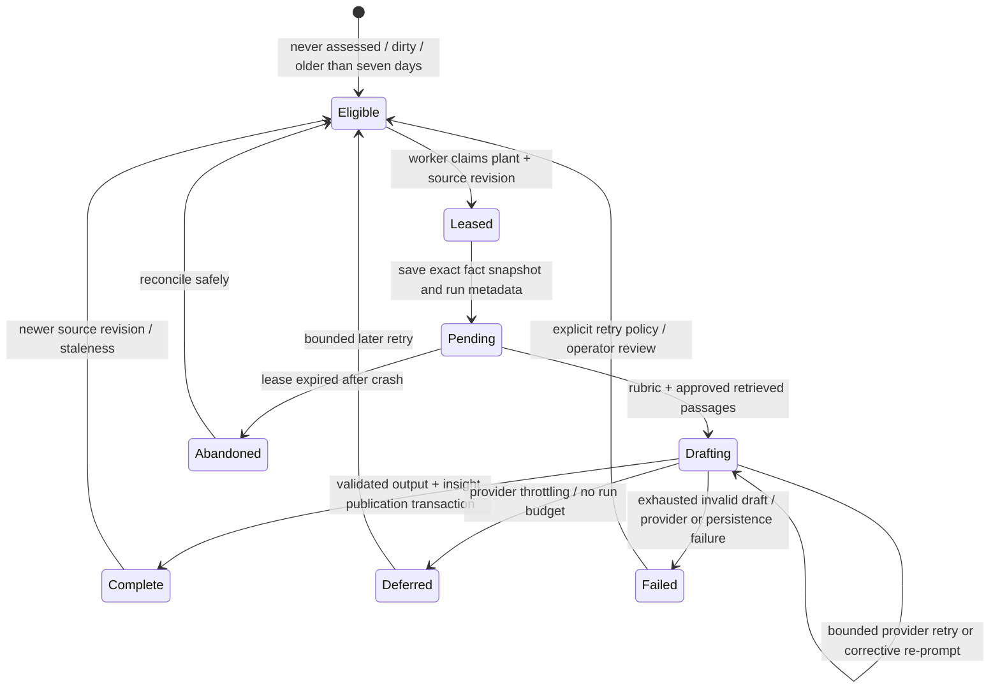
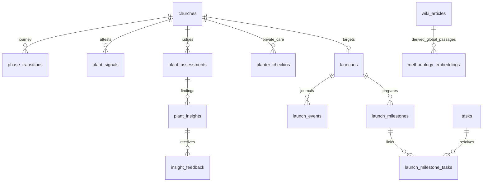

# Methodology, Plant Intelligence, phases, launch and reference specifications

Controller alias evidence is explicit in the registry: `src/app/(dashboard)/launch/actions.ts#scheduleLaunchAction` → LCH-001; `completeMilestoneAction/reopenMilestoneAction` → LCH-004; `setLaunchTaskCompleteAction` → LCH-005 plus ordinary task rules; `recordLaunchOutcomeAction` → LCH-006; `updateLaunchOutcomeAction` → LCH-007. `src/app/(dashboard)/phase/actions.ts#transitionPhaseAction` → PHASE-002/003/005/006/007 (transition, same-phase semantics, emitted effects and journal). These are source-controller aliases, not extra required v3 APIs. File ownership alone cannot establish these semantic links.

Status: documentation-only rebuild plan, **2026-10-03**. Canonical methodology/version reconciliation is in [Methodology foundations](../methodology-foundations.md). Fine-grained evidence, statuses, operations, tests, permissions, states, explicit acceptance criteria and IDs are in [the audit JSON](../../audits/methodology-intelligence.json). This document specifies future implementation; it does not create application code, initialize a DB or authorize migration/deployment.

## Scope and preservation

The audit identifies **69 capabilities**: 42 intelligence/private-care, 8 phase, 11 launch and 8 reference capabilities. 61 have main implementation, 5 are local-only additions, 2 are partial reference work and 1 is explicitly unimplemented recurring-services scope. 138 source/test files in the owned implementation areas and 3 alpha-added files are inventoried. These are capability records, not a claim that every FRD requirement is complete or every referenced test has been executed.

User-facing scope is the full preserved target. Staged slices sequence delivery, not feature deletion. Rubric customization per network, reactive readiness notifications, outcome-correlated benchmarking and recurring-service scheduling are named future decisions; existing stored outcomes, timeline, guidance and templates are retained.

## Bounded target modules and interfaces

Use the common architecture's trusted `ActorContext`, tenant-scoped DTOs, Zod boundary contracts, error codes, idempotency keys and expected revisions. Suggested future ownership paths:

| Owner | Future path | Public operations |
|---|---|---|
| Reference | `packages/reference/` and `packages/domain/src/reference/` | Approved Playbook/rubric/phase/lens/template manifests; canonical Wiki import contract; source hashing, completeness and corpus publication. |
| Phases | `packages/domain/src/phases/` | `phases.declare`, `phases.transition`, `phases.readJourney`, `phases.readReadiness`; expected plant revision and owner authority. |
| Intelligence | `packages/domain/src/intelligence/` | `intelligence.readAssessment`, `readFocus`, `readScorecard`, `readCriteria`, `readTrends`, `readTimeline`, `readOversight`, `submitFeedback`, `requestAssessment`; deterministic facts, judged snapshots and projections. |
| Private care | `packages/domain/src/private-checkins/` | `privateCheckins.saveCurrent`, `readCurrent`, `readHistory`, `correctExisting`; separate sensitive access policy, excluded from general assistant tools. |
| Launch | `packages/domain/src/launch/` | `launch.schedule`, `move`, `postpone`, `recommit`, `readWorkspace`, `completeMilestone`, `reopenMilestone`, `recordOutcome`, `correctOutcome`, `repairReadiness`. |
| Worker | `apps/api/src/worker/intelligence/` | Candidate selection, per-plant leased assessment job, bounded provider adapter, pending recovery and retry/dead-letter operations. |
| UI | `apps/web/src/features/{intelligence,phases,launch}/` | Stable sectioned reading surface, soft phase confirmation, seven attestations, private check-ins, launch readiness/history/outcome forms. |
| Contracts/tests | `packages/contracts/src/{intelligence,phases,launch}/`, `tests/{contracts,integration,e2e,evals}/` | Request/response/error/date/fact/permission contracts, deterministic fixtures and SME-reviewed semantic evaluations. |

Operations return a typed receipt containing aggregate revision, persisted audit ID, affected projection revision and safe result. UI and Evry call the same operation; neither writes a raw table or creates a second workflow.

`FactSnapshot` carries snapshot schema version, one `asOf` instant, source revision/watermark, reference package revision, structured typed facts and evidence provenance. `Assessment` records exact snapshot, approved rubric ID+hash, prompt template version, corpus revision, model/provider ID, retrieval passage IDs/hashes, outcome and generation metadata. Claims cite `FactRef {path, value, evidenceKind, sourceRevision}`; prose citations are display, never the executable source of integrity.

`AssessmentView` is a permission-filtered projection with version, as-of, stale/degraded status, one primary focus, two supplements, separate positives, criteria, eight CSFs, deltas, trends and timeline. Oversight receives a separate **aggregate-only** DTO with category/fact disclosure provenance. It must never receive the raw snapshot, person UUIDs, private care, growth-source composition or confidential human notes.

## Authority and privacy contract

| Operation/surface | V2 evidence | V3 preservation/default |
|---|---|---|
| Phase declaration/change | `phase.declare`: plant Owner | Owner only; explicit reason for ordinary change. Evry can propose, owner approves reviewed execution. |
| Manual plant attestations | `phase.signal`: plant Owner/Admin; `/phase` owner reading surface | Preserve authorized human answering. Evry may draft a statement for review; must not infer or set prayer/giving/values facts itself. |
| Private weekly check-ins | Main incorrectly uses Admin-capable signal action; alpha changes to `phase.declare` and adds history | Owner only; no coach/org/assessment/Evry tool by default. Future ownership-transfer/author-specific retention policy remains explicit decision. |
| Insight feedback | `self.write` plus same-church insight and user scope | Preserve own ratings. FRD coach feedback is partial because no-church coaches cannot reach current action; decide authorized coach feedback separately. |
| Launch day/outcome | `launch.schedule`: plant Owner | Owner reviewed scheduling/postponement/outcome/correction; recorded completed day cannot redated through scheduling. |
| Milestone completion | `launch.milestone`: seated member | Preserve own-duty separation; milestone eligibility checks live tasks; linked task action still checks task assignment/ordinary permissions. |
| Plant intelligence reading | `/phase` Owner only; coach detail/ordinary tenant reads elsewhere depend on access readers | Explicit role-granted read projections; no accidental broadening from generic tenant access. |
| Oversight assessment | Associated org seats; `share_*` feature gates and seen-or-72-hour release | Retain real consent, aggregate scope and immediate revocation on read. Org push preferences never widen plant consent. |
| Jobs/global content/operator triggers | Cron secret/operator context | Server-only roles; no browser credential/cron token, no tenant-input authority. Reference publisher cannot inspect plant records. |

Current oversight cross-cutting categories `onboarding`/`phase_progress` are ungated by feature, and `launch_readiness` maps to meetings despite reading mixed roles/training/launch data. The v3 policy must derive disclosure from **all underlying fact scopes**, not assume category alone protects them. Paired categories do not by themselves prove the planter saw an identical diagnosis; preserve the methodology's trust requirement with evaluated paired concern identifiers.

## State, transactions and recovery

### Phase and attestation

Initial declaration is one row with `kind=initial_declaration`, not synthetic progression. Lock plant, check uniqueness, write declared phase+audit+source revision atomically. A repeated request returns existing declaration without moving phase; correction is a new ordinary transition. Main's declaration already demonstrates row-lock plus partial unique index arbitration.

Ordinary phase transition currently reads `fromPhase`, builds facts, then batches audit insertion and phase update. Atomic writes prevent a half-change but do **not** make the pre-read current under racing owners/tabs. In v3 use a locked aggregate or compare expected revision; derive `fromPhase` from the row protected by that operation. Same-phase requests are currently classified `noop` but still journaled/emitted: decide explicitly whether preserving that audit is useful; never silently discard it.

Manual attestation current values are unique per plant/key and upsert who/when. Keep seven closed keys and boolean inputs. V3 records previous values as revisions, marks the assessment source revision in the same transaction, and keeps stale prayer/giving attestations visible with age. “Still true” is explicit reaffirmation, not a synthesized fresh answer.

### Assessment job

Main selects never-assessed/dirty/stale, orders oldest first, caps 10 per tick, uses a 270-second soft budget under a 300-second maximum and shared process-local token pacer. Preserve anti-starvation and the run arithmetic (`selected = skipped + attempted + deferredUnattempted`); a throttled attempted plant can still cost calls/tokens. The candidate query currently loads every church and every complete assessment row, then selects the latest in memory. V3 should select latest-per-plant in SQL and state eligibility for newly created, inactive or retired plants; no onboarding/readiness filter is present in that source query. Scheduled deployment cadence is **not proven** by `vercel.json` (it only sets branch deployment rules); establish scheduler owner and cadence as environment configuration.

Future candidate claim is unique per `(plant, sourceRevision, rubricHash, assessmentPolicyVersion)`. Use DB lease with expiry/heartbeat, a request digest, and per-run attempt metadata; two cron/manual triggers cannot assess the same revision simultaneously. Keep prior complete assessment readable while a new run is pending, failed or deferred. During generation, newer activity remains dirty because current source revision exceeds the assessed revision.

Snapshot construction must have a defined consistency boundary. Main runs many independent feature queries with `Promise.all`; identical fixed time does not guarantee one database state while data changes. Prefer one read transaction with a consistent PostgreSQL snapshot, or an explicitly documented revision plus retry when any underlying relevant aggregate changes. Never mark unobserved data fresh simply because wall clock advanced.

Persist insights, immutable assessment metadata and complete/current pointer in **one transaction**. Current source inserts pending, inserts insights, updates complete and emits in separate steps: crashes can leave abandoned pending rows or partial artifacts. Completion CAS already protects a finished row from being demoted when a post-complete event throws. Retain that protection; publish notification work via a minimal transactional outbox if required, rather than coupling judgment durability to a bus callback.

The provider ladder owns 429/Retry-After/header budgets and 5xx/socket backoff; the output ladder owns named schema violations and accumulates corrective instructions. Both must observe one deadline, attempt/token budget and cancellation policy. Current default 4 provider attempts and 3 drafts are evidence, not universal optimal budgets. Metrics distinguish provider deferral, deadline truncation, structural rejection and persistence defect. Diagnostics branch correctly reports **last draft** rejection rather than pretending all drafts broke the same rule.

RAG failures currently become an empty passage array without diagnostic context. V3 keeps rubric-based advice possible only under a deliberate degraded policy, labels grounding unavailable, records cause and retries reference retrieval. It cannot manufacture article citations. The judge also validates a generated 10–600-character overall summary, but the current publication path does not persist it. V3 must decide whether that summary belongs in the durable view rather than accidentally promising a lost result. Corpus slug existence is checked; exact passage support and numeric truth also need validation/evaluation.

### Launch and private care

Launch state is `planning → scheduled ↔ postponed → completed`. Planning may lack a date; other states require it. One row per plant is protected by DB uniqueness. Date move/status+append journal is one transaction using locked old values; initial concurrent schedule has uniqueness arbitration. Resaving unchanged is idempotent; recommitting same Sunday after postponement changes status/history. Completed date is historical.

Schedule seeds 9 milestone keys and 22 ordinary `launch_prep` tasks with links atomically, idempotent per `(launch,key)`. Current schedule then seed are separate operations; page convergence repairs missed seeds for scheduled/postponed launches. In v3 schedule and readiness initialize together where bounded, or persist an explicit `readinessPending` command/outbox that retries. Reading a page does not mutate user work. Deleted offered tasks remain deliberate choices; retry never resurrects them.

Manual milestone completion requires no live unresolved linked tasks. Alpha correctly treats `no_longer_needed` as resolved; old `status <> complete` blocked waived work. Reopen is always allowed subject to authorization. Linked task toggles use ordinary task service and current occurrence guard, never a second task write. Completing subtasks does not complete parent task or milestone by inference.

Outcome recording is on/after the target **calendar day**, owner-authorized and once-only; null counts mean unrecorded, zero is a real result. Later corrections keep the date and append before/after outcome revisions. Main journals `completed` with prior status but does not retain every overwritten outcome value: do not call that full value history. Likewise reopening a milestone clears its last completion fields, so v3 must add event history if it promises complete completion/reopen history.

Check-ins have server-derived Monday/week, unique plant/week, four three-level answers and note ≤2000 characters. Alpha preserves overwritten answer snapshots in `editHistory`, full history and existing-row-only corrections; deletion unavailable. Store explicit LocalWeek and revision instead of timestamp-as-date; unchanged save is a no-op and concurrent correction rejects stale revision. Never emit assessment dirty, readiness, notifications or traces from private answers. Missing weeks break consecutive-struggling nudges. Nudges direct to human support without counseling content.

## Every owned schema table and important relation

All 11 tables below have a feature disposition. They are not all tenant tables: methodology embeddings are intentionally global.

| Actual table | Feature IDs and important relations | Fresh v3 disposition |
|---|---|---|
| `phase_transitions` | PHASE-001–008; church, initiating user, from/to, kind, facts/rubric; initial unique per church | Keep append-only journey facts; lock/expected revision; phase range and same-tenant initiator integrity; content-version linkage. |
| `plant_signals` | PI-014–015,028; church, attester, unique church/key | Keep typed current attestations plus historical revisions; no generic arbitrary JSON surface; reference key schema version. |
| `plant_assessments` | PI-001–037,042; church, status, facts/model/rubric, seen timestamp | Keep immutable point-in-time judgment and source/reference versions; job lease/error/attempt metadata separate where useful; atomic complete pointer and history. |
| `plant_insights` | PI-018,023–033; assessment FK cascade, denormalized church, audience/category/severity/rank/facts/slugs | Keep typed findings with exact supporting FactRefs and corpus citations. Ensure `(assessment,church)` consistency; unified urgency vocabulary. |
| `insight_feedback` | PI-033; insight and assessment FKs, user/church/rubric duplicated, unique insight/user | Keep current rating and rubric evaluation data; prove parent IDs/tenant match; whether rating history needed is explicit decision. |
| `planter_checkins` | PI-038–041; church, answerer, unique church/week; alpha JSON prior revisions | Separate personal care module and stronger access policy; LocalWeek, revision history, no AI/oversight relation. Ownership transfer unresolved. |
| `launches` | LCH-001,006–009; unique church, day/status/outcome/nullable counts | Keep one live launch, LocalDate, status constraints, revision and full outcome correction trail. No copied church.launchDate. |
| `launch_milestones` | LCH-003–004,009–010; launch FK cascade, church, key/area, completion user/date | Keep approved fixed milestone package and explicit completion/history; composite tenant relation, template version/offer receipt. |
| `launch_milestone_tasks` | LCH-003–005; milestone/task FK cascade, denormalized church, unique pair | Keep bounded link instead of new task column for every feature; enforce all same plant; user retirement/task history not accidentally erased by cascades. |
| `launch_events` | LCH-001–002,006–007; launch/church/actor, event/old/new date/status/note | Keep journal but expand meaningful full corrections as explicit payloads. Append-only enforcement/retention must be deliberate, not claim a trigger that does not exist. |
| `methodology_embeddings` | PI-017,REF-007; global docKey/chunk index/source/phase/vector | Keep derived global index or replace with verified simpler retrieval if evaluation wins; corpus/model/version/content hash; retire stale chunks. No tenant content. |

External dependencies with actual feature uses: `churches` owns current phase/source freshness/privacy/timezone; `users` supplies authenticated author IDs; `persons`/`commitments` source committed cohort and provenance; `assessments` (human 4Cs) and `interviews` supply recorded human results; `church_meetings`/`meeting_attendance` supply cadence/engagement; `ministry_teams`/`team_memberships` supply leadership/serving; `training_programs`/`training_completions` supply team readiness; `tasks` supplies ownership, obligations and launch work; `wiki_articles`/`wiki_sections` supply approved content; `message_templates` supplies global communications. These remain owned by their bounded modules; intelligence is a read-only consumer, not a generalized second CRM.

The last edge is a logical provenance relationship, **not an existing FK**; Playbook passages have no Wiki article. Duplicated church/assessment/rubric anchors need enforced consistency or deliberate derivation. Main append-only tables are conventions, not DB trigger guarantees. Fresh v3 has no stored customers to migrate, so do not reproduce historical nullable/generalized shapes merely to retain import compatibility.

## Evry integration and human ownership

Evry gets per-feature read tools for authorized phase/readiness, focus/criteria/citations/trends/timeline, launch/work/readiness/history/outcome and approved reference lookup. It reads public operation DTOs, not raw SQL or a giant all-plant prompt. Use short conversational context plus typed draft receipts carrying exact source revision and expiry. Sensitive human judgments are quoted as recorded facts only where the actor may see them; oversized context selects evidence explicitly and labels omissions.

Evry may propose phase changes/reasons, launch scheduling, task assignments/completions, milestone completion/reopen and outcome corrections through ordinary operations. Default is **draft → review → approve → execute**, with actor scope/revision rechecked at execution. Owner-only decisions remain owner-only even if a Member asks the assistant. It never guesses an attestation, assesses pastor fitness, offers prayer/biblical counsel or invents interview/4Cs conclusions. Private sustainability answers have no default tool.

Each execute receipt links audit IDs and supports allowed compensating operations: phase correction appends new transition, task/milestone reopen, reschedule before completion, outcome correction. Undo is a human-visible action and cannot pretend external messages were unsent. Autonomous authority is an explicit open policy; safe defaults do not claim user approval of background writes. Evaluation must cover mixed-role requests, stale drafts, revoked permission, cross-plant IDs, “complete everything,” unsupported spiritual claims, missing evidence and false success after partial provider failure.

## Evidence-backed simplification choices

| Concrete v2 mechanism | Retain the need | Proportional replacement and tradeoff |
|---|---|---|
| Separate Server Actions with hand-written auth, validation, cache revalidation and separate DB helpers | Trusted actor/tenant and usable error recovery | One framework-independent operation contract, thin Hono/Next adapters; deliberate shared validation plus DB constraints rather than every helper duplicating it. |
| Thousands of lines of citation parser/phrase/criteria wrappers with untyped dotted strings | Traceable facts, stable user language and old-version interpretation | Typed FactRef and curated display registry; legacy decoder only for archival data, unnecessary for fresh customers. More upfront contract work, fewer silent string mismatches. |
| Name-substring ministry coverage despite canonical template keys | Custom named ministries and eight-area readiness | Stable area assignment with explicit custom mapping. Ask only for ambiguous mapping; no magical name-derived authority. |
| Code and Markdown rubric prose drift | Approved methodology and replayable history | One reviewed reference artifact produces prompt/read view, exact content hash; retain human editorial ownership, avoid custom rubric CMS prematurely. |
| Whole global Wiki lives only in DB while embeddings are ordinal upserts | Approved methodology guidance and citation links | Reproducible global content package + complete corpus generation. Requires verified snapshot approval once, then bootstrap independent of the old DB. |
| Broad in-memory events best-effort dirty marks and after-commit notifications | Decoupling important side effects and reliable freshness | Direct bounded coordination plus source version increment; small transactional outbox only for external delivery/jobs. No generalized enterprise event platform. |
| Read-time launch readiness seeding and assessment seen stamp | Recovery/planter-first workflow | Explicit idempotent repairs and acknowledgment commands. More explicit job/UI status design, removes hidden read mutations. |
| Separate DB/judge urgency names and generic “health” | Priority and user trust | One documented v3 urgency vocabulary and launch progress label; retain v0/v1 meaning, no simplistic numerical health score. |
| Last good snapshot fallback and bounded retries | Resilient reads and model cost control | Keep; add lease/pending recovery, exact attempt diagnostics and cost budgets. Do not discard mature reliability work merely because tests are numerous. |

## Work-package integration requirements

These are subpackages under the master plan's `WP-reference`, `WP-phases`, `WP-intelligence`, and `WP-launch`. Parent DAG owns final IDs/order; these required inputs/outputs may not vanish during reconciliation.

| Slice | Inputs/prerequisites | Output and owning interface | Gate and integration order |
|---|---|---|---|
| REF-A | Source manifest, SME dispositions, verified global Wiki snapshot | Immutable reference package and catalog manifest | Blank bootstrap hashes/links/counts; freeze seven phases, eight lenses, signal keys and template IDs first. |
| REF-B | REF-A, embedding/provider terms spike, approved retrieval policy | Corpus generation manifest and retrieval DTO | Shrinking source retires old chunks; no tenant data; known queries retrieve relevant passages; citations validated. |
| PHASE-A | Auth/tenant, transaction and date contracts frozen; REF-A | Declare/change/read-journey operations and schema | Racing declarations yield one row; stale change denied; truthful starting phase; no fabricated midjourney steps. |
| PI-A | People/Meetings/Tasks/Teams/Training/Launch read contracts; REF-A | Consistent snapshot, evidence and FactRef contracts with fixtures | Fixed asOf plus consistent source revision identical; unknown distinct from health; correction/retirement dirties relevant revision. |
| PI-B | PI-A, REF-B, provider adapter, worker lease | Judge, retries, atomic publication and pending recovery | Provider 429/5xx, invalid draft, crash at each write, last-good fallback, concurrent ticks, deadline/token budgets. |
| PI-C | PI-B, authorization projections frozen | Assessment UI, criteria, CSFs, focus/deltas/trends/timeline and oversight DTO | Zero model calls on reads; citations verified; 1+2 action budget, separate positives; consent/revocation/release policy and SME semantic review. |
| PI-D | Private-care identity and week policy frozen | Current check-in, full history, corrections and nudges | Answers absent from model/oversight/Evry/push; Owner-only writes, stale correction denied, original values retained. Parallel with PI-B. |
| LCH-A | Task resolved-state/authority, dates/transactions, REF-A | Schedule/journal/readiness initialization and canonical date | Concurrent/duplicate/same-day recommit/completed refusal; nine milestones and twenty-two tasks once; explicit seed recovery. |
| LCH-B | LCH-A and ordinary Tasks completion contract | Milestone completion/reopen, linked tasks and workspace | Waived/deleted task does not block; unresolved task does; own-duty denied correctly; no wrong recurring occurrence. |
| LCH-C | LCH-A, correction/audit contract | Outcome recording/correction and intelligence facts | Future day denied; null distinct from zero; no phase advancement; full revisions; stale correction refused. |
| PI-E | PI-B/C, LCH-C and all synthetic source fixtures | Operator runbook, semantic evaluation suite and final matrix | All 69 acceptance IDs traced; source/table coverage; SME review of scope/fact/privacy; no route-count substitute. |

Parallel lanes: reference approval/package, auth/contracts/database, operational feature modules, private-care UI, and provider/evaluation reliability can proceed independently after their inputs freeze. Critical path to full intelligence is **reference approval → shared source/date/access contracts → consistent snapshots → corpus/judge/job publication → authorized projections → semantic evaluation**. Launch can implement alongside core CRM/meetings/tasks, then join PI snapshot contract. A small team should integrate one vertical slice at a time, with one schema owner and one contract freeze reviewer; many contributors do not justify many services.

Future runnable acceptance belongs under `tests/` and the master build scripts. This plan does not pretend `bun test` can execute an unimplemented application now. For each feature below, implement `AC-<featureID>` with source parity and the explicit risk cases above; contract unit tests, PostgreSQL integration races, essential browser journeys and named semantic cases have different evidence roles.

## Fine-grained capability preservation matrix

Every row has a stable acceptance ID `AC-<ID>` and a work-package family in the JSON. Source references are relative to the verified checkout, `#` denotes a symbol/section. Main/local status describes implemented source, not deployment or runtime proof. The following matrix is generated from the same audit records.

| ID / acceptance | Capability and evidence | Status | Preservation decision |
|---|---|---|---|
| PI-001 / AC-PI-001 | **Deterministic fact-snapshot assembly** · `src/lib/phase-engine/signals/build-fact-snapshot.ts#buildFactSnapshot` | implemented-main | Keep deterministic facts and a single injected asOf clock; replace many independent reads with a defined consistent snapshot transaction or explicit source revision watermark. |
| PI-002 / AC-PI-002 | **Committed adult growth, first commitments and flat streak** · `src/lib/phase-engine/signals/build-fact-snapshot.ts#buildCoreGroupSignals` | implemented-main | Keep committed adult definitions; deduplicate earliest commitment per person, rolling 28-day vs prior 28, one new adult resets flat streak; 21 slowed/28 stalled are approved v1 language floors. |
| PI-003 / AC-PI-003 | **Growth source composition and unknown source counts** · `src/lib/phase-engine/signals/build-fact-snapshot.ts#buildCoreGroupSignals` | implemented-main | Preserve planter-only source mix and unknown-source count; source attribution is not conversion or spiritual fruit; do not introduce conversion scoring. |
| PI-004 / AC-PI-004 | **Vision meeting cadence, completed attendance and trend** · `src/lib/phase-engine/signals/build-fact-snapshot.ts#buildVisionMeetingSignals` | implemented-main | Keep completed vision-meeting data, latest/previous attendance, predictable cadence and new-attendee interpretation; target 14, watch 21, direct 28 days; never chastise weekly cadence. |
| PI-005 / AC-PI-005 | **Core group cohesion and leader disengagement pattern** · `src/lib/phase-engine/signals/build-fact-snapshot.ts#buildCohesionSignals` | implemented-main | Preserve 28-day vs prior 28 attendance; disengagement=no recent attendance after prior attendance; active committed denominator, threshold 20%, minimum 3, leader presence makes tone more direct. No claim about spiritual unity or causes. |
| PI-006 / AC-PI-006 | **Eight ministry coverage readings** · `src/lib/phase-engine/signals/build-fact-snapshot.ts#buildMinistryRoleSignals` | implemented-main | Keep the eight Playbook ministry areas, while replacing name-substring matching with stable canonical ministry-area mappings so rename/duplicate/synonym choices do not change coverage. |
| PI-007 / AC-PI-007 | **Leadership candidate signals and human interview/4Cs references** · `src/lib/phase-engine/signals/build-fact-snapshot.ts#buildLeadershipSignals` | implemented-main | Preserve 60-day behavioral conversation signal, opaque person IDs, countable tenure/attendance/serving and latest recorded human interview/4Cs results. No automated pastoral/character/doctrine/fitness verdict. |
| PI-008 / AC-PI-008 | **Training program/member completion readings** · `src/lib/phase-engine/signals/build-fact-snapshot.ts#buildTrainingSignals` | implemented-main | Keep denominator and team training definition explicit; no programs/no assignees is unknown rather than 100%; use shared training operation contracts. |
| PI-009 / AC-PI-009 | **Launch countdown, status, milestones and outcome facts** · `src/lib/phase-engine/signals/build-fact-snapshot.ts#buildLaunchSignals` | implemented-main | Read canonical launch date/status/outcome and readiness only from launch domain. Completion never changes phase; use one day/time contract. |
| PI-010 / AC-PI-010 | **Legacy person-record follow-up staleness facts** · `src/lib/phase-engine/signals/build-fact-snapshot.ts#buildFollowUpSignals` | implemented-main | Keep historical snapshots interpretable, but replace person.updatedAt proxy for new v3 output: editing a profile is not contact. Reconcile v1 warm 7-day/cold 14-day language with user-approved alpha task warnings before new rubric packaging. |
| PI-011 / AC-PI-011 | **Measured task follow-up ownership** · `src/lib/phase-engine/signals/build-fact-snapshot.ts#buildFollowUpSignals` | implemented-main | Keep unowned/stale-unowned per-contact and distinct/planter owner per-task facts; demoted/removed/noncommitted assignees count unowned. Never infer planter bottleneck from staleness. |
| PI-012 / AC-PI-012 | **48-hour originating-meeting follow-up task metric** · `src/lib/phase-engine/signals/follow-up-task-metrics.ts#computeFollowUpTaskMetrics` | implemented-local-only | Preserve alpha: mature obligations only; denominator undeleted top-level follow_up tasks with same-plant originating meeting and valid followUpStartedAt; no_longer_needed excluded and counted waived, manual/missing provenance unmeasured; success completion after creation/start and by start+48h. |
| PI-013 / AC-PI-013 | **Actual contact freshness independent of task completion** · `src/lib/phase-engine/signals/follow-up-task-metrics.ts#computeContactFreshness` | implemented-local-only | Preserve alpha lastContactAt actual-success evidence: measured only finite nonfuture timestamps, recent strictly younger than 14 days; missing/future contact unknown. Task completion never silently establishes actual contact. |
| PI-014 / AC-PI-014 | **Eight-lens measured/attested/unknown evidence profile** · `src/lib/phase-engine/signals/evidence.ts#buildEvidenceProfile` | implemented-main | Keep absence distinct from health; recompute profile from versioned snapshot consistently for prompt/read validator, retain attestation age. Revisit cohesion using vision-only isMeasured and split generosity/funding semantics rather than silently extrapolate. |
| PI-015 / AC-PI-015 | **Seven manual attestation toggles and reaffirmation** · `src/lib/phase-engine/manual-signals.ts#MANUAL_SIGNALS` | implemented-main | Keep values_documented, financial_base_established, core_group_giving, prayer_leader_assigned, prayer_rhythm_established, prayer_in_gatherings, systems_tested ; 30-day reaffirm for giving/prayer rhythms. Keep who/when; add correction history instead of losing previous attestations. |
| PI-016 / AC-PI-016 | **Active and historical rubric version registry** · `src/lib/phase-engine/rubric.ts#RUBRICS` | implemented-main | Preserve authoritative approved v1 and registered v0 provenance; create an immutable content-addressed reference package with prose/prompt generation from a single reviewed source. Do not silently author v2 methodology. |
| PI-017 / AC-PI-017 | **Phase-filtered dense/sparse methodology retrieval** · `src/lib/phase-engine/rag/retrieve.ts#retrieve` | implemented-main | Keep global-only approved reference corpus, pgvector cosine plus Wiki FTS reciprocal-rank fusion; dense phase/null restriction and sparse all-phase boost are distinct. Return passage IDs/hashes and canonical slugs. |
| PI-018 / AC-PI-018 | **Typed dual-audience judge and product-rule validation** · `src/lib/phase-engine/judge/run-assessment.ts#runAssessment` | implemented-main | Keep plain TS structured pipeline; audience coverage, three planter action slots, network register, planter pairing and unknown-not-positive guards. Add exact fact-path/value/numeric claim validation: nonempty citation strings alone do not prove truth. |
| PI-019 / AC-PI-019 | **Bounded corrective draft retries** · `src/lib/phase-engine/judge/run-assessment.ts#runAssessment` | implemented-main | Keep separate output-correction ladder: default 3 drafts, accumulated named rule violations, same grounded snapshot, run deadline bound; do not multiply SDK/provider retries invisibly. |
| PI-020 / AC-PI-020 | **Provider throttling, backoff and learned token pacing** · `src/lib/phase-engine/judge/paced-call.ts#runPacedCall` | implemented-main | Keep Retry-After/header-informed shared budget, 429 deferral distinct from 5xx/output failure, SDK maxRetries=0, default 4 attempts and deadline on all waits; simplify into one provider adapter with injectable clock. |
| PI-021 / AC-PI-021 | **Dirty-or-seven-day-stale assessment scheduling** · `src/app/api/phase-engine/assess/route.ts#runAssessmentBatch` | implemented-main | Keep dirty/never-assessed/stale semantics and oldest-first starvation control. Query latest complete assessment per plant in SQL and define explicit eligibility for freshly created, inactive or retired plants. Use a separate job worker with per-plant lease/idempotency key and bounded cohorts; preserve run summary counts and operator trigger. |
| PI-022 / AC-PI-022 | **Pending/complete/failed/deferred snapshots and recovery** · `src/lib/phase-engine/assessment/generate-assessment.ts#generateAssessment` | implemented-main | Keep immutable point-in-time runs and last good complete fallback; transactionally publish insight rows + complete pointer and durable side effects. Recover abandoned pending runs by lease timeout. Failed and deferred are separate operational states. |
| PI-023 / AC-PI-023 | **Insight persistence, severity/rank and snapshot deltas** · `src/lib/phase-engine/assessment/persist.ts#buildInsightRows` | implemented-main | Preserve stable urgency order, positive→info/info→low/watch→medium/urgent→high mapping, per-snapshot what-changed delta; replace dual enum mapping with one canonical vocabulary in v3 while legacy labels stay explainable. |
| PI-024 / AC-PI-024 | **Cached assessment reads, as-of and seen marker** · `src/lib/phase-engine/assessment/queries.ts#getLatestAssessment` | implemented-main | Keep latest complete cached reads with zero model calls; as-of/delta distinguish stale/current. Move seen write to explicit authenticated acknowledgment operation instead of read-component side effect. |
| PI-025 / AC-PI-025 | **Primary focus, two supplements, separate positive surface** · `src/components/phase-engine/focus-panel.tsx` | implemented-main | Preserve one primary focus plus at most two supplemental nonpositive work items, separate positive observations, stable sectioned reading and saved drafts. Keep the short actionable view rather than expanding into a generic report. |
| PI-026 / AC-PI-026 | **Human-readable citations and exact snapshot drill-down** · `src/lib/phase-engine/fact-format.ts` | implemented-main | Preserve cited evidence resolving against stored snapshot, attestation key/index resolution and familiar same-meaning language. Simplify ad hoc citation grammar to typed FactRef path+value+provenance, while legacy decoders read old forms. |
| PI-027 / AC-PI-027 | **CSF scorecard eight evidence-aware lens standings** · `src/lib/phase-engine/assessment/queries.ts#buildCsfScorecard` | implemented-main | Keep eight persistent tiles and distinct not-raised/unknown/positive/watch states; absence of insight not healthy. Derive only from authorized assessment insights. |
| PI-028 / AC-PI-028 | **Phase exit criteria cluster, measured progress and evidence** · `src/lib/phase-engine/assessment/exit-criteria.ts#PHASE_EXIT_CRITERIA` | implemented-main | Keep per-phase advisory criteria and the five-indicator Phase 1 cluster without weights or magic headcount. Separate deterministic met/not_met/unknown from judge severity and criteria not currently tracked. |
| PI-029 / AC-PI-029 | **Persisted historical trends with engine-derived alerts** · `src/lib/phase-engine/signals/trends.ts#buildPlantTrends` | implemented-main | Keep last 12 snapshot history, current/previous movement, original snapshot facts rather than recomputing old activity; alpha preserves five independent metrics including task 48 h and actual-contact freshness. |
| PI-030 / AC-PI-030 | **Milestone timeline of declared/moved phases and launch** · `src/lib/phase-engine/signals/milestones.ts#getMilestoneTimeline` | implemented-main | Keep chronological actual initial declaration/transition/Launch Sunday story and severity badges; never manufacture prior ladder phases for a plant joining midjourney. |
| PI-031 / AC-PI-031 | **Oversight privacy-safe four-valued health rollup** · `src/lib/phase-engine/oversight/read.ts#getOversightPlantHealth` | implemented-main | Keep on-track/watch/readiness/limited-visibility classifications. Readiness needs launch within 30 days plus unresolved roles/training, not a close date alone. Filter consent on every read, withhold persons, and re-audit ungated categories and multi-feature facts. |
| PI-032 / AC-PI-032 | **Planter-paired concerns and seen-or-72-hour release** · `src/lib/phase-engine/judge/network-register.ts#findUnpairedNetworkCategories` | implemented-main | Keep the same underlying concern visible to the planter and conservatively phrased to oversight. The current seen-or-72-hour fallback may release without opening; explicitly confirm that policy against literal planter-sees-first wording before v3 launch. |
| PI-033 / AC-PI-033 | **Per-insight feedback rating and optional comment** · `src/lib/phase-engine/feedback/service.ts#upsertInsightFeedback` | implemented-main | Preserve one current feedback rating per insight/user, assessment/rubric linkage and prefilled UI. Feedback is human-reviewed evaluation input, never an automatic rubric change. |
| PI-034 / AC-PI-034 | **Cold-start queued/quiet guidance** · `src/lib/phase-engine/cold-start.ts#assessmentColdStart` | implemented-main | Keep neutral missing evidence/first useful step, queued-after-material-event vs quiet/unassessed distinction. No fake positives to satisfy dual-audience schema. |
| PI-035 / AC-PI-035 | **Judge observability and graceful optional tracing** · `src/lib/phase-engine/observability.ts#startJudgeTrace` | implemented-main | Keep rubric/model/snapshot metadata, token usage, failure/retry rules and operator monitoring. Tracing failure cannot break assessment. Current adapter records metadata/usage rather than full prompts/responses claimed by older prose; define redacted minimum trace fields. |
| PI-036 / AC-PI-036 | **Offline fleet eval, assessment trigger and language audit tooling** · `scripts/run-eval-v1-pass.ts` | implemented-main | Keep synthetic versioned representative fixtures and SME-reviewed evaluation before model/rubric rollout. Rewrite DB-destructive fixture seeding to isolated disposable test environment; never execute historical seed against shared source DB. |
| PI-037 / AC-PI-037 | **Material-event dirty marking and refresh semantics** · `src/lib/phase-engine/dirty-handler.ts#markPlantDirty` | implemented-main | Keep freshness after attendance/team/person/task/phase/signal/outcome changes; inventory all material corrections/deletions too. Replace best-effort missed dirty events with transactionally bumped source revision plus periodic stale fallback. |
| PI-038 / AC-PI-038 | **Private weekly four-dimension planter check-in** · `src/lib/phase-engine/planter-checkin.ts#CHECKIN_DIMENSIONS` | implemented-main | Preserve four spiritually/marriage-family/financially/pace answers using steady/strained/struggling and an optional note. Server-derived Monday and unique church/week make current-week answering idempotent; alpha keeps revisions. No AI, readiness, oversight, coach or Evry access by default. |
| PI-039 / AC-PI-039 | **Private 12-week strip and three-consecutive-struggling nudge** · `src/lib/phase-engine/planter-checkin.ts#checkinNudges` | implemented-main | Keep the private 12-week strip and a nudge after three consecutive struggling weeks to seek human support. A missing week breaks the run. No inferred pastoral concern or generated counseling. |
| PI-040 / AC-PI-040 | **Full private check-in history with preserved revisions** · `src/app/(dashboard)/phase/checkins/page.tsx` | implemented-local-only | Preserve alpha full history route and prior-answer revisions. Separate sensitive personal care storage/access policy from church/assessment module in v3; owner-transfer policy unresolved. |
| PI-041 / AC-PI-041 | **Correct existing check-in without deleting history** · `src/app/(dashboard)/phase/checkin-actions.ts#correctCheckinAction` | implemented-local-only | Preserve tenant-scoped correction of an existing week with previous values, author and time appended. No deletion surface. Add expected revision and unchanged-save no-op to prevent lost corrections or revision spam. |
| PI-042 / AC-PI-042 | **Accurate final-draft assessment failure diagnostics** · `src/lib/phase-engine/judge/schema-rejection.ts#SchemaRejectionError` | implemented-local-only | Preserve diagnostics81abfcc7: report no valid draft after N attempts and the LAST rejected rule; do not falsely claim every draft broke the same rule or that a later model response must repeat it. Add attempt-level rule history. |
| PHASE-001 / AC-PHASE-001 | **One-time midjourney initial phase declaration** · `src/lib/phase-engine/transitions/service.ts#declareInitialPhase` | implemented-main | Keep one attested existing-phase history row. A row lock, partial unique index and ON CONFLICT prevent double declaration; the losing request does not change phase. |
| PHASE-002 / AC-PHASE-002 | **Reasoned forward/backward/skipping/correcting phase transition** · `src/lib/phase-engine/transitions/service.ts#transitionPhase` | implemented-main | Preserve Owner confirmation and reason, phases 0–6, fact snapshot/rubric audit and no readiness gate. Replace pre-read fromPhase with a locked aggregate or expected revision so concurrent changes preserve truthful history. |
| PHASE-003 / AC-PHASE-003 | **Direction classification and same-phase behavior** · `src/lib/phase-engine/transitions/service.ts#classifyTransition` | implemented-main | Current same-phase requests classify as noop but still append history and emit an event. Decide explicitly whether that behavior remains; no silent removal. |
| PHASE-004 / AC-PHASE-004 | **Advisory ready/approaching/not_ready/unknown phase control** · `src/lib/phase-engine/transitions/service.ts#deriveReadiness` | implemented-main | Keep ready/approaching/not_ready/unknown context from cached assessment and soft confirmation for unmet criteria. Readiness neither blocks nor executes a transition. |
| PHASE-005 / AC-PHASE-005 | **Typed phase.changed and assessment.created events** · `src/lib/phase-engine/events.ts` | implemented-main | Preserve typed phase.changed and plant.assessment.created payloads. Use direct bounded coordination for local effects and a small durable outbox where external delivery or jobs require recovery. |
| PHASE-006 / AC-PHASE-006 | **Phase-driven task-template prompt and Wiki recommendations** · `src/lib/tasks/phase-prompt.ts` | implemented-main | Preserve plant-level phase checklist offers and answers, without resurrecting declined/deleted tasks. Wiki recommendations can derive from current phase; historical event-contract dogma need not be copied. |
| PHASE-007 / AC-PHASE-007 | **Phase transition audit and journey chronology** · `src/lib/phase-engine/signals/milestones.ts` | implemented-main | Keep initiator, time, reason, kind, phases, facts and rubric. Existing append-only policy is an application convention. Corrections append truthful new facts rather than rewrite earlier history. |
| PHASE-008 / AC-PHASE-008 | **Seven church-planting phases and Playbook criteria catalog** · `src/lib/phase-engine/assessment/exit-criteria.ts#PHASE_EXIT_CRITERIA` | implemented-main | Preserve all seven phases and reviewed criteria. Aggregate display names/criteria from the approved reference package instead of repeating constants in UI and judge modules. |
| LCH-001 / AC-LCH-001 | **Set, move, postpone and recommit canonical launch date** · `src/lib/launch/service.ts#setLaunchDate` | implemented-main | Keep one live launch per plant and transactional date/status journal. Planning schedules, scheduled postpones or moves, postponed recommits, completed cannot be redated. Same-day recommit is a real change; unchanged save causes no write or notification. |
| LCH-002 / AC-LCH-002 | **Launch date/status journal and actor names** · `src/lib/launch/journal.ts#getLaunchJournalEntries` | implemented-main | Keep old/new target and status, actor, reason and scheduled/moved/postponed/completed event vocabulary. Store exact outcome revisions in v3, rather than claim current journal notes preserve overwritten values. |
| LCH-003 / AC-LCH-003 | **Nine Playbook milestones and 22 linked prep tasks** · `src/lib/launch/milestones.ts#seedLaunchMilestones` | implemented-main | Preserve nine stable milestone keys across operations, launch-team preparation and promotion, plus twenty-two linked tasks. Atomic dependent insertion and database uniqueness prevent duplicate tasks; user-deleted work does not reappear. |
| LCH-004 / AC-LCH-004 | **Complete/reopen milestone under live-task guard** · `src/lib/launch/milestones.ts#completeLaunchMilestone` | implemented-main | Keep explicit milestone completion separate from task progress. Alpha unresolved states not_started/in_progress/blocked prevent completion; complete or no_longer_needed resolves an obligation. Ignore soft-deleted tasks and allow reopening. |
| LCH-005 / AC-LCH-005 | **Complete/reopen linked launch task using ordinary task rules** · `src/app/(dashboard)/launch/actions.ts#setLaunchTaskCompleteAction` | implemented-main | Keep same-plant launch-link checks plus ordinary task assignment/authority. Surface ActiveTaskOccurrenceError instead of changing the wrong recurring occurrence. No second task writer. |
| LCH-006 / AC-LCH-006 | **Record Launch Sunday outcome once date arrives** · `src/lib/launch/outcome.ts#recordLaunchOutcome` | implemented-main | Keep null versus zero counts, notes and capture-the-day. Owner only, calendar-day eligibility and once-only guard, atomic journal and source freshness. No meeting row or phase advancement. |
| LCH-007 / AC-LCH-007 | **Correct recorded outcome with journal/no-op semantics** · `src/lib/launch/outcome.ts#updateLaunchOutcome` | implemented-main | Preserve correction of an existing completed outcome at any time; unchanged input causes no write, historical date stays fixed. Add full before/after revisions because current journal omits prior counts and text. |
| LCH-008 / AC-LCH-008 | **Launch workspace, dashboard countdown and outcome forms** · `src/app/(dashboard)/launch/page.tsx` | implemented-main | Keep date/status/readiness/history/journal/outcome workspace and compact dashboard card. Use one calendar-day contract. Decide explicitly whether current UTC day boundary changes to the plant timezone. |
| LCH-009 / AC-LCH-009 | **Converge missing readiness after seed failure** · `src/lib/launch/milestones.ts#convergeLaunchReadiness` | implemented-main | Preserve idempotent recovery of missing readiness for scheduled/postponed launches. Planning/completed launches do not receive surprise old tasks. Replace page-load writes with explicit repair work and visible readiness-pending state. |
| LCH-010 / AC-LCH-010 | **Milestone completion history and named actor** · `src/lib/launch/milestones.ts#getLaunchMilestoneHistory` | implemented-main | Preserve current completed-by/date history. Reopening currently clears those fields and loses earlier completions; add explicit completion/reopen events if v3 promises full history. |
| LCH-011 / AC-LCH-011 | **Recurring services and worship/volunteer scheduling boundary** · `product-docs/features/launch/frd.md#Non-goals (alpha)` | uncertain | Recurring post-launch services and worship/volunteer scheduling remain intentionally unimplemented. Preserve phase-6 guidance and templates, and require scoped Services discovery rather than infer an existing service-planning module. |
| REF-001 / AC-REF-001 | **Canonical SME Launch Playbook source** · `product-docs/launch-playbook.md` | implemented-main | Preserve the exact approved Playbook, source hash and SME provenance. Operational software design does not authorize rewriting benchmarks, human criteria or spiritual methodology. Reference lookup is distinct from assistant-generated counsel. |
| REF-002 / AC-REF-002 | **Approved global Wiki article/section bootstrap** · `product-docs/wiki/article-checklist.md` | partial | A verified read-only bootstrap snapshot at alpha2107 contains 96 global published Wiki articles, 21 referenced sections and 7 global templates. Preserve its checksums and review editorial/currentness alignment before future import; no tenant records or vectors were exported. |
| REF-003 / AC-REF-003 | **Eleven generated document template catalog** · `src/lib/documents/templates.ts#DOCUMENT_TEMPLATES` | implemented-main | Preserve all eleven code-defined document template IDs, content, merge fields and formats. No generic database CMS is needed; document owners retain rendering/field-validation acceptance. |
| REF-004 / AC-REF-004 | **Twenty phase/launch checklist templates** · `src/lib/tasks/templates.ts#TASK_TEMPLATES` | implemented-main | Preserve twenty stable phase/launch checklist template keys, phase tags, task/subtask content and due offsets. Version the reference package and keep phase offers as plant choices rather than automatic task creation. |
| REF-005 / AC-REF-005 | **Ten predefined ministry teams and role/responsibility catalog** · `src/lib/ministry-teams/role-templates.ts#TEAM_TEMPLATES` | implemented-main | Preserve ten predefined team catalogs, roles, responsibilities, eligibility/safety flags and stable keys. Resolve mapping to the eight intelligence ministry areas explicitly; do not silently drop prayer or invent a required ninth area. |
| REF-006 / AC-REF-006 | **Seven system communication templates** · `src/lib/communication/system-templates.ts#SYSTEM_TEMPLATES` | implemented-main | Preserve seven global system communication templates and merge contracts. Use stable identity/versioned idempotent imports, keep tenant copies distinct and import no customer recipients or sends. |
| REF-007 / AC-REF-007 | **Global methodology embeddings bootstrap** · `scripts/embed-methodology-corpus.ts` | implemented-main | Build global Playbook/published-Wiki passages from the approved source snapshot; rubric stays whole in context. Verified evidence has 547 expected chunks versus 572 stored, 114 mismatches, 2 missing, 27 obsolete, and no recorded vector-model provenance. Regenerate derived vectors in future rather than copy unverified vectors. |
| REF-008 / AC-REF-008 | **Reference package verification and editorial approval gate** · `scripts/audit-benchmark-language.ts` | partial | Verify source/content hashes, article and section identities, related links, active contextual-help slugs, templates, phases/lenses and all 26 comment dispositions. Existing 96 MDX compile successes prove syntax only; editorial approval and blank-environment parity are still gates. |

## Accepted target amendments · 2026-10-03

PD-002 resolves the Evry/private-care catalog conflict AR-01: preserve PI-038–041 native planter-only entry, history and corrections, while excluding private weekly answers, notes and history from every Evry tool/model context. There is no implicit Owner exemption, coach/network/oversight expansion or future selected-entry approval. PI-039 nudge semantics are still under separate unresolved AR-06 review; this privacy ruling does not decide that rule. PD-005 resolves OD-017: only confirmed contact refreshes PI-013 actual-contact freshness, while task completion is measured independently. PD-004 makes first-time Vision attendance depend on prior attended Vision meetings. The Playbook, rubric, phases and remaining methodology decisions are unchanged.

Authority and exact discussion provenance: [five accepted product rulings](../decisions/user-rulings.md). Central feature target decisions and acceptance gates are amended; detailed source audit JSON remains the original observed evidence. These five decisions do not establish holistic architectural readiness or approve starting implementation.
