# Future work packages and prerequisite graph

All packages are planned work. No application code is supplied or executed by this plan. IDs remain stable when estimates or sequencing change. Inputs include the linked feature records, authoritative methodology and the dependency outputs; outputs are reviewable implementation plus acceptance evidence in the owning paths.

There are 86 packages, roughly 222 engineer-days before contingency. Four engineers plus one QA and fractional SME/ops is the planning assumption. With unlimited lane capacity the weighted prerequisite lower bound is 66 working days; actual four-person scheduling, reviews and external source/decision waits make it longer. Treat a 14–20 week full-target planning range as an initial assumption, then re-estimate after the runtime/contracts and first operational slice. No deadline is promised.

Machine-readable source: [dag.json](dag.json). The graph below is generated from the same dependencies.

These are delivery/review batches, not86runtime packages or services. The28 Evry read/write adapter batches can share one registration/approval pattern and combine by domain while retaining feature/gate backreferences. The [complexity budget](../architecture/complexity-budget.md) requires many-to-one source-operation consolidation and a small deployable set. The66-working-day value is an assumption-based duration along the dependent chain at unlimited lane capacity;222human engineer-days is separate total effort. Neither figure estimates autonomous-agent throughput or promises elapsed delivery.

```mermaid
flowchart TD
  W001["WP-001: Confirm source authority and product decisions"]
  W002["WP-002: Freeze domain contracts C0"]
  W003["WP-003: Runtime/auth/file/stream representative spike"]
  W004["WP-004: Fresh database/storage baseline"]
  W005["WP-005: Better Auth identity/recovery"]
  W006["WP-006: Tenant and independent grant policies C1"]
  W007["WP-007: Organizations and consent relationships"]
  W008["WP-008: Invitation lifecycle and atomic acceptance"]
  W009["WP-009: Onboarding and discovery conversion"]
  W010["WP-010: Account and settings surfaces"]
  W011["WP-011: People core and account links"]
  W012["WP-012: Households tags skills and person fields"]
  W013["WP-013: People CSV import/export"]
  W014["WP-014: Assessments interviews commitments"]
  W015["WP-015: Corrections duplicate resolution and merge"]
  W016["WP-016: Team catalog and lifecycle"]
  W017["WP-017: Roster roles leader appointments/org chart"]
  W018["WP-018: Responsibilities canonical offer"]
  W019["WP-019: Training programs completion revoke/correct"]
  W020["WP-020: Meeting and location lifecycle"]
  W021["WP-021: Meeting invitations and RSVP"]
  W022["WP-022: Attendance finalization/evaluation C2a"]
  W023["WP-023: Follow-up obligation/outcome C2b"]
  W024["WP-024: Tasks lifecycle/bulk/status history"]
  W025["WP-025: Task dependencies and recurrence"]
  W026["WP-026: Phase task templates and prompts"]
  W027["WP-027: Communication composition/templates"]
  W028["WP-028: Shared email delivery and webhook reconciliation"]
  W029["WP-029: Communication history and resend"]
  W030["WP-030: Notification feed/preferences"]
  W031["WP-031: Outbox jobs and dispatch recovery"]
  W032["WP-032: Canonical reference/template manifest"]
  W033["WP-033: Approve and version available global Wiki snapshot"]
  W034["WP-034: Wiki browsing/search/progress/bookmarks"]
  W035["WP-035: Wiki feedback/admin/revalidation"]
  W036["WP-036: Document template and format contracts"]
  W037["WP-037: Generate store preview/download/history"]
  W038["WP-038: Phase initial declaration and transitions"]
  W039["WP-039: Check-ins manual signals and corrections"]
  W040["WP-040: Deterministic fact snapshot and metric lineage"]
  W041["WP-041: Rubric/reference retrieval and history C3a"]
  W042["WP-042: Structured AI judge and evaluation harness"]
  W043["WP-043: Assessment orchestration/retry/publication"]
  W044["WP-044: Plant Intelligence/oversight assessment UI"]
  W045["WP-045: Launch plan/readiness/milestones"]
  W046["WP-046: Launch outcomes/events/history"]
  W047["WP-047: Oversight portfolio/coaching/health"]
  W048["WP-048: Dashboard/navigation/settings integration"]
  W049["WP-049: Feedback admin public waitlist/legal/marketing"]
  W050["WP-050: Environment migration/ops/observability"]
  W051["WP-051: Evry conversation/run framework spike"]
  W052["WP-052: Evry per-feature read/tool coverage"]
  W053["WP-053: Evry proposal approval execution C3b"]
  W054["WP-054: Evry private uploads/artifacts/recovery"]
  W055["WP-055: Evry autonomy policy/evals/human ownership"]
  W056["WP-056: Cross-module race/privacy/correction integration"]
  W057["WP-057: Full target browser/file/capability parity gate"]
  W058["WP-058: Fresh bootstrap and release rehearsal"]
  W059["WP-059: Evry people-core reads/helper adapters"]
  W060["WP-060: Evry people-core draft/propose/execute adapters"]
  W061["WP-061: Evry people-assessments reads/helper adapters"]
  W062["WP-062: Evry people-assessments draft/propose/execute adapters"]
  W063["WP-063: Evry people-organization reads/helper adapters"]
  W064["WP-064: Evry people-organization draft/propose/execute adapters"]
  W065["WP-065: Evry meetings reads/helper adapters"]
  W066["WP-066: Evry meetings draft/propose/execute adapters"]
  W067["WP-067: Evry tasks reads/helper adapters"]
  W068["WP-068: Evry tasks draft/propose/execute adapters"]
  W069["WP-069: Evry teams reads/helper adapters"]
  W070["WP-070: Evry teams draft/propose/execute adapters"]
  W071["WP-071: Evry communication reads/helper adapters"]
  W072["WP-072: Evry communication draft/propose/execute adapters"]
  W073["WP-073: Evry intelligence reads/helper adapters"]
  W074["WP-074: Evry intelligence draft/propose/execute adapters"]
  W075["WP-075: Evry launch reads/helper adapters"]
  W076["WP-076: Evry launch draft/propose/execute adapters"]
  W077["WP-077: Evry wiki reads/helper adapters"]
  W078["WP-078: Evry wiki draft/propose/execute adapters"]
  W079["WP-079: Evry documents reads/helper adapters"]
  W080["WP-080: Evry documents draft/propose/execute adapters"]
  W081["WP-081: Evry notifications reads/helper adapters"]
  W082["WP-082: Evry notifications draft/propose/execute adapters"]
  W083["WP-083: Evry platform reads/helper adapters"]
  W084["WP-084: Evry platform draft/propose/execute adapters"]
  W085["WP-085: Evry helpers reads/helper adapters"]
  W086["WP-086: Evry helpers draft/propose/execute adapters"]
  W001 --> W002
  W002 --> W003
  W003 --> W004
  W004 --> W005
  W031 --> W005
  W005 --> W006
  W006 --> W007
  W006 --> W008
  W007 --> W008
  W011 --> W008
  W008 --> W009
  W007 --> W010
  W008 --> W010
  W009 --> W010
  W006 --> W011
  W011 --> W012
  W012 --> W013
  W011 --> W014
  W001 --> W014
  W012 --> W015
  W014 --> W015
  W011 --> W016
  W032 --> W016
  W016 --> W017
  W008 --> W017
  W016 --> W018
  W017 --> W019
  W015 --> W019
  W011 --> W020
  W016 --> W020
  W020 --> W021
  W008 --> W021
  W020 --> W022
  W021 --> W022
  W022 --> W023
  W024 --> W023
  W006 --> W024
  W011 --> W024
  W024 --> W025
  W025 --> W026
  W032 --> W026
  W038 --> W026
  W011 --> W027
  W020 --> W027
  W027 --> W028
  W031 --> W028
  W028 --> W029
  W006 --> W030
  W007 --> W030
  W031 --> W030
  W004 --> W031
  W001 --> W032
  W004 --> W032
  W001 --> W033
  W006 --> W034
  W032 --> W034
  W033 --> W034
  W034 --> W035
  W011 --> W036
  W019 --> W036
  W020 --> W036
  W024 --> W036
  W032 --> W036
  W036 --> W037
  W004 --> W037
  W031 --> W037
  W009 --> W038
  W032 --> W038
  W038 --> W039
  W015 --> W039
  W019 --> W040
  W022 --> W040
  W023 --> W040
  W025 --> W040
  W039 --> W040
  W032 --> W041
  W040 --> W041
  W041 --> W042
  W003 --> W042
  W042 --> W043
  W031 --> W043
  W043 --> W044
  W047 --> W044
  W024 --> W045
  W019 --> W045
  W032 --> W045
  W038 --> W045
  W045 --> W046
  W007 --> W047
  W011 --> W047
  W038 --> W047
  W009 --> W048
  W010 --> W048
  W024 --> W048
  W034 --> W048
  W045 --> W048
  W047 --> W048
  W006 --> W049
  W031 --> W049
  W003 --> W050
  W004 --> W050
  W031 --> W050
  W003 --> W051
  W006 --> W051
  W031 --> W051
  W051 --> W052
  W006 --> W052
  W052 --> W053
  W008 --> W053
  W015 --> W053
  W024 --> W053
  W031 --> W053
  W053 --> W054
  W013 --> W054
  W037 --> W054
  W054 --> W055
  W042 --> W055
  W001 --> W055
  W060 --> W055
  W062 --> W055
  W064 --> W055
  W066 --> W055
  W068 --> W055
  W070 --> W055
  W072 --> W055
  W074 --> W055
  W076 --> W055
  W078 --> W055
  W080 --> W055
  W082 --> W055
  W084 --> W055
  W086 --> W055
  W015 --> W056
  W019 --> W056
  W023 --> W056
  W026 --> W056
  W029 --> W056
  W035 --> W056
  W037 --> W056
  W044 --> W056
  W046 --> W056
  W049 --> W056
  W050 --> W056
  W055 --> W056
  W048 --> W057
  W056 --> W057
  W057 --> W058
  W033 --> W058
  W052 --> W059
  W011 --> W059
  W012 --> W059
  W015 --> W059
  W053 --> W060
  W059 --> W060
  W011 --> W060
  W012 --> W060
  W015 --> W060
  W052 --> W061
  W014 --> W061
  W015 --> W061
  W053 --> W062
  W061 --> W062
  W014 --> W062
  W015 --> W062
  W052 --> W063
  W012 --> W063
  W053 --> W064
  W063 --> W064
  W012 --> W064
  W052 --> W065
  W020 --> W065
  W021 --> W065
  W022 --> W065
  W053 --> W066
  W065 --> W066
  W020 --> W066
  W021 --> W066
  W022 --> W066
  W052 --> W067
  W023 --> W067
  W024 --> W067
  W025 --> W067
  W026 --> W067
  W053 --> W068
  W067 --> W068
  W023 --> W068
  W024 --> W068
  W025 --> W068
  W026 --> W068
  W052 --> W069
  W017 --> W069
  W018 --> W069
  W019 --> W069
  W053 --> W070
  W069 --> W070
  W017 --> W070
  W018 --> W070
  W019 --> W070
  W052 --> W071
  W027 --> W071
  W028 --> W071
  W029 --> W071
  W053 --> W072
  W071 --> W072
  W027 --> W072
  W028 --> W072
  W029 --> W072
  W052 --> W073
  W039 --> W073
  W040 --> W073
  W041 --> W073
  W043 --> W073
  W044 --> W073
  W053 --> W074
  W073 --> W074
  W039 --> W074
  W040 --> W074
  W041 --> W074
  W043 --> W074
  W044 --> W074
  W052 --> W075
  W045 --> W075
  W046 --> W075
  W053 --> W076
  W075 --> W076
  W045 --> W076
  W046 --> W076
  W052 --> W077
  W034 --> W077
  W035 --> W077
  W053 --> W078
  W077 --> W078
  W034 --> W078
  W035 --> W078
  W052 --> W079
  W036 --> W079
  W037 --> W079
  W053 --> W080
  W079 --> W080
  W036 --> W080
  W037 --> W080
  W052 --> W081
  W030 --> W081
  W031 --> W081
  W053 --> W082
  W081 --> W082
  W030 --> W082
  W031 --> W082
  W052 --> W083
  W010 --> W083
  W047 --> W083
  W048 --> W083
  W049 --> W083
  W050 --> W083
  W053 --> W084
  W083 --> W084
  W010 --> W084
  W047 --> W084
  W048 --> W084
  W049 --> W084
  W050 --> W084
  W052 --> W085
  W013 --> W085
  W019 --> W085
  W021 --> W085
  W037 --> W085
  W053 --> W086
  W085 --> W086
  W013 --> W086
  W019 --> W086
  W021 --> W086
  W037 --> W086
```

## Integration order and lanes

Use the topological order in JSON as a valid merge order, not a demand to serialize independent modules. The contract/platform owner merges C0/runtime/database/auth/grants first. After C1, people, meetings/tasks/teams, communications/knowledge/docs, intelligence/launch and Evry lanes can proceed against frozen typed contracts and independent feature fixtures. Shared schema/migration changes are serialized through one owner. QA starts at each vertical slice, not after all modules finish. Root branch stays green; contract changes land before callers and obsolete adapters are removed only after caller migration.

Critical prerequisite chain: WP-001 → WP-002 → WP-003 → WP-004 → WP-031 → WP-005 → WP-006 → WP-011 → WP-016 → WP-020 → WP-021 → WP-022 → WP-023 → WP-040 → WP-041 → WP-042 → WP-043 → WP-044 → WP-073 → WP-074 → WP-055 → WP-056 → WP-057 → WP-058.

## Staged vertical slices

Slices are cumulative; JSON explicitly lists both required and cumulative packages and validates prerequisite closure. Repeated package IDs indicate reuse, not repeated implementation. Foundation packages can deliver supporting contracts before their final UI integration.

| Slice | Runnable future result | Required packages | Gate / preserved later scope |
|---|---|---|---|
| S0 | chosen runtime + auth/grants + fresh DB/reference contracts and early ops boundary | WP-001..011, WP-031..032, WP-050 | no production use until denied-access/recovery/rollback proof; global Wiki approval can proceed separately |
| S1 | person → vision meeting → attendance → first-time follow-up → outcome/history, plus early Evry people read/reviewed-write slice | WP-011..016, WP-020..025, WP-031, WP-051..053, WP-059..060 | prove task-driven warning and distinct metric clocks; assistant kernel uses actual shared domain operations; partial slice does not remove other features |
| S2 | teams/leadership/training + communication/notifications + docs/Wiki | WP-016..019, WP-027..037 | source-approved corpus and rendered files; consent/suppression/recovery proof |
| S3 | phases/check-ins/facts/rubric judge → assessment/oversight → launch plus admin/public contracts | WP-026, WP-038..049 | methodology/visibility/no-evidence/eval gates; platform contracts available before their Evry adapters |
| S4 | Evry reads/drafts/reviewed writes/private artifacts with full domain coverage | WP-051..055 plus WP-059..086 | explicit autonomy decision; exact approved plan execution; no pastoral authority |
| S5 | full parity/admin/ops/bootstrap rehearsal | WP-056..058 | exercise earlier hidden admin/ops packages; every feature accepted or explicit user decision; no customer migration |

## Package specifications

### WP-001 — Confirm source authority and product decisions

Lane: contract; assumption: 2 engineer-days. Prerequisites: none.

**Inputs:** accepted feature/source records for reference.

**Outputs/interfaces:** approved-source register and OD dispositions; named acceptance evidence and updated contract/schema version if changed.

**Owning paths:** `packages/reference/`, `tests/integration/reference/`.

**Acceptance:** SME/user confirms methodology version precedence; no customer migration; unresolved decisions assigned.

### WP-002 — Freeze domain contracts C0

Lane: contract; assumption: 3 engineer-days. Prerequisites: WP-001.

**Inputs:** accepted feature/source records for contracts; WP-001 reviewed output.

**Outputs/interfaces:** ActorContext, branded IDs, LocalDate/LocalTime/Instant, errors, revisions, idempotency; named acceptance evidence and updated contract/schema version if changed.

**Owning paths:** `packages/contracts/src/`, `tests/contracts/`.

**Acceptance:** contract round trips; no protected request fields; denial/error fixtures.

### WP-003 — Runtime/auth/file/stream representative spike

Lane: platform; assumption: 3 engineer-days. Prerequisites: WP-002.

**Inputs:** accepted feature/source records for platform; WP-002 reviewed output.

**Outputs/interfaces:** ADR-002 selection and exact runtime/tooling lock baseline; named acceptance evidence and updated contract/schema version if changed.

**Owning paths:** `apps/api/src/platform/`, `tests/integration/platform/`.

**Acceptance:** login/recovery/revocation; rollback; DOCX/XLSX/PDF preview; private upload; SSE reconnect; TS7 build.

### WP-004 — Fresh database/storage baseline

Lane: platform; assumption: 3 engineer-days. Prerequisites: WP-003.

**Inputs:** accepted feature/source records for db; WP-003 reviewed output.

**Outputs/interfaces:** reviewed new schema baseline, pool, private object adapter; named acceptance evidence and updated contract/schema version if changed.

**Owning paths:** `packages/db/src/schema/`, `packages/db/migrations/`, `tests/integration/db/`.

**Acceptance:** fresh DB migration succeeds; rollback and same-tenant FKs; no v2 ledger/customer import.

### WP-005 — Better Auth identity/recovery

Lane: identity; assumption: 3 engineer-days. Prerequisites: WP-004, WP-031.

**Inputs:** accepted feature/source records for identity; WP-004 reviewed output; WP-031 reviewed output.

**Outputs/interfaces:** register/login/logout/verify/recover credential API; named acceptance evidence and updated contract/schema version if changed.

**Owning paths:** `packages/domain/src/identity/`, `packages/contracts/src/identity/`, `apps/web/src/features/identity/`, `tests/integration/identity/`.

**Acceptance:** nonenumeration; expiring single-use reset; stale credential request denial; session revocation.

### WP-006 — Tenant and independent grant policies C1

Lane: identity; assumption: 3 engineer-days. Prerequisites: WP-005.

**Inputs:** accepted feature/source records for access; WP-005 reviewed output.

**Outputs/interfaces:** flat seat, coach, discovery and platform policies; named acceptance evidence and updated contract/schema version if changed.

**Owning paths:** `packages/domain/src/access/`, `packages/contracts/src/access/`, `apps/web/src/features/access/`, `tests/integration/access/`.

**Acceptance:** cross-tenant direct operation denied; role/coach scopes independent; export DTO private.

### WP-007 — Organizations and consent relationships

Lane: identity; assumption: 3 engineer-days. Prerequisites: WP-006.

**Inputs:** accepted feature/source records for organizations; WP-006 reviewed output.

**Outputs/interfaces:** associate/end/reassociate/privacy/versioned relationship ops; named acceptance evidence and updated contract/schema version if changed.

**Owning paths:** `packages/domain/src/organizations/`, `packages/contracts/src/organizations/`, `apps/web/src/features/organizations/`, `tests/integration/organizations/`.

**Acceptance:** disclosed defaults; prior sharing retained; locality-only oversight; coarse consent-exempt notice.

### WP-008 — Invitation lifecycle and atomic acceptance

Lane: identity; assumption: 3 engineer-days. Prerequisites: WP-006, WP-007, WP-011.

**Inputs:** accepted feature/source records for identity; WP-006 reviewed output; WP-007 reviewed output; WP-011 reviewed output.

**Outputs/interfaces:** create/describe/revoke/resend/accept invitation; named acceptance evidence and updated contract/schema version if changed.

**Owning paths:** `packages/domain/src/identity/`, `packages/contracts/src/identity/`, `apps/web/src/features/identity/`, `tests/integration/identity/`.

**Acceptance:** parallel revoke/register/claim; token hash/expiry; no account-existence leak; no tenancy move.

### WP-009 — Onboarding and discovery conversion

Lane: identity; assumption: 3 engineer-days. Prerequisites: WP-008.

**Inputs:** accepted feature/source records for onboarding; WP-008 reviewed output.

**Outputs/interfaces:** create plant, leadership/journey attestation, completion; named acceptance evidence and updated contract/schema version if changed.

**Owning paths:** `packages/domain/src/onboarding/`, `packages/contracts/src/onboarding/`, `apps/web/src/features/onboarding/`, `tests/integration/onboarding/`.

**Acceptance:** back/reentry/drafts; association/seat conversion guard; no automatic phase assumption.

### WP-010 — Account and settings surfaces

Lane: web; assumption: 3 engineer-days. Prerequisites: WP-007, WP-008, WP-009.

**Inputs:** accepted feature/source records for settings; WP-007 reviewed output; WP-008 reviewed output; WP-009 reviewed output.

**Outputs/interfaces:** account/team/privacy/preferences/hash-modal UI; named acceptance evidence and updated contract/schema version if changed.

**Owning paths:** `packages/domain/src/settings/`, `packages/contracts/src/settings/`, `apps/web/src/features/settings/`, `tests/integration/settings/`.

**Acceptance:** dirty draft navigation/focus; email-change races; private avatar; owner-only controls.

### WP-011 — People core and account links

Lane: people; assumption: 3 engineer-days. Prerequisites: WP-006.

**Inputs:** accepted feature/source records for people; WP-006 reviewed output.

**Outputs/interfaces:** scoped CRUD/query/activity and linked-account contract; named acceptance evidence and updated contract/schema version if changed.

**Owning paths:** `packages/domain/src/people/`, `packages/contracts/src/people/`, `apps/web/src/features/people/`, `tests/integration/people/`.

**Acceptance:** same-tenant person/user; delete versus seat removal; historical person preserved.

### WP-012 — Households tags skills and person fields

Lane: people; assumption: 2 engineer-days. Prerequisites: WP-011.

**Inputs:** accepted feature/source records for people; WP-011 reviewed output.

**Outputs/interfaces:** household/tag/skills/photo/background-check operations; named acceptance evidence and updated contract/schema version if changed.

**Owning paths:** `packages/domain/src/people/`, `packages/contracts/src/people/`, `apps/web/src/features/people/`, `tests/integration/people/`.

**Acceptance:** household create/link atomicity; stale references; private photo; configured field validation.

### WP-013 — People CSV import/export

Lane: people; assumption: 2 engineer-days. Prerequisites: WP-012.

**Inputs:** accepted feature/source records for people; WP-012 reviewed output.

**Outputs/interfaces:** bounded preview/import/export result contracts; named acceptance evidence and updated contract/schema version if changed.

**Owning paths:** `packages/domain/src/people/`, `packages/contracts/src/people/`, `apps/web/src/features/people/`, `tests/integration/people/`.

**Acceptance:** quoted multiline CSV; duplicate/invalid rows; formula-injection safe export; tenant authorization.

### WP-014 — Assessments interviews commitments

Lane: people; assumption: 3 engineer-days. Prerequisites: WP-011, WP-001.

**Inputs:** accepted feature/source records for people; WP-011 reviewed output; WP-001 reviewed output.

**Outputs/interfaces:** record 4Cs/interview/commitment with approved status policy; named acceptance evidence and updated contract/schema version if changed.

**Owning paths:** `packages/domain/src/people/`, `packages/contracts/src/people/`, `apps/web/src/features/people/`, `tests/integration/people/`.

**Acceptance:** approved method fixtures; not-qualified completion; no unintended regression; actor+history atomicity.

### WP-015 — Corrections duplicate resolution and merge

Lane: people; assumption: 3 engineer-days. Prerequisites: WP-012, WP-014.

**Inputs:** accepted feature/source records for people; WP-012 reviewed output; WP-014 reviewed output.

**Outputs/interfaces:** exact correction snapshots and transactional merge; named acceptance evidence and updated contract/schema version if changed.

**Owning paths:** `packages/domain/src/people/`, `packages/contracts/src/people/`, `apps/web/src/features/people/`, `tests/integration/people/`.

**Acceptance:** all dependent references accounted; stale/cross-tenant/duplicate merge denied; rollback; reversibility explained.

### WP-016 — Team catalog and lifecycle

Lane: teams; assumption: 2 engineer-days. Prerequisites: WP-011, WP-032.

**Inputs:** accepted feature/source records for teams; WP-011 reviewed output; WP-032 reviewed output.

**Outputs/interfaces:** canonical team create/archive/edit/list; named acceptance evidence and updated contract/schema version if changed.

**Owning paths:** `packages/domain/src/teams/`, `packages/contracts/src/teams/`, `apps/web/src/features/teams/`, `tests/integration/teams/`.

**Acceptance:** template identity survives rename; repeat initialize no duplicate; archived team handling.

### WP-017 — Roster roles leader appointments/org chart

Lane: teams; assumption: 3 engineer-days. Prerequisites: WP-016, WP-008.

**Inputs:** accepted feature/source records for teams; WP-016 reviewed output; WP-008 reviewed output.

**Outputs/interfaces:** membership/role/leader/remove-seat reconciliation; named acceptance evidence and updated contract/schema version if changed.

**Owning paths:** `packages/domain/src/teams/`, `packages/contracts/src/teams/`, `apps/web/src/features/teams/`, `tests/integration/teams/`.

**Acceptance:** same-tenant links; explicit appointment provenance; multi-role person; revoked seat cleanup.

### WP-018 — Responsibilities canonical offer

Lane: teams; assumption: 2 engineer-days. Prerequisites: WP-016.

**Inputs:** accepted feature/source records for teams; WP-016 reviewed output.

**Outputs/interfaces:** transactional offer/decline/delete/reorder responsibility; named acceptance evidence and updated contract/schema version if changed.

**Owning paths:** `packages/domain/src/teams/`, `packages/contracts/src/teams/`, `apps/web/src/features/teams/`, `tests/integration/teams/`.

**Acceptance:** read has no mutation; claim+items crash-safe; deleted/declined offer not resurrected.

### WP-019 — Training programs completion revoke/correct

Lane: teams; assumption: 3 engineer-days. Prerequisites: WP-017, WP-015.

**Inputs:** accepted feature/source records for teams; WP-017 reviewed output; WP-015 reviewed output.

**Outputs/interfaces:** training matrix/program/completion/correction; named acceptance evidence and updated contract/schema version if changed.

**Owning paths:** `packages/domain/src/teams/`, `packages/contracts/src/teams/`, `apps/web/src/features/teams/`, `tests/integration/teams/`.

**Acceptance:** exact before/after rows; duplicate role denominators explained; completion/revoke permission and history.

### WP-020 — Meeting and location lifecycle

Lane: meetings; assumption: 3 engineer-days. Prerequisites: WP-011, WP-016.

**Inputs:** accepted feature/source records for meetings; WP-011 reviewed output; WP-016 reviewed output.

**Outputs/interfaces:** vision/team meetings, locations, logistics, checklist; named acceptance evidence and updated contract/schema version if changed.

**Owning paths:** `packages/domain/src/meetings/`, `packages/contracts/src/meetings/`, `apps/web/src/features/meetings/`, `tests/integration/meetings/`.

**Acceptance:** meeting types retain Playbook semantics; location reuse/correction; local dates and archived references.

### WP-021 — Meeting invitations and RSVP

Lane: meetings; assumption: 3 engineer-days. Prerequisites: WP-020, WP-008.

**Inputs:** accepted feature/source records for meetings; WP-020 reviewed output; WP-008 reviewed output.

**Outputs/interfaces:** invite/response/public token/authenticated own-RSVP; named acceptance evidence and updated contract/schema version if changed.

**Owning paths:** `packages/domain/src/meetings/`, `packages/contracts/src/meetings/`, `apps/web/src/features/meetings/`, `tests/integration/meetings/`.

**Acceptance:** token scoped/expiring; own RSVP member policy; idempotent responses; no people enumeration.

### WP-022 — Attendance finalization/evaluation C2a

Lane: meetings; assumption: 3 engineer-days. Prerequisites: WP-020, WP-021.

**Inputs:** accepted feature/source records for meetings; WP-020 reviewed output; WP-021 reviewed output.

**Outputs/interfaces:** attendance finalize/correct/evaluate/analytics; named acceptance evidence and updated contract/schema version if changed.

**Owning paths:** `packages/domain/src/meetings/`, `packages/contracts/src/meetings/`, `apps/web/src/features/meetings/`, `tests/integration/meetings/`.

**Acceptance:** first-time versus returning; retries/concurrent finalize; no half-finalization; exact evaluation history.

### WP-023 — Follow-up obligation/outcome C2b

Lane: tasks; assumption: 3 engineer-days. Prerequisites: WP-022, WP-024.

**Inputs:** accepted feature/source records for followups; WP-022 reviewed output; WP-024 reviewed output.

**Outputs/interfaces:** obligation provenance, start/outcome/no-longer-needed; named acceptance evidence and updated contract/schema version if changed.

**Owning paths:** `packages/domain/src/followups/`, `packages/contracts/src/followups/`, `apps/web/src/features/followups/`, `tests/integration/followups/`.

**Acceptance:** meeting-origin 48h metric; manual exclusion; 14d actual-contact freshness; attendance correction reconciliation.

### WP-024 — Tasks lifecycle/bulk/status history

Lane: tasks; assumption: 3 engineer-days. Prerequisites: WP-006, WP-011.

**Inputs:** accepted feature/source records for tasks; WP-006 reviewed output; WP-011 reviewed output.

**Outputs/interfaces:** CRUD/assign/complete/reopen/delete/bulk/status audit; named acceptance evidence and updated contract/schema version if changed.

**Owning paths:** `packages/domain/src/tasks/`, `packages/contracts/src/tasks/`, `apps/web/src/features/tasks/`, `tests/integration/tasks/`.

**Acceptance:** member assigned-task policy; fresh actor checks; terminal reason/history; checklist parent independent.

### WP-025 — Task dependencies and recurrence

Lane: tasks; assumption: 3 engineer-days. Prerequisites: WP-024.

**Inputs:** accepted feature/source records for tasks; WP-024 reviewed output.

**Outputs/interfaces:** cycle guards, reschedule, transactional successor; named acceptance evidence and updated contract/schema version if changed.

**Owning paths:** `packages/domain/src/tasks/`, `packages/contracts/src/tasks/`, `apps/web/src/features/tasks/`, `tests/integration/tasks/`.

**Acceptance:** one live successor on concurrent complete; fresh checklist; rollback copy failure; DST/local recurrence.

### WP-026 — Phase task templates and prompts

Lane: tasks; assumption: 2 engineer-days. Prerequisites: WP-025, WP-032, WP-038.

**Inputs:** accepted feature/source records for tasks; WP-025 reviewed output; WP-032 reviewed output; WP-038 reviewed output.

**Outputs/interfaces:** offer/import/decline templates per transition; named acceptance evidence and updated contract/schema version if changed.

**Owning paths:** `packages/domain/src/tasks/`, `packages/contracts/src/tasks/`, `apps/web/src/features/tasks/`, `tests/integration/tasks/`.

**Acceptance:** one response per transition; no resurrection; canonical key/version; imported ordinary tasks preserved.

### WP-027 — Communication composition/templates

Lane: communication; assumption: 3 engineer-days. Prerequisites: WP-011, WP-020.

**Inputs:** accepted feature/source records for communication; WP-011 reviewed output; WP-020 reviewed output.

**Outputs/interfaces:** recipient selection, merge fields, template/draft/preview; named acceptance evidence and updated contract/schema version if changed.

**Owning paths:** `packages/domain/src/communication/`, `packages/contracts/src/communication/`, `apps/web/src/features/communication/`, `tests/integration/communication/`.

**Acceptance:** recipient consent/status filters; sanitized rich text; template lineage; permission-filtered preview.

### WP-028 — Shared email delivery and webhook reconciliation

Lane: communication; assumption: 3 engineer-days. Prerequisites: WP-027, WP-031.

**Inputs:** accepted feature/source records for communication; WP-027 reviewed output; WP-031 reviewed output.

**Outputs/interfaces:** provider send boundary and durable recipient states; named acceptance evidence and updated contract/schema version if changed.

**Owning paths:** `packages/domain/src/communication/`, `packages/contracts/src/communication/`, `apps/web/src/features/communication/`, `tests/integration/communication/`.

**Acceptance:** suppressed address never sent; accepted!=delivered; uncertain acceptance; duplicate/out-of-order signed webhook.

### WP-029 — Communication history and resend

Lane: communication; assumption: 2 engineer-days. Prerequisites: WP-028.

**Inputs:** accepted feature/source records for communication; WP-028 reviewed output.

**Outputs/interfaces:** delivery stats/person history/resend non-openers; named acceptance evidence and updated contract/schema version if changed.

**Owning paths:** `packages/domain/src/communication/`, `packages/contracts/src/communication/`, `apps/web/src/features/communication/`, `tests/integration/communication/`.

**Acceptance:** historical filter labels; recipient exclusions; failed-zero acceptance; no blind resend of unknown.

### WP-030 — Notification feed/preferences

Lane: notifications; assumption: 2 engineer-days. Prerequisites: WP-006, WP-007, WP-031.

**Inputs:** accepted feature/source records for notifications; WP-006 reviewed output; WP-007 reviewed output; WP-031 reviewed output.

**Outputs/interfaces:** feed/read/preferences/unsubscribe/suppression views; named acceptance evidence and updated contract/schema version if changed.

**Owning paths:** `packages/domain/src/notifications/`, `packages/contracts/src/notifications/`, `apps/web/src/features/notifications/`, `tests/integration/notifications/`.

**Acceptance:** plant consent precedes org preference; coarse sharing notice; token unsubscribe; denied scope.

### WP-031 — Outbox jobs and dispatch recovery

Lane: platform; assumption: 3 engineer-days. Prerequisites: WP-004.

**Inputs:** accepted feature/source records for jobs; WP-004 reviewed output.

**Outputs/interfaces:** shared transactional mail transport, protected auth templates, suppression/provider idempotency plus claim/lease/dedupe/retry/digest/dead-letter/reconcile; named acceptance evidence and updated contract/schema version if changed.

**Owning paths:** `apps/api/src/worker/`, `tests/integration/jobs/`.

**Acceptance:** crash after claim; suppression/provider idempotency; timeout-safe unknown reconciliation; auth-template token secrecy and log redaction; max attempts/backoff; budgets/fairness; no duplicate external effect.

### WP-032 — Canonical reference/template manifest

Lane: reference; assumption: 2 engineer-days. Prerequisites: WP-001, WP-004.

**Inputs:** accepted feature/source records for reference; WP-001 reviewed output; WP-004 reviewed output.

**Outputs/interfaces:** versioned Playbook/rubrics/phases/team/task/launch/doc catalogs; named acceptance evidence and updated contract/schema version if changed.

**Owning paths:** `packages/reference/`, `tests/integration/reference/`.

**Acceptance:** hashes stable IDs; repeated upsert; approved source freeze; no tenant/global mixing.

### WP-033 — Approve and version available global Wiki snapshot

Lane: reference; assumption: 3 engineer-days. Prerequisites: WP-001.

**Inputs:** accepted feature/source records for wiki; WP-001 reviewed output.

**Outputs/interfaces:** verified existing noncustomer snapshot/source provenance/assets/approved corpus; named acceptance evidence and updated contract/schema version if changed.

**Owning paths:** `packages/domain/src/wiki/`, `packages/contracts/src/wiki/`, `apps/web/src/features/wiki/`, `tests/integration/wiki/`.

**Acceptance:** existing snapshot checksums/revision; editorial/currentness approval; article/link/section counts; reject tenant rows/progress; no invented text.

### WP-034 — Wiki browsing/search/progress/bookmarks

Lane: knowledge; assumption: 3 engineer-days. Prerequisites: WP-006, WP-032, WP-033.

**Inputs:** accepted feature/source records for wiki; WP-006 reviewed output; WP-032 reviewed output; WP-033 reviewed output.

**Outputs/interfaces:** browse/download/search/progress/bookmark; named acceptance evidence and updated contract/schema version if changed.

**Owning paths:** `packages/domain/src/wiki/`, `packages/contracts/src/wiki/`, `apps/web/src/features/wiki/`, `tests/integration/wiki/`.

**Acceptance:** global/private scope; safe article render; pagination/search; content source/version; no lost downloads.

### WP-035 — Wiki feedback/admin/revalidation

Lane: knowledge; assumption: 2 engineer-days. Prerequisites: WP-034.

**Inputs:** accepted feature/source records for wiki; WP-034 reviewed output.

**Outputs/interfaces:** feedback/manage/import/revalidate authorized surfaces; named acceptance evidence and updated contract/schema version if changed.

**Owning paths:** `packages/domain/src/wiki/`, `packages/contracts/src/wiki/`, `apps/web/src/features/wiki/`, `tests/integration/wiki/`.

**Acceptance:** admin and plant author scopes; malformed MDX; stale cache; exact source revisions.

### WP-036 — Document template and format contracts

Lane: documents; assumption: 3 engineer-days. Prerequisites: WP-011, WP-019, WP-020, WP-024, WP-032.

**Inputs:** accepted feature/source records for documents; WP-011 reviewed output; WP-019 reviewed output; WP-020 reviewed output; WP-024 reviewed output; WP-032 reviewed output.

**Outputs/interfaces:** all code-defined template inputs/merge/export formats; named acceptance evidence and updated contract/schema version if changed.

**Owning paths:** `packages/domain/src/documents/`, `packages/contracts/src/documents/`, `apps/web/src/features/documents/`, `tests/integration/documents/`.

**Acceptance:** every old template mapped; data permission; no new authoring platform assumed.

### WP-037 — Generate store preview/download/history

Lane: documents; assumption: 3 engineer-days. Prerequisites: WP-036, WP-004, WP-031.

**Inputs:** accepted feature/source records for documents; WP-036 reviewed output; WP-004 reviewed output; WP-031 reviewed output.

**Outputs/interfaces:** PDF/DOCX/XLSX generation and private artifact lifecycle; named acceptance evidence and updated contract/schema version if changed.

**Owning paths:** `packages/domain/src/documents/`, `packages/contracts/src/documents/`, `apps/web/src/features/documents/`, `tests/integration/documents/`.

**Acceptance:** actual rendered fixture QA; merged Office preview; retry/idempotency; orphan cleanup; denied downloads.

### WP-038 — Phase initial declaration and transitions

Lane: intelligence; assumption: 2 engineer-days. Prerequisites: WP-009, WP-032.

**Inputs:** accepted feature/source records for phases; WP-009 reviewed output; WP-032 reviewed output.

**Outputs/interfaces:** attest initial phase/manual advance/override/history; named acceptance evidence and updated contract/schema version if changed.

**Owning paths:** `packages/domain/src/phases/`, `packages/contracts/src/phases/`, `apps/web/src/features/phases/`, `tests/integration/phases/`.

**Acceptance:** phase advisory; no auto advance; declaration!=transition; overrides and history.

### WP-039 — Check-ins manual signals and corrections

Lane: intelligence; assumption: 3 engineer-days. Prerequisites: WP-038, WP-015.

**Inputs:** accepted feature/source records for intelligence; WP-038 reviewed output; WP-015 reviewed output.

**Outputs/interfaces:** plant-owned attestations/check-in drafts/history/edit; named acceptance evidence and updated contract/schema version if changed.

**Owning paths:** `packages/domain/src/intelligence/`, `packages/contracts/src/intelligence/`, `apps/web/src/features/intelligence/`, `tests/integration/intelligence/`.

**Acceptance:** unknown not healthy; time windows; privacy; draft preservation; concurrent edits.

### WP-040 — Deterministic fact snapshot and metric lineage

Lane: intelligence; assumption: 3 engineer-days. Prerequisites: WP-019, WP-022, WP-023, WP-025, WP-039.

**Inputs:** accepted feature/source records for intelligence; WP-019 reviewed output; WP-022 reviewed output; WP-023 reviewed output; WP-025 reviewed output; WP-039 reviewed output.

**Outputs/interfaces:** versioned observed facts/lenses/trends/evidence; named acceptance evidence and updated contract/schema version if changed.

**Owning paths:** `packages/domain/src/intelligence/`, `packages/contracts/src/intelligence/`, `apps/web/src/features/intelligence/`, `tests/integration/intelligence/`.

**Acceptance:** follow-up clocks; no evidence unknown; denominator approved; no unsupported causal/pastoral attribution.

### WP-041 — Rubric/reference retrieval and history C3a

Lane: intelligence; assumption: 2 engineer-days. Prerequisites: WP-032, WP-040.

**Inputs:** accepted feature/source records for intelligence; WP-032 reviewed output; WP-040 reviewed output.

**Outputs/interfaces:** active version/historical rubric interpretation/source citations; named acceptance evidence and updated contract/schema version if changed.

**Owning paths:** `packages/domain/src/intelligence/`, `packages/contracts/src/intelligence/`, `apps/web/src/features/intelligence/`, `tests/integration/intelligence/`.

**Acceptance:** v0/v1/later rulings distinguished; compiled copy drift fixed by approved source; embedding version.

### WP-042 — Structured AI judge and evaluation harness

Lane: intelligence; assumption: 3 engineer-days. Prerequisites: WP-041, WP-003.

**Inputs:** accepted feature/source records for intelligence; WP-041 reviewed output; WP-003 reviewed output.

**Outputs/interfaces:** grounded schema/primary+secondary focus/evals/model config; named acceptance evidence and updated contract/schema version if changed.

**Owning paths:** `packages/domain/src/intelligence/`, `packages/contracts/src/intelligence/`, `apps/web/src/features/intelligence/`, `tests/integration/intelligence/`.

**Acceptance:** rejection ladder; fact/reference citations; limited visibility; no biblical/prayer/pastoral counsel; provider posture.

### WP-043 — Assessment orchestration/retry/publication

Lane: intelligence; assumption: 3 engineer-days. Prerequisites: WP-042, WP-031.

**Inputs:** accepted feature/source records for intelligence; WP-042 reviewed output; WP-031 reviewed output.

**Outputs/interfaces:** run claims/budget/dirty scheduling/stale publication guard; named acceptance evidence and updated contract/schema version if changed.

**Owning paths:** `packages/domain/src/intelligence/`, `packages/contracts/src/intelligence/`, `apps/web/src/features/intelligence/`, `tests/integration/intelligence/`.

**Acceptance:** attempt-level rejection attribution; run-budget vs rules; stale snapshot; concurrent run; fairness/recovery.

### WP-044 — Plant Intelligence/oversight assessment UI

Lane: web; assumption: 3 engineer-days. Prerequisites: WP-043, WP-047.

**Inputs:** accepted feature/source records for intelligence; WP-043 reviewed output; WP-047 reviewed output.

**Outputs/interfaces:** sectioned assessment/check-in/feedback/history/read DTO; named acceptance evidence and updated contract/schema version if changed.

**Owning paths:** `packages/domain/src/intelligence/`, `packages/contracts/src/intelligence/`, `apps/web/src/features/intelligence/`, `tests/integration/intelligence/`.

**Acceptance:** planter gets diagnosis first; consent projection; drafts and sticky controls; evidence and next step.

### WP-045 — Launch plan/readiness/milestones

Lane: launch; assumption: 3 engineer-days. Prerequisites: WP-024, WP-019, WP-032, WP-038.

**Inputs:** accepted feature/source records for launch; WP-024 reviewed output; WP-019 reviewed output; WP-032 reviewed output; WP-038 reviewed output.

**Outputs/interfaces:** manual launch plan/milestone/task linkage/readiness; named acceptance evidence and updated contract/schema version if changed.

**Owning paths:** `packages/domain/src/launch/`, `packages/contracts/src/launch/`, `apps/web/src/features/launch/`, `tests/integration/launch/`.

**Acceptance:** actual gaps plus date; canonical templates; no inferred readiness or phase promotion.

### WP-046 — Launch outcomes/events/history

Lane: launch; assumption: 2 engineer-days. Prerequisites: WP-045.

**Inputs:** accepted feature/source records for launch; WP-045 reviewed output.

**Outputs/interfaces:** record Launch Sunday and chronology/outcome; named acceptance evidence and updated contract/schema version if changed.

**Owning paths:** `packages/domain/src/launch/`, `packages/contracts/src/launch/`, `apps/web/src/features/launch/`, `tests/integration/launch/`.

**Acceptance:** outcome distinct from meeting; correction/history; no auto phase; undeveloped postlaunch features explicit.

### WP-047 — Oversight portfolio/coaching/health

Lane: web; assumption: 3 engineer-days. Prerequisites: WP-007, WP-011, WP-038.

**Inputs:** accepted feature/source records for oversight; WP-007 reviewed output; WP-011 reviewed output; WP-038 reviewed output.

**Outputs/interfaces:** network/sending church/coach discovery and plant reads; named acceptance evidence and updated contract/schema version if changed.

**Owning paths:** `packages/domain/src/oversight/`, `packages/contracts/src/oversight/`, `apps/web/src/features/oversight/`, `tests/integration/oversight/`.

**Acceptance:** relationship visibility!=private records; coach complete intended records; aggregate nonreconstruction.

### WP-048 — Dashboard/navigation/settings integration

Lane: web; assumption: 3 engineer-days. Prerequisites: WP-009, WP-010, WP-024, WP-034, WP-045, WP-047.

**Inputs:** accepted feature/source records for dashboard; WP-009 reviewed output; WP-010 reviewed output; WP-024 reviewed output; WP-034 reviewed output; WP-045 reviewed output; WP-047 reviewed output.

**Outputs/interfaces:** discovery/plant/no-plant/oversight shell and workflow entry points; named acceptance evidence and updated contract/schema version if changed.

**Owning paths:** `packages/domain/src/dashboard/`, `packages/contracts/src/dashboard/`, `apps/web/src/features/dashboard/`, `tests/integration/dashboard/`.

**Acceptance:** all role empty states; actionable incomplete onboarding; accessible shell; mobile/drafts/history navigation.

### WP-049 — Feedback admin public waitlist/legal/marketing

Lane: web; assumption: 3 engineer-days. Prerequisites: WP-006, WP-031.

**Inputs:** accepted feature/source records for admin; WP-006 reviewed output; WP-031 reviewed output.

**Outputs/interfaces:** feedback lifecycle/GitHub convenience/waitlist/public surfaces; named acceptance evidence and updated contract/schema version if changed.

**Owning paths:** `packages/domain/src/admin/`, `packages/contracts/src/admin/`, `apps/web/src/features/admin/`, `tests/integration/admin/`.

**Acceptance:** published description disclosure; private attached identity; platform admin denied; prototype versus production.

### WP-050 — Environment migration/ops/observability

Lane: platform; assumption: 3 engineer-days. Prerequisites: WP-003, WP-004, WP-031.

**Inputs:** accepted feature/source records for operations; WP-003 reviewed output; WP-004 reviewed output; WP-031 reviewed output.

**Outputs/interfaces:** isolated configs/CI/traces/runbooks/health/backup restore; named acceptance evidence and updated contract/schema version if changed.

**Owning paths:** `apps/api/src/operations/`, `tests/integration/operations/`.

**Acceptance:** no shared seed target; fresh migration/references; secrets redacted; job inspect/reconcile; provider baseline.

### WP-051 — Evry conversation/run framework spike

Lane: evry; assumption: 3 engineer-days. Prerequisites: WP-003, WP-006, WP-031.

**Inputs:** accepted feature/source records for evry; WP-003 reviewed output; WP-006 reviewed output; WP-031 reviewed output.

**Outputs/interfaces:** one durable conversation owner/stream/context budget; named acceptance evidence and updated contract/schema version if changed.

**Owning paths:** `packages/evry/`, `packages/contracts/src/evry/`, `apps/web/src/features/evry/`, `tests/evals/evry/`.

**Acceptance:** TTFT budget agreed; cancel/reconnect/replay; no history mirroring drift; revocation; limited context.

### WP-052 — Evry per-feature read/tool coverage

Lane: evry; assumption: 2 engineer-days. Prerequisites: WP-051, WP-006.

**Inputs:** accepted feature/source records for evry; WP-051 reviewed output; WP-006 reviewed output.

**Outputs/interfaces:** shared permission-filtered read registration and helper contract kernel; named acceptance evidence and updated contract/schema version if changed.

**Owning paths:** `packages/evry/`, `packages/contracts/src/evry/`, `apps/web/src/features/evry/`, `tests/evals/evry/`.

**Acceptance:** registry coverage diff; pagination/field minimization; denial across grants; facts cited; parity claims verified.

### WP-053 — Evry proposal approval execution C3b

Lane: evry; assumption: 3 engineer-days. Prerequisites: WP-052, WP-008, WP-015, WP-024, WP-031.

**Inputs:** accepted feature/source records for evry; WP-052 reviewed output; WP-008 reviewed output; WP-015 reviewed output; WP-024 reviewed output; WP-031 reviewed output.

**Outputs/interfaces:** typed plans/exact digest/actor recheck/shared operations/audit; named acceptance evidence and updated contract/schema version if changed.

**Owning paths:** `packages/evry/`, `packages/contracts/src/evry/`, `apps/web/src/features/evry/`, `tests/evals/evry/`.

**Acceptance:** stale plan/revision; revoked grant; dedupe; irreversible send disclosure; partial effects and compensation.

### WP-054 — Evry private uploads/artifacts/recovery

Lane: evry; assumption: 2 engineer-days. Prerequisites: WP-053, WP-013, WP-037.

**Inputs:** accepted feature/source records for evry; WP-053 reviewed output; WP-013 reviewed output; WP-037 reviewed output.

**Outputs/interfaces:** CSV/photo/commitment-document intents and typed artifact UI; named acceptance evidence and updated contract/schema version if changed.

**Owning paths:** `packages/evry/`, `packages/contracts/src/evry/`, `apps/web/src/features/evry/`, `tests/evals/evry/`.

**Acceptance:** scoped uploads/content limits; preview approved action; expired attachment; private artifacts; run failure.

### WP-055 — Evry autonomy policy/evals/human ownership

Lane: evry; assumption: 3 engineer-days. Prerequisites: WP-054, WP-042, WP-001, WP-060, WP-062, WP-064, WP-066, WP-068, WP-070, WP-072, WP-074, WP-076, WP-078, WP-080, WP-082, WP-084, WP-086.

**Inputs:** accepted feature/source records for evry; WP-054 reviewed output; WP-042 reviewed output; WP-001 reviewed output; WP-060 reviewed output; WP-062 reviewed output; WP-064 reviewed output; WP-066 reviewed output; WP-068 reviewed output; WP-070 reviewed output; WP-072 reviewed output; WP-074 reviewed output; WP-076 reviewed output; WP-078 reviewed output; WP-080 reviewed output; WP-082 reviewed output; WP-084 reviewed output; WP-086 reviewed output.

**Outputs/interfaces:** policy class matrix, task handoff/eval suite/ownership; named acceptance evidence and updated contract/schema version if changed.

**Owning paths:** `packages/evry/`, `packages/contracts/src/evry/`, `apps/web/src/features/evry/`, `tests/evals/evry/`.

**Acceptance:** OD-003 explicitly resolved before writes enabled; no pastoral authority; unsafe/stale/ambiguous request eval.

### WP-056 — Cross-module race/privacy/correction integration

Lane: integration; assumption: 3 engineer-days. Prerequisites: WP-015, WP-019, WP-023, WP-026, WP-029, WP-035, WP-037, WP-044, WP-046, WP-049, WP-050, WP-055.

**Inputs:** accepted feature/source records for integration; WP-015 reviewed output; WP-019 reviewed output; WP-023 reviewed output; WP-026 reviewed output; WP-029 reviewed output; WP-035 reviewed output; WP-037 reviewed output; WP-044 reviewed output; WP-046 reviewed output; WP-049 reviewed output; WP-050 reviewed output; WP-055 reviewed output.

**Outputs/interfaces:** full SQL/contract negative-path test report; named acceptance evidence and updated contract/schema version if changed.

**Owning paths:** `apps/api/src/integration/`, `tests/integration/integration/`.

**Acceptance:** invitation race; attendance/follow-up; merge/recurrence; provider crash; consent revocation; correct history.

### WP-057 — Full target browser/file/capability parity gate

Lane: integration; assumption: 3 engineer-days. Prerequisites: WP-048, WP-056.

**Inputs:** accepted feature/source records for integration; WP-048 reviewed output; WP-056 reviewed output.

**Outputs/interfaces:** every preserved feature accepted with UI/Evry/file evidence; named acceptance evidence and updated contract/schema version if changed.

**Owning paths:** `apps/api/src/integration/`, `tests/integration/integration/`.

**Acceptance:** feature IDs matched to acceptance; accessibility; no hidden/dead/local capability silently omitted.

### WP-058 — Fresh bootstrap and release rehearsal

Lane: integration; assumption: 2 engineer-days. Prerequisites: WP-057, WP-033.

**Inputs:** accepted feature/source records for operations; WP-057 reviewed output; WP-033 reviewed output.

**Outputs/interfaces:** staging-only future rehearsal/readiness evidence; named acceptance evidence and updated contract/schema version if changed.

**Owning paths:** `apps/api/src/operations/`, `tests/integration/operations/`.

**Acceptance:** fresh reference bootstrap reproducible; backup/restore; ops recovery; zero customer import; approval required for later deploy.

### WP-059 — Evry people-core reads/helper adapters

Lane: evry-people-core; assumption: 2 engineer-days. Prerequisites: WP-052, WP-011, WP-012, WP-015.

**Inputs:** accepted feature/source records for evry; WP-052 reviewed output; WP-011 reviewed output; WP-012 reviewed output; WP-015 reviewed output.

**Outputs/interfaces:** named people-core read contracts, scoped DTOs, provenance and pagination; named acceptance evidence and updated contract/schema version if changed.

**Owning paths:** `packages/evry/`, `packages/contracts/src/evry/`, `apps/web/src/features/evry/`, `tests/evals/evry/`.

**Acceptance:** each exact contract wired; private fields omitted; direct tool denial; bounded evidence; source parity reviewed.

### WP-060 — Evry people-core draft/propose/execute adapters

Lane: evry-people-core; assumption: 2 engineer-days. Prerequisites: WP-053, WP-059, WP-011, WP-012, WP-015.

**Inputs:** accepted feature/source records for evry; WP-053 reviewed output; WP-059 reviewed output; WP-011 reviewed output; WP-012 reviewed output; WP-015 reviewed output.

**Outputs/interfaces:** typed people-core proposed operations, approval cards, executor adapters and effect receipts; named acceptance evidence and updated contract/schema version if changed.

**Owning paths:** `packages/evry/`, `packages/contracts/src/evry/`, `apps/web/src/features/evry/`, `tests/evals/evry/`.

**Acceptance:** each actual effect uses shared domain op; exact digest/revisions; stale/revoked denied; retry/correction; ambiguous/irreversible review.

### WP-061 — Evry people-assessments reads/helper adapters

Lane: evry-people-assessments; assumption: 2 engineer-days. Prerequisites: WP-052, WP-014, WP-015.

**Inputs:** accepted feature/source records for evry; WP-052 reviewed output; WP-014 reviewed output; WP-015 reviewed output.

**Outputs/interfaces:** named people-assessments read contracts, scoped DTOs, provenance and pagination; named acceptance evidence and updated contract/schema version if changed.

**Owning paths:** `packages/evry/`, `packages/contracts/src/evry/`, `apps/web/src/features/evry/`, `tests/evals/evry/`.

**Acceptance:** each exact contract wired; private fields omitted; direct tool denial; bounded evidence; source parity reviewed.

### WP-062 — Evry people-assessments draft/propose/execute adapters

Lane: evry-people-assessments; assumption: 2 engineer-days. Prerequisites: WP-053, WP-061, WP-014, WP-015.

**Inputs:** accepted feature/source records for evry; WP-053 reviewed output; WP-061 reviewed output; WP-014 reviewed output; WP-015 reviewed output.

**Outputs/interfaces:** typed people-assessments proposed operations, approval cards, executor adapters and effect receipts; named acceptance evidence and updated contract/schema version if changed.

**Owning paths:** `packages/evry/`, `packages/contracts/src/evry/`, `apps/web/src/features/evry/`, `tests/evals/evry/`.

**Acceptance:** each actual effect uses shared domain op; exact digest/revisions; stale/revoked denied; retry/correction; ambiguous/irreversible review.

### WP-063 — Evry people-organization reads/helper adapters

Lane: evry-people-organization; assumption: 2 engineer-days. Prerequisites: WP-052, WP-012.

**Inputs:** accepted feature/source records for evry; WP-052 reviewed output; WP-012 reviewed output.

**Outputs/interfaces:** named people-organization read contracts, scoped DTOs, provenance and pagination; named acceptance evidence and updated contract/schema version if changed.

**Owning paths:** `packages/evry/`, `packages/contracts/src/evry/`, `apps/web/src/features/evry/`, `tests/evals/evry/`.

**Acceptance:** each exact contract wired; private fields omitted; direct tool denial; bounded evidence; source parity reviewed.

### WP-064 — Evry people-organization draft/propose/execute adapters

Lane: evry-people-organization; assumption: 2 engineer-days. Prerequisites: WP-053, WP-063, WP-012.

**Inputs:** accepted feature/source records for evry; WP-053 reviewed output; WP-063 reviewed output; WP-012 reviewed output.

**Outputs/interfaces:** typed people-organization proposed operations, approval cards, executor adapters and effect receipts; named acceptance evidence and updated contract/schema version if changed.

**Owning paths:** `packages/evry/`, `packages/contracts/src/evry/`, `apps/web/src/features/evry/`, `tests/evals/evry/`.

**Acceptance:** each actual effect uses shared domain op; exact digest/revisions; stale/revoked denied; retry/correction; ambiguous/irreversible review.

### WP-065 — Evry meetings reads/helper adapters

Lane: evry-meetings; assumption: 3 engineer-days. Prerequisites: WP-052, WP-020, WP-021, WP-022.

**Inputs:** accepted feature/source records for evry; WP-052 reviewed output; WP-020 reviewed output; WP-021 reviewed output; WP-022 reviewed output.

**Outputs/interfaces:** named meetings read contracts, scoped DTOs, provenance and pagination; named acceptance evidence and updated contract/schema version if changed.

**Owning paths:** `packages/evry/`, `packages/contracts/src/evry/`, `apps/web/src/features/evry/`, `tests/evals/evry/`.

**Acceptance:** each exact contract wired; private fields omitted; direct tool denial; bounded evidence; source parity reviewed.

### WP-066 — Evry meetings draft/propose/execute adapters

Lane: evry-meetings; assumption: 3 engineer-days. Prerequisites: WP-053, WP-065, WP-020, WP-021, WP-022.

**Inputs:** accepted feature/source records for evry; WP-053 reviewed output; WP-065 reviewed output; WP-020 reviewed output; WP-021 reviewed output; WP-022 reviewed output.

**Outputs/interfaces:** typed meetings proposed operations, approval cards, executor adapters and effect receipts; named acceptance evidence and updated contract/schema version if changed.

**Owning paths:** `packages/evry/`, `packages/contracts/src/evry/`, `apps/web/src/features/evry/`, `tests/evals/evry/`.

**Acceptance:** each actual effect uses shared domain op; exact digest/revisions; stale/revoked denied; retry/correction; ambiguous/irreversible review.

### WP-067 — Evry tasks reads/helper adapters

Lane: evry-tasks; assumption: 3 engineer-days. Prerequisites: WP-052, WP-023, WP-024, WP-025, WP-026.

**Inputs:** accepted feature/source records for evry; WP-052 reviewed output; WP-023 reviewed output; WP-024 reviewed output; WP-025 reviewed output; WP-026 reviewed output.

**Outputs/interfaces:** named tasks read contracts, scoped DTOs, provenance and pagination; named acceptance evidence and updated contract/schema version if changed.

**Owning paths:** `packages/evry/`, `packages/contracts/src/evry/`, `apps/web/src/features/evry/`, `tests/evals/evry/`.

**Acceptance:** each exact contract wired; private fields omitted; direct tool denial; bounded evidence; source parity reviewed.

### WP-068 — Evry tasks draft/propose/execute adapters

Lane: evry-tasks; assumption: 3 engineer-days. Prerequisites: WP-053, WP-067, WP-023, WP-024, WP-025, WP-026.

**Inputs:** accepted feature/source records for evry; WP-053 reviewed output; WP-067 reviewed output; WP-023 reviewed output; WP-024 reviewed output; WP-025 reviewed output; WP-026 reviewed output.

**Outputs/interfaces:** typed tasks proposed operations, approval cards, executor adapters and effect receipts; named acceptance evidence and updated contract/schema version if changed.

**Owning paths:** `packages/evry/`, `packages/contracts/src/evry/`, `apps/web/src/features/evry/`, `tests/evals/evry/`.

**Acceptance:** each actual effect uses shared domain op; exact digest/revisions; stale/revoked denied; retry/correction; ambiguous/irreversible review.

### WP-069 — Evry teams reads/helper adapters

Lane: evry-teams; assumption: 3 engineer-days. Prerequisites: WP-052, WP-017, WP-018, WP-019.

**Inputs:** accepted feature/source records for evry; WP-052 reviewed output; WP-017 reviewed output; WP-018 reviewed output; WP-019 reviewed output.

**Outputs/interfaces:** named teams read contracts, scoped DTOs, provenance and pagination; named acceptance evidence and updated contract/schema version if changed.

**Owning paths:** `packages/evry/`, `packages/contracts/src/evry/`, `apps/web/src/features/evry/`, `tests/evals/evry/`.

**Acceptance:** each exact contract wired; private fields omitted; direct tool denial; bounded evidence; source parity reviewed.

### WP-070 — Evry teams draft/propose/execute adapters

Lane: evry-teams; assumption: 3 engineer-days. Prerequisites: WP-053, WP-069, WP-017, WP-018, WP-019.

**Inputs:** accepted feature/source records for evry; WP-053 reviewed output; WP-069 reviewed output; WP-017 reviewed output; WP-018 reviewed output; WP-019 reviewed output.

**Outputs/interfaces:** typed teams proposed operations, approval cards, executor adapters and effect receipts; named acceptance evidence and updated contract/schema version if changed.

**Owning paths:** `packages/evry/`, `packages/contracts/src/evry/`, `apps/web/src/features/evry/`, `tests/evals/evry/`.

**Acceptance:** each actual effect uses shared domain op; exact digest/revisions; stale/revoked denied; retry/correction; ambiguous/irreversible review.

### WP-071 — Evry communication reads/helper adapters

Lane: evry-communication; assumption: 3 engineer-days. Prerequisites: WP-052, WP-027, WP-028, WP-029.

**Inputs:** accepted feature/source records for evry; WP-052 reviewed output; WP-027 reviewed output; WP-028 reviewed output; WP-029 reviewed output.

**Outputs/interfaces:** named communication read contracts, scoped DTOs, provenance and pagination; named acceptance evidence and updated contract/schema version if changed.

**Owning paths:** `packages/evry/`, `packages/contracts/src/evry/`, `apps/web/src/features/evry/`, `tests/evals/evry/`.

**Acceptance:** each exact contract wired; private fields omitted; direct tool denial; bounded evidence; source parity reviewed.

### WP-072 — Evry communication draft/propose/execute adapters

Lane: evry-communication; assumption: 3 engineer-days. Prerequisites: WP-053, WP-071, WP-027, WP-028, WP-029.

**Inputs:** accepted feature/source records for evry; WP-053 reviewed output; WP-071 reviewed output; WP-027 reviewed output; WP-028 reviewed output; WP-029 reviewed output.

**Outputs/interfaces:** typed communication proposed operations, approval cards, executor adapters and effect receipts; named acceptance evidence and updated contract/schema version if changed.

**Owning paths:** `packages/evry/`, `packages/contracts/src/evry/`, `apps/web/src/features/evry/`, `tests/evals/evry/`.

**Acceptance:** each actual effect uses shared domain op; exact digest/revisions; stale/revoked denied; retry/correction; ambiguous/irreversible review.

### WP-073 — Evry intelligence reads/helper adapters

Lane: evry-intelligence; assumption: 2 engineer-days. Prerequisites: WP-052, WP-039, WP-040, WP-041, WP-043, WP-044.

**Inputs:** accepted feature/source records for evry; WP-052 reviewed output; WP-039 reviewed output; WP-040 reviewed output; WP-041 reviewed output; WP-043 reviewed output; WP-044 reviewed output.

**Outputs/interfaces:** named intelligence read contracts, scoped DTOs, provenance and pagination; named acceptance evidence and updated contract/schema version if changed.

**Owning paths:** `packages/evry/`, `packages/contracts/src/evry/`, `apps/web/src/features/evry/`, `tests/evals/evry/`.

**Acceptance:** each exact contract wired; private fields omitted; direct tool denial; bounded evidence; source parity reviewed.

### WP-074 — Evry intelligence draft/propose/execute adapters

Lane: evry-intelligence; assumption: 2 engineer-days. Prerequisites: WP-053, WP-073, WP-039, WP-040, WP-041, WP-043, WP-044.

**Inputs:** accepted feature/source records for evry; WP-053 reviewed output; WP-073 reviewed output; WP-039 reviewed output; WP-040 reviewed output; WP-041 reviewed output; WP-043 reviewed output; WP-044 reviewed output.

**Outputs/interfaces:** typed intelligence proposed operations, approval cards, executor adapters and effect receipts; named acceptance evidence and updated contract/schema version if changed.

**Owning paths:** `packages/evry/`, `packages/contracts/src/evry/`, `apps/web/src/features/evry/`, `tests/evals/evry/`.

**Acceptance:** each actual effect uses shared domain op; exact digest/revisions; stale/revoked denied; retry/correction; ambiguous/irreversible review.

### WP-075 — Evry launch reads/helper adapters

Lane: evry-launch; assumption: 2 engineer-days. Prerequisites: WP-052, WP-045, WP-046.

**Inputs:** accepted feature/source records for evry; WP-052 reviewed output; WP-045 reviewed output; WP-046 reviewed output.

**Outputs/interfaces:** named launch read contracts, scoped DTOs, provenance and pagination; named acceptance evidence and updated contract/schema version if changed.

**Owning paths:** `packages/evry/`, `packages/contracts/src/evry/`, `apps/web/src/features/evry/`, `tests/evals/evry/`.

**Acceptance:** each exact contract wired; private fields omitted; direct tool denial; bounded evidence; source parity reviewed.

### WP-076 — Evry launch draft/propose/execute adapters

Lane: evry-launch; assumption: 2 engineer-days. Prerequisites: WP-053, WP-075, WP-045, WP-046.

**Inputs:** accepted feature/source records for evry; WP-053 reviewed output; WP-075 reviewed output; WP-045 reviewed output; WP-046 reviewed output.

**Outputs/interfaces:** typed launch proposed operations, approval cards, executor adapters and effect receipts; named acceptance evidence and updated contract/schema version if changed.

**Owning paths:** `packages/evry/`, `packages/contracts/src/evry/`, `apps/web/src/features/evry/`, `tests/evals/evry/`.

**Acceptance:** each actual effect uses shared domain op; exact digest/revisions; stale/revoked denied; retry/correction; ambiguous/irreversible review.

### WP-077 — Evry wiki reads/helper adapters

Lane: evry-wiki; assumption: 2 engineer-days. Prerequisites: WP-052, WP-034, WP-035.

**Inputs:** accepted feature/source records for evry; WP-052 reviewed output; WP-034 reviewed output; WP-035 reviewed output.

**Outputs/interfaces:** named wiki read contracts, scoped DTOs, provenance and pagination; named acceptance evidence and updated contract/schema version if changed.

**Owning paths:** `packages/evry/`, `packages/contracts/src/evry/`, `apps/web/src/features/evry/`, `tests/evals/evry/`.

**Acceptance:** each exact contract wired; private fields omitted; direct tool denial; bounded evidence; source parity reviewed.

### WP-078 — Evry wiki draft/propose/execute adapters

Lane: evry-wiki; assumption: 2 engineer-days. Prerequisites: WP-053, WP-077, WP-034, WP-035.

**Inputs:** accepted feature/source records for evry; WP-053 reviewed output; WP-077 reviewed output; WP-034 reviewed output; WP-035 reviewed output.

**Outputs/interfaces:** typed wiki proposed operations, approval cards, executor adapters and effect receipts; named acceptance evidence and updated contract/schema version if changed.

**Owning paths:** `packages/evry/`, `packages/contracts/src/evry/`, `apps/web/src/features/evry/`, `tests/evals/evry/`.

**Acceptance:** each actual effect uses shared domain op; exact digest/revisions; stale/revoked denied; retry/correction; ambiguous/irreversible review.

### WP-079 — Evry documents reads/helper adapters

Lane: evry-documents; assumption: 2 engineer-days. Prerequisites: WP-052, WP-036, WP-037.

**Inputs:** accepted feature/source records for evry; WP-052 reviewed output; WP-036 reviewed output; WP-037 reviewed output.

**Outputs/interfaces:** named documents read contracts, scoped DTOs, provenance and pagination; named acceptance evidence and updated contract/schema version if changed.

**Owning paths:** `packages/evry/`, `packages/contracts/src/evry/`, `apps/web/src/features/evry/`, `tests/evals/evry/`.

**Acceptance:** each exact contract wired; private fields omitted; direct tool denial; bounded evidence; source parity reviewed.

### WP-080 — Evry documents draft/propose/execute adapters

Lane: evry-documents; assumption: 2 engineer-days. Prerequisites: WP-053, WP-079, WP-036, WP-037.

**Inputs:** accepted feature/source records for evry; WP-053 reviewed output; WP-079 reviewed output; WP-036 reviewed output; WP-037 reviewed output.

**Outputs/interfaces:** typed documents proposed operations, approval cards, executor adapters and effect receipts; named acceptance evidence and updated contract/schema version if changed.

**Owning paths:** `packages/evry/`, `packages/contracts/src/evry/`, `apps/web/src/features/evry/`, `tests/evals/evry/`.

**Acceptance:** each actual effect uses shared domain op; exact digest/revisions; stale/revoked denied; retry/correction; ambiguous/irreversible review.

### WP-081 — Evry notifications reads/helper adapters

Lane: evry-notifications; assumption: 2 engineer-days. Prerequisites: WP-052, WP-030, WP-031.

**Inputs:** accepted feature/source records for evry; WP-052 reviewed output; WP-030 reviewed output; WP-031 reviewed output.

**Outputs/interfaces:** named notifications read contracts, scoped DTOs, provenance and pagination; named acceptance evidence and updated contract/schema version if changed.

**Owning paths:** `packages/evry/`, `packages/contracts/src/evry/`, `apps/web/src/features/evry/`, `tests/evals/evry/`.

**Acceptance:** each exact contract wired; private fields omitted; direct tool denial; bounded evidence; source parity reviewed.

### WP-082 — Evry notifications draft/propose/execute adapters

Lane: evry-notifications; assumption: 2 engineer-days. Prerequisites: WP-053, WP-081, WP-030, WP-031.

**Inputs:** accepted feature/source records for evry; WP-053 reviewed output; WP-081 reviewed output; WP-030 reviewed output; WP-031 reviewed output.

**Outputs/interfaces:** typed notifications proposed operations, approval cards, executor adapters and effect receipts; named acceptance evidence and updated contract/schema version if changed.

**Owning paths:** `packages/evry/`, `packages/contracts/src/evry/`, `apps/web/src/features/evry/`, `tests/evals/evry/`.

**Acceptance:** each actual effect uses shared domain op; exact digest/revisions; stale/revoked denied; retry/correction; ambiguous/irreversible review.

### WP-083 — Evry platform reads/helper adapters

Lane: evry-platform; assumption: 2 engineer-days. Prerequisites: WP-052, WP-010, WP-047, WP-048, WP-049, WP-050.

**Inputs:** accepted feature/source records for evry; WP-052 reviewed output; WP-010 reviewed output; WP-047 reviewed output; WP-048 reviewed output; WP-049 reviewed output; WP-050 reviewed output.

**Outputs/interfaces:** named platform read contracts, scoped DTOs, provenance and pagination; named acceptance evidence and updated contract/schema version if changed.

**Owning paths:** `packages/evry/`, `packages/contracts/src/evry/`, `apps/web/src/features/evry/`, `tests/evals/evry/`.

**Acceptance:** each exact contract wired; private fields omitted; direct tool denial; bounded evidence; source parity reviewed.

### WP-084 — Evry platform draft/propose/execute adapters

Lane: evry-platform; assumption: 2 engineer-days. Prerequisites: WP-053, WP-083, WP-010, WP-047, WP-048, WP-049, WP-050.

**Inputs:** accepted feature/source records for evry; WP-053 reviewed output; WP-083 reviewed output; WP-010 reviewed output; WP-047 reviewed output; WP-048 reviewed output; WP-049 reviewed output; WP-050 reviewed output.

**Outputs/interfaces:** typed platform proposed operations, approval cards, executor adapters and effect receipts; named acceptance evidence and updated contract/schema version if changed.

**Owning paths:** `packages/evry/`, `packages/contracts/src/evry/`, `apps/web/src/features/evry/`, `tests/evals/evry/`.

**Acceptance:** each actual effect uses shared domain op; exact digest/revisions; stale/revoked denied; retry/correction; ambiguous/irreversible review.

### WP-085 — Evry helpers reads/helper adapters

Lane: evry-helpers; assumption: 2 engineer-days. Prerequisites: WP-052, WP-013, WP-019, WP-021, WP-037.

**Inputs:** accepted feature/source records for evry; WP-052 reviewed output; WP-013 reviewed output; WP-019 reviewed output; WP-021 reviewed output; WP-037 reviewed output.

**Outputs/interfaces:** named helpers read contracts, scoped DTOs, provenance and pagination; named acceptance evidence and updated contract/schema version if changed.

**Owning paths:** `packages/evry/`, `packages/contracts/src/evry/`, `apps/web/src/features/evry/`, `tests/evals/evry/`.

**Acceptance:** each exact contract wired; private fields omitted; direct tool denial; bounded evidence; source parity reviewed.

### WP-086 — Evry helpers draft/propose/execute adapters

Lane: evry-helpers; assumption: 2 engineer-days. Prerequisites: WP-053, WP-085, WP-013, WP-019, WP-021, WP-037.

**Inputs:** accepted feature/source records for evry; WP-053 reviewed output; WP-085 reviewed output; WP-013 reviewed output; WP-019 reviewed output; WP-021 reviewed output; WP-037 reviewed output.

**Outputs/interfaces:** typed helpers proposed operations, approval cards, executor adapters and effect receipts; named acceptance evidence and updated contract/schema version if changed.

**Owning paths:** `packages/evry/`, `packages/contracts/src/evry/`, `apps/web/src/features/evry/`, `tests/evals/evry/`.

**Acceptance:** each actual effect uses shared domain op; exact digest/revisions; stale/revoked denied; retry/correction; ambiguous/irreversible review.
