# Future build plan

The approved target has 87 active single-owner packages. WP-086 is retired into WP-085; IDs are never reused. Implementation state lives only in docs/build-progress.json.

Start with a [short package brief](context.md). Read detailed clauses, cases and schema on demand. The [DAG](dag.json) owns scope and dependencies; builders choose filenames and internal structures within the owned directories.

Rough scope-based effort is 292.5 engineer-days. The weighted prerequisite lower bound with unconstrained capacity is 109 working days. These are planning estimates, not autonomous-agent throughput or a delivery date. Reviews, real scheduling and external setup add time. Re-estimate after the local runtime and first integrated slice.

## Foundation and shared UI

WP-087 supplies root scaffold, workspace scripts, TypeScript/test setup, minimal CI and the configured per-task local stack before WP-001. It does not grant remote/provider/spending authority. WP-088 builds packages/ui tokens, fonts, Hugeicons, AppShell and every component in design/handoff/components.md against the prototype. Feature UI and WP-048 compose these components; the dashboard preserves the prototype look. UI work belongs to ui-designer on Opus 5.5.

C0 at WP-002 covers shared scope/time/revision/replay/receipt/audit patterns and bounded contract fixtures. Domain producers own their behavior and persistence. C1, C2, C3 and C-EDITOR remain reviewed producer/interface milestones; full closure stays at integration.

DOC-016 belongs to WP-037 for native documents and WP-079/080 for Evry read/command coverage. WP-036 owns template/format contracts. Evry pairs own queries and commands separately, with every selected operation producer as an ancestor. WP-085 owns named helpers and candidate preparation, including the retired WP-086 scope.

## Vertical slices

Each row lists only packages newly reached in that dependency-closed slice.

| Slice | Delivery | New packages |
|---|---|---|
| S0 | Fresh foundation and identity/reference skeleton | WP-001, WP-002, WP-003, WP-004, WP-005, WP-006, WP-007, WP-008, WP-009, WP-010, WP-011, WP-031, WP-032, WP-050, WP-087, WP-088 |
| S1 | People/meeting/task native and reviewed Evry vertical slice | WP-012, WP-013, WP-014, WP-015, WP-016, WP-020, WP-021, WP-022, WP-023, WP-024, WP-025, WP-051, WP-052, WP-053, WP-059, WP-060 |
| S2 | Teams/training/communication/Wiki/documents | WP-017, WP-018, WP-019, WP-027, WP-028, WP-029, WP-030, WP-033, WP-034, WP-035, WP-036, WP-037 |
| S3 | Full phases/Plant and Network Intelligence/Launch/operations | WP-026, WP-038, WP-039, WP-040, WP-041, WP-042, WP-043, WP-044, WP-045, WP-046, WP-047, WP-048, WP-049 |
| S4 | All assistant adapters and whole-target integration | WP-054, WP-055, WP-061, WP-062, WP-063, WP-064, WP-065, WP-066, WP-067, WP-068, WP-069, WP-070, WP-071, WP-072, WP-073, WP-074, WP-075, WP-076, WP-077, WP-078, WP-079, WP-080, WP-081, WP-082, WP-083, WP-084, WP-085 |
| S5 | Full target release rehearsal | WP-056, WP-057, WP-058 |

## Scope estimates

Each package stores its estimate factors in the DAG. Counts use owned selectors, rather than transitive reading size. Contract and adapter fixtures prove their scoped portions; broad whole-target scripts remain integration work.

| Package | Task | Clauses | Operations | Cases | Tables | Days |
|---|---|---:|---:|---:|---:|---:|
| WP-087 | Local workflow and repository bootstrap | 0 | 0 | 0 | 0 | 3 |
| WP-001 | Verify current source authority/version/hash | 9 | 10 | 22 | 0 | 2 |
| WP-002 | Shared C0 contracts and transaction patterns | 5 | 0 | 8 | 3 | 1.5 |
| WP-003 | Next.js security/auth/file/stream/execution proof | 13 | 0 | 29 | 2 | 2.5 |
| WP-004 | Fresh database/storage baseline | 37 | 17 | 260 | 100 | 7 |
| WP-031 | Outbox jobs and dispatch recovery | 43 | 40 | 109 | 8 | 4.5 |
| WP-088 | Prototype design system and application shell | 0 | 0 | 0 | 0 | 9.5 |
| WP-005 | Better Auth identity/recovery | 17 | 20 | 40 | 10 | 3 |
| WP-006 | Tenant and independent grant policies C1 | 17 | 12 | 81 | 5 | 2.5 |
| WP-007 | Organizations and consent relationships | 35 | 40 | 272 | 8 | 5 |
| WP-011 | People core and account links | 21 | 34 | 117 | 2 | 3 |
| WP-008 | Invitation lifecycle and atomic acceptance | 12 | 24 | 75 | 3 | 2.5 |
| WP-009 | Onboarding and discovery conversion | 10 | 13 | 98 | 4 | 2.5 |
| WP-010 | Account and settings surfaces | 35 | 33 | 231 | 5 | 4.5 |
| WP-012 | Households tags skills and person fields | 13 | 27 | 27 | 3 | 2.5 |
| WP-013 | People CSV import/export | 2 | 5 | 16 | 4 | 2 |
| WP-014 | Assessments interviews commitments | 10 | 13 | 57 | 6 | 2.5 |
| WP-015 | Corrections duplicate resolution and merge | 8 | 11 | 113 | 4 | 2.5 |
| WP-032 | Canonical reference/template manifest | 17 | 23 | 216 | 3 | 3.5 |
| WP-016 | Team catalog and lifecycle | 1 | 22 | 55 | 2 | 2 |
| WP-017 | Roster roles leader appointments/org chart | 12 | 32 | 122 | 3 | 3 |
| WP-018 | Responsibilities canonical offer | 2 | 7 | 31 | 2 | 2 |
| WP-019 | Training programs completion revoke/correct | 14 | 31 | 84 | 8 | 3 |
| WP-020 | Meeting and location lifecycle | 20 | 25 | 59 | 4 | 3 |
| WP-021 | Meeting invitations and RSVP | 9 | 25 | 40 | 4 | 2.5 |
| WP-024 | Tasks lifecycle/bulk/status history | 14 | 36 | 91 | 6 | 3 |
| WP-022 | Attendance finalization/evaluation C2a | 16 | 43 | 102 | 7 | 3.5 |
| WP-023 | Follow-up obligation/outcome C2b | 18 | 23 | 149 | 2 | 3.5 |
| WP-025 | Task dependencies and recurrence | 10 | 25 | 93 | 1 | 2.5 |
| WP-038 | Phase initial declaration and transitions | 41 | 20 | 119 | 5 | 3.5 |
| WP-026 | Phase task templates and prompts | 5 | 15 | 30 | 3 | 2 |
| WP-027 | Communication composition/templates | 17 | 23 | 41 | 4 | 2.5 |
| WP-028 | Shared email delivery and webhook reconciliation | 21 | 28 | 49 | 9 | 3 |
| WP-029 | Communication history and resend | 23 | 28 | 61 | 4 | 3 |
| WP-030 | Notification feed/preferences | 24 | 29 | 76 | 5 | 3 |
| WP-033 | Approve and version available global Wiki snapshot | 4 | 4 | 89 | 9 | 2.5 |
| WP-034 | Wiki browsing/search/progress/bookmarks | 84 | 25 | 164 | 5 | 5 |
| WP-035 | Wiki feedback/admin/revalidation | 93 | 17 | 165 | 6 | 5.5 |
| WP-036 | Document template and format contracts | 27 | 11 | 45 | 4 | 2.5 |
| WP-037 | Generated files and native owned documents | 31 | 21 | 114 | 3 | 3.5 |
| WP-039 | Check-ins manual signals and corrections | 19 | 18 | 163 | 5 | 3.5 |
| WP-045 | Launch plan/readiness/milestones | 31 | 20 | 119 | 9 | 3.5 |
| WP-046 | Launch outcomes/events/history | 48 | 19 | 69 | 8 | 3.5 |
| WP-040 | Deterministic fact snapshot and metric lineage | 40 | 14 | 218 | 2 | 4 |
| WP-041 | Rubric/reference retrieval and history C3a | 10 | 13 | 157 | 4 | 3 |
| WP-047 | Oversight portfolio and health | 16 | 15 | 174 | 7 | 3.5 |
| WP-042 | Structured AI judge and evaluation harness | 11 | 17 | 176 | 4 | 3.5 |
| WP-043 | Assessment orchestration/retry/publication | 14 | 25 | 184 | 6 | 3.5 |
| WP-044 | Plant Intelligence/oversight assessment UI | 50 | 40 | 287 | 4 | 5 |
| WP-048 | Dashboard/navigation/settings integration | 3 | 7 | 7 | 2 | 2 |
| WP-049 | Feedback admin public waitlist/legal/marketing | 20 | 15 | 22 | 4 | 2.5 |
| WP-050 | Environment bootstrap/ops/observability | 46 | 44 | 148 | 9 | 4.5 |
| WP-051 | Evry conversation/run framework spike | 34 | 19 | 71 | 4 | 3 |
| WP-052 | Evry per-feature read/tool coverage | 6 | 7 | 17 | 0 | 2 |
| WP-053 | Evry proposal approval execution C3b | 9 | 13 | 38 | 8 | 2.5 |
| WP-054 | Evry private uploads/artifacts/recovery | 35 | 6 | 74 | 3 | 3 |
| WP-059 | Evry people-core reads/helper adapters | 26 | 21 | 60 | 0 | 3 |
| WP-060 | Evry people-core draft/propose/execute adapters | 23 | 16 | 48 | 0 | 2.5 |
| WP-061 | Evry people-assessments reads/helper adapters | 8 | 5 | 27 | 0 | 2 |
| WP-062 | Evry people-assessments draft/propose/execute adapters | 6 | 7 | 35 | 0 | 2 |
| WP-063 | Evry people-organization reads/helper adapters | 10 | 7 | 12 | 0 | 2 |
| WP-064 | Evry people-organization draft/propose/execute adapters | 20 | 18 | 12 | 0 | 2.5 |
| WP-065 | Evry meetings reads/helper adapters | 15 | 29 | 46 | 0 | 2.5 |
| WP-066 | Evry meetings draft/propose/execute adapters | 44 | 40 | 55 | 0 | 3.5 |
| WP-067 | Evry tasks reads/helper adapters | 18 | 20 | 43 | 0 | 2.5 |
| WP-068 | Evry tasks draft/propose/execute adapters | 29 | 30 | 49 | 0 | 3 |
| WP-069 | Evry teams reads/helper adapters | 19 | 26 | 55 | 0 | 3 |
| WP-070 | Evry teams draft/propose/execute adapters | 27 | 30 | 52 | 0 | 3 |
| WP-071 | Evry communication reads/helper adapters | 29 | 21 | 45 | 0 | 3 |
| WP-072 | Evry communication draft/propose/execute adapters | 16 | 24 | 35 | 0 | 2.5 |
| WP-073 | Evry intelligence reads/helper adapters | 55 | 45 | 347 | 0 | 5.5 |
| WP-074 | Evry intelligence draft/propose/execute adapters | 31 | 27 | 202 | 0 | 4 |
| WP-075 | Evry launch reads/helper adapters | 9 | 5 | 39 | 0 | 2 |
| WP-076 | Evry launch draft/propose/execute adapters | 13 | 16 | 47 | 0 | 2.5 |
| WP-077 | Evry wiki reads/helper adapters | 17 | 19 | 91 | 0 | 3 |
| WP-078 | Evry wiki draft/propose/execute adapters | 10 | 9 | 96 | 0 | 2.5 |
| WP-079 | Evry documents reads/helper adapters | 19 | 14 | 89 | 0 | 3 |
| WP-080 | Evry documents draft/propose/execute adapters | 12 | 10 | 80 | 0 | 2.5 |
| WP-081 | Evry notifications reads/helper adapters | 12 | 8 | 40 | 0 | 2 |
| WP-082 | Evry notifications draft/propose/execute adapters | 17 | 28 | 60 | 0 | 3 |
| WP-083 | Evry platform reads/helper adapters | 17 | 38 | 148 | 0 | 3.5 |
| WP-084 | Evry platform draft/propose/execute adapters | 20 | 53 | 136 | 0 | 3.5 |
| WP-085 | Evry named helpers and candidate preparation | 7 | 2 | 15 | 0 | 2 |
| WP-055 | Evry autonomy policy/evals/human ownership | 9 | 9 | 51 | 0 | 2 |
| WP-056 | Cross-module race/privacy/correction integration | 715 | 662 | 1086 | 0 | 14.5 |
| WP-057 | Full target browser/file/capability parity gate | 715 | 662 | 1086 | 5 | 14.5 |
| WP-058 | Fresh bootstrap and release rehearsal | 16 | 9 | 139 | 0 | 3 |

## Critical prerequisite chain

WP-087 → WP-001 → WP-002 → WP-003 → WP-004 → WP-031 → WP-005 → WP-006 → WP-007 → WP-008 → WP-017 → WP-019 → WP-045 → WP-046 → WP-040 → WP-041 → WP-042 → WP-043 → WP-044 → WP-073 → WP-074 → WP-055 → WP-056 → WP-057 → WP-058

The graph has 337 edges. The chain above is the maximum sum of scope estimates along prerequisites, calculated by docs/package-context.py --refresh-plan.

## Exact dependency graph

```mermaid
graph LR
  WP087["WP-087: Local workflow and repository bootstrap"]
  WP001["WP-001: Verify current source authority/version/hash"]
  WP002["WP-002: Shared C0 contracts and transaction patterns"]
  WP003["WP-003: Next.js security/auth/file/stream/execution proof"]
  WP004["WP-004: Fresh database/storage baseline"]
  WP031["WP-031: Outbox jobs and dispatch recovery"]
  WP088["WP-088: Prototype design system and application shell"]
  WP005["WP-005: Better Auth identity/recovery"]
  WP006["WP-006: Tenant and independent grant policies C1"]
  WP007["WP-007: Organizations and consent relationships"]
  WP011["WP-011: People core and account links"]
  WP008["WP-008: Invitation lifecycle and atomic acceptance"]
  WP009["WP-009: Onboarding and discovery conversion"]
  WP010["WP-010: Account and settings surfaces"]
  WP012["WP-012: Households tags skills and person fields"]
  WP013["WP-013: People CSV import/export"]
  WP014["WP-014: Assessments interviews commitments"]
  WP015["WP-015: Corrections duplicate resolution and merge"]
  WP032["WP-032: Canonical reference/template manifest"]
  WP016["WP-016: Team catalog and lifecycle"]
  WP017["WP-017: Roster roles leader appointments/org chart"]
  WP018["WP-018: Responsibilities canonical offer"]
  WP019["WP-019: Training programs completion revoke/correct"]
  WP020["WP-020: Meeting and location lifecycle"]
  WP021["WP-021: Meeting invitations and RSVP"]
  WP024["WP-024: Tasks lifecycle/bulk/status history"]
  WP022["WP-022: Attendance finalization/evaluation C2a"]
  WP023["WP-023: Follow-up obligation/outcome C2b"]
  WP025["WP-025: Task dependencies and recurrence"]
  WP038["WP-038: Phase initial declaration and transitions"]
  WP026["WP-026: Phase task templates and prompts"]
  WP027["WP-027: Communication composition/templates"]
  WP028["WP-028: Shared email delivery and webhook reconciliation"]
  WP029["WP-029: Communication history and resend"]
  WP030["WP-030: Notification feed/preferences"]
  WP033["WP-033: Approve and version available global Wiki snapshot"]
  WP034["WP-034: Wiki browsing/search/progress/bookmarks"]
  WP035["WP-035: Wiki feedback/admin/revalidation"]
  WP036["WP-036: Document template and format contracts"]
  WP037["WP-037: Generated files and native owned documents"]
  WP039["WP-039: Check-ins manual signals and corrections"]
  WP045["WP-045: Launch plan/readiness/milestones"]
  WP046["WP-046: Launch outcomes/events/history"]
  WP040["WP-040: Deterministic fact snapshot and metric lineage"]
  WP041["WP-041: Rubric/reference retrieval and history C3a"]
  WP047["WP-047: Oversight portfolio and health"]
  WP042["WP-042: Structured AI judge and evaluation harness"]
  WP043["WP-043: Assessment orchestration/retry/publication"]
  WP044["WP-044: Plant Intelligence/oversight assessment UI"]
  WP048["WP-048: Dashboard/navigation/settings integration"]
  WP049["WP-049: Feedback admin public waitlist/legal/marketing"]
  WP050["WP-050: Environment bootstrap/ops/observability"]
  WP051["WP-051: Evry conversation/run framework spike"]
  WP052["WP-052: Evry per-feature read/tool coverage"]
  WP053["WP-053: Evry proposal approval execution C3b"]
  WP054["WP-054: Evry private uploads/artifacts/recovery"]
  WP059["WP-059: Evry people-core reads/helper adapters"]
  WP060["WP-060: Evry people-core draft/propose/execute adapters"]
  WP061["WP-061: Evry people-assessments reads/helper adapters"]
  WP062["WP-062: Evry people-assessments draft/propose/execute adapters"]
  WP063["WP-063: Evry people-organization reads/helper adapters"]
  WP064["WP-064: Evry people-organization draft/propose/execute adapters"]
  WP065["WP-065: Evry meetings reads/helper adapters"]
  WP066["WP-066: Evry meetings draft/propose/execute adapters"]
  WP067["WP-067: Evry tasks reads/helper adapters"]
  WP068["WP-068: Evry tasks draft/propose/execute adapters"]
  WP069["WP-069: Evry teams reads/helper adapters"]
  WP070["WP-070: Evry teams draft/propose/execute adapters"]
  WP071["WP-071: Evry communication reads/helper adapters"]
  WP072["WP-072: Evry communication draft/propose/execute adapters"]
  WP073["WP-073: Evry intelligence reads/helper adapters"]
  WP074["WP-074: Evry intelligence draft/propose/execute adapters"]
  WP075["WP-075: Evry launch reads/helper adapters"]
  WP076["WP-076: Evry launch draft/propose/execute adapters"]
  WP077["WP-077: Evry wiki reads/helper adapters"]
  WP078["WP-078: Evry wiki draft/propose/execute adapters"]
  WP079["WP-079: Evry documents reads/helper adapters"]
  WP080["WP-080: Evry documents draft/propose/execute adapters"]
  WP081["WP-081: Evry notifications reads/helper adapters"]
  WP082["WP-082: Evry notifications draft/propose/execute adapters"]
  WP083["WP-083: Evry platform reads/helper adapters"]
  WP084["WP-084: Evry platform draft/propose/execute adapters"]
  WP085["WP-085: Evry named helpers and candidate preparation"]
  WP055["WP-055: Evry autonomy policy/evals/human ownership"]
  WP056["WP-056: Cross-module race/privacy/correction integration"]
  WP057["WP-057: Full target browser/file/capability parity gate"]
  WP058["WP-058: Fresh bootstrap and release rehearsal"]
  WP087 --> WP001
  WP001 --> WP002
  WP002 --> WP003
  WP003 --> WP004
  WP004 --> WP031
  WP087 --> WP088
  WP002 --> WP088
  WP004 --> WP005
  WP031 --> WP005
  WP088 --> WP005
  WP005 --> WP006
  WP088 --> WP006
  WP006 --> WP007
  WP088 --> WP007
  WP006 --> WP011
  WP088 --> WP011
  WP006 --> WP008
  WP007 --> WP008
  WP011 --> WP008
  WP088 --> WP008
  WP008 --> WP009
  WP088 --> WP009
  WP007 --> WP010
  WP008 --> WP010
  WP009 --> WP010
  WP088 --> WP010
  WP011 --> WP012
  WP088 --> WP012
  WP012 --> WP013
  WP088 --> WP013
  WP011 --> WP014
  WP001 --> WP014
  WP088 --> WP014
  WP012 --> WP015
  WP014 --> WP015
  WP088 --> WP015
  WP001 --> WP032
  WP004 --> WP032
  WP011 --> WP016
  WP032 --> WP016
  WP088 --> WP016
  WP016 --> WP017
  WP008 --> WP017
  WP088 --> WP017
  WP016 --> WP018
  WP088 --> WP018
  WP017 --> WP019
  WP015 --> WP019
  WP088 --> WP019
  WP011 --> WP020
  WP016 --> WP020
  WP088 --> WP020
  WP020 --> WP021
  WP008 --> WP021
  WP088 --> WP021
  WP006 --> WP024
  WP011 --> WP024
  WP088 --> WP024
  WP020 --> WP022
  WP021 --> WP022
  WP024 --> WP022
  WP088 --> WP022
  WP022 --> WP023
  WP024 --> WP023
  WP088 --> WP023
  WP024 --> WP025
  WP088 --> WP025
  WP009 --> WP038
  WP032 --> WP038
  WP088 --> WP038
  WP025 --> WP026
  WP032 --> WP026
  WP038 --> WP026
  WP088 --> WP026
  WP011 --> WP027
  WP020 --> WP027
  WP088 --> WP027
  WP027 --> WP028
  WP031 --> WP028
  WP088 --> WP028
  WP028 --> WP029
  WP088 --> WP029
  WP006 --> WP030
  WP007 --> WP030
  WP031 --> WP030
  WP088 --> WP030
  WP001 --> WP033
  WP006 --> WP034
  WP032 --> WP034
  WP033 --> WP034
  WP088 --> WP034
  WP034 --> WP035
  WP088 --> WP035
  WP011 --> WP036
  WP019 --> WP036
  WP020 --> WP036
  WP024 --> WP036
  WP032 --> WP036
  WP088 --> WP036
  WP036 --> WP037
  WP004 --> WP037
  WP031 --> WP037
  WP088 --> WP037
  WP038 --> WP039
  WP015 --> WP039
  WP010 --> WP039
  WP088 --> WP039
  WP024 --> WP045
  WP019 --> WP045
  WP032 --> WP045
  WP038 --> WP045
  WP020 --> WP045
  WP088 --> WP045
  WP045 --> WP046
  WP011 --> WP046
  WP015 --> WP046
  WP088 --> WP046
  WP007 --> WP040
  WP019 --> WP040
  WP022 --> WP040
  WP023 --> WP040
  WP025 --> WP040
  WP034 --> WP040
  WP037 --> WP040
  WP039 --> WP040
  WP046 --> WP040
  WP088 --> WP040
  WP032 --> WP041
  WP040 --> WP041
  WP088 --> WP041
  WP007 --> WP047
  WP011 --> WP047
  WP017 --> WP047
  WP038 --> WP047
  WP046 --> WP047
  WP088 --> WP047
  WP041 --> WP042
  WP003 --> WP042
  WP047 --> WP042
  WP088 --> WP042
  WP042 --> WP043
  WP031 --> WP043
  WP088 --> WP043
  WP043 --> WP044
  WP047 --> WP044
  WP088 --> WP044
  WP009 --> WP048
  WP010 --> WP048
  WP024 --> WP048
  WP034 --> WP048
  WP045 --> WP048
  WP047 --> WP048
  WP088 --> WP048
  WP006 --> WP049
  WP031 --> WP049
  WP088 --> WP049
  WP003 --> WP050
  WP004 --> WP050
  WP031 --> WP050
  WP003 --> WP051
  WP006 --> WP051
  WP031 --> WP051
  WP088 --> WP051
  WP051 --> WP052
  WP006 --> WP052
  WP052 --> WP053
  WP008 --> WP053
  WP015 --> WP053
  WP024 --> WP053
  WP031 --> WP053
  WP088 --> WP053
  WP053 --> WP054
  WP013 --> WP054
  WP037 --> WP054
  WP088 --> WP054
  WP052 --> WP059
  WP011 --> WP059
  WP012 --> WP059
  WP015 --> WP059
  WP013 --> WP059
  WP023 --> WP059
  WP053 --> WP060
  WP059 --> WP060
  WP011 --> WP060
  WP012 --> WP060
  WP015 --> WP060
  WP013 --> WP060
  WP023 --> WP060
  WP052 --> WP061
  WP014 --> WP061
  WP015 --> WP061
  WP053 --> WP062
  WP061 --> WP062
  WP014 --> WP062
  WP015 --> WP062
  WP052 --> WP063
  WP012 --> WP063
  WP013 --> WP063
  WP014 --> WP063
  WP015 --> WP063
  WP053 --> WP064
  WP063 --> WP064
  WP012 --> WP064
  WP013 --> WP064
  WP052 --> WP065
  WP020 --> WP065
  WP021 --> WP065
  WP022 --> WP065
  WP023 --> WP065
  WP053 --> WP066
  WP065 --> WP066
  WP020 --> WP066
  WP021 --> WP066
  WP022 --> WP066
  WP023 --> WP066
  WP052 --> WP067
  WP023 --> WP067
  WP024 --> WP067
  WP025 --> WP067
  WP026 --> WP067
  WP053 --> WP068
  WP067 --> WP068
  WP023 --> WP068
  WP024 --> WP068
  WP025 --> WP068
  WP026 --> WP068
  WP052 --> WP069
  WP017 --> WP069
  WP018 --> WP069
  WP019 --> WP069
  WP053 --> WP070
  WP069 --> WP070
  WP017 --> WP070
  WP018 --> WP070
  WP019 --> WP070
  WP052 --> WP071
  WP027 --> WP071
  WP028 --> WP071
  WP029 --> WP071
  WP053 --> WP072
  WP071 --> WP072
  WP027 --> WP072
  WP028 --> WP072
  WP029 --> WP072
  WP052 --> WP073
  WP039 --> WP073
  WP040 --> WP073
  WP041 --> WP073
  WP043 --> WP073
  WP044 --> WP073
  WP053 --> WP074
  WP073 --> WP074
  WP039 --> WP074
  WP040 --> WP074
  WP041 --> WP074
  WP043 --> WP074
  WP044 --> WP074
  WP052 --> WP075
  WP045 --> WP075
  WP046 --> WP075
  WP053 --> WP076
  WP075 --> WP076
  WP045 --> WP076
  WP046 --> WP076
  WP052 --> WP077
  WP034 --> WP077
  WP035 --> WP077
  WP053 --> WP078
  WP077 --> WP078
  WP034 --> WP078
  WP035 --> WP078
  WP052 --> WP079
  WP036 --> WP079
  WP037 --> WP079
  WP053 --> WP080
  WP079 --> WP080
  WP036 --> WP080
  WP037 --> WP080
  WP052 --> WP081
  WP030 --> WP081
  WP031 --> WP081
  WP053 --> WP082
  WP081 --> WP082
  WP030 --> WP082
  WP031 --> WP082
  WP052 --> WP083
  WP010 --> WP083
  WP047 --> WP083
  WP048 --> WP083
  WP049 --> WP083
  WP050 --> WP083
  WP053 --> WP084
  WP083 --> WP084
  WP010 --> WP084
  WP047 --> WP084
  WP048 --> WP084
  WP049 --> WP084
  WP050 --> WP084
  WP052 --> WP085
  WP013 --> WP085
  WP019 --> WP085
  WP021 --> WP085
  WP037 --> WP085
  WP053 --> WP085
  WP054 --> WP055
  WP042 --> WP055
  WP001 --> WP055
  WP060 --> WP055
  WP062 --> WP055
  WP064 --> WP055
  WP066 --> WP055
  WP068 --> WP055
  WP070 --> WP055
  WP072 --> WP055
  WP074 --> WP055
  WP076 --> WP055
  WP078 --> WP055
  WP080 --> WP055
  WP082 --> WP055
  WP084 --> WP055
  WP085 --> WP055
  WP015 --> WP056
  WP019 --> WP056
  WP023 --> WP056
  WP026 --> WP056
  WP029 --> WP056
  WP035 --> WP056
  WP037 --> WP056
  WP044 --> WP056
  WP046 --> WP056
  WP049 --> WP056
  WP050 --> WP056
  WP055 --> WP056
  WP048 --> WP057
  WP056 --> WP057
  WP057 --> WP058
  WP033 --> WP058
```

Run --check-plan for nonempty scope, directory ownership, disjoint adapter paths, operation-kind ownership, producer ancestry, slice closure, estimates and graph projections. Manifest and planning checks are documentation/tooling proof; they do not establish application acceptance.
