# Future build plan

The approved target has 95 active single-owner packages. WP-086 is retired into WP-085; IDs are never reused. Implementation state lives only in docs/build-progress.json.

Start with a [short package brief](context.md). Read detailed clauses, cases and schema on demand. The [DAG](dag.json) owns scope and dependencies; builders choose filenames and internal structures within the owned directories.

Rough scope-based effort is 251.5 engineer-days. The weighted prerequisite lower bound with unconstrained capacity is 93 working days. These are planning estimates, not autonomous-agent throughput or a delivery date. Reviews, real scheduling and external setup add time. Re-estimate after the local runtime and first integrated slice.

## Foundation and shared UI

WP-087 delivers local stack/assertion scripts and minimal scaffold/CI; reviewed OPS maintenance wires evf.config.json. WP-088 delivers tokens/fonts/icons/AppShell, WP-089 controls/surfaces/overlays and WP-090 data/content/domain display. Only feature UI tasks wait for these design milestones. UI work belongs to ui-designer on Opus 5.5.

C0 at WP-002 covers shared scope/time/revision/replay/receipt/audit patterns and bounded contract fixtures. Domain producers own their behavior and persistence. C1, C2, C3 and C-EDITOR remain reviewed producer/interface milestones; full closure stays at integration.

DOC-016 belongs to WP-037 for native documents and WP-079/080 for Evry read/command coverage. WP-036 owns template/format contracts. Evry pairs own queries and commands separately, with every selected operation producer as an ancestor. WP-085 owns named helpers and candidate preparation, including the retired WP-086 scope. Catalog work_packages, owning_package and evry_packages are the only ownership authority. Feature selectors add consumed context. WP-004 installs the 100-table baseline; ordered, schema-reviewed migrations let WP-040 install its input revision triggers. WP-033 follows WP-032. WP-056/057 retain complete target gates after scoped domain integration packages.

## Vertical slices

Each row lists only packages newly reached in that dependency-closed slice.

| Slice | Delivery | New packages |
|---|---|---|
| S0 | Fresh foundation and identity/reference skeleton | WP-001, WP-002, WP-003, WP-004, WP-005, WP-006, WP-007, WP-008, WP-009, WP-010, WP-011, WP-031, WP-032, WP-050, WP-087, WP-088, WP-089, WP-090 |
| S1 | People/meeting/task native and reviewed Evry vertical slice | WP-012, WP-013, WP-014, WP-015, WP-016, WP-020, WP-021, WP-022, WP-023, WP-024, WP-025, WP-051, WP-052, WP-053, WP-059, WP-060 |
| S2 | Teams/training/communication/Wiki/documents | WP-017, WP-018, WP-019, WP-027, WP-028, WP-029, WP-030, WP-033, WP-034, WP-035, WP-036, WP-037 |
| S3 | Full phases/Plant and Network Intelligence/Launch/operations | WP-026, WP-038, WP-039, WP-040, WP-041, WP-042, WP-043, WP-044, WP-045, WP-046, WP-047, WP-048, WP-049 |
| S4 | All assistant adapters and whole-target integration | WP-054, WP-055, WP-061, WP-062, WP-063, WP-064, WP-065, WP-066, WP-067, WP-068, WP-069, WP-070, WP-071, WP-072, WP-073, WP-074, WP-075, WP-076, WP-077, WP-078, WP-079, WP-080, WP-081, WP-082, WP-083, WP-084, WP-085 |
| S5 | Full target release rehearsal | WP-056, WP-057, WP-058, WP-091, WP-092, WP-093, WP-094, WP-095, WP-096 |

## Scope estimates

Each package stores its estimate factors in the DAG. Counts use owned selectors, rather than transitive reading size; whole-target gates use all selected cases. WP-056/057 each reproduce 1,086 cases with no deferrals, estimated at 0.0115 engineer-days per case plus base and gate allowances, rounded to 14 days. The lower total compared with the earlier 287.5 days mainly removes repeated counting of consumed cases across packages. Contract and adapter fixtures prove their scoped portions; broad whole-target scripts remain integration work.

| Package | Task | Clauses | Operations | Cases | Tables | Days |
|---|---|---:|---:|---:|---:|---:|
| WP-087 | Local workflow and repository bootstrap | 0 | 0 | 0 | 0 | 3 |
| WP-001 | Verify current source authority/version/hash | 0 | 0 | 0 | 0 | 1.5 |
| WP-002 | Shared C0 contracts and transaction patterns | 5 | 2 | 4 | 0 | 1.5 |
| WP-003 | Next.js security/auth/file/stream/execution proof | 12 | 0 | 7 | 2 | 2 |
| WP-004 | Fresh database/storage baseline | 20 | 4 | 29 | 100 | 5 |
| WP-031 | Outbox jobs and dispatch recovery | 17 | 17 | 20 | 8 | 2.5 |
| WP-088 | Design foundations and AppShell | 0 | 0 | 0 | 0 | 3 |
| WP-089 | Shared controls, surfaces and overlays | 0 | 0 | 0 | 0 | 4 |
| WP-090 | Shared data, content and domain display components | 0 | 0 | 0 | 0 | 4.5 |
| WP-005 | Better Auth identity/recovery | 7 | 13 | 11 | 10 | 2.5 |
| WP-006 | Tenant and independent grant policies C1 | 7 | 5 | 16 | 5 | 2 |
| WP-007 | Organizations and consent relationships | 8 | 13 | 45 | 8 | 2.5 |
| WP-011 | People core and account links | 13 | 30 | 13 | 2 | 2.5 |
| WP-008 | Invitation lifecycle and atomic acceptance | 6 | 11 | 40 | 3 | 2 |
| WP-009 | Onboarding and discovery conversion | 6 | 8 | 21 | 4 | 2 |
| WP-010 | Account and settings surfaces | 20 | 21 | 35 | 5 | 2.5 |
| WP-012 | Households tags skills and person fields | 9 | 21 | 11 | 3 | 2 |
| WP-013 | People CSV import/export | 2 | 5 | 5 | 4 | 2 |
| WP-014 | Assessments interviews commitments | 8 | 10 | 24 | 6 | 2 |
| WP-015 | Corrections duplicate resolution and merge | 8 | 7 | 88 | 4 | 2.5 |
| WP-032 | Canonical reference/template manifest | 7 | 12 | 15 | 3 | 2 |
| WP-016 | Team catalog and lifecycle | 1 | 22 | 6 | 2 | 2 |
| WP-017 | Roster roles leader appointments/org chart | 8 | 17 | 30 | 3 | 2 |
| WP-018 | Responsibilities canonical offer | 3 | 7 | 4 | 2 | 1.5 |
| WP-019 | Training programs completion revoke/correct | 14 | 10 | 33 | 8 | 2.5 |
| WP-020 | Meeting and location lifecycle | 19 | 17 | 29 | 4 | 2.5 |
| WP-021 | Meeting invitations and RSVP | 8 | 16 | 9 | 4 | 2 |
| WP-024 | Tasks lifecycle/bulk/status history | 11 | 28 | 25 | 6 | 2.5 |
| WP-022 | Attendance finalization/evaluation C2a | 15 | 36 | 25 | 7 | 3 |
| WP-023 | Follow-up obligation/outcome C2b | 16 | 10 | 29 | 2 | 2.5 |
| WP-025 | Task dependencies and recurrence | 8 | 6 | 17 | 1 | 2 |
| WP-038 | Phase initial declaration and transitions | 32 | 7 | 66 | 5 | 3 |
| WP-026 | Phase task templates and prompts | 5 | 7 | 7 | 3 | 2 |
| WP-027 | Communication composition/templates | 14 | 17 | 18 | 4 | 2.5 |
| WP-028 | Shared email delivery and webhook reconciliation | 20 | 19 | 26 | 9 | 3 |
| WP-029 | Communication history and resend | 19 | 9 | 22 | 4 | 2.5 |
| WP-030 | Notification feed/preferences | 19 | 19 | 28 | 5 | 2.5 |
| WP-033 | Approve and version available global Wiki snapshot | 4 | 4 | 10 | 9 | 2 |
| WP-034 | Wiki browsing/search/progress/bookmarks | 80 | 21 | 95 | 5 | 4.5 |
| WP-035 | Wiki feedback/admin/revalidation | 89 | 7 | 92 | 6 | 4.5 |
| WP-036 | Document template and format contracts | 22 | 5 | 28 | 4 | 2.5 |
| WP-037 | Generated files and native owned documents | 20 | 15 | 16 | 3 | 2.5 |
| WP-039 | Check-ins manual signals and corrections | 15 | 11 | 51 | 5 | 2.5 |
| WP-045 | Launch plan/readiness/milestones | 18 | 10 | 25 | 9 | 2.5 |
| WP-046 | Launch outcomes/events/history | 43 | 11 | 56 | 8 | 3.5 |
| WP-040 | Deterministic fact snapshot and metric lineage | 41 | 4 | 150 | 2 | 3.5 |
| WP-041 | Rubric/reference retrieval and history C3a | 6 | 3 | 51 | 4 | 2 |
| WP-047 | Oversight portfolio and health | 14 | 14 | 128 | 7 | 3 |
| WP-042 | Structured AI judge and evaluation harness | 8 | 2 | 112 | 4 | 2.5 |
| WP-043 | Assessment orchestration/retry/publication | 11 | 5 | 117 | 6 | 3 |
| WP-044 | Plant Intelligence/oversight assessment UI | 41 | 25 | 161 | 4 | 4 |
| WP-048 | Dashboard/navigation/settings integration | 3 | 6 | 5 | 2 | 2 |
| WP-049 | Feedback admin public waitlist/legal/marketing | 20 | 15 | 15 | 4 | 2.5 |
| WP-050 | Environment bootstrap/ops/observability | 37 | 35 | 65 | 9 | 3.5 |
| WP-051 | Evry conversation/run framework spike | 32 | 18 | 19 | 4 | 3 |
| WP-052 | Evry per-feature read/tool coverage | 40 | 2 | 66 | 0 | 3 |
| WP-053 | Evry proposal approval execution C3b | 52 | 13 | 69 | 8 | 3.5 |
| WP-054 | Evry private uploads/artifacts/recovery | 33 | 5 | 15 | 3 | 2.5 |
| WP-059 | Evry people-core reads/helper adapters | 4 | 21 | 20 | 0 | 2 |
| WP-060 | Evry people-core draft/propose/execute adapters | 3 | 16 | 10 | 0 | 2 |
| WP-061 | Evry people-assessments reads/helper adapters | 2 | 5 | 9 | 0 | 1.5 |
| WP-062 | Evry people-assessments draft/propose/execute adapters | 0 | 7 | 7 | 0 | 1.5 |
| WP-063 | Evry people-organization reads/helper adapters | 1 | 7 | 6 | 0 | 1.5 |
| WP-064 | Evry people-organization draft/propose/execute adapters | 1 | 18 | 6 | 0 | 2 |
| WP-065 | Evry meetings reads/helper adapters | 0 | 29 | 10 | 0 | 2 |
| WP-066 | Evry meetings draft/propose/execute adapters | 7 | 40 | 13 | 0 | 2.5 |
| WP-067 | Evry tasks reads/helper adapters | 0 | 20 | 14 | 0 | 2 |
| WP-068 | Evry tasks draft/propose/execute adapters | 1 | 30 | 10 | 0 | 2 |
| WP-069 | Evry teams reads/helper adapters | 1 | 26 | 14 | 0 | 2 |
| WP-070 | Evry teams draft/propose/execute adapters | 1 | 30 | 9 | 0 | 2 |
| WP-071 | Evry communication reads/helper adapters | 1 | 21 | 9 | 0 | 2 |
| WP-072 | Evry communication draft/propose/execute adapters | 1 | 24 | 7 | 0 | 2 |
| WP-073 | Evry intelligence reads/helper adapters | 5 | 45 | 51 | 0 | 2.5 |
| WP-074 | Evry intelligence draft/propose/execute adapters | 6 | 26 | 36 | 0 | 2.5 |
| WP-075 | Evry launch reads/helper adapters | 2 | 5 | 11 | 0 | 2 |
| WP-076 | Evry launch draft/propose/execute adapters | 3 | 16 | 8 | 0 | 2 |
| WP-077 | Evry wiki reads/helper adapters | 0 | 19 | 4 | 0 | 2 |
| WP-078 | Evry wiki draft/propose/execute adapters | 0 | 9 | 1 | 0 | 1.5 |
| WP-079 | Evry documents reads/helper adapters | 2 | 14 | 8 | 0 | 2 |
| WP-080 | Evry documents draft/propose/execute adapters | 0 | 10 | 5 | 0 | 1.5 |
| WP-081 | Evry notifications reads/helper adapters | 2 | 8 | 9 | 0 | 2 |
| WP-082 | Evry notifications draft/propose/execute adapters | 2 | 28 | 7 | 0 | 2 |
| WP-083 | Evry platform reads/helper adapters | 1 | 38 | 1 | 0 | 2 |
| WP-084 | Evry platform draft/propose/execute adapters | 2 | 53 | 2 | 0 | 2.5 |
| WP-085 | Evry named helpers and candidate preparation | 1 | 2 | 7 | 0 | 2 |
| WP-055 | Evry autonomy policy/evals/human ownership | 53 | 4 | 100 | 0 | 3.5 |
| WP-091 | Core SQL race/privacy/correction integration | 10 | 0 | 80 | 0 | 2.5 |
| WP-092 | Knowledge SQL race/privacy/correction integration | 9 | 0 | 11 | 0 | 1.5 |
| WP-093 | Intelligence SQL race/privacy/correction integration | 6 | 0 | 32 | 0 | 2 |
| WP-056 | Cross-module race/privacy/correction integration | 0 | 0 | 1086 | 0 | 14 |
| WP-094 | Core browser/file/native-Evry parity integration | 4 | 0 | 6 | 0 | 1.5 |
| WP-095 | Knowledge browser/file/native-Evry parity integration | 7 | 0 | 8 | 0 | 1.5 |
| WP-096 | Intelligence browser/file/native-Evry parity integration | 3 | 0 | 18 | 0 | 1.5 |
| WP-057 | Full target browser/file/capability parity gate | 0 | 0 | 1086 | 5 | 14 |
| WP-058 | Fresh bootstrap and release rehearsal | 12 | 0 | 29 | 0 | 2 |

## Package splits

The retained target gates reproduce complete evidence after the scoped producers. A split never waives an obligation.

WP-088: WP-088, WP-089, WP-090. Foundations and first three Layout rows; controls/surfaces/overlays; data/content/domain display. Inventory groups are exhaustive, with shell rows excluded from WP-089. Feature UI consumes all three; contracts and APIs have no design prerequisite.

WP-056: WP-091, WP-092, WP-093, WP-056. Core identity/people/meetings/tasks/teams/Evry/operations; knowledge/communication/reference; phases/intelligence/Launch. Multi-family records go to intelligence first, then knowledge, then core. WP-056 reproduces all whole-target SQL/race/privacy gates after the three scoped producers; no deferrals.

WP-057: WP-094, WP-095, WP-096, WP-057. The same domain partition for browser/file/native-Evry parity, after WP-056. WP-057 remains the final complete target gate after the scoped browser producers; no deferrals.

## Critical prerequisite chain

WP-087 → WP-001 → WP-002 → WP-003 → WP-004 → WP-031 → WP-005 → WP-006 → WP-011 → WP-012 → WP-015 → WP-019 → WP-045 → WP-046 → WP-040 → WP-041 → WP-042 → WP-043 → WP-044 → WP-073 → WP-074 → WP-055 → WP-091 → WP-056 → WP-094 → WP-057 → WP-058

The graph has 479 edges. The chain above is the maximum sum of scope estimates along prerequisites, calculated by docs/package-context.py --refresh-plan.

## Exact dependency graph

```mermaid
graph LR
  WP087["WP-087: Local workflow and repository bootstrap"]
  WP001["WP-001: Verify current source authority/version/hash"]
  WP002["WP-002: Shared C0 contracts and transaction patterns"]
  WP003["WP-003: Next.js security/auth/file/stream/execution proof"]
  WP004["WP-004: Fresh database/storage baseline"]
  WP031["WP-031: Outbox jobs and dispatch recovery"]
  WP088["WP-088: Design foundations and AppShell"]
  WP089["WP-089: Shared controls, surfaces and overlays"]
  WP090["WP-090: Shared data, content and domain display components"]
  WP005["WP-005: Better Auth identity/recovery"]
  WP006["WP-006: Tenant and independent grant policies C1"]
  WP007["WP-007: Organizations and consent relationships"]
  WP011["WP-011: People core and account links"]
  WP008["WP-008: Invitation lifecycle and atomic acceptance"]
  WP009["WP-009: Onboarding and discovery conversion"]
  WP010["WP-010: Account and settings surfaces"]
  WP012["WP-012: Households tags skills and person fields"]
  WP013["WP-013: People CSV import/export"]
  WP014["WP-014: Assessments interviews commitments"]
  WP015["WP-015: Corrections duplicate resolution and merge"]
  WP032["WP-032: Canonical reference/template manifest"]
  WP016["WP-016: Team catalog and lifecycle"]
  WP017["WP-017: Roster roles leader appointments/org chart"]
  WP018["WP-018: Responsibilities canonical offer"]
  WP019["WP-019: Training programs completion revoke/correct"]
  WP020["WP-020: Meeting and location lifecycle"]
  WP021["WP-021: Meeting invitations and RSVP"]
  WP024["WP-024: Tasks lifecycle/bulk/status history"]
  WP022["WP-022: Attendance finalization/evaluation C2a"]
  WP023["WP-023: Follow-up obligation/outcome C2b"]
  WP025["WP-025: Task dependencies and recurrence"]
  WP038["WP-038: Phase initial declaration and transitions"]
  WP026["WP-026: Phase task templates and prompts"]
  WP027["WP-027: Communication composition/templates"]
  WP028["WP-028: Shared email delivery and webhook reconciliation"]
  WP029["WP-029: Communication history and resend"]
  WP030["WP-030: Notification feed/preferences"]
  WP033["WP-033: Approve and version available global Wiki snapshot"]
  WP034["WP-034: Wiki browsing/search/progress/bookmarks"]
  WP035["WP-035: Wiki feedback/admin/revalidation"]
  WP036["WP-036: Document template and format contracts"]
  WP037["WP-037: Generated files and native owned documents"]
  WP039["WP-039: Check-ins manual signals and corrections"]
  WP045["WP-045: Launch plan/readiness/milestones"]
  WP046["WP-046: Launch outcomes/events/history"]
  WP040["WP-040: Deterministic fact snapshot and metric lineage"]
  WP041["WP-041: Rubric/reference retrieval and history C3a"]
  WP047["WP-047: Oversight portfolio and health"]
  WP042["WP-042: Structured AI judge and evaluation harness"]
  WP043["WP-043: Assessment orchestration/retry/publication"]
  WP044["WP-044: Plant Intelligence/oversight assessment UI"]
  WP048["WP-048: Dashboard/navigation/settings integration"]
  WP049["WP-049: Feedback admin public waitlist/legal/marketing"]
  WP050["WP-050: Environment bootstrap/ops/observability"]
  WP051["WP-051: Evry conversation/run framework spike"]
  WP052["WP-052: Evry per-feature read/tool coverage"]
  WP053["WP-053: Evry proposal approval execution C3b"]
  WP054["WP-054: Evry private uploads/artifacts/recovery"]
  WP059["WP-059: Evry people-core reads/helper adapters"]
  WP060["WP-060: Evry people-core draft/propose/execute adapters"]
  WP061["WP-061: Evry people-assessments reads/helper adapters"]
  WP062["WP-062: Evry people-assessments draft/propose/execute adapters"]
  WP063["WP-063: Evry people-organization reads/helper adapters"]
  WP064["WP-064: Evry people-organization draft/propose/execute adapters"]
  WP065["WP-065: Evry meetings reads/helper adapters"]
  WP066["WP-066: Evry meetings draft/propose/execute adapters"]
  WP067["WP-067: Evry tasks reads/helper adapters"]
  WP068["WP-068: Evry tasks draft/propose/execute adapters"]
  WP069["WP-069: Evry teams reads/helper adapters"]
  WP070["WP-070: Evry teams draft/propose/execute adapters"]
  WP071["WP-071: Evry communication reads/helper adapters"]
  WP072["WP-072: Evry communication draft/propose/execute adapters"]
  WP073["WP-073: Evry intelligence reads/helper adapters"]
  WP074["WP-074: Evry intelligence draft/propose/execute adapters"]
  WP075["WP-075: Evry launch reads/helper adapters"]
  WP076["WP-076: Evry launch draft/propose/execute adapters"]
  WP077["WP-077: Evry wiki reads/helper adapters"]
  WP078["WP-078: Evry wiki draft/propose/execute adapters"]
  WP079["WP-079: Evry documents reads/helper adapters"]
  WP080["WP-080: Evry documents draft/propose/execute adapters"]
  WP081["WP-081: Evry notifications reads/helper adapters"]
  WP082["WP-082: Evry notifications draft/propose/execute adapters"]
  WP083["WP-083: Evry platform reads/helper adapters"]
  WP084["WP-084: Evry platform draft/propose/execute adapters"]
  WP085["WP-085: Evry named helpers and candidate preparation"]
  WP055["WP-055: Evry autonomy policy/evals/human ownership"]
  WP091["WP-091: Core SQL race/privacy/correction integration"]
  WP092["WP-092: Knowledge SQL race/privacy/correction integration"]
  WP093["WP-093: Intelligence SQL race/privacy/correction integration"]
  WP056["WP-056: Cross-module race/privacy/correction integration"]
  WP094["WP-094: Core browser/file/native-Evry parity integration"]
  WP095["WP-095: Knowledge browser/file/native-Evry parity integration"]
  WP096["WP-096: Intelligence browser/file/native-Evry parity integration"]
  WP057["WP-057: Full target browser/file/capability parity gate"]
  WP058["WP-058: Fresh bootstrap and release rehearsal"]
  WP087 --> WP001
  WP001 --> WP002
  WP002 --> WP003
  WP003 --> WP004
  WP004 --> WP031
  WP087 --> WP088
  WP088 --> WP089
  WP088 --> WP090
  WP089 --> WP090
  WP004 --> WP005
  WP031 --> WP005
  WP088 -. UI .-> WP005
  WP089 -. UI .-> WP005
  WP090 -. UI .-> WP005
  WP005 --> WP006
  WP088 -. UI .-> WP006
  WP089 -. UI .-> WP006
  WP090 -. UI .-> WP006
  WP006 --> WP007
  WP088 -. UI .-> WP007
  WP089 -. UI .-> WP007
  WP090 -. UI .-> WP007
  WP006 --> WP011
  WP088 -. UI .-> WP011
  WP089 -. UI .-> WP011
  WP090 -. UI .-> WP011
  WP006 --> WP008
  WP007 --> WP008
  WP011 --> WP008
  WP088 -. UI .-> WP008
  WP089 -. UI .-> WP008
  WP090 -. UI .-> WP008
  WP008 --> WP009
  WP088 -. UI .-> WP009
  WP089 -. UI .-> WP009
  WP090 -. UI .-> WP009
  WP007 --> WP010
  WP008 --> WP010
  WP009 --> WP010
  WP088 -. UI .-> WP010
  WP089 -. UI .-> WP010
  WP090 -. UI .-> WP010
  WP011 --> WP012
  WP088 -. UI .-> WP012
  WP089 -. UI .-> WP012
  WP090 -. UI .-> WP012
  WP012 --> WP013
  WP088 -. UI .-> WP013
  WP089 -. UI .-> WP013
  WP090 -. UI .-> WP013
  WP011 --> WP014
  WP001 --> WP014
  WP088 -. UI .-> WP014
  WP089 -. UI .-> WP014
  WP090 -. UI .-> WP014
  WP012 --> WP015
  WP014 --> WP015
  WP088 -. UI .-> WP015
  WP089 -. UI .-> WP015
  WP090 -. UI .-> WP015
  WP001 --> WP032
  WP004 --> WP032
  WP011 --> WP016
  WP032 --> WP016
  WP088 -. UI .-> WP016
  WP089 -. UI .-> WP016
  WP090 -. UI .-> WP016
  WP016 --> WP017
  WP008 --> WP017
  WP088 -. UI .-> WP017
  WP089 -. UI .-> WP017
  WP090 -. UI .-> WP017
  WP016 --> WP018
  WP088 -. UI .-> WP018
  WP089 -. UI .-> WP018
  WP090 -. UI .-> WP018
  WP017 --> WP019
  WP015 --> WP019
  WP088 -. UI .-> WP019
  WP089 -. UI .-> WP019
  WP090 -. UI .-> WP019
  WP011 --> WP020
  WP016 --> WP020
  WP088 -. UI .-> WP020
  WP089 -. UI .-> WP020
  WP090 -. UI .-> WP020
  WP020 --> WP021
  WP008 --> WP021
  WP088 -. UI .-> WP021
  WP089 -. UI .-> WP021
  WP090 -. UI .-> WP021
  WP006 --> WP024
  WP011 --> WP024
  WP088 -. UI .-> WP024
  WP089 -. UI .-> WP024
  WP090 -. UI .-> WP024
  WP020 --> WP022
  WP021 --> WP022
  WP024 --> WP022
  WP088 -. UI .-> WP022
  WP089 -. UI .-> WP022
  WP090 -. UI .-> WP022
  WP022 --> WP023
  WP024 --> WP023
  WP088 -. UI .-> WP023
  WP089 -. UI .-> WP023
  WP090 -. UI .-> WP023
  WP024 --> WP025
  WP088 -. UI .-> WP025
  WP089 -. UI .-> WP025
  WP090 -. UI .-> WP025
  WP009 --> WP038
  WP032 --> WP038
  WP088 -. UI .-> WP038
  WP089 -. UI .-> WP038
  WP090 -. UI .-> WP038
  WP025 --> WP026
  WP032 --> WP026
  WP038 --> WP026
  WP088 -. UI .-> WP026
  WP089 -. UI .-> WP026
  WP090 -. UI .-> WP026
  WP011 --> WP027
  WP020 --> WP027
  WP088 -. UI .-> WP027
  WP089 -. UI .-> WP027
  WP090 -. UI .-> WP027
  WP027 --> WP028
  WP031 --> WP028
  WP088 -. UI .-> WP028
  WP089 -. UI .-> WP028
  WP090 -. UI .-> WP028
  WP028 --> WP029
  WP088 -. UI .-> WP029
  WP089 -. UI .-> WP029
  WP090 -. UI .-> WP029
  WP006 --> WP030
  WP007 --> WP030
  WP031 --> WP030
  WP088 -. UI .-> WP030
  WP089 -. UI .-> WP030
  WP090 -. UI .-> WP030
  WP001 --> WP033
  WP032 --> WP033
  WP006 --> WP034
  WP032 --> WP034
  WP033 --> WP034
  WP088 -. UI .-> WP034
  WP089 -. UI .-> WP034
  WP090 -. UI .-> WP034
  WP034 --> WP035
  WP088 -. UI .-> WP035
  WP089 -. UI .-> WP035
  WP090 -. UI .-> WP035
  WP011 --> WP036
  WP019 --> WP036
  WP020 --> WP036
  WP024 --> WP036
  WP032 --> WP036
  WP088 -. UI .-> WP036
  WP089 -. UI .-> WP036
  WP090 -. UI .-> WP036
  WP036 --> WP037
  WP004 --> WP037
  WP031 --> WP037
  WP088 -. UI .-> WP037
  WP089 -. UI .-> WP037
  WP090 -. UI .-> WP037
  WP038 --> WP039
  WP015 --> WP039
  WP010 --> WP039
  WP088 -. UI .-> WP039
  WP089 -. UI .-> WP039
  WP090 -. UI .-> WP039
  WP024 --> WP045
  WP019 --> WP045
  WP032 --> WP045
  WP038 --> WP045
  WP020 --> WP045
  WP088 -. UI .-> WP045
  WP089 -. UI .-> WP045
  WP090 -. UI .-> WP045
  WP045 --> WP046
  WP011 --> WP046
  WP015 --> WP046
  WP088 -. UI .-> WP046
  WP089 -. UI .-> WP046
  WP090 -. UI .-> WP046
  WP007 --> WP040
  WP019 --> WP040
  WP022 --> WP040
  WP023 --> WP040
  WP025 --> WP040
  WP034 --> WP040
  WP037 --> WP040
  WP039 --> WP040
  WP046 --> WP040
  WP004 --> WP040
  WP088 -. UI .-> WP040
  WP089 -. UI .-> WP040
  WP090 -. UI .-> WP040
  WP032 --> WP041
  WP040 --> WP041
  WP088 -. UI .-> WP041
  WP089 -. UI .-> WP041
  WP090 -. UI .-> WP041
  WP007 --> WP047
  WP011 --> WP047
  WP017 --> WP047
  WP038 --> WP047
  WP046 --> WP047
  WP088 -. UI .-> WP047
  WP089 -. UI .-> WP047
  WP090 -. UI .-> WP047
  WP041 --> WP042
  WP003 --> WP042
  WP047 --> WP042
  WP088 -. UI .-> WP042
  WP089 -. UI .-> WP042
  WP090 -. UI .-> WP042
  WP042 --> WP043
  WP031 --> WP043
  WP088 -. UI .-> WP043
  WP089 -. UI .-> WP043
  WP090 -. UI .-> WP043
  WP043 --> WP044
  WP047 --> WP044
  WP088 -. UI .-> WP044
  WP089 -. UI .-> WP044
  WP090 -. UI .-> WP044
  WP009 --> WP048
  WP010 --> WP048
  WP024 --> WP048
  WP034 --> WP048
  WP045 --> WP048
  WP047 --> WP048
  WP088 -. UI .-> WP048
  WP089 -. UI .-> WP048
  WP090 -. UI .-> WP048
  WP006 --> WP049
  WP031 --> WP049
  WP088 -. UI .-> WP049
  WP089 -. UI .-> WP049
  WP090 -. UI .-> WP049
  WP003 --> WP050
  WP004 --> WP050
  WP031 --> WP050
  WP003 --> WP051
  WP006 --> WP051
  WP031 --> WP051
  WP088 -. UI .-> WP051
  WP089 -. UI .-> WP051
  WP090 -. UI .-> WP051
  WP051 --> WP052
  WP006 --> WP052
  WP052 --> WP053
  WP008 --> WP053
  WP015 --> WP053
  WP024 --> WP053
  WP031 --> WP053
  WP088 -. UI .-> WP053
  WP089 -. UI .-> WP053
  WP090 -. UI .-> WP053
  WP053 --> WP054
  WP013 --> WP054
  WP037 --> WP054
  WP088 -. UI .-> WP054
  WP089 -. UI .-> WP054
  WP090 -. UI .-> WP054
  WP052 --> WP059
  WP011 --> WP059
  WP012 --> WP059
  WP015 --> WP059
  WP013 --> WP059
  WP023 --> WP059
  WP053 --> WP060
  WP059 --> WP060
  WP011 --> WP060
  WP012 --> WP060
  WP015 --> WP060
  WP013 --> WP060
  WP023 --> WP060
  WP052 --> WP061
  WP014 --> WP061
  WP015 --> WP061
  WP053 --> WP062
  WP061 --> WP062
  WP014 --> WP062
  WP015 --> WP062
  WP052 --> WP063
  WP012 --> WP063
  WP013 --> WP063
  WP014 --> WP063
  WP015 --> WP063
  WP053 --> WP064
  WP063 --> WP064
  WP012 --> WP064
  WP013 --> WP064
  WP052 --> WP065
  WP020 --> WP065
  WP021 --> WP065
  WP022 --> WP065
  WP023 --> WP065
  WP053 --> WP066
  WP065 --> WP066
  WP020 --> WP066
  WP021 --> WP066
  WP022 --> WP066
  WP023 --> WP066
  WP052 --> WP067
  WP023 --> WP067
  WP024 --> WP067
  WP025 --> WP067
  WP026 --> WP067
  WP053 --> WP068
  WP067 --> WP068
  WP023 --> WP068
  WP024 --> WP068
  WP025 --> WP068
  WP026 --> WP068
  WP052 --> WP069
  WP017 --> WP069
  WP018 --> WP069
  WP019 --> WP069
  WP053 --> WP070
  WP069 --> WP070
  WP017 --> WP070
  WP018 --> WP070
  WP019 --> WP070
  WP052 --> WP071
  WP027 --> WP071
  WP028 --> WP071
  WP029 --> WP071
  WP053 --> WP072
  WP071 --> WP072
  WP027 --> WP072
  WP028 --> WP072
  WP029 --> WP072
  WP052 --> WP073
  WP039 --> WP073
  WP040 --> WP073
  WP041 --> WP073
  WP043 --> WP073
  WP044 --> WP073
  WP053 --> WP074
  WP073 --> WP074
  WP039 --> WP074
  WP040 --> WP074
  WP041 --> WP074
  WP043 --> WP074
  WP044 --> WP074
  WP052 --> WP075
  WP045 --> WP075
  WP046 --> WP075
  WP053 --> WP076
  WP075 --> WP076
  WP045 --> WP076
  WP046 --> WP076
  WP052 --> WP077
  WP034 --> WP077
  WP035 --> WP077
  WP053 --> WP078
  WP077 --> WP078
  WP034 --> WP078
  WP035 --> WP078
  WP052 --> WP079
  WP036 --> WP079
  WP037 --> WP079
  WP053 --> WP080
  WP079 --> WP080
  WP036 --> WP080
  WP037 --> WP080
  WP052 --> WP081
  WP030 --> WP081
  WP031 --> WP081
  WP053 --> WP082
  WP081 --> WP082
  WP030 --> WP082
  WP031 --> WP082
  WP052 --> WP083
  WP010 --> WP083
  WP047 --> WP083
  WP048 --> WP083
  WP049 --> WP083
  WP050 --> WP083
  WP053 --> WP084
  WP083 --> WP084
  WP010 --> WP084
  WP047 --> WP084
  WP048 --> WP084
  WP049 --> WP084
  WP050 --> WP084
  WP052 --> WP085
  WP013 --> WP085
  WP019 --> WP085
  WP021 --> WP085
  WP037 --> WP085
  WP053 --> WP085
  WP054 --> WP055
  WP042 --> WP055
  WP001 --> WP055
  WP060 --> WP055
  WP062 --> WP055
  WP064 --> WP055
  WP066 --> WP055
  WP068 --> WP055
  WP070 --> WP055
  WP072 --> WP055
  WP074 --> WP055
  WP076 --> WP055
  WP078 --> WP055
  WP080 --> WP055
  WP082 --> WP055
  WP084 --> WP055
  WP085 --> WP055
  WP015 --> WP091
  WP019 --> WP091
  WP023 --> WP091
  WP026 --> WP091
  WP029 --> WP091
  WP035 --> WP091
  WP037 --> WP091
  WP044 --> WP091
  WP046 --> WP091
  WP049 --> WP091
  WP050 --> WP091
  WP055 --> WP091
  WP015 --> WP092
  WP019 --> WP092
  WP023 --> WP092
  WP026 --> WP092
  WP029 --> WP092
  WP035 --> WP092
  WP037 --> WP092
  WP044 --> WP092
  WP046 --> WP092
  WP049 --> WP092
  WP050 --> WP092
  WP055 --> WP092
  WP015 --> WP093
  WP019 --> WP093
  WP023 --> WP093
  WP026 --> WP093
  WP029 --> WP093
  WP035 --> WP093
  WP037 --> WP093
  WP044 --> WP093
  WP046 --> WP093
  WP049 --> WP093
  WP050 --> WP093
  WP055 --> WP093
  WP015 --> WP056
  WP019 --> WP056
  WP023 --> WP056
  WP026 --> WP056
  WP029 --> WP056
  WP035 --> WP056
  WP037 --> WP056
  WP044 --> WP056
  WP046 --> WP056
  WP049 --> WP056
  WP050 --> WP056
  WP055 --> WP056
  WP091 --> WP056
  WP092 --> WP056
  WP093 --> WP056
  WP048 --> WP094
  WP056 --> WP094
  WP048 --> WP095
  WP056 --> WP095
  WP048 --> WP096
  WP056 --> WP096
  WP048 --> WP057
  WP056 --> WP057
  WP094 --> WP057
  WP095 --> WP057
  WP096 --> WP057
  WP057 --> WP058
  WP033 --> WP058
```

Run --check-plan for nonempty scope, directory ownership, disjoint adapter paths, operation-kind ownership, producer ancestry, slice closure, estimates and graph projections. Manifest and planning checks are documentation/tooling proof; they do not establish application acceptance.
