# Future build plan

The full target contains86delivery/review packages. None is implemented. Stable IDs and canonical progress stay unchanged; slices are staged delivery, not scope removal. Use [the package context tool](context-manifest.json) to select current requirements, exact operations, target tables, fixtures and direct producer interfaces before each package.

Four engineers, one QA engineer and quarter-time product/SME and operations support are planning assumptions. Total rough effort is 247 engineer-days; the weighted prerequisite lower bound with unconstrained capacity is 87 working days. Real four-person scheduling, reviews and external gates add time. Re-estimate after the compatibility spike and first integrated slice; no date or autonomous-agent speed is promised.

The two producer corrections are WP024→WP022 for atomic meeting follow-up creation, and WP046→WP047 for the actual published Launch-summary consumer. All284 dependency edges are in [dag.json](dag.json).

## Freeze and integration order

C0 freezes typed scope/date/error/command/audit/receipt interfaces at WP002; WP003/004 verify the actual adapter/driver and fresh physical schema before dependent behavior. C1 freezes current access/invitation/People identities after WP006/008/011. C2 freezes actual finalized attendance/obligation/task/contact/phase interfaces after WP022/023/025/038. C3 closes grounded Plant/Network inference and reviewed assistant execution after WP041/042/053. C-EDITOR freezes the portable initial reference manifest and release/rollback interfaces at WP032. These are checked producer outputs, not branches to edit concurrently.

Foundation is first. People, tasks, teams/reference and identity can then run in independent lanes when their direct prerequisites pass. Meetings wait for the obligation kernel; documents wait for their exact People/training/meeting/task producers; inference waits for snapshots and exact organization projections. Domain owners integrate schema/contract changes serially. Evry adapters own disjoint files; one integrator owns composition, runtime, review and evaluation. Consumers merge only after actual producer fixtures pass.

## Vertical slices

- **S0 — Fresh foundation and identity/reference skeleton**: 14 cumulative dependency-closed packages. Required additions: WP-001, WP-002, WP-003, WP-004, WP-005, WP-006, WP-007, WP-008, WP-009, WP-010, WP-011, WP-031, WP-032, WP-050.
- **S1 — People/meeting/task native and reviewed Evry vertical slice**: 30 cumulative dependency-closed packages. Required additions: WP-011, WP-012, WP-013, WP-014, WP-015, WP-016, WP-020, WP-021, WP-022, WP-023, WP-024, WP-025, WP-031, WP-051, WP-052, WP-053, WP-059, WP-060.
- **S2 — Teams/training/communication/Wiki/documents**: 42 cumulative dependency-closed packages. Required additions: WP-016, WP-017, WP-018, WP-019, WP-027, WP-028, WP-029, WP-030, WP-031, WP-032, WP-033, WP-034, WP-035, WP-036, WP-037.
- **S3 — Full phases/Plant and Network Intelligence/Launch/operations**: 55 cumulative dependency-closed packages. Required additions: WP-026, WP-038, WP-039, WP-040, WP-041, WP-042, WP-043, WP-044, WP-045, WP-046, WP-047, WP-048, WP-049.
- **S4 — All assistant adapters and whole-target integration**: 83 cumulative dependency-closed packages. Required additions: WP-051, WP-052, WP-053, WP-054, WP-055, WP-059, WP-060, WP-061, WP-062, WP-063, WP-064, WP-065, WP-066, WP-067, WP-068, WP-069, WP-070, WP-071, WP-072, WP-073, WP-074, WP-075, WP-076, WP-077, WP-078, WP-079, WP-080, WP-081, WP-082, WP-083, WP-084, WP-085, WP-086.
- **S5 — Full target release rehearsal**: 86 cumulative dependency-closed packages. Required additions: WP-056, WP-057, WP-058.

## Critical prerequisite chain

WP-001 → WP-002 → WP-003 → WP-004 → WP-031 → WP-005 → WP-006 → WP-011 → WP-014 → WP-015 → WP-019 → WP-036 → WP-037 → WP-040 → WP-041 → WP-042 → WP-043 → WP-044 → WP-073 → WP-074 → WP-055 → WP-056 → WP-057 → WP-058

The following exact graph is generated from the machine DAG. The offline explorer also filters it by package and selected prerequisites.

```mermaid
graph LR
  WP001["WP-001: Verify current source authority/version/hash"]
  WP002["WP-002: Freeze domain contracts C0"]
  WP003["WP-003: Next.js security/auth/file/stream/execution proof"]
  WP004["WP-004: Fresh database/storage baseline"]
  WP005["WP-005: Better Auth identity/recovery"]
  WP006["WP-006: Tenant and independent grant policies C1"]
  WP007["WP-007: Organizations and consent relationships"]
  WP008["WP-008: Invitation lifecycle and atomic acceptance"]
  WP009["WP-009: Onboarding and discovery conversion"]
  WP010["WP-010: Account and settings surfaces"]
  WP011["WP-011: People core and account links"]
  WP012["WP-012: Households tags skills and person fields"]
  WP013["WP-013: People CSV import/export"]
  WP014["WP-014: Assessments interviews commitments"]
  WP015["WP-015: Corrections duplicate resolution and merge"]
  WP016["WP-016: Team catalog and lifecycle"]
  WP017["WP-017: Roster roles leader appointments/org chart"]
  WP018["WP-018: Responsibilities canonical offer"]
  WP019["WP-019: Training programs completion revoke/correct"]
  WP020["WP-020: Meeting and location lifecycle"]
  WP021["WP-021: Meeting invitations and RSVP"]
  WP022["WP-022: Attendance finalization/evaluation C2a"]
  WP023["WP-023: Follow-up obligation/outcome C2b"]
  WP024["WP-024: Tasks lifecycle/bulk/status history"]
  WP025["WP-025: Task dependencies and recurrence"]
  WP026["WP-026: Phase task templates and prompts"]
  WP027["WP-027: Communication composition/templates"]
  WP028["WP-028: Shared email delivery and webhook reconciliation"]
  WP029["WP-029: Communication history and resend"]
  WP030["WP-030: Notification feed/preferences"]
  WP031["WP-031: Outbox jobs and dispatch recovery"]
  WP032["WP-032: Canonical reference/template manifest"]
  WP033["WP-033: Approve and version available global Wiki snapshot"]
  WP034["WP-034: Wiki browsing/search/progress/bookmarks"]
  WP035["WP-035: Wiki feedback/admin/revalidation"]
  WP036["WP-036: Document template and format contracts"]
  WP037["WP-037: Generate store preview/download/history"]
  WP038["WP-038: Phase initial declaration and transitions"]
  WP039["WP-039: Check-ins manual signals and corrections"]
  WP040["WP-040: Deterministic fact snapshot and metric lineage"]
  WP041["WP-041: Rubric/reference retrieval and history C3a"]
  WP042["WP-042: Structured AI judge and evaluation harness"]
  WP043["WP-043: Assessment orchestration/retry/publication"]
  WP044["WP-044: Plant Intelligence/oversight assessment UI"]
  WP045["WP-045: Launch plan/readiness/milestones"]
  WP046["WP-046: Launch outcomes/events/history"]
  WP047["WP-047: Oversight portfolio and health"]
  WP048["WP-048: Dashboard/navigation/settings integration"]
  WP049["WP-049: Feedback admin public waitlist/legal/marketing"]
  WP050["WP-050: Environment bootstrap/ops/observability"]
  WP051["WP-051: Evry conversation/run framework spike"]
  WP052["WP-052: Evry per-feature read/tool coverage"]
  WP053["WP-053: Evry proposal approval execution C3b"]
  WP054["WP-054: Evry private uploads/artifacts/recovery"]
  WP055["WP-055: Evry autonomy policy/evals/human ownership"]
  WP056["WP-056: Cross-module race/privacy/correction integration"]
  WP057["WP-057: Full target browser/file/capability parity gate"]
  WP058["WP-058: Fresh bootstrap and release rehearsal"]
  WP059["WP-059: Evry people-core reads/helper adapters"]
  WP060["WP-060: Evry people-core draft/propose/execute adapters"]
  WP061["WP-061: Evry people-assessments reads/helper adapters"]
  WP062["WP-062: Evry people-assessments draft/propose/execute adapters"]
  WP063["WP-063: Evry people-organization reads/helper adapters"]
  WP064["WP-064: Evry people-organization draft/propose/execute adapters"]
  WP065["WP-065: Evry meetings reads/helper adapters"]
  WP066["WP-066: Evry meetings draft/propose/execute adapters"]
  WP067["WP-067: Evry tasks reads/helper adapters"]
  WP068["WP-068: Evry tasks draft/propose/execute adapters"]
  WP069["WP-069: Evry teams reads/helper adapters"]
  WP070["WP-070: Evry teams draft/propose/execute adapters"]
  WP071["WP-071: Evry communication reads/helper adapters"]
  WP072["WP-072: Evry communication draft/propose/execute adapters"]
  WP073["WP-073: Evry intelligence reads/helper adapters"]
  WP074["WP-074: Evry intelligence draft/propose/execute adapters"]
  WP075["WP-075: Evry launch reads/helper adapters"]
  WP076["WP-076: Evry launch draft/propose/execute adapters"]
  WP077["WP-077: Evry wiki reads/helper adapters"]
  WP078["WP-078: Evry wiki draft/propose/execute adapters"]
  WP079["WP-079: Evry documents reads/helper adapters"]
  WP080["WP-080: Evry documents draft/propose/execute adapters"]
  WP081["WP-081: Evry notifications reads/helper adapters"]
  WP082["WP-082: Evry notifications draft/propose/execute adapters"]
  WP083["WP-083: Evry platform reads/helper adapters"]
  WP084["WP-084: Evry platform draft/propose/execute adapters"]
  WP085["WP-085: Evry helpers reads/helper adapters"]
  WP086["WP-086: Evry helpers draft/propose/execute adapters"]
  WP001 --> WP002
  WP002 --> WP003
  WP003 --> WP004
  WP004 --> WP005
  WP031 --> WP005
  WP005 --> WP006
  WP006 --> WP007
  WP006 --> WP008
  WP007 --> WP008
  WP011 --> WP008
  WP008 --> WP009
  WP007 --> WP010
  WP008 --> WP010
  WP009 --> WP010
  WP006 --> WP011
  WP011 --> WP012
  WP012 --> WP013
  WP011 --> WP014
  WP001 --> WP014
  WP012 --> WP015
  WP014 --> WP015
  WP011 --> WP016
  WP032 --> WP016
  WP016 --> WP017
  WP008 --> WP017
  WP016 --> WP018
  WP017 --> WP019
  WP015 --> WP019
  WP011 --> WP020
  WP016 --> WP020
  WP020 --> WP021
  WP008 --> WP021
  WP020 --> WP022
  WP021 --> WP022
  WP024 --> WP022
  WP022 --> WP023
  WP024 --> WP023
  WP006 --> WP024
  WP011 --> WP024
  WP024 --> WP025
  WP025 --> WP026
  WP032 --> WP026
  WP038 --> WP026
  WP011 --> WP027
  WP020 --> WP027
  WP027 --> WP028
  WP031 --> WP028
  WP028 --> WP029
  WP006 --> WP030
  WP007 --> WP030
  WP031 --> WP030
  WP004 --> WP031
  WP001 --> WP032
  WP004 --> WP032
  WP001 --> WP033
  WP006 --> WP034
  WP032 --> WP034
  WP033 --> WP034
  WP034 --> WP035
  WP011 --> WP036
  WP019 --> WP036
  WP020 --> WP036
  WP024 --> WP036
  WP032 --> WP036
  WP036 --> WP037
  WP004 --> WP037
  WP031 --> WP037
  WP009 --> WP038
  WP032 --> WP038
  WP038 --> WP039
  WP015 --> WP039
  WP010 --> WP039
  WP007 --> WP040
  WP019 --> WP040
  WP022 --> WP040
  WP023 --> WP040
  WP025 --> WP040
  WP034 --> WP040
  WP037 --> WP040
  WP039 --> WP040
  WP046 --> WP040
  WP032 --> WP041
  WP040 --> WP041
  WP041 --> WP042
  WP003 --> WP042
  WP047 --> WP042
  WP042 --> WP043
  WP031 --> WP043
  WP043 --> WP044
  WP047 --> WP044
  WP024 --> WP045
  WP019 --> WP045
  WP032 --> WP045
  WP038 --> WP045
  WP020 --> WP045
  WP045 --> WP046
  WP011 --> WP046
  WP015 --> WP046
  WP007 --> WP047
  WP011 --> WP047
  WP017 --> WP047
  WP038 --> WP047
  WP046 --> WP047
  WP009 --> WP048
  WP010 --> WP048
  WP024 --> WP048
  WP034 --> WP048
  WP045 --> WP048
  WP047 --> WP048
  WP006 --> WP049
  WP031 --> WP049
  WP003 --> WP050
  WP004 --> WP050
  WP031 --> WP050
  WP003 --> WP051
  WP006 --> WP051
  WP031 --> WP051
  WP051 --> WP052
  WP006 --> WP052
  WP052 --> WP053
  WP008 --> WP053
  WP015 --> WP053
  WP024 --> WP053
  WP031 --> WP053
  WP053 --> WP054
  WP013 --> WP054
  WP037 --> WP054
  WP054 --> WP055
  WP042 --> WP055
  WP001 --> WP055
  WP060 --> WP055
  WP062 --> WP055
  WP064 --> WP055
  WP066 --> WP055
  WP068 --> WP055
  WP070 --> WP055
  WP072 --> WP055
  WP074 --> WP055
  WP076 --> WP055
  WP078 --> WP055
  WP080 --> WP055
  WP082 --> WP055
  WP084 --> WP055
  WP086 --> WP055
  WP015 --> WP056
  WP019 --> WP056
  WP023 --> WP056
  WP026 --> WP056
  WP029 --> WP056
  WP035 --> WP056
  WP037 --> WP056
  WP044 --> WP056
  WP046 --> WP056
  WP049 --> WP056
  WP050 --> WP056
  WP055 --> WP056
  WP048 --> WP057
  WP056 --> WP057
  WP057 --> WP058
  WP033 --> WP058
  WP052 --> WP059
  WP011 --> WP059
  WP012 --> WP059
  WP015 --> WP059
  WP053 --> WP060
  WP059 --> WP060
  WP011 --> WP060
  WP012 --> WP060
  WP015 --> WP060
  WP052 --> WP061
  WP014 --> WP061
  WP015 --> WP061
  WP053 --> WP062
  WP061 --> WP062
  WP014 --> WP062
  WP015 --> WP062
  WP052 --> WP063
  WP012 --> WP063
  WP053 --> WP064
  WP063 --> WP064
  WP012 --> WP064
  WP052 --> WP065
  WP020 --> WP065
  WP021 --> WP065
  WP022 --> WP065
  WP053 --> WP066
  WP065 --> WP066
  WP020 --> WP066
  WP021 --> WP066
  WP022 --> WP066
  WP052 --> WP067
  WP023 --> WP067
  WP024 --> WP067
  WP025 --> WP067
  WP026 --> WP067
  WP053 --> WP068
  WP067 --> WP068
  WP023 --> WP068
  WP024 --> WP068
  WP025 --> WP068
  WP026 --> WP068
  WP052 --> WP069
  WP017 --> WP069
  WP018 --> WP069
  WP019 --> WP069
  WP053 --> WP070
  WP069 --> WP070
  WP017 --> WP070
  WP018 --> WP070
  WP019 --> WP070
  WP052 --> WP071
  WP027 --> WP071
  WP028 --> WP071
  WP029 --> WP071
  WP053 --> WP072
  WP071 --> WP072
  WP027 --> WP072
  WP028 --> WP072
  WP029 --> WP072
  WP052 --> WP073
  WP039 --> WP073
  WP040 --> WP073
  WP041 --> WP073
  WP043 --> WP073
  WP044 --> WP073
  WP053 --> WP074
  WP073 --> WP074
  WP039 --> WP074
  WP040 --> WP074
  WP041 --> WP074
  WP043 --> WP074
  WP044 --> WP074
  WP052 --> WP075
  WP045 --> WP075
  WP046 --> WP075
  WP053 --> WP076
  WP075 --> WP076
  WP045 --> WP076
  WP046 --> WP076
  WP052 --> WP077
  WP034 --> WP077
  WP035 --> WP077
  WP053 --> WP078
  WP077 --> WP078
  WP034 --> WP078
  WP035 --> WP078
  WP052 --> WP079
  WP036 --> WP079
  WP037 --> WP079
  WP053 --> WP080
  WP079 --> WP080
  WP036 --> WP080
  WP037 --> WP080
  WP052 --> WP081
  WP030 --> WP081
  WP031 --> WP081
  WP053 --> WP082
  WP081 --> WP082
  WP030 --> WP082
  WP031 --> WP082
  WP052 --> WP083
  WP010 --> WP083
  WP047 --> WP083
  WP048 --> WP083
  WP049 --> WP083
  WP050 --> WP083
  WP053 --> WP084
  WP083 --> WP084
  WP010 --> WP084
  WP047 --> WP084
  WP048 --> WP084
  WP049 --> WP084
  WP050 --> WP084
  WP052 --> WP085
  WP013 --> WP085
  WP019 --> WP085
  WP021 --> WP085
  WP037 --> WP085
  WP053 --> WP086
  WP085 --> WP086
  WP013 --> WP086
  WP019 --> WP086
  WP021 --> WP086
  WP037 --> WP086
```

## Package outputs and gates

[dag.json](dag.json) owns all86inputs, outputs, paths, interfaces, direct dependencies and gates; [adapter ownership](adapter-ownership.json) names the disjoint assistant files. [release gates](release-gates.json) separates finished design from actual compatibility/security/concurrency/model/browser/provider/recovery proof and outstanding external spend/workflow/setup inputs. Each package packet selects its clause and case IDs rather than repeating the entire plan.

A future package is closed only with accepted actual tests at its required layers, current-authority denials and failure/replay/correction evidence. Unit counts, old source suites, documentation validation or explorer checkmarks cannot stand in for that evidence. Whole-target Person/schema/native/Evry closure belongs to WP056/057. Before customer data, demonstrate DB-plus-file recovery, authorized restricted backup execution and deletion/copy expiry. All work remains subject to later implementation authorization.
