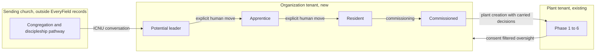

# ADR-001: Multiplication pathway for sending churches and networks

**Status:** Accepted by the product owner on 2026-10-16, with the rulings in [Owner rulings](#owner-rulings-2026-10-16). Proposed on 2026-10-15. Acceptance sets product direction. It does not yet add a requirement, case, operation, schema or package: each item in [Proposed changes to the current contract](#proposed-changes-to-the-current-contract) still goes through a reviewed contract change. Requirement JSON in `docs/catalog/requirements/` stays the behavior authority until those changes land.

**Deciders:** product owner (Sebastian), methodology owner for anything that touches the Playbook or rubrics.

**Sources:** three Send Network books, reviewed in the crimson-yak workspace notes: *Churches Plant Churches* (Hernandez, 2026), *Discerning a Call to Ministry* (Spratt and Medders, 2026) and *Building Your Core Team* (Stetzer and Rogers, 2022). Page references below point to those books.

## Context

### The bottleneck

All three books name the same limit on new churches: there are not enough ready planters. *Churches Plant Churches* says it directly: "The greatest barrier to planting more churches is often the development and mobilization of new church planters" (p. 40). Its answer is a structure, not a program. A church that wants to keep sending needs a vision, a plan and people (pp. 13-14), and the plan is a multiplication strategy in three phases (pp. 27-38):

1. A **discipleship pathway** moves a person from lost to growing disciple.
2. **Ministry training** moves a growing disciple to ministry leader.
3. A **residency** moves a qualified leader to church planter or missionary.

Across those phases the church performs three functions: discover, develop and deploy. *Discerning a Call* adds survey data from Send Network planters: 33% came from churches that prioritized planting, 19% started because a church staff member approached them, and 78% planted within three years of sensing the call (pp. 16-17). The sample is small, self-selected and from one denomination, so these numbers are illustration, not thresholds. They still point at one thing: **what the sending church does before a plant exists decides whether a planter appears.**

### What EveryField has today

EveryField is built around the planter. A plant tenant moves through Phases 0 to 6. Organization tenants (a sending church or a sending network) have these capabilities:

- Typed relationship invitations, including Discovery to sending church and Discovery to network (IDN-020).
- Consent-filtered aggregate oversight of linked plants (IDN-022, IDN-023) and a network's sending-church roster (IDN-024).
- Network Intelligence over shared plant findings ([network rubric v1](../reference/network-rubric-v1.md)).
- Organization versions of Wiki articles ([knowledge and documents](knowledge-documents.md)).

This ADR uses three kinds of workspace. Keep them apart, because they look alike on screen:

| Workspace | What it is | Who works in it |
|---|---|---|
| Plant | The new church being planted. Phases 0 to 6, People, Meetings, Tasks, Launch. | The planter and the plant team |
| Sending church | An established church that develops and sends planters. Today it only reads oversight of plants that linked to it. | The church's staff |
| Network | A family of churches. It sees counts across its sending churches and plants. | Network staff |

A sending church can look at a plant it sent, but only as a read-only, consent-filtered overview. It never works inside the plant.

An organization has no records of its own about the people it is developing. The pre-plant Discovery state belongs to the individual account. So EveryField starts to see a planter only after that person decides to plant. That is after the bottleneck.

### Constraints this decision must respect

These come from [START-HERE](../START-HERE.md), [scope](scope.md) and the current requirements:

- Coaching is excluded: no coach invitation, assignment, grant or read surface (IDN-018, IDN-025).
- Finance and background checks are excluded.
- An account has at most one active tenant seat. Multiple active seats are excluded.
- A separate lead designation, activation or transfer engine is excluded.
- Software never judges calling, character, doctrine or spiritual fitness. These stay dated human judgments. Plant Intelligence and Evry may cite that a human record exists, never its content (methodology chapter).
- Native weekly private care stays with its original author. It never reaches organizations, models, exports or audit.
- Every durable Evry action needs exact human review. Evry has no prayer, pastoral or counsel role.
- Organization roles never make the holder a plant editor.

## Decision drivers

1. Address the bottleneck itself: help a sending church find, develop and send more planters, and see where people stall.
2. Do not become a church management system for the sending church's whole congregation.
3. Keep every judgment about a person human, dated and attributable. No scoring of calling.
4. Reuse what exists: organization tenants, the Discovery state and relationship, Wiki organization versions, generated documents, the task kernel and plant creation.
5. Each step must be useful on its own and must not need the later steps.

## Options considered

### Option A: content only

Write Wiki articles and document templates from the books: the ICNU ("I see in you") conversation, spotting future leaders, partnership agreement, commissioning, residency design. Add a residency template and a prospectus template. No new records.

- Good: fits the current scope. No privacy risk. The wiki workspace can start now.
- Bad: the sending church still cannot see its pipeline. Nothing tells it that it had no ICNU conversations this quarter, or that a resident has been stuck in one stage for six months. The bottleneck stays invisible.

### Option B: congregation discipleship tracking

Model the sending church's whole discipleship pathway as records: every member, their groups, courses, serving and spiritual progress.

- Good: matches the book's full "lost to planter" diagram.
- Bad: this is a church management system. Planning Center and similar products already do it, and churches will not move their congregation into EveryField. It puts pastoral judgments about many people into software and multiplies the privacy work. It also pulls focus from the planter journey, which is the core of the product.

### Option C: leader pipeline and residency for organizations (chosen)

Model only the leadership end of the pathway: the small number of people a sending church is deliberately developing toward planting or mission, from the first ICNU conversation to commissioning. Keep the congregation's discipleship pathway as a document the church writes, not as records. Connect the pipeline to the existing Discovery state and to plant creation, so that a resident's preparation becomes the start of the plant's journey.

- Good: it targets the bottleneck. The data is small and the people in it are known to the staff. It gives a sending church its own daily use for EveryField, which today it lacks. It produces aggregate pipeline data that a network can use.
- Bad: it adds organization-owned person records, which need deletion, export and consent rules. It sits close to the coaching exclusion and needs an explicit ruling on that. It is a new product area.

### Option D: network-wide candidate sharing

Let a network share residencies and candidates across its sending churches. *Churches Plant Churches* mentions this as the "relationally" path (p. 51): a future planter may serve in a church that has no residency.

- Good: it helps small churches that cannot run a residency alone.
- Bad: it needs Option C first, plus cross-tenant consent for individual people, which EveryField does not have.

## Decision

**Adopt Option C, delivered in stages. Ship Option A content now, alongside it. Keep Option D as a later extension. Reject Option B.**

The principle: **EveryField models the people a church is deliberately sending, not the whole church.** The congregation's discipleship pathway is something the church defines and writes. The leader pipeline is something EveryField tracks.

## The proposed feature set

Each part below is a candidate requirement. Names are illustrative. The builder chooses the code shape after the requirement is accepted.

### 1. Sending vision goal

*Source: Churches Plant Churches pp. 24, 47 ("X to Y by when").*

An organization records one or more goals: "develop N leaders to plant M churches by YEAR", with a short statement of why. EveryField shows the goal next to deterministic counts from the pipeline: people in each stage, residents finished, plants commissioned. It never forecasts or judges whether the goal is realistic.

### 2. Leader pipeline with configurable stages

*Source: Churches Plant Churches ch. 2 and 3; Discerning a Call pp. 17-27.*

- The organization uses a default stage set: Potential leader, Apprentice, Resident, Commissioned, Not continuing. It may rename stages or add its own. Each stage maps to a stable kind, the same way team responsibilities use stable mappings and not names.
- A **pipeline person** is an organization-owned record: display name, optional contact, the staff member responsible, the current stage and dated stage history. A person with an EveryField account can be linked to their account, but only after they accept (see part 5).
- A stage move is an explicit human action. It records the actor, the date and a reason. It is never automatic and never inferred from attendance, reading or task completion.
- "Not continuing" is a normal, respectful outcome. *Building Your Core Team* treats leaving well as healthy, and so should the pipeline.
- What the default stages mean: **Potential leader**, staff see leadership potential and have had an "I see in you" conversation. **Apprentice**, in ministry training. **Resident**, in a planting residency. **Commissioned**, sent out at a commissioning service. **Not continuing**, stepped off the pathway.
- Editing stages: an Owner or Admin can rename, reorder and add stages. Each stage keeps one fixed kind (Potential leader, Apprentice, Resident, Commissioned, Not continuing or Other), so counts stay comparable across churches. A stage that still has people in it cannot be deleted; staff move the people first. A rename keeps the old name in history. Saving shows a review of the changes.
- No fitness fields: no calling score, no readiness rating and no assessment outcome. If the church took an outside assessment, the record may hold "assessed: yes, date, by whom", never the result (*Discerning a Call* pp. 25-26).

### 3. Leadership conversations

*Source: Churches Plant Churches p. 44; Discerning a Call pp. 17, 19, 25.*

A staff member logs that an ICNU conversation took place: who, when and with whom. An optional short note is visible only to the organization's Owner, Admins and the person responsible. The organization sees how many conversations its staff had per month or quarter.

This is the cheapest lever in the whole design. The 19% figure says that asking people is how many planters start. A dashboard count that sits at zero for a quarter is a useful prompt for the staff. EveryField counts conversations. It does not judge them.

### 4. Development programs: apprenticeship and residency

*Source: Churches Plant Churches pp. 46-56, Appendix B, Appendix C.*

- An organization defines a program: kind (apprenticeship or residency), director, meeting rhythm, expected length (the book recommends 12 to 18 months), stages and a milestone checklist.
- EveryField offers a starter residency template with four stages from Appendix C, written in our own words: Assimilating (2 to 3 months), Training and planning (6 to 9 months), Gathering (2 to 3 months), Sending and planting (2 to 3 months). The template also offers milestones such as "start a small group and raise a replacement", "present your vision to the sending church leadership" and "write a church planting prospectus".
- A reading list links to Wiki articles. The organization's own Wiki versions can supply residency content, so a network can publish its residency curriculum once.
- An **enrollment** connects one pipeline person to one program and cohort, with a start date, an expected end and a status.
- Milestones on an enrollment record who completed each item and when. The resident can mark an item done when their account is linked. The director confirms it. Each fact is an attributable record, not a judgment.
- Hands-on ministry assignments are milestones with a description, for example "preach on a Sunday" or "lead a small group". Feedback after an assignment is a dated human note, visible to the director, the resident and the church's Owner and Admins.
- Editing a program: start from the four-stage template or from blank. Edit stages and month ranges, milestones in each stage, rhythm, director and reading list. Evry may draft milestones, and the director reviews them. A change applies to new enrollments. Current residents keep their milestones unless the director applies the change to them.

### 5. Discovery link for the resident

*Source: the existing Discovery state and relationship (IDN-016, IDN-020).*

- A resident who has an EveryField account stays in the Discovery state. They keep their account-private Wiki reading and documents.
- Today the Discovery account starts the Discovery to sending church relationship. This ADR proposes that the organization may also invite a pipeline person to link their account. The person accepts or declines, and the link uses the same relationship and consent rules.
- With consent, the director sees the resident's progress facts: which program milestones are done and whether the six Discovery foundations articles are complete. The director does not see the resident's private documents, reflections or anything from private care. A calling-story worksheet, if added later, is account-private by default (the *Discerning a Call* review recommends this).
- The invitation tells the person, before they accept, exactly what the church will see and what it will never see. Declining leaves the account as it was.

**What the linked person sees.** The resident does not get a plant workspace. They keep the Discovery experience (Wiki, foundations reading, private documents) and gain a "My residency" area: the program, their current residency stage, the next meeting, their own milestones (mark done, then wait for the director to confirm), the reading list, and a panel that shows what the church can see, with a way to stop sharing or leave. People, Meetings, Tasks and Launch arrive only when they create their plant after commissioning.

The person does not see the church's internal pipeline view of them: the pipeline stage label, stage-move reasons, staff conversation notes or the "no move in six months" flag. These are staff working records. Being told "you are a Potential leader" by a dashboard would replace the human conversation this design exists to encourage.

### 6. Commissioning and handoff into the plant

*Source: Churches Plant Churches pp. 61, 73-74.*

- Commissioning is a dated event on the enrollment. It closes the residency and moves the person to Commissioned.
- During the residency the resident records key decisions: church name, target community, launch window, team size and a first-year budget document (Appendix C, stage 1). When the commissioned person creates the plant, EveryField offers these decisions as prefilled values for plant basics (IDN-013) and for the `geographic_area` attestation. The planter confirms each value. Nothing is attested silently.
- The plant's creation journal records that it came from that organization's residency, which gives a network the multiplication lineage: which church sent which plant.
- The plant then follows the normal Phase 1 rule. Commissioning does not set a phase.
- After that, the sending church sees the plant through a read-only, consent-filtered overview in its own workspace: phase and journey, launch date and the published launch summary, limited to what the planter shares with that church (IDN-022, IDN-023). The screen says plainly that the church is viewing another workspace and cannot edit it.

### 7. Partnership agreement record

*Source: Churches Plant Churches Appendices D and E.*

- A generated DOCX partnership agreement, in our own neutral text. Networks add their own clauses through organization templates or Wiki versions.
- A small structured record next to the document: the two parties, start and end dates, a communication cadence and an annual review date. The review date creates an ordinary task for both sides.
- Support amounts stay as text in the document, because finance is excluded.
- A signed, current agreement is dated human evidence for the existing `coach_assigned` criterion. It does not replace the human attestation that the criterion already needs.

### 8. Post-send care rhythm (later stage, needs its own ruling)

*Source: Churches Plant Churches pp. 61-63.*

The book's "send them and forget them" warning is real. A sending church could keep a care rhythm: reminders to check in, a prayer team roster and visit dates. This must be organization-owned and must stay completely separate from the planter's private weekly care. Because it is close to the excluded coaching surfaces, it is listed here only as a candidate for a later decision.

### 9. Network view of the pipeline

*Source: Churches Plant Churches p. 5, and Send Network's published sending church pathway.*

- A network sees aggregate pipeline counts across its sending churches: people per stage, active residents, commissioned per year. It sees no individual people, unless Option D is later accepted.
- **Church sending stage, defined by the network.** Send Network sorts its churches on a five-stage pathway. Its first four stages are Cooperating (prays for and gives to planting through the network), Supporting (partners with a specific plant through prayer, people or resources), Sending (takes responsibility for one planter: develops, commissions, cares) and Multiplying (sends again and again, and its plants start to send). The book only names these stages, on its opening page, and does not define them. The definitions here follow Send Network's public material. EveryField offers **Cooperating, Supporting, Sending and Multiplying** as its starter template, because these four describe sending churches in any tradition. Send Network's fifth stage, Movement, is not in the template, but a network can add it. A network edits its list with the same editor as the pipeline stages: rename, reorder, add, remove a stage only when no church is in it, history kept for renames, a review before saving. A network can also turn church stages off. A sending church then picks its stage on its organization profile, and the network roster (IDN-024) can sort by it. A church that has not picked a stage shows as "Not declared".
- These are new Network Intelligence inputs. They need a rubric revision, with the existing rule that a pattern needs at least two contributing organizations.

### What Evry may do

Evry may draft a program plan, a milestone list, a partnership agreement and a commissioning service order. It may answer "who in our pipeline has had no stage move in six months?" for an authorized staff member. Every durable write is exactly reviewed. Evry never suggests who is called, ranks people or reads conversation notes into a model.

## Stages of delivery

| Stage | Content | Scope change |
|---|---|---|
| 0 | Wiki articles and templates from the books (Option A). The handoff to the wiki workspace is done. | None for articles. New DOC templates need catalog entries. |
| 1 | Sending vision goal, leader pipeline, leadership conversations (parts 1 to 3) | Organization-owned Person records under the full Person contract |
| 2 | Apprenticeships and residencies, enrollments, milestones and the Discovery link (parts 4 and 5) | Organization-initiated relationship invitation |
| 3 | Commissioning, plant handoff, partnership agreement (parts 6 and 7) | Plant creation prefill, lineage field, new DOC template |
| 4 | Network pipeline aggregates and the network-defined church sending stage (part 9) | Network rubric revision |
| Later | Post-send care rhythm (part 8), network-wide sharing (Option D) | Separate decisions |

Stages 1 and 2 ship before the alpha release and can be built together. The planter side of the product comes first in build order, but both sides are required for alpha. Stage 1 is still the smallest unit that tests the idea: if sending churches do not log conversations and stage moves, the later stages need a second look.

## Consequences

### Positive

- EveryField sees planters before they plant, which is where the bottleneck is.
- Sending churches get their own daily use for the product, and not only oversight.
- A planter who comes from a residency starts Phase 1 with decisions already made, without typing them again.
- Networks get a measurable pipeline: where people stall, and how many conversations become residents.

### Negative and risks

- Organization-owned Person records are new. By owner ruling they use the full Person contract: the same retire, restore, export, deletion, duplicate, merge and Unmerge rules as plant People, scoped to the organization tenant. This is the largest piece of work.
- **Coaching boundary.** A residency director looks like a coach. The line: a director acts only on organization-owned pipeline records and on progress facts the resident consented to share. A director gets no plant access and no read access to the resident's private content. Post-send coaching stays excluded. The owner accepted this boundary on 2026-10-16 for now, and asked the plan builder to review whether coaching (IDN-018, IDN-025) should return to scope.
- **One active seat.** A staff member of the sending church holds an organization seat. If that person becomes the planter, plant creation conflicts with the one-seat rule. The commissioning flow must handle leaving the organization seat explicitly, without a special transfer engine.
- Pipeline counts at a small church are small numbers. The UI must show counts and dates, not rates or health verdicts.
- Pastoral sensitivity: a "Not continuing" record about a real person is sensitive. Notes stay narrow in visibility, and nothing reaches models.

## Proposed changes to the current contract

Acceptance needs these contract changes. Each one goes through its own reviewed change:

1. **Scope** ([scope.md](scope.md)): add the organization leader pipeline and programs. Clarify that the coaching exclusion still covers coach grants, coach reads of plants and post-send coaching.
2. **IDN-020**: allow an organization Owner or Admin to invite a pipeline person to link a Discovery account. The person accepts or declines.
3. **IDN-013 and IDN-015**: offer residency decisions as confirmed prefill during plant creation, and record organization lineage in the creation journal.
4. **People domain**: extend the Person contract (REQ-PPL-024, REQ-PPL-025) to organization-owned pipeline people.
5. **DOC catalog** (DOC-001): add Partnership Agreement, Residency Plan and Church Planting Prospectus templates.
6. **Network rubric**: new pipeline aggregate inputs, after stage 4 is accepted.
7. **Evry tool list**: read and draft tools for pipeline and programs, all writes exactly reviewed.

## Owner rulings (2026-10-16)

1. **The sending church is a buyer in its own right**, not mainly a viewer of plants. Stages 1 and 2 come before the alpha release and can be built together. The planter side is built first, but both sides are required for alpha.
2. **Coaching boundary: accepted for now.** A director acts only on organization-owned records and on progress the resident consents to share. The plan builder will review whether the coaching features (IDN-018, IDN-025) should come back into scope.
3. **Pipeline people use the full Person contract.**
4. **Apprenticeships are in the first release**, together with residencies.
5. **The church Owner and Admins see a director's feedback** on a resident's assignments.
6. **The church sending stage exists.** The starter template is Cooperating, Supporting, Sending and Multiplying. Movement is not in the template. A network edits its stages with an editor like the pipeline stage editor.
7. **Send Network is not a design partner.** The books are one input among many sources of know-how.
